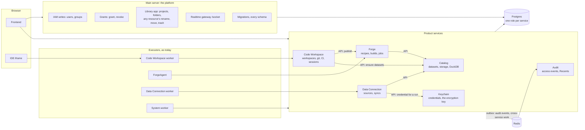

# Splitting Quarry into services

_Plan, 2026-10-31. Not started. From [architecture-today.md](architecture-today.md) (the system as built) and the decisions taken in discussion that day. What's decided is in §1; what each piece becomes in §2–§6; the cross-service writes and how each stays consistent in §7; how services call each other in §8; the order in §10; what's still open in §11._

## 1. Decisions

| Decision | Choice |
|---|---|
| Shape | **A main server that owns the platform**, plus **product services** — Catalog, Forge, Audit, Keychain, Code Workspace, Data Connection — each its own NestJS process |
| Database | **One Postgres**, the schemas as today. **A database role per service**, not a database per service |
| Migrations | **The main server migrates every schema**, the services' included. A service never runs DDL |
| Releases | **Lockstep**: a Quarry release updates every service at once, all built from one commit. No mixed versions, so no compatibility window between services, schemas and the shared package |
| Shared code | A **shared kernel** package every server imports: IAM (read), Gatekeeper (read), Library (typed writes), Realtime (emit), the audit and durable-queue writers |
| Platform writes | Only the main server writes **users, groups, memberships, grants**, and **moves, renames and trashes folders and projects** |
| Library | Each service **creates, renames, moves, trashes and restores resources of its own type**, and may **create folders** — enforced by Postgres, per role |
| Audit | Its own service, fed by **events through the outbox** — asynchronous, but never lost |
| Data Connection | Keeps writing datasets through Catalog's API for now; **later a sync becomes a Forge job** (a recipe with an ingestion runtime), as in Foundry |
| Tokens | **The main server mints every token** Quarry signs: session tokens (IDE, checks, jobs), tokens for a user for a purpose, service tokens (§8) |
| Service-to-service | **NestJS microservices over NATS**, through an **injectable client per service** (`this.forge.publishRecipes(…)`), generated from that service's contracts; never the public HTTP. **Authenticated per service**: every call says which service is calling, besides which user it acts for (§8) |
| Browsers | **Through the main server, as a reverse proxy** to each service. Services call each other directly, not through it |

## 2. The target



Every server, main or product, also has the **shared kernel** in-process (§4), so permission checks, identity lookups and Library writes never cross the network.

## 3. What each server owns

| Server | Schema(s) it writes | Resource type(s) | Also |
|---|---|---|---|
| **Main** | `identity` (users, groups, memberships), `gatekeeper.role_grant`; `library` for any type | `project`, `folder`; any type for rename, move, trash, restore from the Library app | migrations; the Realtime gateway (`/socket`); GoTrue's admin side (bootstrap admin) |
| **Catalog** | `catalog` | `dataset` | object storage, DuckDB, read and upload passes, storage GC |
| **Forge** | `forge` | — (recipes, builds and jobs aren't Library resources) | the `run-job` queue; the ForgeAgent's endpoints |
| **Audit** | `audit` | — | consumes audit events; serves Recents |
| **Keychain** | `keychain` | `credential` | **the only holder of `QUARRY_ENCRYPTION_KEY`** |
| **Code Workspace** | `code_workspace` | `workspace` | git repositories, CI (`run-check`), sessions; its worker and IDE proxy |
| **Data Connection** | `data_connection` | `source` | syncs, probes; its worker |

## 4. The shared kernel

One package (working name `@quarry/platform-server`), imported by every server, same version everywhere (lockstep).

| Part | Gives | Reads / writes |
|---|---|---|
| **Auth** | `AuthGuard`, `TokenVerifier` (GoTrue JWT, locally), principals, the internal-token guard | reads `identity.user` (`resolveMember`) |
| **IAM (read)** | `me`, `getUser` — what Code Workspace uses today | reads `identity.user` |
| **Gatekeeper (read)** | `rank`, `can`, `assert`, `filter`, `@SecurityGate`, `@RequireLive`, the per-request memo | calls `gatekeeper.effective_ranks` (`SECURITY DEFINER`: no table access needed); a refusal → an audit event |
| **Library** | `@EnsureResource(type)`, `get`, `path`, `getByPath`, `findByPath`, `getDestination`, `trash` / `restore` / `rename` / `move` of the caller's type | reads `library.*`; writes `library.resource` within the role's policies (§5) — **in the caller's transaction**, so a resource's Library row and its own row stay atomic |
| **Realtime (emit)** | `emitEvent` | Redis publish |
| **Audit (emit)** | `record`, `recordOpen`, `recordDenied`, `@Audit` | an outbox message in the caller's transaction (§7) |
| **Durable queues, database** | `defineDatabase` with the service's roles, `@Transactional`, the outbox writer and relay | `foundations.outbox` |

What stays in the main server only: IAM writes, `grant` / `revoke`, the Library app's generic endpoints, the gateway.

## 5. Database roles

Today: one owner connection; user transactions `SET LOCAL ROLE quarry_user`. Target: **two roles per service**, mirroring today's pair.

| Role | Kind | Used for | Gets |
|---|---|---|---|
| `<service>_service` (e.g. `code_workspace_service`) | `LOGIN` — the service's connection | its system work (`Principal.SELF`): workers' internal endpoints, sweeps | its own schema's tables, through permissive policies `TO <service>_service USING (true)` on **its tables only** — no `BYPASSRLS`, so its system work can't touch other schemas' rows |
| `<service>_user` (e.g. `code_workspace_user`) | `NOLOGIN` — the service switches to it for a user's transaction | users and delegates, as today | the Gatekeeper policies (as `quarry_user` has today) on the tables it's granted; its type restriction on `library.resource` |

**Grants** follow §3 and §4: each `<service>_user` gets its own schema's tables as `quarry_user` has them today; select on `library.*` and `identity.user`; `EXECUTE` on Gatekeeper's functions; insert on `foundations.outbox`. Nothing on another product's schema — that goes through the other service's API.

**Library's type rule** — one restrictive policy per role, on top of Gatekeeper's permissive ones (a row must pass both):

```sql
-- Code Workspace: its own type, and new folders.
CREATE POLICY code_workspace_types ON library.resource AS RESTRICTIVE
    FOR INSERT TO code_workspace_user WITH CHECK (type IN ('workspace', 'folder'));
CREATE POLICY code_workspace_changes ON library.resource AS RESTRICTIVE
    FOR UPDATE TO code_workspace_user USING (type = 'workspace') WITH CHECK (type = 'workspace');
```

So a service can create, rename, move, trash and restore only its own resources, and create folders; the user still needs write on the parent (and on the new parent for a move), as today. **Folders and projects are only changed by the main server**: trashing or moving a folder affects everything inside it, whatever the type — a Library operation, not a product's. `library.resource_ancestor` stays maintained by Library's `SECURITY DEFINER` triggers, so it follows every move whoever made it.

**To verify before relying on it:** that Postgres applies policies written `TO quarry_user` to a member role created with `GRANT quarry_user TO code_workspace_user WITH INHERIT FALSE` (Postgres 16+: membership without the privileges). If it does, today's policies stay as written and privileges are granted per role; if not, the policies are rewritten `TO` each service's user role.

## 6. The services, one by one

**Catalog** — the strongest case: storage, DuckDB and file I/O are a different workload from the API (DuckDB in the API's process is a known concern, [catalog-storage.md](catalog-storage.md)). Its API to others: `get`, `getByReference`, `getOrCreateByReference`, `createDataset`, transactions (`open`, `openBatch`, `registerChanges`, `commit`, `commitBatch`, `abort`, `abortBatch`), storage (`getReadPasses`, `getUploadPass`, `registerFile`).

**Forge** — the build control plane. Calls Catalog for everything about datasets; receives recipes from Code Workspace; serves the ForgeAgent. Mints the job's token (§10).

**Audit** — consumes the audit events, stores them in `audit.access_event`, serves Recents (the user's opens). Nothing calls it synchronously.

**Keychain** — the secrets service, and the only process holding `QUARRY_ENCRYPTION_KEY` (today the main server and the Data Connection worker both do). Hands **decrypted** credentials only to a caller entitled to that use — a sync run of a source using the credential — instead of handing out the key.

**Code Workspace** — workspaces, git hosting, CI and sessions, with its worker and IDE proxy as today; the worker's internal calls go to it instead of the main server. Calls Catalog and Forge when a check publishes.

**Data Connection** — sources, syncs and probes, with its worker. Calls Keychain for a run's credential and Catalog for the output dataset. **Later:** a sync becomes a Forge job — a recipe kind with an ingestion runtime ("adapters", [forge-runtimes.md](forge-runtimes.md)) — and Data Connection stops writing datasets itself.

## 7. Cross-service writes

Inside one service nothing changes: its rows, its Library rows, its outbox messages are one transaction. Between services, each write today becomes:

| Today (one process) | After | Consistency |
|---|---|---|
| **Forge commits a job's outputs in its own transaction** (`TransactionRepository.commitBatch`), then schedules the children in the same one | Forge marks the job succeeded and adds **"commit these outputs"** to the outbox, in one transaction; Catalog commits them (**idempotent**: committing a committed transaction is a no-op) and emits **"committed"**; Forge schedules the children on it | the guarantee stays — no child is claimed before its parent's outputs are committed. A lost or repeated message is re-sent or ignored, by the outbox |
| Forge opens a build's output transactions (`openBatch`), then inserts the build | **unchanged in shape**: already open-then-insert, with `abortBatch` on failure and storage GC aborting leftovers | already a remote-safe order |
| Forge aborts outputs on failure or cancel | Catalog's API (`abortBatch`), retried; storage GC as the backstop | as today's failure path |
| **Code Workspace publishes a passing check**: ensures datasets in Catalog, then publishes recipes in Forge | the same two calls, over the API, both **idempotent** (get-or-create; publishing the same commit's recipes again replaces them); the check run is `published` only once both succeed — otherwise it stays unpublished, and publishing is retried | a check is never half-published: Forge's recipes only point at datasets that exist |
| Data Connection writes a sync's dataset (open, register, commit) | Catalog's API, the run holding its transaction; abort on failure, storage GC as the backstop | as today |
| Data Connection gets a run's credential (`getEncryptedBlob`, decrypted in the worker) | Keychain's API returns the **decrypted** credential for that run, checked by Keychain | the key leaves the worker |
| Audit records (`recordOpen`, `recordDenied`, `@Audit`) in the caller's transaction | an **audit event in the caller's outbox**, in its transaction; Audit consumes and stores it | **not fire-and-forget**: a crash or a Redis restart can't lose a record (credential reveals, data reads are evidence) |
| Realtime emits | the shared kernel publishes to Redis, as today | best effort, as today |
| The gateway authorizes a build's channel through Forge's service | the gateway (main server) reads `forge.build` under the user's RLS — granted select | no call to Forge |

## 8. Calls between services

### Three kinds of call

| Kind | Example | Who may call | Authorized as | Carried by |
|---|---|---|---|---|
| **Public** | create a build, get a dataset, open a session | browsers (and the IDE's extension) | the user — Gatekeeper, nothing more | **HTTP**, through the main server's reverse proxy |
| **Service** | publish a check's recipes, commit a job's outputs, a run's decrypted credential, a build for a user | the services that call names allows, **never a browser** | the calling service, and the user it acts for where there is one | **NestJS microservices over NATS**, internal network only |
| **Executor** | claim a job, report a check step | the workers and the ForgeAgent | their own credential | HTTP internal endpoints, as today (may move to the transport later) |

**The rule: services never call each other's HTTP.** Everything one service asks of another — even "create this build as this user", which a browser could also ask — is a service call. Public endpoints are for browsers only, so the two can't be confused, and a service call has no HTTP route the proxy could ever expose.

### Hybrid apps on NATS

Each service is a NestJS **hybrid app**: `NestFactory.create(…)` serves HTTP (public endpoints, through the main server's proxy), and `app.connectMicroservice(…)` serves its **service calls** over **NATS**.

Why NATS: a request goes to **one** instance of a queue group, so a service scales out without handling a call twice — Nest's Redis transport is pub/sub, where every instance gets every request; TCP needs a load balancer and discovery in front; gRPC would mean `.proto` files beside the zod contracts. NATS is one small server to run.

**Not on the transport:** anything that must survive the callee being down. Nest's microservice events aren't durable on any transport. Forge's "commit these outputs" and audit events stay on the **outbox and durable queues** (§7).

### Contracts

In the shared domain, next to each domain's public API, in the `Stdio` style:

```ts
export namespace Forge.Service {
    export namespace PublishRecipes {
        export const PATTERN  = 'forge.publish-recipes'
        export const Request  = z.object({ workspaceRid: CodeWorkspace.Rid, branch: Foundations.Branch, recipes: PublishedRecipe.array() })
        export const Response = z.object({ recipes: Recipe.Schema.array() })
    }

    export namespace CreateBuild { /* PATTERN, Request, Response */ }

    /** Everything Forge serves to other services, by method name. */
    export const Calls = {
        publishRecipes: PublishRecipes,
        createBuild:    CreateBuild,
    }
}
```

`Forge.Service.Calls` is **the whole service-only surface of Forge**, in one place.

### The client: an injectable module per service

```ts
@Injectable()
export class CIService {
    constructor(private readonly forge: ForgeClient) {}

    async publish(principal: Principal.User, run: CheckRun.Schema, recipes: PublishedRecipe[]): Promise<void> {
        await this.forge.publishRecipes(principal, { workspaceRid: run.workspaceRid, branch: run.branch, recipes })
    }
}
```

- **Generated from `Calls`**, not written by hand: a mapped type plus one helper (`createServiceClient(Forge.Service.Calls)`) turn each entry into a method `(principal, request) => Promise<Response>`, typed from the contract. Adding a call to `Calls` adds the method — no per-method wrapper to keep in step.
- **Each method** sends `{ principal, request }` with the call's `PATTERN`, attaches the identities (below), and parses the response with the contract.
- **`ForgeClientModule`** provides `ForgeClient`, configured with the transport and the calling service's credentials; a service imports the clients of the services it calls. Clients and their modules live in a shared server package; contracts in `@quarry/shared/domain/<Domain>`.

### The handlers

On the callee, a controller of its own, apart from the public HTTP ones:

```ts
@Controller()
export class ForgeServiceCalls {

    constructor(private readonly forge: ForgeService) {}

    @ServiceCall(Forge.Service.PublishRecipes, { from: ['code-workspace'] })
    publishRecipes(@Caller() principal: Principal.User, @Payload() request: Forge.Service.PublishRecipes.Request) {
        return this.forge.recipes.publish(principal, request.workspaceRid, request.branch, request.recipes)
    }
}
```

`@ServiceCall(call, { from })` is `@MessagePattern(call.PATTERN)` plus a **guard** (a valid service token, from one of `from`), zod parsing of the request, and resolving `@Caller()` — the principal the call acts as. Inside, it's the same service code as today: Gatekeeper and RLS apply to that principal.

### Identities on a call

| In the message | Says | Checked |
|---|---|---|
| **Service token** | the calling service | the guard: signature, audience (this service), and `from` |
| **User token** — or none for a service principal | the acting user | the shared kernel's `TokenVerifier`, then Gatekeeper and RLS as that user — exactly as if they had called |

The client fills both in. The **service token** it holds and refreshes. The **user token** is the current request's — the shared kernel keeps it in AsyncLocalStorage for the request, as `RequestMemo` keeps ranks — or, for deferred work (a build waiting on a check), one the main server mints for that user and purpose. A delegate travels as its user's token plus `via`.

**Service tokens** — short-lived JWTs from the main server (`sub` the calling service, `aud` the callee), requested with each service's own secret and refreshed. Signed with an **asymmetric key**: services verify with the main server's public key and can't mint anything. User tokens the main server mints use the same key. GoTrue's own JWTs use a shared secret today; its asymmetric signing keys, if the deployed version has them, would take that secret out of the services as well.

### Before the split: the same client, in-process

In step 4 (§10), while everything is still one process, each client has an **in-process implementation**: `ForgeClient` calls `ForgeService` directly, same signatures, same principal. Every cross-module call already goes through the client then; extracting Forge only swaps in the NATS implementation — no caller changes.

### Example: Code Workspace asks for a build

1. The extension: `POST /api/code-workspaces/:rid/builds { branch, commit, transform }` with the session's token — a **public** call → the main server's proxy → Code Workspace.
2. Code Workspace: read on the workspace (Gatekeeper, in-process); the commit's check run.
   - **Passed and published** → `await this.forge.getRecipe(principal, { …the commit, the transform })` for its outputs, then `await this.forge.createBuild(principal, { branch, target })`. Forge's handler checks write on the targets as the user and creates the build.
   - **Still running** → a build request, waiting on that check run, in `code_workspace`. When the check publishes (`CIService.finish`), the same `this.forge.createBuild(…)` — the client gets a token for that user from the main server, the request's own may have expired.
   - **Failed** → the request fails with the check's reason; Forge is never called.
3. Code Workspace returns the request — waiting, or its build — for the extension to follow.

## 9. What stays as it is

- **The executors**: Code Workspace worker, ForgeAgent, Data Connection worker, System worker — still the only Docker / heavy-I/O processes, still without database access. Each talks to its own service's internal API instead of the main server's; the system worker calls each service's sweep.
- **Authentication**: GoTrue JWTs verified locally by every server (the shared kernel).
- **Gatekeeper's model**: ranks, roles, inheritance through the tree, RLS as the default check, `@SecurityGate` and `assert` beside it.
- **Lockstep**: one repository, one release; a service's API to another is versioned only by the release.

## 10. Order

Each step lands on its own and leaves Quarry working; the services only become separate processes at step 5.

1. **Roles in the monolith.** Each module's repositories use its own `<module>_service` / `<module>_user` roles (§5), with the restrictive Library policies and narrowed grants. Proves the permission model with no network change. Settles §5's open point.
2. **The shared kernel package.** Move Auth, IAM read, Gatekeeper read, Library, Realtime emit, the audit writer and the durable-queue infra into it; the server imports it.
3. **Audit through the outbox.** Audit events instead of direct inserts; Audit consumes them (still in the monolith).
4. **Cross-module calls as protocols, still in one process.** Each service's contracts (`<Domain>.Service.Calls`) and its client, with the **in-process implementation** (§8); every cross-module call goes through the clients. Forge's output commit (§7) as outbox + idempotent commit + "committed"; publishing as two idempotent calls; Keychain decrypting for a run.
5. **Extract, one at a time:** Keychain → Catalog → Forge → Code Workspace → Data Connection → Audit. Each extraction moves a module and its executor's internal API into a new process, connects it to NATS, and swaps its client to the NATS implementation; nothing about its behaviour changes. (NATS joins the infrastructure with the first extraction.)
6. **Later:** syncs as Forge jobs.

## Phase 1 — the kernel and Catalog (built 2026-11-01, branch `split/phase-1`)

Steps 1, 3 and Catalog's part of 5, ahead of the rest: Catalog runs as a service of its own; Data Connection, Code Workspaces and Forge are paused — they call Catalog in-process today and come back as services in phase 2, with the service-call framework (§8), which phase 1 doesn't need: nothing calls Catalog service-to-service yet, and the main server never calls it either (browsers through the proxy; the platform's data through the shared kernel; audit through the outbox).

**As built**

| Part | What | Where |
|---|---|---|
| **Roles** | `quarry_user` is now the privilege-less group every policy names; `main_user` (member) holds the grants it had — the main server switches to it; `catalog_service` (login) and `catalog_user` (member) for Catalog, with only Catalog's grants, the restrictive Library policies (`dataset`, new `folder`), and permissive policies of `catalog_service`'s own on Catalog's tables. Checked first in a scratch database: a member gets the group's policies, the group grants nothing, a restrictive policy per role holds | `migrations/foundations`, `migrations/catalog`, every schema's `GRANT … TO main_user` |
| **Packages** | **`@quarry/platform-server`** — the kernel: `auth/` (guard, verifier, principals), `db/` (pool, repositories, liveness, the migrator, service logins), `infra/` (queues, durable queues, storage), `http/` (health, request log, Zod pipe), the Identity, Library, Gatekeeper and Audit **modules**, `testing/` (the test database, for every package's tests). **`@quarry/catalog-service`** — `src/catalog/` (the Catalog module), `src/main.ts`, its module, its tests. **`@quarry/server`** — the main server: `api.ts`, **all migrations** (`MIGRATIONS_FOLDER`), session tokens, the platform's controllers (Identity, Library, grants, audit), Keychain, Realtime, the proxy, the paused products. Each package imports itself and the others by package name (`@quarry/platform-server/db/pool`) — never `@/` across packages, which resolves into whichever package compiles the file | `packages/platform-server`, `packages/catalog-service`, `packages/server` |
| **Per-process login** | `useDatabaseLogin({ url, userRole })` before the first query; the main server defaults to `DATABASE_URL` and `main_user`. The main server sets `catalog_service`'s password from `CATALOG_DATABASE_URL` after migrating — dev and tests; production creates the login with the infrastructure | `platform-server/db/pool.ts`, `platform-server/db/service-logins.ts` |
| **Catalog service** | Its own process: `CatalogServiceModule` (Catalog plus the kernel modules: Identity, Library, Gatekeeper, Audit, infra), own port (`CATALOG_PORT`, 4010), own login. Waits for the main server's health — after migrations and the login. Doesn't bootstrap admins (it can't write `identity.user`) | `catalog-service/src/main.ts`, `catalog-service.module.ts`; `npm run dev:catalog` |
| **Proxy** | The main server forwards `/api/datasets/**` to Catalog unchanged, bodies streamed, before Nest's parsers. Routes kept as they were — no `/api/catalog/` prefix yet | `server/src/http/service-proxy.ts`, `server/src/http/main-server.ts` |
| **Audit through the outbox** | `audit.record` messages, queued in the access's transaction; relayed after the request (`AuditRelayMiddleware`); consumed by the system worker; stored once (`event_id` unique) and acked by the main server. Users can't insert audit records any more | `shared/domain/Audit/{queue,durable-queue,api/internal}.ts`, `platform-server/services/Audit/*`, `server/src/services/Audit/audit.internal.controller.ts`, system worker `audit-record.processor.ts` |
| **Storage GC** | The system worker calls Catalog directly (`getCatalogApi()`, `CATALOG_URL`) | `shared/server/internal-api.ts` |
| **Paused** | Data Connection, Code Workspaces, Forge: out of `ApiModule`, out of `npm run dev` (with their workers), out of the frontend's app list (routes kept), their tests excluded in `vitest.config.ts`. Code unchanged, but for imports: they still call Catalog in-process, now as `@quarry/catalog-service/catalog/…` — the server's one dependency on a service package, temporary, gone when they call Catalog's client in phase 2 | |

**Where it differs from the plan**

- **Realtime stays in the main server**, not the kernel: nothing in the kernel or Catalog emits yet. Its emit joins the kernel with the first service that does (phase 2).
- **Identity's whole service is in the kernel**, writes included: splitting it into reads and writes wasn't part of a pure move. What a service may write is decided by its database role — Catalog's can't write `identity`.
- **Keychain stays in the main server** for now — it doesn't depend on Catalog.
- **`main_user` still holds the paused products' grants** (and Catalog's): narrowing it is phase 2's, when those become services with roles of their own.

**Tests**

- `catalog-service/test/catalog/roles.test.ts` — on Catalog's login: creates datasets and folders; refused another product's resource (`catalog_creates`), changing a folder or project (0 rows), writing `identity`, reaching `audit` or `keychain`; `catalog_service` reads its own and the platform's tables, nothing else, and can't write the Library.
- `catalog-service/test/catalog/transaction-batches.test.ts` — on `CatalogHarness`: Catalog's modules on Catalog's login.
- `server/test/audit/records.test.ts` — queued not stored; stored once however often delivered, and acked; nothing for a service principal.
- `server/test/e2e/catalog-service.e2e.test.ts` — the main server in-process, **Catalog as a real separate process** (`catalog-service/src/main.ts`, as `npm run dev:catalog` runs it): a user uploads a CSV through the main server's proxy, previews it, and the main server's Library lists it; an open queues its audit record from Catalog's transaction; a create where the user can't write is refused by Catalog. Run six times in a row, green; once, earlier, every proxied request came back 500 while Catalog's log showed 201/200 — not reproduced since, cause not found.
- `server/test/architecture/security-gates.test.ts` scans every service module, the paused ones included; `server/test/infra/durable-queues.test.ts` on `MainServerHarness`.
- `server/test/architecture/package-boundaries.test.ts` — the kernel imports no server, service or product (and no `@/`); Catalog imports nothing of the main server's.

**To run it:** reset the dev database (the migrations changed in place); `.env` gains `CATALOG_DATABASE_URL`, `CATALOG_PORT`, `CATALOG_URL` (`.env.example`); `npm run dev` now starts the main server, Catalog, the system worker and the frontend.

## 11. Open questions

- **Each service's own secret** for requesting its service tokens — where it lives, how it's rotated.
- **GoTrue's signing**: whether the deployed GoTrue supports asymmetric JWT signing keys; until it does, every server verifying user JWTs holds `GOTRUE_JWT_SECRET`, which can mint them.
- **The gateway's reach.** It reads each domain's tables to authorize channels (`forge.build`, workspaces, sources). Fine while it's in the main server with read grants; revisit if a domain's visibility stops being a row it can read.
- **§5's role membership** — verified in step 1.
