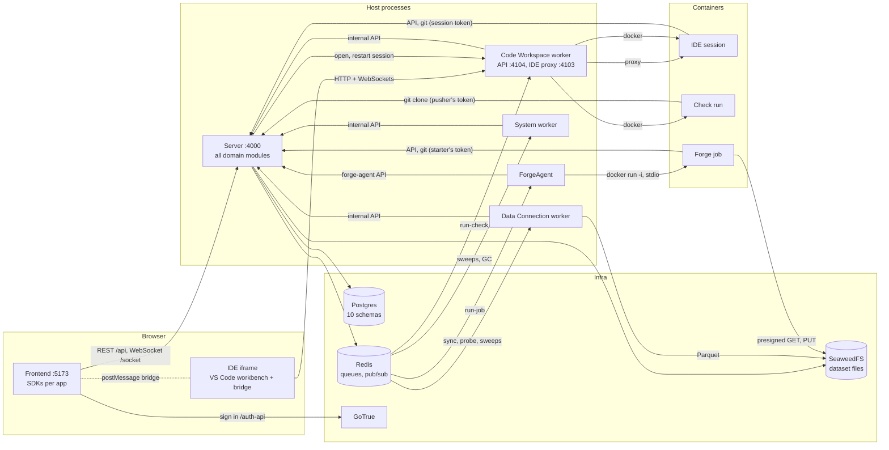

# Quarry today — the system as built

_Written 2026-10-31 from the code, as the baseline for deciding how to split the architecture. What runs, what each part reads and writes, how identity and permissions are checked, and every channel between processes. No proposals here — those come after. Older design: [architecture.md](architecture.md) (layer 1, 2026-10-13)._

## 1. What runs

| Process | Package | Started by | Ports | Holds |
|---|---|---|---|---|
| **Server** (NestJS, the API) | `packages/server` | `npm run dev` (`[server]`) | `:4000` — REST `/api`, WebSocket `/socket`, git `/api/git` | the Postgres connection (owner role), `GOTRUE_JWT_SECRET`, `QUARRY_ENCRYPTION_KEY`, storage keys, `QUARRY_INTERNAL_TOKEN`, `FORGE_AGENT_TOKEN` |
| **Frontend** (React, Vite) | `packages/frontend` | `npm run dev` (`[web]`) | `:5173` — proxies `/api`, `/socket` to the server, `/auth-api` to GoTrue | nothing; the user's GoTrue session in the browser |
| **Code Workspace worker** (NestJS) | `packages/code-workspace-worker` | `npm run dev` (`[cw]`) | `:4104` worker API (server only) · `:4103` IDE proxy (browsers) | the **Docker socket**, `QUARRY_INTERNAL_TOKEN` |
| **ForgeAgent** (NestJS) | `packages/forge-agent` | `npm run dev` (`[forge]`) | `:4105` health | the **Docker socket**, `FORGE_AGENT_TOKEN` |
| **Data Connection worker** (NestJS) | `packages/data-connection-worker` | `npm run dev` (`[dc]`) | — | `QUARRY_INTERNAL_TOKEN`, `QUARRY_ENCRYPTION_KEY` (decrypts a source's credential for a run), storage keys (writes Parquet), DuckDB in-process |
| **System worker** (NestJS) | `packages/system-worker` | `npm run dev` (`[system]`) | — | `QUARRY_INTERNAL_TOKEN` |
| **Postgres** 17 | docker-compose | `npm run infra` | `:5432` | every schema |
| **Redis** 7 | docker-compose | `npm run infra` | `:6379` | BullMQ queues, realtime pub/sub (no persistence) |
| **GoTrue** (Supabase Auth) | docker-compose | `npm run infra` | `:9999` | passwords, its own `gotrue` database |
| **SeaweedFS** (S3) | docker-compose | `npm run infra` | `:9000` | dataset files (Parquet, CSV) |

**Containers the workers start** (all from images built in this repo):

| Container | Image | Started by | Lives | Runs |
|---|---|---|---|---|
| IDE session — one per user per workspace | `quarry/code-workspace-ide` | Code Workspace worker | while the IDE is open (stopped when idle; its volume stays) | openvscode-server, the extension host with the Quarry extension, basedpyright, the code-workspace runtime and Python previews |
| Check run | `quarry/code-workspace-ide` | Code Workspace worker | one check | `quarry-check-setup` (clone at the commit), `quarry-ci.yml`'s steps by `docker exec`, the manifest |
| Forge job | `quarry/code-workspace-runtime` | ForgeAgent | one job | the runtime over stdio: clone, `uv sync`, inputs by read passes, the transform as user `transform`, outputs by upload passes |

## 2. The map

**Only the server talks to Postgres.** Every worker reaches the database through the server's `/api/internal/…` (or `/api/forge-agent/…`) endpoints with a shared token; containers through the public API with a user's token.

## 3. The server's modules

One NestJS process, one module per domain under `packages/server/src/services/`. Each owns a Postgres **schema**; migrations run per schema at startup, in this order: `foundations, identity, library, gatekeeper, keychain, catalog, data_connection, code_workspace, forge, audit`.

| Module | Owns (schema: tables) | Imports | Global |
|---|---|---|---|
| **Identity** | `identity`: `user`, `group`, `group_member` | — | |
| **Library** | `library`: `resource_type`, `resource`, `resource_ancestor` | — | |
| **Gatekeeper** | `gatekeeper`: `role`, `role_grant`, `epoch`; the rank functions and every RLS policy on `library` | — | ✓ |
| **Audit** | `audit`: `access_event` | — | ✓ |
| **Keychain** | `keychain`: `credential` | Library | |
| **Catalog** | `catalog`: `dataset`, `branch`, `transaction`, `transaction_change` | Library | |
| **Data Connection** | `data_connection`: `source`, `sync`, `sync_run` | Catalog, Keychain, Library | |
| **Code Workspace** | `code_workspace`: `workspace`, `check_run`; git repositories on disk (`.data/git`) | Catalog, Forge, Identity, Library, DurableQueue | |
| **Forge** | `forge`: `recipe`, `recipe_input_dataset`, `recipe_output_dataset`, `current_recipe`, `build`, `job` | Catalog, DurableQueue | |
| **Realtime** | — (Redis pub/sub, the `/socket` gateway) | Identity | ✓ |
| *Foundations* (infra) | `foundations`: `outbox` (durable queues) | | ✓ (`InfraModule`) |

Global modules are injectable everywhere without importing: **Gatekeeper, Audit, Realtime**, and the infra (database, Redis, storage, durable queues).

## 4. Reads and writes across schemas

**Declared reads.** Each module's database type lists the other schemas it may query directly (`defineDatabase<…>()` in its `*.db.ts`):

| Module | Reads directly besides its own |
|---|---|
| Identity | — |
| Library | Identity |
| Gatekeeper, Keychain, Catalog, Data Connection, Code Workspace, Forge | Library, Identity |
| Audit | Library |

In practice: joining `library.resource` for a resource's name, parent and trashed state (every resource type's rows are a Library resource plus its own row), and `identity.user` for names.

**Writes into other modules** — through their services or repositories, inside the caller's transaction where noted:

| Writer | Writes | How |
|---|---|---|
| Keychain, Catalog, Data Connection, Code Workspace (creating their resource) | `library.resource` (+ `resource_ancestor` by Library's triggers) | `@EnsureResource(type)` on the repository's create: the Library row and the module's row in one transaction |
| Catalog, Data Connection, Code Workspace, Library (`open`) | `audit.access_event` | `audit.recordOpen`, joining the caller's transaction |
| Gatekeeper (`assert` refused) | `audit.access_event` | `audit.recordDenied` |
| Catalog, Data Connection, Keychain (`@Audit` methods: view, sample, read passes, preview, test, explore, reveal, use) | `audit.access_event` | `@Audit(action)` decorator → `audit.record` |
| Code Workspace (`CheckPublisher`, a passing check) | `catalog.dataset` (new outputs), `forge.recipe*`, `forge.current_recipe` | `catalog.getOrCreateByReference`, `forge.recipes.publish` — as the pusher |
| Data Connection (a sync) | `catalog` datasets and transactions | Catalog's service |
| Forge (`finishJob`) | `catalog.transaction` (commit or abort outputs) | Catalog's exported `TransactionRepository`, **in Forge's transaction** — the job, its outputs' commits and its children scheduled together |
| Forge, Code Workspace | `foundations.outbox` | a durable queue's `add`, in the domain's transaction |

## 5. Database roles and row-level security

Two roles, one connection pool (`db/pool.ts`):

- **The owner** — the role the server connects as; owns every table, so RLS doesn't apply to it. **Service transactions** (`asService`, `Principal.SELF`) run as it: housekeeping, the workers' internal endpoints, Gatekeeper's own lookups.
- **`quarry_user`** (`NOLOGIN`) — **user and delegate transactions** run `set_config('app.user_rid', …)` then `SET LOCAL ROLE quarry_user`, so every table's RLS applies, for that user. The owner is a member so it may switch.

`quarry_user`'s grants are per schema (each migration's end): mostly `SELECT, INSERT`, `UPDATE` where rows change (`catalog.branch`, `catalog.transaction`, `data_connection.sync_run`, `code_workspace.check_run`, `forge.build`, `forge.job`), `DELETE` only on `forge.current_recipe` and Identity's tables; `audit.access_event` is `SELECT, INSERT` only; `gatekeeper.role` `SELECT`.

**The policies** call `gatekeeper.can(<resource>, '<action>')` for the transaction's user:

| Table | Policies |
|---|---|
| `library.resource` | SELECT discover (itself or its parent); INSERT `create_in_parent`; UPDATE `change` (rename, move, trash) |
| `library.resource_ancestor` | SELECT discover — written only by Library's definer triggers |
| `gatekeeper.role_grant` | SELECT read · INSERT `grant_` manage · UPDATE `regrant` · DELETE `revoke` manage |
| `keychain.credential` | SELECT discover · INSERT write · UPDATE change |
| `catalog.dataset`, `catalog.branch`, `catalog.transaction`, `catalog.transaction_change` | discover / read to see; write to create, open, commit, abort, register files |
| `data_connection.source`, `sync`, `sync_run` | discover to see; write to create and run |
| `code_workspace.workspace`, `check_run` | discover / read to see; write to create; check runs change by the pusher |
| `forge.recipe*`, `current_recipe` | discover to see; write on the producer or dataset to publish and point |
| `forge.build`, `forge.job` | discover to see; write on the targets (`forge.writes(forge.targets_of(…))`) to create and change |
| `audit.access_event` | SELECT `read_own_opens`; INSERT `record_own` |

## 6. Identity — who is acting

**Principals** (`auth/principal.ts`), the first argument of every gated service and repository method:

| Principal | Who | Checked as |
|---|---|---|
| `User` | a workspace member, from a GoTrue JWT | themselves (RLS + Gatekeeper) |
| `Delegate` | background work for a user — a sync run (`via: sync:<id>`) | exactly that user; `via` is for audit only |
| `Service` (`SELF(reason)`) | the system on its own | bypasses Gatekeeper and RLS (owner role) |

**Tokens** (`auth/auth.guard.ts` decides by the endpoint's decorator):

| Token | Issued by | Opens | Verified |
|---|---|---|---|
| **GoTrue JWT** | GoTrue, at sign-in; refreshed by the browser | every non-internal endpoint, `/socket` (`?token=`), git | `TokenVerifier.user`: `jose` checks the signature with `GOTRUE_JWT_SECRET` and audience `authenticated`, `sub` → user RID, then `IdentityService.resolveMember` (the `identity.user` row must exist and be active; the first verified login matching `QUARRY_BOOTSTRAP_ADMIN_EMAIL` becomes admin). No call to GoTrue |
| **Session token** | the server (`SessionTokens.mint`, same key and audience, 12 h) | same as a JWT — it *is* one, for that user | same path. Minted for an IDE session (on each open), a check run (the pusher), a Forge job (the build's starter, at claim) |
| **`QUARRY_INTERNAL_TOKEN`** | `.env`, shared | `@Internal()` controllers only (`/api/internal/…` in Catalog, Data Connection, Code Workspace) | constant-time compare; a JWT never opens them |
| **`FORGE_AGENT_TOKEN`** | `.env`, shared | `@ForgeAgent()` endpoints only (`/api/forge-agent/jobs/:rid/claim`, `heartbeat`, `finish`) | constant-time compare |

## 7. Gatekeeper — may they do it

**Ranks.** Roles `discoverer 1 · viewer 2 · editor 3 · owner 4`; actions need `discover 1 · read 2 · write 3 · manage 4`. A user's **effective rank** on a resource (`gatekeeper.effective_ranks`, `SECURITY DEFINER`): 0 if deactivated, 4 if a workspace admin, otherwise the highest grant on the resource **or any ancestor** (`library.resource_ancestor`), to the user **or a group they're in** (`identity.group_member`). Computed per check — no materialised access table.

**Three places a check happens:**

1. **RLS** — every plain read and write of a row (§5), inside the user's transaction. The default.
2. **`@SecurityGate(action)`** on a service method shaped `(principal, rid, …)` — for what RLS can't express (an effect that isn't a row: a queued job, object storage, a probe; a stricter action than the row's; side effects before the row). In use: Catalog 5 read + 1 write · Code Workspace 6 read + 1 write · Data Connection 4 read + 2 write · Keychain 1 read + 1 write · Audit 1 write. Calls `GatekeeperService.assert`, then checks `@RequireLive` RIDs aren't trashed.
3. **Explicit `gatekeeper.assert` / `can`** for compound checks: Forge's service (3), Code Workspace (1), Data Connection (1); the realtime gateway's subscribe (`can` per channel: discover on a source, read on a workspace, a build through Forge, a personal channel only its owner).

**`GatekeeperService`** (global): `rank`, `can`, `assert` (a refusal records audit `denied`, then 404 below discover, 403 above), `filter` (many RIDs, one query), `listGrants`, and the only writes — **`grant`** and **`revoke`** (`gatekeeper.role_grant`, under RLS: manage on the resource). Service principals get owner rank without a query. Ranks are memoised **per HTTP request** (`RequestMemo`, AsyncLocalStorage); workers' internal calls have no memo.

**Epochs.** Triggers bump `gatekeeper.epoch` and `pg_notify('gatekeeper_epoch')` on any change that can change a rank: grants (`epoch_on_grant`), moves (`epoch_on_move`, Library), memberships (`epoch_on_membership`, Identity), a user's role or deactivation (`epoch_on_user`). Nothing listens yet — they're there for a cross-request cache.

## 8. Audit

`audit.access_event`, insert-only for users. Recorded: **opens** (an app opening a resource's page: dataset, source, workspace, any resource through Library — in the open's transaction), **refusals** (`assert` denied), and **reads that reveal data** via `@Audit` (dataset view, sample, read passes, preview; source test, explore, table preview; credential reveal and use). Users can read their own opens (Recents).

## 9. Queues and timers

**Durable queues** — the message is written to `foundations.outbox` in the domain's transaction, relayed to Redis, acknowledged by the consumer, re-sent by the sweep ([durable-queues.md](durable-queues.md)):

| Queue | Added by | Consumed by | Slots |
|---|---|---|---|
| `code-workspace.run-check` | Code Workspace (scheduling a check) | Code Workspace worker | `config.checks.slots` |
| `forge.run-job` | Forge (scheduling a job) | ForgeAgent | `SLOTS` |

**Plain BullMQ queues:**

| Queue | Produced by | Consumed by |
|---|---|---|
| `data-connection.sync` | cron schedulers per sync (system worker keeps them in step with `data_connection.sync.schedule`); manual runs | Data Connection worker (1) |
| `data-connection.source-probe` | the server (test, explore) | Data Connection worker (4) |
| `data-connection.sync-reaper` | system worker, every 2 min | system worker → `/internal` reap |
| `code-workspace.check-sweep` | system worker, every minute | system worker → `/internal` sweep (fail silent check runs) |
| `durable-queue.sweep` | system worker, every minute | system worker → `/internal` (re-send unacknowledged outbox messages) |
| `catalog.storage-gc` | system worker, hourly | system worker → `/internal` storage GC |

**What each worker asks the server** (`/api/internal/…` unless noted): Code Workspace worker — session credentials, check run start / report step / finish · Data Connection worker — run start / heartbeat / complete / fail · System worker — reap runs, sweep check runs, durable-queue sweep, storage GC · ForgeAgent — `/api/forge-agent/jobs/:rid/claim`, `heartbeat`, `finish`.

## 10. Realtime

One WebSocket per browser at `/socket` (`RealtimeGateway`), authenticated by `?token=`; subscribe is authorized per channel; messages come from Redis pub/sub (`RealtimeService.emitEvent`, best effort).

| Channel | Carries | May subscribe |
|---|---|---|
| `data-connection:source:<rid>` | sync runs | discover on the source |
| `code-workspace:workspace:<rid>` | check run updates | read on the workspace |
| `forge:build:<rid>` | build and job updates | whoever can see the build |
| `identity:user:<rid>` | notifications | that user only |

## 11. The frontend

React + Vite, one SPA; apps under `src/apps/` (Library, Code Workspaces, Data Connection, …) on a shared shell (AppKit); data through **SDKs** (`src/SDKs/<Domain>SDK`: a zustand store, TanStack Query queries, actions calling `@quarry/shared/domain`'s `*.API`), live updates through `RealtimeSDK`. Signs in against GoTrue (`/auth-api`), sends the JWT on every `/api` call and `/socket`. The Code Workspace page embeds the IDE (`IDESessionFrame`, iframe on the IDE proxy's origin) and talks to its workbench over the [workbench bridge](code-workspaces/workbench-bridge.md).

## 12. Facts that matter for a split

- **One database role for all modules.** The owner connection can read and write every schema; module boundaries are enforced by code (`defineDatabase` types, module imports), not by Postgres.
- **Cross-module transactions are relied on**: a resource's Library row with its own row (`@EnsureResource`); audit opens with the open; Forge committing Catalog's outputs with the job; outbox messages with the domain row. Each would become a cross-service consistency problem if split.
- **Every RLS policy depends on Gatekeeper's functions**, which read three owners' tables: `gatekeeper.role_grant`, `library.resource_ancestor`, `identity.group_member` / `user`. They're `SECURITY DEFINER`, so a caller only needs to execute them.
- **Gatekeeper's writes are `grant` and `revoke`.** Everything else in it reads.
- **Two processes hold the Docker socket** (Code Workspace worker, ForgeAgent); neither holds database credentials. The Data Connection worker holds storage keys and `QUARRY_ENCRYPTION_KEY`: it receives a source's credential still encrypted and decrypts it for the run.
- **Shared secrets:** `QUARRY_INTERNAL_TOKEN` (three workers) and `FORGE_AGENT_TOKEN` gate the server's non-user endpoints; `GOTRUE_JWT_SECRET` also signs session tokens — anyone holding it can mint any user's token; `QUARRY_ENCRYPTION_KEY` (server and Data Connection worker) opens every stored credential.
- **Redis has no persistence**: queues survive a Redis restart only where the outbox re-sends them (durable queues); realtime events are lost by design.
