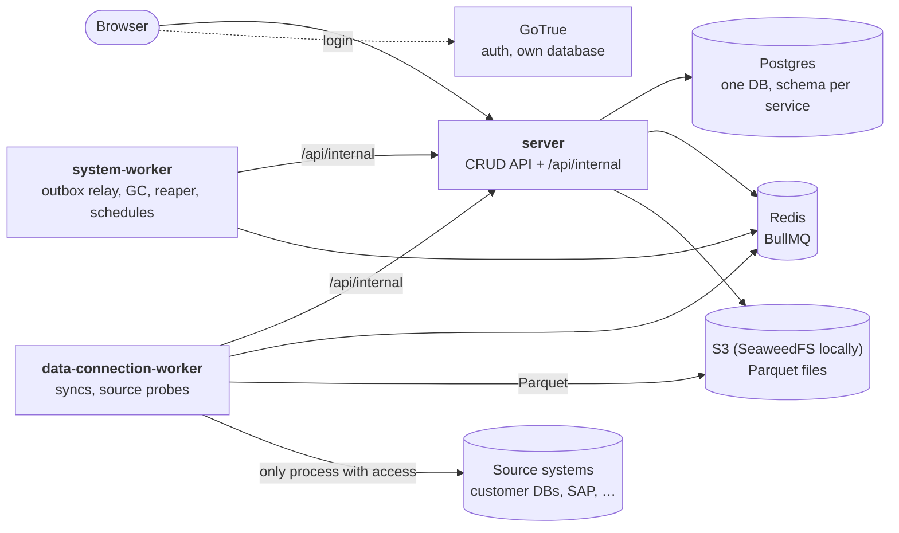
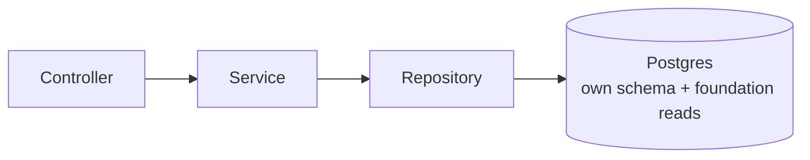
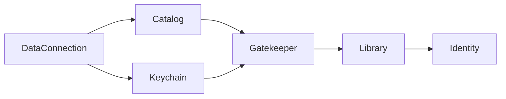

# Quarry — Architecture & File Structure

_Draft, 2026-10-13. Scope: layer 1 — Identity, Library, Gatekeeper, Keychain (credentials), Catalog (datasets), Data Connection (sources → syncs). Ontology, transforms and builds come later and aren't laid out here._

Related: [database.md](database.md) (all DDL) · [jobs.md](jobs.md) (queues) · [gatekeeper.md](gatekeeper.md) (authorization) · [keychain.md](keychain.md) (credentials) · [catalog.md](catalog.md) (datasets) · [data-connection.md](data-connection.md) (sources, syncs) · [research notes](../research/palantir-foundry-ontology.md).

---

## 1. Shape

**Three packages, three processes, one rule: only the server touches Postgres.** The server is the CRUD backend; the two workers are their own packages that never import it — they call the server's `/api/internal/…` endpoints (service token) for anything in the database, and do the I/O the server shouldn't: source systems and DuckDB (Data Connection worker), scheduling and queue relaying (system worker).



| Container | Package | Database | Purpose |
|---|---|---|---|
| `server` | `packages/server` | **yes — the only one** | HTTP API (runs migrations on boot); the run lifecycle and housekeeping behind `/api/internal/…`; never talks to source systems |
| `data-connection-worker` | `packages/data-connection-worker` | no | Sync runs, connection tests, table exploration — the only container with network routes to sources and DuckDB; decrypts source credentials |
| `system-worker` | `packages/system-worker` | no | Housekeeping on a schedule: outbox relay, storage GC, reaper, schedule reconcile |
| `postgres` | — | | All service schemas + GoTrue's `auth` |
| `redis` | — | | BullMQ only; disposable (rebuilt from Postgres on boot) |
| `gotrue` | — | | Authentication, JWTs |
| `seaweedfs` | — | | S3-compatible object storage for dataset files (`seaweedfs-init` creates the bucket) |

One image runs all three; docker compose picks each one's command. Each package's build contains only what it imports — a worker's `dist` has `shared` (+ `integrations` for the Data Connection worker) and itself, never server code.

### Why the workers are separate packages

- **Boundaries by construction** — a worker can't reach a repository, a transaction or a permission check, because it can't import them. Everything that changes Postgres goes through one place: the server.
- **Credentials** — stored encrypted in the server's database (Keychain); the server hands them on encrypted and the Data Connection worker decrypts them in memory for a run. Plain-text values never sit in Postgres or Redis.
- **Resources** — DuckDB `COPY` runs can take lots of memory and CPU; a large sync can't starve the API. Each worker gets its own memory limit and concurrency.
- **Network** — only the Data Connection worker needs a route to source systems. In a locked-down deployment, only it gets egress to customer databases.
- **Scaling and failure** — each scales on its own; a crashing driver kills one Data Connection worker, and BullMQ re-delivers or the reaper cleans up. Later the Data Connection worker is also the natural shape for a Data Connection **agent** inside a customer network: it already talks to the platform only over HTTP and Redis.

**Server ↔ worker contracts** live in `@quarry/shared`: `DataConnection.API.Internal` and `Catalog.API.Internal` (endpoints + axios clients), and the queue definitions. `/api/internal/…` routes are marked `@Internal()`: AuthGuard accepts only `QUARRY_INTERNAL_TOKEN` there — never a user's JWT — and the token opens nothing else.

Connection tests and table exploration also run in the Data Connection worker: the server loads and permission-checks the source, enqueues a short `source-probe` job carrying it, and waits for the result (request–reply, 15 s timeout).

---

## 2. Repository layout

```
Quarry/
├── package.json                  npm workspaces: packages/*
├── Dockerfile                    one image for server + both workers (Debian — DuckDB needs glibc)
├── docker-compose.yml            postgres · redis · gotrue · seaweedfs; server + workers under profile `app`
├── docker/postgres/init/         creates GoTrue's own database
├── .env.example
├── docs/
│   ├── design/                   architecture.md · database.md · gatekeeper.md · keychain.md · catalog.md · data-connection.md · jobs.md · ai-context.md
│   └── research/                 palantir-foundry-ontology.md
└── packages/
    ├── shared/                   @quarry/shared — domain types + API contracts, used by server and frontend
    ├── integrations/             @quarry/integrations — one folder per external system: definition.ts + runtime.ts
    ├── server/                   @quarry/server — the CRUD backend; the only package with database access
    ├── data-connection-worker/              @quarry/data-connection-worker — syncs + source probes (DuckDB, source credentials)
    ├── system-worker/            @quarry/system-worker — housekeeping on a schedule
    └── frontend/                 later
```

### `packages/shared`

Domain models and API contracts only: zod schemas, branded IDs, RID types, request/response types, typed API client functions (axios). **No database, no NestJS, no Node-only imports** — the frontend imports it too.

Same layout as PretzelGraph's shared domain: **entity files are pure domain** (IDs, schemas, rules); **contracts live on the service namespace**: the HTTP surface in an `api/` folder (`<Service>.API`, grouped by entity — `Catalog.API.Dataset.Create.Request`, `Library.API.Resource.move(api, rid, req)`), and background-job contracts in a `queue/` folder (`<Service>.Queue` — `DataConnection.Queue.Sync.Definition`; see [jobs.md](jobs.md)). Each `<Service>.API` mirrors that service's controllers one-to-one. `Request` types are `z.input` (what a client sends, defaults optional); controllers receive the parsed `z.output`.

```
packages/shared/
└── domain/
    ├── index.ts                  re-exports every service namespace
    ├── Foundations/
    │   ├── Rid.ts                Rid<S,T> type, Rid.create / parse / generateSchema / ofTypes, uuidv7
    │   ├── Queue.ts              Queue.Name (branded), Definition, define(), Options — the queue contract
    │   └── index.ts
    ├── Identity/
    │   ├── User.ts               User.Rid (ri.identity.main.user.<GoTrue id>), fromAuthId, WorkspaceRole, Schema
    │   ├── Group.ts              Group.Rid (ri.identity.main.group.<uuidv7>), createRid, Schema, Member
    │   ├── api/index.ts          Identity.API: Me, Users, Groups
    │   └── index.ts              namespace Identity { User, Group, API }
    ├── Library/
    │   ├── Resource.ts           Resource.Type, Rid, Base (shared fields), Name
    │   ├── Project.ts            Project.Rid, Schema
    │   ├── Folder.ts             Folder.Rid, Schema
    │   ├── api/                  Library.API: project.ts · folder.ts · resource.ts (get, path, children, rename, move, trash)
    │   └── index.ts
    ├── Keychain/
    │   ├── Credential.ts         Credential.Rid, Template (wire shape), Blob, Values, Encrypted, Schema
    │   ├── api/                  Keychain.API: credential.ts (listTemplates, list, create, get, updateValues, reveal)
    │   └── index.ts
    ├── Gatekeeper/
    │   ├── Role.ts               'discoverer' | 'viewer' | 'editor' | 'owner', RANK
    │   ├── Action.ts             'discover' | 'read' | 'write' | 'manage', MINIMUM_RANK, isAllowed
    │   ├── Grant.ts              Subject, Schema (keyed by resource + subject; no id)
    │   ├── api/                  Gatekeeper.API: grant.ts (list, put, revoke)
    │   └── index.ts
    ├── Catalog/
    │   ├── Dataset.ts            Dataset.Rid, Schema, View (the dataset at a sequence)
    │   ├── Transaction.ts        Transaction.Rid, Type, Status, Schema, File
    │   ├── ColumnSchema.ts       the dataset type system (string, long, decimal(p,s), …)
    │   ├── api/                  Catalog.API: dataset.ts (create, get, getView)
    │   ├── queue/                Catalog.Queue: OutboxRelay, StorageGc, DatasetUpdated
    │   └── index.ts
    └── DataConnection/
        ├── Source.ts             Source.Rid, DefinitionId, Config, Schema (+ credentialRid), Definition (wire shape), Table
        ├── Sync.ts               Sync.Rid, Target, Mode, Schedule, Schema
        ├── SyncRun.ts            SyncRun.Id, Status, Trigger, Schema
        ├── api/                  DataConnection.API: source.ts (create, get, test, explore) · sync.ts (list, create, run, listRuns)
        ├── queue/                DataConnection.Queue: Sync, SourceProbe, SyncReaper
        └── index.ts
```

### `packages/integrations`

One folder per external system — a source **definition** (`definition.ts`: metadata, capabilities, credential template, zod Config) next to its **credential template** (`credential.ts`) and **runtime** (`runtime.ts`: the live connection), plus `core/` contracts. Two entry points keep the credential boundary: `@quarry/integrations/definitions` (API-safe, imported by the API) and `@quarry/integrations/runtimes` (drivers, imported by the Data Connection worker only). Depends on `@quarry/shared`, zod and DuckDB — never on the server. Details: [data-connection.md §3](data-connection.md#3-source-definitions-and-runtimes).

### `packages/server`

```
packages/server/
├── migrations/                   .sql migrations, one folder per Postgres schema (run in this order)
│   ├── foundations/              001_initial.sql — the `foundations.rid` domain, needed by every other schema
│   ├── identity/                 001_initial.sql
│   ├── library/                  001_initial.sql
│   ├── gatekeeper/               001_initial.sql
│   ├── keychain/                 001_initial.sql
│   ├── catalog/                  001_initial.sql
│   └── data_connection/          001_initial.sql
└── src/
    ├── api.ts                    entry: NestFactory.create(ApiModule)
    ├── api.module.ts             service modules + all controllers (incl. the /internal ones) + AuthGuard
    ├── load-env.ts
    │
    ├── auth/                     authentication → Principal
    │   ├── principal.ts          Principal = User | Delegate | Service; Principal.SELF(reason), Principal.onBehalfOf(userRid, via)
    │   ├── auth.guard.ts         verify GoTrue JWT locally, load identity.user (global APP_GUARD)
    │   ├── current-principal.ts  @CurrentPrincipal(), @Public(), @Internal() (service token only)
    │   └── gotrue.ts             GoTrue admin client (invites)
    │
    ├── db/                       database plumbing — no tables here
    │   ├── pool.ts               the one Kysely instance + pg pool; defineDatabase<Tables>() → asUser / asService
    │   ├── repository.ts         Repository(DB) base + @Transactional (PretzelCloud pattern)
    │   ├── table.ts              Table<RowSchema, Generated> helper; ReadOnly<Table>
    │   ├── errors.ts             catchDatabaseErrors → HTTP exceptions
    │   ├── migrator.ts           one Kysely Migrator per schema
    │   └── migrate.ts            CLI entry: run all migrations in order
    │
    ├── infra/                    clients for external systems
    │   ├── file-storage.ts       FileStorage: the bucket behind Storage.File — write-once objects by key (list, delete, deletePrefix)
    │   ├── redis.ts              ioredis connection
    │   └── queue.ts              QueueManager — the server only produces (add, request/reply, schedulers); see jobs.md
    │
    ├── http/                     zod.pipe.ts · health.controller.ts
    │
    └── services/                 one folder per service = one Postgres schema
        ├── Identity/
        ├── Library/
        ├── Gatekeeper/
        ├── Keychain/
        ├── Catalog/
        └── DataConnection/
```

Each service module (`*.module.ts`) registers **providers only** (services, repositories) and exports its public services; controllers are listed in `api.module.ts`. The server never consumes a queue, opens a source, or runs DuckDB.

### `packages/data-connection-worker` and `packages/system-worker`

```
packages/data-connection-worker/src/             NestJS app — @nestjs/bullmq processors + GET /health (port 4101)
├── main.ts           waits for the server, NestFactory.create(WorkerModule), listens on WORKER_PORT
├── worker.module.ts  BullModule (Redis), the two queues, HealthController, providers
├── processors.ts     SyncProcessor (one run: server start → runtime open/read/close → describe Parquet → server
│                     complete / fail; concurrency 1) · SourceProbeProcessor (test, explore; concurrency 4)
└── infra.ts          env, server client, JobProcessor base, DuckDb, SourceRuntimes (decrypts credentials), describeParquet

packages/system-worker/src/                      NestJS app — GET /health on port 4102
├── main.ts
├── worker.module.ts  BullModule, its queues (+ dataset-updated and sync, which it produces), HealthController
├── schedules.ts      Schedules — on boot: the repeating schedules, reconcile sync schedulers
├── processors/       one per job — each a server /internal call + the Redis part
│   ├── outbox-relay.processor.ts · storage-gc.processor.ts · sync-reaper.processor.ts
└── infra.ts          env, server client, JobProcessor base
```

Both are NestJS apps like the server, but without controllers beyond `GET /health` — which checks Redis (503 within a second if it's unreachable) and is only for container probes; nothing else calls the workers. Both wait for the server's health check before starting. Their `infra.ts` files repeat a little plumbing (env, Redis options, `JobProcessor`) rather than share a package for it.

---

## 3. Services in detail

Naming follows Pretzel: `<name>.module.ts`, `.controller.ts`, `.service.ts`, `.repository.ts`, `.db.ts` (database module: rows, tables, `toDomain`), `.processor.ts` (BullMQ consumer).

### Identity — schema `identity`

```
services/Identity/
├── identity.module.ts
├── identity.db.ts            IdentityDB: User.Row, Group.Row, GroupMember.Row, Tables, ReadTables
├── user.repository.ts
├── group.repository.ts
├── identity.service.ts       users (invite, deactivate, set admin), groups, membership
├── me.controller.ts          GET/PATCH /api/me
├── users.controller.ts       /api/users (admin)
└── groups.controller.ts      /api/groups
```

| Tables | `identity.user` · `identity.group` · `identity.group_member` |
|---|---|
| Foundation | Yes — every module may **read** these (via `IdentityDB.ReadTables`) |

### Library — schema `library`

```
services/Library/
├── library.module.ts
├── library.db.ts             LibraryDB: Resource.Row, ResourceAncestor.Row, Tables, ReadTables
├── resource.repository.ts    get, list children, path, move, rename, trash, restore
├── library.statements.ts     insertResource / liveResources(trx, …) — Library's SQL run inside other code's transactions
├── ensure-resource.ts          @EnsureResource('<type>') — the only cross-schema write path: a subtype's create method writes its library row first, same transaction (see §5)
├── library.service.ts        projects, folders, move, trash; @SecurityGate on each
└── library.controller.ts     /api/projects, /api/folders, /api/resources/:rid (+ /path, /children, /name, /move, /trash)
```

| Tables | `library.resource_type` · `library.resource` · `library.resource_ancestor` (+ triggers) |
|---|---|
| Foundation | Yes — every module may **read** `resource` and `resource_ancestor` |

### Gatekeeper — schema `gatekeeper`

```
services/Gatekeeper/
├── gatekeeper.module.ts      global module: every service injects GatekeeperService
├── gatekeeper.db.ts          GatekeeperDB: RoleGrant.Row, Tables
├── grant.repository.ts       effective ranks (calls gatekeeper.effective_ranks), grant, revoke, list
├── gatekeeper.service.ts     class GatekeeperService: rank, can, assert, filter, grant, revoke
├── security-gate.ts          @SecurityGate(action)
├── request-memo.ts           AsyncLocalStorage memo keyed (principal, rid, action)
├── epoch.listener.ts         LISTEN gatekeeper_epoch (for the deferred decision cache)
└── grants.controller.ts      /api/resources/:rid/grants
```

| Tables | `gatekeeper.role` · `gatekeeper.role_grant` · `gatekeeper.epoch` (+ epoch triggers on foundation tables) |
|---|---|
| Foundation | No — nobody else reads grants; everyone calls `GatekeeperService` |

### Keychain — schema `keychain`

```
services/Keychain/
├── keychain.module.ts        KeychainService + KeychainRepository
├── keychain.controller.ts    /api/keychain/templates, /credentials, /:rid, /:rid/values, /:rid/reveal
├── keychain.service.ts       templates, list, create, get, updateValues, reveal (write); getEncryptedBlob (read — for Data Connection)
└── keychain.repository.ts    KeychainDB (rows) + create (library row + credential), get, list, setBlob
```

| Tables | `keychain.credential` |
|---|---|
| Encryption | `@quarry/shared/server/encryption.ts`, key `QUARRY_ENCRYPTION_KEY` — see [keychain.md](keychain.md) |

### Catalog — schema `catalog`

Sub-concepts get their own folder — `transaction/`, `outbox/` — so a service is namespaced the way the shared domain is.

```
services/Catalog/
├── catalog.module.ts
├── catalog.db.ts                 CatalogDB: Dataset/Branch/Transaction/TransactionChange/Outbox rows, Tables
├── catalog.service.ts            Catalog's one entry point: create, get, view; .transaction = the write protocol; outbox + storage GC for /internal
├── catalog.controller.ts         /api/datasets, /:rid, /:rid/view
├── catalog.internal.controller.ts  system worker only: /api/internal/outbox, /storage-gc
├── dataset.repository.ts         create (library row + dataset + branch main), get
├── transaction/
│   ├── dataset-transactions.ts   the write protocol, reached as catalog.transaction: open → upload under storagePrefix → registerChanges → commit / abort
│   └── transaction.repository.ts open, registerChanges, commit (sequence + outbox row), abort, resolveView, housekeeping queries
└── outbox/
    └── outbox.repository.ts      pending, markPublished (relayed by the system worker through /internal)
```

| Tables | `catalog.dataset` · `catalog.branch` · `catalog.transaction` · `catalog.transaction_change` · `catalog.outbox` |
|---|---|
| File storage | `s3://datasets/{datasetRid}/{transactionRid}/data_N.parquet` (bucket `S3_BUCKET`) |
| Queues | `Catalog.Queue`: `OutboxRelay`, `StorageGc`, `DatasetUpdated` (shared domain) |

### DataConnection — schema `data_connection`

```
services/DataConnection/
├── data-connection.controller.ts           /api/sources/definitions, /:rid, /test, /explore, /syncs, /syncs/:syncRid/run
├── data-connection.internal.controller.ts  workers only: /api/internal/sync-runs (start, heartbeat, complete, fail, reap),
│                                           /api/internal/syncs/scheduled
├── data-connection.service.ts      sources, syncs, probes (request–reply to the Data Connection worker); the run lifecycle
│                                   and housekeeping the workers drive through /internal
├── data-connection.module.ts       DataConnectionService + DataConnectionRepository; no runtimes; imports Keychain
└── data-connection.repository.ts   DataConnectionDB (rows) + one DataConnectionRepository: .source · .sync · .run
```

| Tables | `data_connection.source` · `data_connection.sync` · `data_connection.sync_run` |
|---|---|
| Queues | `sync` (deduplicated by `sync:<syncRid>`) and `source-probe` → **data-connection-worker**; `sync-reaper` (repeatable) → **system-worker** |

The server only *produces* `sync` jobs (run now, and the cron schedulers it upserts on create); the Data Connection worker consumes them and calls back through `/internal`.

---

## 4. Where every table lives

| Postgres table | Owner service | DB module | Migrations |
|---|---|---|---|
| `identity.user` | Identity | `services/Identity/identity.db.ts` | `migrations/identity/` |
| `identity.group` | Identity | 〃 | 〃 |
| `identity.group_member` | Identity | 〃 | 〃 |
| `library.resource_type` | Library | `services/Library/library.db.ts` | `migrations/library/` |
| `library.resource` | Library | 〃 | 〃 |
| `library.resource_ancestor` | Library | 〃 | 〃 |
| `gatekeeper.role` | Gatekeeper | `services/Gatekeeper/gatekeeper.db.ts` | `migrations/gatekeeper/` |
| `gatekeeper.role_grant` | Gatekeeper | 〃 | 〃 |
| `gatekeeper.epoch` | Gatekeeper | 〃 | 〃 |
| `keychain.credential` | Keychain | `services/Keychain/keychain.repository.ts` (`KeychainDB`) | `migrations/keychain/` |
| `catalog.dataset` | Catalog | `services/Catalog/catalog.db.ts` | `migrations/catalog/` |
| `catalog.branch` | Catalog | 〃 | 〃 |
| `catalog.transaction` | Catalog | 〃 | 〃 |
| `catalog.transaction_change` | Catalog | 〃 | 〃 |
| `catalog.outbox` | Catalog | 〃 | 〃 |
| `data_connection.source` | DataConnection | `services/DataConnection/data-connection.repository.ts` (`DataConnectionDB`) | `migrations/data_connection/` |
| `data_connection.sync` | DataConnection | 〃 | 〃 |
| `data_connection.sync_run` | DataConnection | 〃 | 〃 |
| `auth.*` | GoTrue | — not ours | GoTrue's own |

The DDL for all of them is in [database.md](database.md).

---

## 5. Domain models vs rows

Two representations, as in Pretzel, joined by `toDomain`:

| | Domain model | Row |
|---|---|---|
| Lives in | `@quarry/shared` — `Catalog.Dataset.Schema` | `@quarry/server` — `CatalogDB.Dataset.Row` in `catalog.db.ts` |
| Shape | camelCase, what the API returns and the frontend renders | snake_case, column for column |
| Used by | services, controllers, frontend | repositories only |

### Foundations

```ts
// shared/domain/Foundations/Rid.ts
export namespace Foundations {
    type Uuid = `${string}-${string}-${string}-${string}-${string}`;

    export type Rid<S extends string = string, T extends string = string> = `ri.${S}.main.${T}.${Uuid}`;

    export namespace Rid {
        export const create = <S extends string, T extends string>(service: S, type: T) =>
            `ri.${service}.main.${type}.${uuidv7()}` as Rid<S, T>;

        export const generateSchema = <S extends string, T extends string>(service: S, type: T) =>
            z.string().regex(ridPattern(service, type)).transform((v) => v as Rid<S, T>);

        export const parse = (rid: Rid) => { /* → { service, instance, type, locator } */ };
    }
}
```

### Library resource — the shared fields

```ts
// shared/domain/Library/Resource.ts
export namespace Resource {
    export const Type = z.enum(['project', 'folder', 'dataset', 'source']);
    export type  Type = z.infer<typeof Type>;

    export type  Rid = Foundations.Rid<string, Type>;

    // What every resource has, whatever its type. Subtypes extend this.
    export const Base = z.object({
        rid:         z.string(),                       // narrowed by each subtype
        type:        Type,
        name:        z.string(),
        description: z.string().nullable(),
        parentRid:   z.string().nullable(),
        createdBy:   User.Rid.nullable(),               // null = the system
        createdAt:   z.coerce.date(),
        updatedAt:   z.coerce.date(),
        trashedAt:   z.coerce.date().nullable(),
    });
}
```

### A subtype — Dataset

```ts
// shared/domain/Catalog/Dataset.ts — pure domain
export namespace Dataset {
    export type  Rid = Foundations.Rid<"catalog", "dataset">
    export const Rid = Foundations.Rid.generateSchema("catalog", "dataset")
    export const createRid = () => Foundations.Rid.create("catalog", "dataset")

    export const Schema = Resource.Base.extend({
        rid:           Rid,
        type:          z.literal("dataset"),
        parentRid:     Resource.Rid,
        lastSequence:  z.number().int(),
    })
    export type Schema = z.infer<typeof Schema>
}

// shared/domain/Catalog/api/dataset.ts — the HTTP surface, as Catalog.API.Dataset
export namespace Dataset {
    export namespace Create {
        export const Request  = z.object({ parentRid: ResourceD.Rid, name: ResourceD.Name, description: z.string().nullable().default(null) })
        export type  Request  = z.input<typeof Request>
        export const Response = z.object({ dataset: DatasetD.Schema })
        export type  Response = z.infer<typeof Response>
    }
    // Get, GetView …

    export async function create(api: AxiosInstance, req: Create.Request): Promise<Create.Response> {
        const { data } = await api.post("/api/datasets", req)
        return Create.Response.parse(data)
    }
}
```

The domain `Dataset` is the **library fields + the catalog fields**. The repository builds it by joining `library.resource` (foundation, read-only) with `catalog.dataset`.

### The DB module — rows and typed tables

```ts
// server/src/services/Catalog/catalog.db.ts
export namespace CatalogDB {

    export namespace Dataset {
        export const Row = z.object({
            rid:  Catalog.Dataset.Rid,
            type: z.literal('dataset'),
        });
        export type Row = z.infer<typeof Row>;

        export const toDomain = (row: Row, resource: LibraryDB.Resource.Row, latest: …) =>
            Catalog.Dataset.Schema.parse({ ...LibraryDB.Resource.toBase(resource), … });
    }

    // Transaction, TransactionFile, Branch, Outbox — same pattern

    export interface Tables extends LibraryDB.ReadTables, IdentityDB.ReadTables {
        'catalog.dataset':          Table<typeof Dataset.Row>;
        'catalog.branch':           Table<typeof Branch.Row, 'created_at'>;
        'catalog.transaction':      Table<typeof Transaction.Row, 'started_at'>;
        'catalog.transaction_change': Table<typeof TransactionChange.Row>;
        'catalog.outbox':           Table<typeof Outbox.Row, 'id' | 'created_at'>;
    }
}
```

### What a `*.db.ts` file holds

One per Postgres schema (the counterpart of PretzelCloud's `db/portal/index.ts`) — the only place that knows the schema's physical shape:

1. **Row schemas** — zod, snake_case, column for column; parse what Kysely returns.
2. **`toDomain` mappers** — row → shared domain model (`LibraryDB.Resource.toFolder`, …). Index-only tables (`resource_ancestor`) have rows but no `toDomain`.
3. **Table types** — `Tables` (own repositories: read + write) and, for foundation schemas, `ReadTables` (other services: read only).
4. **Transaction openers** — `asUser` / `asService`, which `@Transactional` calls; `asUser` sets `app.user_rid` and switches to the `quarry_user` role, so row-level security applies (database.md §8).

All `*.db.ts` modules share the one pool in `db/pool.ts` — they differ only in TypeScript type.

`ReadTables` types foundation tables with `ColumnType<T, never, never>` — selecting compiles, inserting or updating doesn't. So `CatalogDB` can join `library.resource` but can't write it — except through **`@EnsureResource`**.

### Creating a resource subtype — `@EnsureResource`

A dataset (or source) is one thing split across two schemas: its `library.resource` row and its own row. **The owning service is the entry point** — `CatalogService.createDataset`, not Library — and its repository's create method declares the library row as part of it:

```ts
@Transactional()
@EnsureResource('dataset')                 // inserts library.resource first, in this same transaction
async create(principal: Principal, values: { rid, name, description, parentRid }) {
    await this.trx.insertInto('catalog.dataset')…     // the subtype's own rows
    return toDomain(dataset, this.resource);          // this.resource: the library row it just wrote, like this.trx
}
```

Both commit or neither (verified: a body that throws after both inserts leaves no library row). The SQL stays Library's (`library.statements.insertResource`, the one cast to `LibraryDB.Tables`); `@EnsureResource` must sit under `@Transactional` (wrong order fails with a clear error), the method's second parameter must carry `rid, name, description, parentRid` (compile-time), and the parent must be live (404 otherwise). Projects and folders are Library's own: `ResourceRepository.createContainer`.

---

## 6. Layers and rules



| Layer | Owns |
|---|---|
| **Controller** | zod in/out; builds the `Principal` |
| **Service** | `@SecurityGate`; business rules, orchestration; object storage, queues, events |
| **Repository** | `@Transactional`; one transaction per method, principal first; SQL for one schema; row → domain |

| Rule | Enforced by |
|---|---|
| `@SecurityGate` on services, `@Transactional` on repositories, never both | Review; decorator target types |
| Trashed resources read as absent: `@Transactional` 404s unless every top-level library-resource RID argument exists, isn't trashed, and has no trashed ancestor (one query, same transaction). Exempt a parameter with `@AllowTrashed()` (restore, purge, trash listing) | Runtime, detected by value (`Library.Resource.Rid` pattern) — so resources you act on are top-level parameters, payloads are objects |
| Names say what they hold: `rid`, `parentRid`, `datasetRid`, `sourceRid` — never `…Id` for a RID | Review |
| Repositories never call other repositories; `@Transactional` doesn't nest | Runtime throw (PretzelCloud pattern) |
| A repository touches only its own schema (+ foundation reads) | `Repository(CatalogDB)` typing |
| Services import other services' **public services**, never their repositories or `.db.ts` | Lint (`eslint-plugin-boundaries` or `dependency-cruiser`) |
| Pass the caller's principal service → service → repository; background work for a user is a delegate; `Principal.SELF` only for system work | Review; greppable reasons |

### Allowed dependencies between services



An arrow means "may import / call" — never the other way. On top of that, every service may **read** the foundation schemas' tables (`identity`, `library`), and everything may use `Foundations` (shared).

- **Identity** depends on nothing.
- **Library** reads Identity (`created_by`).
- **Gatekeeper** reads Library ancestry and Identity membership.
- **Keychain** uses Library (statements) and Gatekeeper.
- **Catalog** uses Library (statements) and Gatekeeper.
- **DataConnection** uses Library, Gatekeeper, `KeychainService` (`getEncryptedBlob` — a source's credential for the worker) and `CatalogService` (`catalog.transaction`) to write datasets.

No cycles: a service never depends on one to its right.

---

## 7. Walkthrough: running a sync

| Step | Where | Runs as |
|---|---|---|
| `POST /api/sources/:rid/syncs/:syncRid/run` | `data-connection.controller.ts` → AuthGuard builds `Principal.User` | user |
| Check `write` on the source and on the output dataset | `DataConnectionService.runSync` (`@SecurityGate('write')` on the source + explicit `assert` on the dataset) | user |
| Enqueue `DataConnection.Queue.Sync` (deduplicated by `syncRid`) | `DataConnectionService` via `QueueManager.add` (`infra/queue.ts`) | — |
| **— data-connection-worker** (`packages/data-connection-worker`) **picks up the job** | `SyncProcessor` (`src/processors.ts`) | no principal — it has no database |
| `POST /api/internal/sync-runs` | server: `DataConnectionInternalController` (`data-connection.internal.controller.ts`) → `DataConnectionService.startRun`; AuthGuard checks the service token | `SELF('sync.start')` loads the sync — only now is it known who the run acts for |
| Decide the actor | `Principal.onBehalfOf(job.triggeredBy ?? sync.created_by, 'sync:<syncRid>')` | **delegate** of whoever pressed run (manual) or the sync's creator (scheduled) |
| Insert `sync_run` (unique running per sync) | `repository.run.start` | delegate |
| Open dataset transaction — Gatekeeper checks `write` on the dataset **as that user** | `catalog.transaction.open` (`@SecurityGate('write')`) → `TransactionRepository.open` | delegate (`started_by` = the user) |
| Decrypt credential, `COPY (SELECT …) TO s3://…`; heartbeat every 30 s | Data Connection worker: `SourceRuntimes` (`src/infra.ts`) + `integrations/Postgres/runtime.ts` | — |
| `POST …/:runRid/complete`: list the prefix, register files + schema, commit (+ outbox event) | server: `DataConnectionService.completeRun` → `catalog.transaction.registerChanges` / `commit` | delegate |
| Mark run succeeded with its `state_to` | `repository.run.succeed` | delegate |
| Publish `catalog.dataset-updated` (**system-worker**) | `OutboxRelayProcessor` (`src/processors.ts`) → `GET /internal/outbox` → BullMQ → `POST /internal/outbox/published` | `SELF` (server side) |

On failure the Data Connection worker calls `POST …/:runRid/fail`: the server aborts the transaction and marks the run failed — as `SELF`, so cleanup succeeds even if the user lost access mid-run; storage GC later removes the orphaned files. If the Data Connection worker dies mid-run, the system worker's reaper (`POST /internal/sync-runs/reap`) does the same for runs stuck in `running`.

---

## 8. Not in this layout yet

- **Ontology** (object types, links, edits, index) — the next layer, after transforms.
- **Transforms / builds / lineage** — and the Python transform runtime they probably need.
- **Frontend.**
- **Markings** (mandatory controls) — wait for lineage.
- **Audit log** — designed in [audit.md](audit.md).
