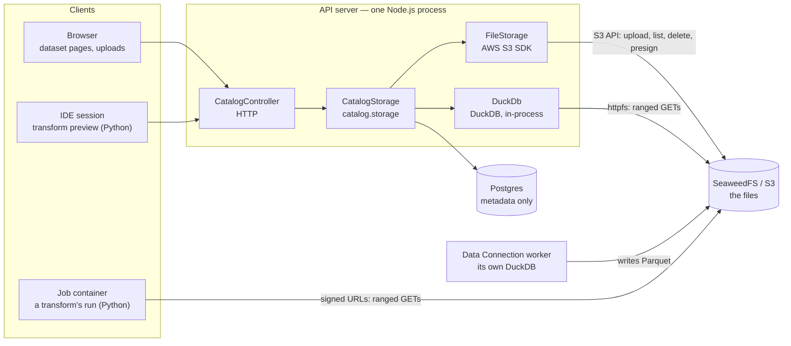
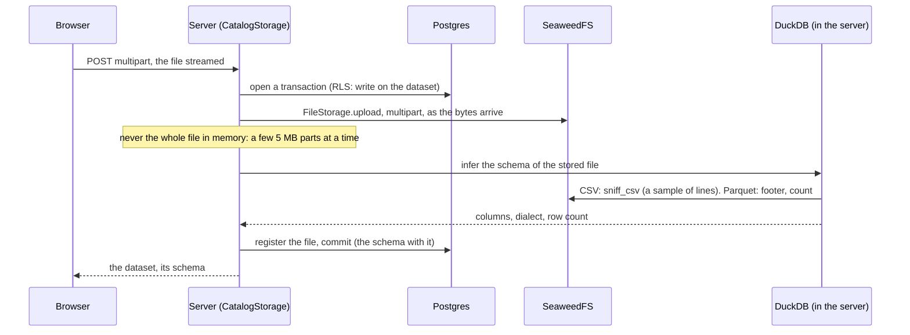
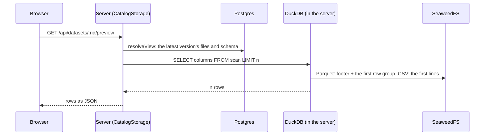
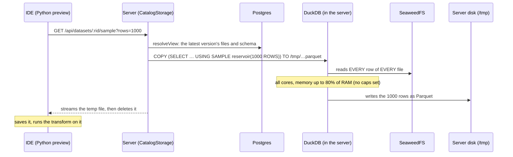

# Catalog storage — where dataset bytes live, and who reads them

_Explainer, 2026-10-30: how dataset files move between the browser, the server, DuckDB, object storage and job containers today — where they're read, and where memory, disk and CPU are spent. Describes the code as it is; the last section lists what's wrong with it. Related: [catalog.md](catalog.md) (the transaction model), [forge-runtimes.md](forge-runtimes.md) (jobs reading inputs)._

## 1. The pieces

| Piece | What it is | Holds |
|---|---|---|
| **Postgres** (`catalog` schema) | the database | **metadata only**: datasets, branches (`last_sequence`), transactions, each transaction's file changes (`key`, `format`, `bytes`, `rowCount`), schemas. Never a row of data |
| **SeaweedFS** (S3 API, `localhost:9000` locally) | object storage, in Docker | **the bytes**: every dataset file, at `<dataset>/<transaction>/<file>` (`Dataset.getStorageKey`) |
| **`FileStorage`** (`server/src/infra/file-storage.ts`) | the server's S3 client | nothing — moves bytes to and from the bucket, lists, deletes, signs URLs |
| **`DuckDb`** (`server/src/services/Catalog/storage/duckdb.ts`) | DuckDB, an analytical SQL engine, **as a library inside the server's process** — not a separate service | nothing persistent (`:memory:`); reads files straight from the bucket while a query runs |
| **`CatalogStorage`** (`catalog-storage.service.ts`, reached as `catalog.storage`) | the service that touches dataset **contents** | nothing — it coordinates Postgres, `FileStorage` and DuckDB |

## 2. What `CatalogStorage` does

Four jobs, each a public method:

| Method | Called by | Postgres | Bucket | DuckDB |
|---|---|---|---|---|
| `upload` (snapshot / append) | browser, dataset page; `CatalogService.createFromFile` (new dataset from a file) | opens a transaction; registers the file; commits | writes the file (`FileStorage.upload`) | reads it back to **infer its schema** |
| `preview` | browser, dataset page (`CatalogSDK.preview`) | resolves the latest version's files | — | reads the **first N rows** |
| `sample` | IDE preview (`QuarryClient.sample` in `quarry.transforms`) | resolves the latest version's files | — | reads **every row**, keeps N at random |
| `setSchema` | browser, schema editor | commits an `update` transaction with the new schema | — | reads **100 rows** with the new schema, to check it parses |
| `getReadPasses` | Forge, for a running job's runtime | resolves a pinned version's files | **signs** each file's URL (no bytes move) | — |

`resolveView` (in `TransactionRepository`) is the step every read starts with: from Postgres, which files make up the version (the latest snapshot, plus the appends after it), and its schema. Only then does anything read bytes.

## 3. DuckDB — what it is, and how it reads

- **In the server's process.** A C++ library loaded into Node as a native add-on (`@duckdb/node-api`). One instance for the whole server, created on first use, in memory.
- **Off the event loop.** `run` / `runAndReadAll` are async: the query runs on DuckDB's own threads, and the server keeps answering other requests meanwhile. Only small things run on the main thread: closing a connection, turning a result into JSON.
- **Its own threads and memory.** By default DuckDB uses **every CPU core** and up to **80% of the machine's RAM**; past the memory limit it spills to disk. The server sets **neither** today, so a heavy query competes with the whole API server.
- **Reading from the bucket.** The `httpfs` extension speaks the S3 API itself, with a `SECRET` holding the bucket's credentials (set up once, in `DuckDb.create`). For `s3://datasets/<key>` it signs and sends HTTP requests to SeaweedFS:
  - **Parquet:** a request for the file's size, a ranged `GET` for the **footer** (schema, row groups, min/max), then ranged `GET`s for only the **columns and row groups** the query needs.
  - **CSV:** ranged `GET`s from the start of the file, parsed as it goes, as far as the query needs.
- **How a version is read** (`CatalogStorage.scan`): one table expression over all the version's files, by its schema's reader — `read_parquet([files], union_by_name = true)`, or `read_csv([files], delim = …, quote = …, header = …, columns = {…})` with the dataset's dialect and column types.
- **`INSTALL httpfs`** downloads the extension from DuckDB's repository the first time on a machine (then cached): a server without internet access would need it bundled.

## 4. Each flow: what's read, where memory and disk go

### Upload

| Resource | Use |
|---|---|
| Server memory | small and bounded: the upload is streamed (busboy → the S3 SDK's multipart upload, a few parts in flight) |
| Server disk | none |
| DuckDB | cheap: a sniff of the CSV's first lines, or a Parquet footer |
| Bucket | one new file |

### Preview (dataset page)

Cheap: DuckDB stops after `n` rows. Memory: those rows, briefly.

### Sample (IDE transform preview) — the expensive one

| Resource | Use |
|---|---|
| Network (bucket → server) | **the whole version**: a reservoir sample must see every row to pick fairly |
| Server CPU | DuckDB's threads, all cores by default, for the whole read |
| Server memory | DuckDB's working memory while it scans (bounded by its limit, 80% of RAM by default) |
| Server disk | the temp Parquet file (small: `rows` rows), deleted after sending |

Once per input, per click on Preview. Trivial on a small dataset; on a large one, every preview reads the dataset in full inside the API server.

### Schema edit

`resolveView` → DuckDB reads **100 rows** with the new schema (it fails if the types don't parse) → an `update` transaction commits the schema. Cheap.

### Read passes (a job's inputs)

`resolveView` at the pinned sequence → `FileStorage.presignGet` for each file: signing is local computation, **no request to the bucket, no DuckDB**. The job container then reads the bucket directly ([forge-runtimes.md](forge-runtimes.md) §5) — none of a job's data passes through the server.

## 5. Where it goes wrong today

- **`sample` reads the whole dataset** in the API server, on every IDE preview. A random sample is the reason; the first N rows (`LIMIT`) would read about one row group. Choices: first N rows; N rows spread over a few files; a few random row groups ([open](#6-open)).
- **DuckDB has no limits.** Every core, 80% of RAM, inside the process that serves every request. `SET threads` and `SET memory_limit` when the instance is created would cap it ([open](#6-open)).
- **`CatalogStorage` mixes four jobs** — ingest, reading contents, schema edits, presigning — and builds DuckDB SQL inline, with two private helpers (`infer`, `scan`) the AGENTS.md rules don't allow in a service.
- **CSV in jobs.** A version's files are all one format (enforced on upload), but jobs read only Parquet so far; a CSV input fails ([forge-runtimes.md](forge-runtimes.md), phase 3).

## 6. Open

- `sample`: first N rows instead of a reservoir sample?
- DuckDB: which caps (threads, memory) for the server's instance?
- `CatalogStorage`: split by job (ingest / reading / schema / passes), and where the DuckDB SQL lives.
