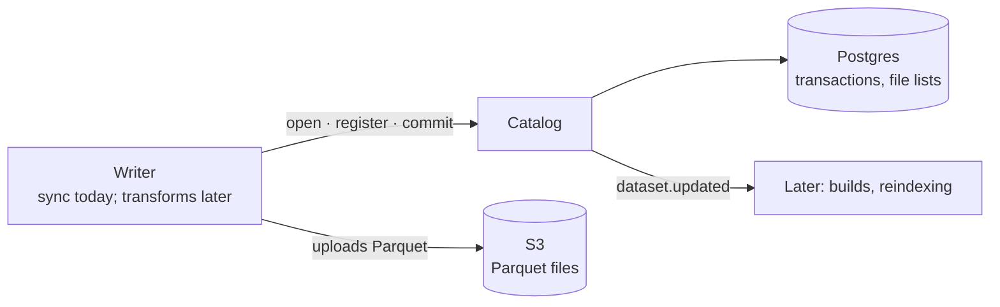
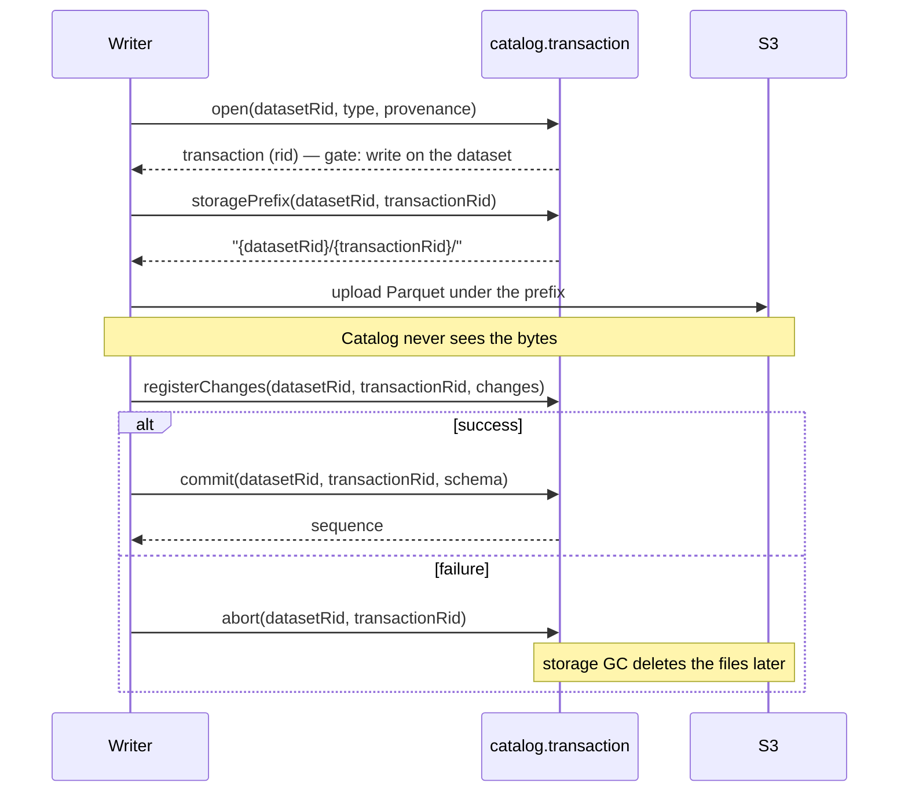

# Catalog — Datasets

_Draft, 2026-10-18 (split from the 2026-10-13 datasets sketch). Tables, commit SQL and the outbox are in [database.md](database.md#6-catalog); queues in [jobs.md](jobs.md); permissions in [gatekeeper.md](gatekeeper.md). Foundry background: [research notes](../research/palantir-foundry-ontology.md) §2–3. What writes into datasets today: [data-connection.md](data-connection.md)._

Catalog owns **datasets**: versioned tables made of immutable files. It's Foundry's dataset layer — files in object storage, a transaction history in Postgres, and a "view" computed from that history. Everything later (transforms, ontology, indexing) reads datasets; only Catalog decides what a dataset contains.



---

## 1. Model

A **dataset** is a logical, versioned table: a set of immutable files plus a schema plus a transaction history. Not a file — a *history of file sets*.

| Part | What it is | Where it lives |
|---|---|---|
| **Dataset** | The resource: name, folder, grants, trash | `library.resource` + `catalog.dataset` (shared RID) |
| **Branch** | A line of history; `main` only for now | `catalog.branch` (`last_sequence`) |
| **Transaction** | One change to the file set; has a RID, isn't a resource | `catalog.transaction` |
| **Files** | `Storage.File`s — Parquet now, other formats later | Object storage; a transaction's changes list them (`catalog.transaction_change`) |
| **Schema** | Ordered column list, attached to a transaction | `catalog.transaction.schema` |
| **View** | The file set at one sequence, computed from transactions | Derived, never stored |

A dataset is a library resource (`ri.catalog.main.dataset.…`): it lives in a folder, inherits grants, can be trashed. A transaction (`ri.catalog.main.transaction.…`) is only addressable — access to it is access to its dataset.

### Transactions

Every write is a transaction: `open → committed | aborted`. Only committed transactions are visible.

| Type | Effect | Used by |
|---|---|---|
| `snapshot` | Replaces the whole file set | Snapshot syncs, full rebuilds |
| `append` | Adds files; can't touch existing ones | Incremental syncs |
| `update` | Adds files, may replace files at the same logical path | Corrections (breaks append-only — avoid) |
| `delete` | Removes files from the view | Cleanup |

On commit a transaction gets the next **sequence** on its branch (1, 2, 3…). Sequences are the version numbers readers ask for.

### Rules

- **Files are immutable.** An object is never overwritten. Keys are unique per transaction (`{datasetRid}/{transactionRid}/…`); the catalog maps logical paths → keys.
- **One open transaction per dataset branch** (unique index `transaction_one_open`). A second writer fails with 409.
- **An upload without a commit is invisible.** Commit is a single Postgres transaction; that's the atomicity point. S3 is just bytes.
- **Schema describes, checks enforce.** The schema is metadata written by the writer. Validation (types, key uniqueness) is a separate, optional step that can fail a transaction before commit — not built yet.
- **Only Catalog writes Catalog's tables.** Other services go through `catalog.transaction`.
- **Writers only add files.** Nothing in the write protocol deletes bytes: a `remove` drops a logical path from the view, and only background GC deletes objects ([§6](#6-events-and-housekeeping), [§7](#7-not-built-yet)). There is deliberately no "purge files" call — a writer deleting bytes could break old views and other branches.

### Schema type system

Small, explicit, independent of any source's native types (`Catalog.ColumnSchema`):

`string · integer (i32) · long (i64) · double · decimal(p,s) · boolean · date · timestamp (UTC) · binary` — nested `array / struct / map` deferred.

Each source's columns are mapped onto these; unmappable types become `string` (with a warning), never a silent drop. Postgres mapping: [data-connection.md §3](data-connection.md#3-source-definitions-and-runtimes).

---

## 2. `CatalogService`

**One entry point.** Other services inject `CatalogService` and nothing else from Catalog; the module doesn't export anything another service could write through.

| | `catalog.*` | `catalog.transaction.*` |
|---|---|---|
| Deals with | the dataset as a resource | changing its contents |
| Methods | `createDataset`, `get`, `view` | `open`, `registerChanges`, `commit`, `abort`, `storagePrefix` |
| Called by | the API (users), other services | writers — today the sync runner and sync reaper |
| Spans | one request | a job: open, minutes of uploading, commit |

`catalog.transaction` is a `DatasetTransactions` instance (`transaction/dataset-transactions.ts`) — a class only so its methods can carry `@SecurityGate`; it's provided inside Catalog and not exported. Both halves use `DatasetRepository` / `TransactionRepository`. Creating a dataset is `DatasetRepository.create` under `@EnsureResource('dataset')` — the library row, the dataset row and branch `main` in one transaction.

### HTTP API (`Catalog.API`)

| Route | Service | Gate |
|---|---|---|
| `POST /datasets` `{ parentRid, name, description }` | `createDataset` | `write` on the parent folder |
| `GET /datasets/:rid` | `get` | `discover` |
| `GET /datasets/:rid/view?sequence=` | `view` | `read` |

There's no HTTP route for transactions: writes come from server-side writers, not browsers.

---

## 3. The write protocol



- **`open`** inserts the transaction (`started_by` from the principal). `provenance` is free-form JSON recording who wrote it — a sync run writes `{ syncRid, syncRunRid }`.
- **`registerChanges`** records the transaction's changes: `add` a stored file at a logical path, or `remove` a logical path. Called once or many times.
- **`commit`**, in one Postgres transaction: lock the branch row (serialises commits), take `last_sequence + 1`, mark the transaction committed with its schema, insert a `dataset.updated` outbox row, `pg_notify`. Returns the sequence.
- **`abort`** marks the transaction aborted. A no-op if it's already finished — failure paths race (runner catch block, sync reaper).

### Permissions and liveness

**A transaction is always addressed through its dataset** — every method takes `(datasetRid, transactionRid)`, like Foundry's `/datasets/{datasetRid}/transactions/{transactionRid}/commit`. That puts a resource RID in the signature, so the standard decorators do all the checking:

| Step | Permission | Liveness |
|---|---|---|
| `open`, `registerChanges`, `commit` | `@SecurityGate('write')` on the dataset | automatic — `@Transactional` checks the dataset (a top-level argument); 404 if it or a folder above it is trashed |
| `abort` | `@SecurityGate('write')` on the dataset | **skipped**: the repository marks the dataset `@AllowTrashed()` — aborting is how a writer cleans up after a trash |

The repository matches on **both** RIDs (`WHERE rid = $transaction AND dataset_rid = $dataset`), so write on dataset A can't be used to commit or abort a transaction of dataset B — that's a 404 (or a no-op abort). Service principals skip the permission check, as everywhere, but not liveness.

Writers act as the principal they were given: a sync run as a **delegate** of the user it runs for, so if that user loses write on the dataset, their runs stop at `open`. Cleanup (`abort`) runs as `SELF` so it succeeds regardless.

**Accepted race:** a trash landing between `@Transactional`'s liveness check and the commit lets that one commit through. Its data is still unreachable — every read path checks liveness. Closing it would mean locking every ancestor on each commit.

---

## 4. Reading: view resolution

`TransactionRepository.resolveView(datasetRid, branch, sequence?)` — the file set at `sequence` (default: the branch's `last_sequence`):

1. `sequence = 0` → empty view (nothing committed yet).
2. Find the latest committed `snapshot` at or before it (none → start at 1).
3. Apply every committed transaction from there up to `sequence`, in order, by logical path: `add` sets, `remove` deletes.
4. Schema = the latest non-null schema at or before `sequence`. Row count = sum of file row counts, if all are known.

Reading an old sequence is the same algorithm stopped earlier — time travel for free, until retention removes the files.

The result (`Catalog.Dataset.View.Schema`) lists **files** — their keys, not their data. Readers (DuckDB previews later, transforms) fetch the Parquet themselves. A preview/query endpoint that reads the files doesn't exist yet.

---

## 5. Storage

### Files: three concepts

| Concept | Where | What it is |
|---|---|---|
| **`Storage.File`** | shared `Storage` | An object in storage: `key`, `bytes`, `format`, plus that format's metadata (`Storage.File.Parquet.Schema` adds `rowCount`). Knows nothing about datasets. `Storage.File.Schema` is the union, discriminated by `format`. |
| **`Catalog.Transaction.FileChange`** | a transaction | An instruction, not a file: `add` a `Storage.File` at a logical path, or `remove` a logical path. Stored in `catalog.transaction_change`. |
| **`Catalog.Dataset.View.File`** | a view | A `Storage.File` plus its **logical path** — its name within this dataset, unique within one view (two datasets can both have `part-0.parquet`). |

The **key** is where the bytes are, written once and never reused. The **logical path** is the dataset's name for the file, stable across versions — an `update` can put new bytes (a new key) at the same logical path.

S3-compatible object storage, through `FileStorage` (`infra/file-storage.ts`) — code against the S3 API only, so the backend is swappable:

| Environment | Backend |
|---|---|
| Local dev | MinIO (docker compose) |
| Cloud | AWS S3 / Cloudflare R2 / GCS (S3 interop) / Azure Blob |

```
s3://{S3_BUCKET}/
  {datasetRid}/
    {transactionRid}/             catalog.transaction.storagePrefix
      data_0.parquet              written by the writer (sync: DuckDB COPY … PER_THREAD_OUTPUT)
      data_1.parquet
```

Nothing readable depends on listing the bucket — the catalog's file list is the truth. Target ~128 MB per Parquet part, Snappy or Zstd.

**Build vs adopt.** Delta Lake / Iceberg solve the same problem (Parquet + a transaction log). We own a thin catalog for v1: Foundry's transaction types and branch semantics map directly onto a few Postgres tables, and we avoid a JVM/Spark-centric stack. The layout stays Iceberg-friendly (immutable Parquet, explicit file lists), so exporting to Iceberg later stays possible.

---

## 6. Events and housekeeping

Scheduled by the **system worker** (`packages/system-worker`), which has no database: the Postgres part of each job is a server endpoint (`Catalog.API.Internal`: `GET /internal/outbox`, `POST /internal/outbox/published`, `POST /internal/storage-gc`). Queue definitions in `Catalog.Queue` ([jobs.md](jobs.md)).

| Job | Cadence | Does |
|---|---|---|
| `catalog.outbox-relay` | every 5 s (singleton) | Publishes unpublished `catalog.outbox` rows as `catalog.dataset-updated` jobs, `jobId` = transaction RID (a re-publish after a crash is a no-op), then marks them published |
| `catalog.storage-gc` | hourly (singleton) | Aborts transactions open > 24 h; deletes the storage prefix of every transaction aborted in the last 7 days (idempotent) |
| `catalog.dataset-updated` | per commit | **No consumer yet** — the hook for builds (layer 2) and reindexing (layer 3) |

The outbox exists so an event is published **iff** the commit happened: the row is written in the commit's own Postgres transaction, and the relay only moves committed rows to BullMQ.

---

## 7. Not built yet

- **History retention** — deleting old versions of a live dataset. Planned as **one global policy**, not a per-dataset setting: keep the latest view plus N days of history, computed from `finished_at` (nothing counts down). Files referenced only by older views are marked, then swept after a grace period (Foundry's mark-and-sweep). The latest view is never deleted; append-only datasets, whose history all stays in the latest view, need an opt-in age-based mode. Per-dataset or per-project overrides later, as a policy table, if ever needed. Until then, `delete` transactions only hide files and old views stay readable forever.
- **Trash purge** — a separate thing: permanently deleting a whole trashed resource (library row, dataset rows, every file) once `trashed_at` is older than one global setting. Starts in Library (`library.purge`, [jobs.md](jobs.md)), which asks each owning service to purge its part.
- **Orphaned files** — files uploaded under a prefix with no transaction row (writer crashed before `open` returned) aren't swept.
- **Schema checks** — no validation before commit; schema changes aren't detected or warned about.
- **Branches beyond `main`**, previews / reads of file contents, unstructured datasets (the model allows files without a schema; no tooling).
- **Outbox via `LISTEN`** — commits `pg_notify('catalog_outbox')`, but the relay polls every 5 s and doesn't listen.

---

## 8. Open questions

- **Large initial loads** — one transaction with many parts, or several `append`s?
- **Retention semantics** — keep views for N days, or the last N sequences? What about a view a running build is reading?
- **`update` transactions** — keep them, or drop them as Foundry-compat baggage? Today's writers never produce one.
