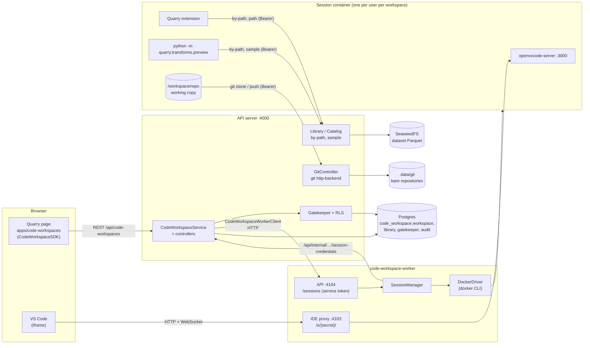

# Code Workspaces — how it works

_Written 2026-10-25 against the code as built (iteration 1 of [transforms.md](../transforms.md)). The design and its decisions are in transforms.md; these pages explain the running system, file by file._

A **Code Workspace** is a Git repository of Python transforms plus its environment, edited in VS Code in the browser. Iteration 1 covers creating one, editing it in a session, and **previewing** a transform on samples of its inputs. Nothing writes datasets yet (that's checks and builds, iteration 2).

| Page | What it covers |
|---|---|
| [creating.md](creating.md) | `POST /api/code-workspaces` → the template rendered, locked, committed, the row inserted |
| [sessions.md](sessions.md) | A session's life: container, setup, credentials, idle stop, restore after a restart |
| [ide-proxy.md](ide-proxy.md) | How the browser reaches VS Code: the secret path, the HTTP and WebSocket proxy |
| [authorization.md](authorization.md) | Every entry point and what Gatekeeper / RLS check there; tokens and their reach |
| [preview.md](preview.md) | Running a transform: the button → the worker's API → `docker exec` → samples → the panel |
| [extension.md](extension.md) | The Quarry VS Code extension inside each session |
| [checks.md](checks.md) | **Spec, not built**: CI on push — `quarry-ci.yml`, the worker's check runs, publishing recipes |

## The pieces

**Processes**

| Process | Package | Talks to |
|---|---|---|
| API server | `packages/server` (`services/CodeWorkspace`, `services/Library`, `services/Catalog`) | Postgres, Redis, object storage, the bare repositories on disk |
| Code workspace worker | `packages/code-workspace-worker` | Docker, the server's `/api/internal`, Redis (it takes check runs from `code-workspace.run-check`) — no database. Serves its API (`CODE_WORKSPACE_WORKER_PORT`, 4104 — for the server only) and the IDE proxy (`CODE_WORKSPACE_IDE_PROXY_PORT`, 4103 — for browsers) |
| Session container | `docker/code-workspace-runtime` (image `quarry/code-workspace-runtime:dev`) | The server, as the user (git, previews, the extension) |
| Browser | `packages/frontend` (`apps/code-workspaces`, `SDKs/CodeWorkspaceSDK`) | The server (REST), the worker's IDE proxy (the IDE iframe) |

**Where the code is**

| Concern | Files |
|---|---|
| Domain (shared) | `shared/domain/CodeWorkspace/` — `Rid`, `Schema`, `Template`, `Preview`, `API` (`API.Internal`: the server, for the worker; `API.Worker`: the worker, for the server) |
| Resource, create, sessions, credentials | `server/src/services/CodeWorkspace/code-workspace.{service,repository,controller,internal.controller}.ts`, `worker/code-workspace-worker.client.ts` |
| Git hosting | `server/src/services/CodeWorkspace/git/{repositories,git.controller,http-backend}.ts` |
| Templates | `server/src/services/CodeWorkspace/templates/` |
| Session tokens | `server/src/auth/session-tokens.ts` |
| Sessions, IDE proxy, Docker | `code-workspace-worker/src/{session-manager,ide-proxy,docker-driver,config}.ts`, `src/http/` (the API: controller, service-token guard, error filter), `src/domain/Session.ts` |
| Runtime image | `docker/code-workspace-runtime/` (Dockerfile, `bin/quarry-session-ide`, `bin/quarry-session-setup`) |
| Python library | `transforms-python/src/quarry/transforms/` |
| VS Code extension | `code-workspace-extension/` |
| Frontend | `frontend/src/apps/code-workspaces/`, `frontend/src/SDKs/CodeWorkspaceSDK/` |
