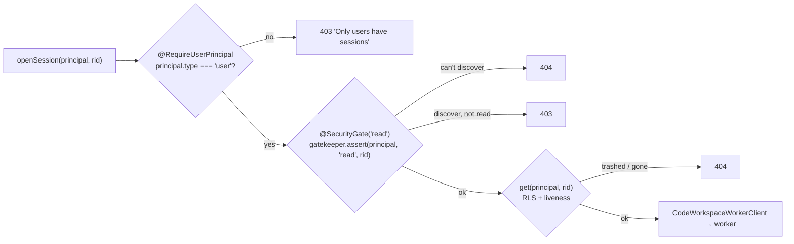
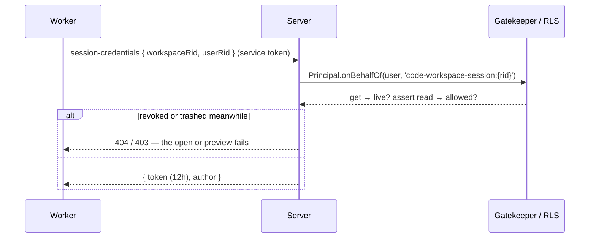

# Authorization

Code Workspaces follow [gatekeeper.md](../gatekeeper.md) (mechanics: [gatekeeper-and-rls.md](../gatekeeper-and-rls.md)): **row-level security decides plain reads and writes of rows**; `@SecurityGate` / `gatekeeper.assert` are for what RLS can't express — effects that aren't rows (a container, a call to the worker, a minted token, files on disk), actions stricter than a row's policy, and side effects before the guarded row.

| Role (rank) | On a Code Workspace |
|---|---|
| discoverer (1) | see it exists — in lists, the tree, Recents |
| viewer (2) | **read**: open a session, see its transforms, preview them, clone / fetch |
| editor (3) | **write**: push |
| owner (4) | **manage**: share it |

A user's rank is the highest of their grants on the workspace or any ancestor (and admins are owners of everything). **404 vs 403**: without `discover`, `assert` says *Not found* (it doesn't reveal the workspace exists); with `discover` but not the action, *Forbidden*.

## Every entry point

| Endpoint | Principal | Checks, in order | Effect |
|---|---|---|---|
| `GET /api/code-workspaces` | user | RLS: rows with `discover` | list |
| `GET /api/code-workspaces/templates` | user | — | template list |
| `POST /api/code-workspaces` | user | `assert write` on the **parent** (before anything) · RLS on the input's path (example) · RLS `write` on parent at insert | repository + rows |
| `GET /api/code-workspaces/:rid` | user | RLS `discover` + liveness | the row |
| `POST …/:rid/open` | user | `@RequireUserPrincipal` · RLS + liveness | row + audit `open` |
| `POST …/:rid/session` | user | `@RequireUserPrincipal` → `@SecurityGate('read')` → `get` (404 if trashed) | worker → container |
| `GET …/:rid/session/transforms` | user | same | worker → `docker exec` |
| `POST …/:rid/session/preview` | user | same | worker → `docker exec` |
| `POST /api/internal/code-workspaces/session-credentials` | **service token** (worker) | as a **delegate** of the user: `get` + `assert read` | a minted token |
| `/api/git/<rid>.git/info/refs`, `git-upload-pack` | user (Bearer) | `get` + `assert read` | clone / fetch |
| `/api/git/<rid>.git/git-receive-pack` (and its advertisement) | user (Bearer) | `get` + `assert write` | push |
| `/api/git/…` anything else | — | 404 (no dumb protocol) | — |
| IDE proxy `/s/<secret>/…` (`CODE_WORKSPACE_IDE_PROXY_PORT`) | the secret (capability) | the secret is a known, running session | VS Code |
| Worker `/sessions/{open,transforms,preview}` (`CODE_WORKSPACE_WORKER_PORT`) | **service token** (the server) | `ServiceTokenGuard` — never published to browsers | the session |

Inside a preview, the session token reaches two more endpoints as the user:

| Endpoint | Checks |
|---|---|
| `GET /api/resources/by-path?path=` (`LibraryService.getByPath`) | RLS at every step of the path — a hidden folder on the way is a 404 |
| `GET /api/datasets/:rid/sample?rows=` (`CatalogStorage.sample`) | `@SecurityGate('read')` on the dataset, `@Audit('read', { op: 'sample' })` |

## The decorators on a session method

`@RequireUserPrincipal` sits above `@SecurityGate`, so a non-user is refused before any permission lookup. The method then types its principal as `Principal.User` (it needs `userRid` for the job).

## Re-checked, not trusted

The server's call to the worker carries only `workspaceRid` and `userRid` — no credential. The worker can't act on a session until the server has checked **again**, as the user (a delegate principal), and minted a token:

So revoking someone's access stops their next open, preview and transforms listing. Deactivating them stops everything their tokens do on the next request (`TokenVerifier` resolves the member every time).

## What a session token can do — and the gaps

A session token is `SessionTokens.mint`: signed with the same key as GoTrue's (`GOTRUE_JWT_SECRET`), `sub` = the user, `aud = authenticated`, 12 hours. `TokenVerifier` accepts it exactly like a login.

| Known gap | Consequence | Planned fix (iteration 2) |
|---|---|---|
| **Not scoped — accepted** (2026-10-25) | anything running in the container (the extension, the user's code, a teammate's previewed transform) can do anything the user can in Quarry, for up to 12h — never more: every call is Gatekeeper and RLS as them | none planned. The session acts as the user, like their browser does; the extension may call any Quarry API. Revisit if previews run code the user didn't write or review |
| **`quarry_via` ignored** | requests with it audit as the plain user, not "via session" | the verifier turns `quarry_via` into a delegate principal |
| **Readable in the container** | `~/.gitconfig` and `~/.quarry/session.json` (mode 600, but the user's own code runs as that user) | accepted with the above |
| **IDE proxy secret** | anyone with the URL reaches that IDE until the container is recreated | rotate on reopen; or put the IDE proxy behind Quarry's session cookie |
| **Git not audited** | clones and pushes leave no access event | `@Audit` on `authorizeGit` |
| **No container sandbox** | plain Docker isolation; user code shares the host kernel | gVisor (`runsc`) as the runtime — no image change |
