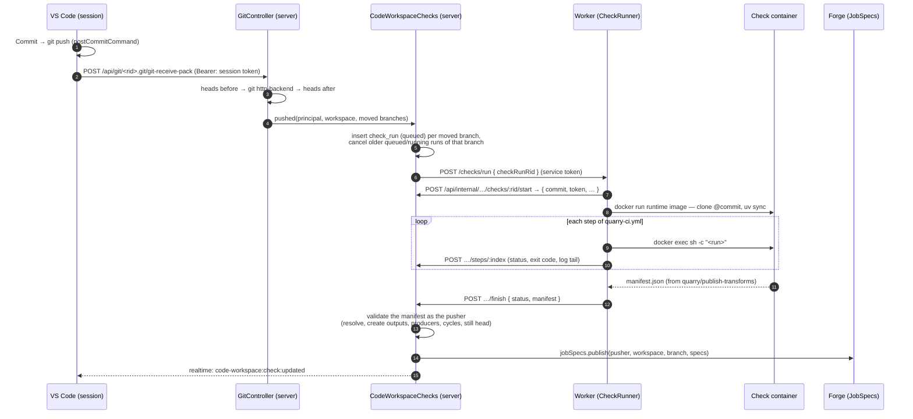

# Checks (CI)

_Spec, written 2026-10-27. Built so far: steps 1–2 of the build order (the domain and the table; pushes queue runs). Nothing runs them yet. Part of iteration 2 of [transforms.md](../transforms.md) ("checks and a Build button")._

A **check run** is CI for one commit of a Code Workspace: it runs the steps the repository declares in `quarry-ci.yml`, then — if they all pass — **publishes the workspace's job specs** for that branch, pinned to that commit. It's the only thing that publishes them: a build reads specs, it never makes them ([forge.md](../forge.md)). No passing check, nothing to build.

## Decisions

| Decision | Choice |
|---|---|
| What triggers a check | A **push** that moves a branch — seen by `GitController`, which the push already passes through. Not local commits: until pushed, the server hasn't got them |
| Commit = push | The session's VS Code pushes after every commit (`git.postCommitCommand: "push"`), so for the user, committing is what runs checks |
| Which commits | One check per **moved branch head**. Five commits in one push → one check, of the newest |
| Who defines the steps | The **repository**: `quarry-ci.yml` at its root, written by the template, editable by the user |
| Who defines publishing | **Quarry**: the last step is `uses: quarry/publish-transforms`, a command in the runtime image, not a script in the repo. It only *claims* what the transforms are; the server checks every claim itself |
| Where checks run | The **Code Workspace worker**, in a throwaway container from the runtime image — it already has Docker, the image and `quarry.transforms` |
| As whom | The **pusher**. Every read, every dataset created, every spec published is theirs to do, or the check fails |
| Publishing | All or nothing, and only while the commit is **still the branch head** |
| New outputs | A missing `Output("/path")` is **created** as an empty dataset, as the pusher (transforms.md) |

## End to end



## 1. Seeing the push

`git.controller.ts`, around `serveGit`, for a `POST git-receive-pack` only:

```ts
// git.controller.ts
const before = rest === 'git-receive-pack' ? await this.service.getHeads(rid) : null;   // git for-each-ref refs/heads

await serveGit(request, response, {
    …,
    afterServe: before ? () => this.service.pushed(principal, rid, before) : undefined,
});

// CodeWorkspaceService.pushed: the heads again, getMovedHeads(before, after) → checks.pushed(principal, rid, moved)
```

- `afterServe` runs once `git http-backend` has exited and **before the response ends**: when the user's `git push` returns, its runs are queued. A rejected push (non-fast-forward, say) moves nothing.
- `pushed` never throws — the push already succeeded; a run that couldn't be queued is logged.
- `CodeWorkspaceChecks.pushed` → `CodeWorkspaceRepository.queueCheckRuns`, as the pusher, one transaction: cancel the branches' `queued`/`running` runs, insert a `queued` run per head.
- **Deleted branches** run nothing. Their specs stay until branch deletion is designed (open question).
- **The template's first commit** doesn't pass through the controller (`repositories.ts` pushes straight to the bare repository); creating a workspace calls `checks.pushed` for `main` itself.
- **Push on commit**: `docker/code-workspace-runtime/configuration-defaults.json` gets `"git.postCommitCommand": "push"`. `git commit` in the terminal still needs a `git push` — ordinary Git.

## 2. `quarry-ci.yml`

At the repository's root. The `python-transforms` template writes:

```yaml
# What every pushed commit goes through. The last step publishes this branch's
# transforms as job specs — what Build runs — and only if every step before it passed.
steps:
  - name: Environment
    run: uv sync --frozen

  - name: Lint
    run: ruff check .

  - name: Tests
    run: pytest -q

  - name: Publish transforms
    uses: quarry/publish-transforms
```

| Field | Meaning |
|---|---|
| `steps` | In order; the first failing one stops the run |
| `name` | Shown in the Checks tab |
| `run` | A shell command (`sh -c`), in the checkout, with the workspace's `.venv` on `PATH`. Exit 0 passes |
| `uses` | A step Quarry provides. One today: `quarry/publish-transforms` |
| `timeoutMinutes` | Optional, per step; default 10, at most 30 |

Rules — a file breaking one fails the run at **Parse**, before anything runs:

- Valid YAML matching the schema (`CodeWorkspace.Check.Config`, zod, in `@quarry/shared`); a step has exactly one of `run` and `uses`.
- Exactly one `uses: quarry/publish-transforms`, and it's the **last** step. A repository that wants no publishing can't opt out silently — every workspace is a producer.
- No file → the run fails: "No quarry-ci.yml at the root".

Templates own the file's first version: a future template (SQL, another language) writes its own steps and its own `uses:` step. The file is parsed **by the server**, from the bare repository at the commit (`git show <commit>:quarry-ci.yml`) — so a bad file fails fast without a container, and the worker gets the steps already validated.

## 3. Running it — the worker

New in `packages/code-workspace-worker`: `src/check-runner.ts` and `src/http/check.controller.ts` (`POST /checks/run`, service token, like `/sessions`). The worker still has no database and no Redis — it reports everything to the server.

1. **Accept** `{ checkRunRid }`, answer 202, run in the background. At most `CODE_WORKSPACE_CHECK_SLOTS` (default 2) at once; more wait in memory.
2. **Start**: `POST /api/internal/code-workspaces/checks/:rid/start` → `{ workspaceRid, branch, commit, steps, token, gitUrl }`. The server marks it `running`, or answers 409 if it's no longer `queued` (superseded, or a duplicate send) — the worker drops it.
3. **Container**: `docker run` the runtime image (`CODE_WORKSPACE_RUNTIME_IMAGE`) with no volume, CPU and memory limits, and only `QUARRY_TOKEN`, `QUARRY_SERVER_URL`, `QUARRY_GIT_URL`. Then `quarry-check-setup` (new, beside `quarry-session-setup`): git's auth header, `git clone`, `git checkout --detach <commit>`, `uv venv --system-site-packages`.
4. **Steps**: each `run` as `docker exec … sh -c`, stdout and stderr merged; after each, `POST …/steps/:index` with `{ status, exitCode, startedAt, finishedAt, log }` (the last 64 KB). Stop at the first failure.
5. **Publish step**: `python -m quarry.transforms.manifest` — writes the manifest (§4) to stdout.
6. **Finish**: `POST …/finish` with `{ status, manifest? , failure? }`; `docker rm --force` the container, always.

The **token** is minted by `SessionTokens.mint(pusher, 'check')` — the pusher's, like a session's. So `uv sync` reaches nothing private, but the manifest step and any step that calls Quarry (tests reading a dataset, say) act as the pusher, checked on every request.

A step's code is the user's code: it can do anything the pusher's token can. That's the same reach their session already has — no new power.

## 4. The manifest

`quarry/publish-transforms` runs `python -m quarry.transforms.manifest` (new in `transforms-python`, sharing `load_pipeline` with `preview.py`): import `src/<package>/pipeline.py`, describe every transform. It reads no data and resolves nothing.

```json
{
  "transforms": [
    {
      "name": "sales_cleaning.datasets.orders.clean_orders",
      "inputs":  { "raw": "/Sales/raw/orders" },
      "outputs": { "out": "/Sales/clean/orders" },
      "resources": { "cpuCores": 1, "memoryGb": 4 }
    }
  ]
}
```

`CodeWorkspace.Check.Manifest` in `@quarry/shared` (zod): `name` a `ModuleFunctionPath`, references `CodeTransform.DatasetReference` (a RID or a library path). Fails the step: the pipeline doesn't import, a decorator is malformed, two transforms write the same output, no transforms at all.

## 5. Validating and publishing — the server

`CodeWorkspaceChecks.finish` (`services/CodeWorkspace/checks/`), when the run succeeded. **As the pusher**, all in one database transaction:

| # | Check | Fails the run when |
|---|---|---|
| 1 | **Still the head** | `refs/heads/<branch>` no longer points at the commit — a newer push won. The run is `succeeded` but **not published** (`published: false`); the newer run publishes |
| 2 | **Resolve inputs** | a path or RID doesn't exist, or the pusher can't see it (`Library` by-path, Gatekeeper `read`) |
| 3 | **Resolve outputs** | a RID that doesn't exist; a path that exists but isn't a dataset. A path that doesn't exist → **create** an empty dataset there (`Catalog.createDataset`), if its folder exists and the pusher can write it — else fail ("No folder /Sales/clean") |
| 4 | **Write outputs** | the pusher can't write an output (Gatekeeper `write`) |
| 5 | **One producer** | an output's current spec on this branch belongs to another producer — "`/Sales/clean/orders` is produced by *Claims Transforms*" (the repository's `_requireUnowned`, as a 409) |
| 6 | **No cycles** | a transform reads, through this workspace's own transforms, its own output |
| 7 | **Publish** | `forge.jobSpecs.publish(pusher, workspaceRid, branch, specs)` — one spec per transform: `logic { type: 'code-workspace', workspaceRid, commit, transform: name }`, the resolved RIDs, its resources. RLS has the final say (write on the producer and outputs, read on inputs) |

Publishing replaces the branch's specs for this producer: outputs no longer declared lose their current spec (a deleted transform stops being buildable). Outputs created at step 3 stay if a later step fails — empty datasets, harmless, and the next run finds them.

Any failure → the run is `failed` with a `failure { step: 'publish', message }` naming the dataset, and **nothing is published**: the branch keeps its previous specs.

## 6. Model

`code_workspace.check_run` — one row per (branch head, push):

| Column | |
|---|---|
| `rid` | `ri.code-workspace.main.check-run.<uuid>` |
| `workspace_rid`, `branch`, `commit` | what's checked |
| `status` | `queued → running → succeeded \| failed \| canceled` |
| `steps` | jsonb: `[{ name, status (waiting/running/succeeded/failed/skipped), exitCode, startedAt, finishedAt, log }]` — the parsed file's steps, plus the server's own **Parse** first and **Validate & publish** last |
| `published` | did this run's commit become the branch's specs |
| `failure` | jsonb `{ step, message }`, null unless failed |
| `pushed_by` | the pusher — whom the run acts as |
| `created_at`, `started_at`, `finished_at` | |

- **Superseding**: a new run for a branch cancels that branch's `queued` and `running` runs. A canceled running run's late `step`/`finish` gets 409 (the ForgeAgent's rule); the worker kills its container on 409.
- **Delivery**: the row is the outbox. `queued` = decided, maybe not sent. The system worker's sweep (Forge's relay pattern, same 60 s timer) re-sends `queued` runs older than 2 min, and fails `running` runs with no step report for 35 min (the worker died). `start` accepts `queued` only, once.
- **RLS**: read with read on the workspace; inserts and updates only through the service (the internal endpoints, as the system).

Domain: `CodeWorkspace.CheckRun` (`Rid`, `Status`, `Step`, `Schema`), `CodeWorkspace.Check.Config` (the file), `CodeWorkspace.Check.Manifest`.

## 7. Reaching the user

- **Events**: `code-workspace:check:updated` with the run, on the workspace's channel (`Realtime.Event.defineFactory`, like Forge's), on every status and step change.
- **API**: `GET /api/code-workspaces/:rid/checks?branch=` (newest first), `GET …/checks/:checkRunRid`. Both need read on the workspace.
- **Checks tab** (`routes/$rid/checks.tsx`): runs by commit — status, branch, short sha, pusher, when; open one for its steps and their logs. Live through the event.
- **In the IDE** (later): the status bar shows the head commit's check.
- **Build** stays disabled until the branch has specs — `GET /api/forge/job-specs/current` for the transform's output.

## Permissions

| Action | Needs |
|---|---|
| Push (and so start a check) | write on the workspace (`GitController`, as today) |
| See check runs | read on the workspace |
| What a check does | everything as the pusher: read inputs, create outputs in folders they can write, write outputs, publish (write on the workspace) |
| Worker ↔ server | the worker's service token (`/api/internal`), as for sessions |

## Build order

1. Domain and table — `CheckRun`, `Check.Config`, `Check.Manifest`; `code_workspace.check_run` in `code_workspace/001_initial.sql` (a living file until launch). **Built 2026-10-27.**
2. Push detection + `postCommitCommand` — `GitController`, `repositories.getHeads`, runs inserted `queued` (nothing runs them yet). **Built 2026-10-27.**
3. The worker's runner — `check.controller.ts`, `check-runner.ts`, `quarry-check-setup`, the internal endpoints, the sweep.
4. `quarry.transforms.manifest` and the template's `quarry-ci.yml` (with `ruff` added to the template's dev dependencies).
5. Validate and publish — `CodeWorkspaceChecks.finish`.
6. Checks tab and events.
7. Tests — the harness pattern from [testing.md](../testing.md): push to a real bare repository, play the worker, assert specs.

## Open questions

- **Deleted branches** — drop the branch's specs, or keep them until something else replaces them?
- **Logs** — the last 64 KB per step in Postgres for now; full logs in object storage later (with the ForgeAgents' job logs).
- **Caching** — every check does a full `uv sync` into a fresh container. A shared uv cache volume on the worker would make it seconds.
- **Moving to ForgeAgents** — once they run containers, a check could be a kind of Forge job; the server side (§5, §6) wouldn't change.
