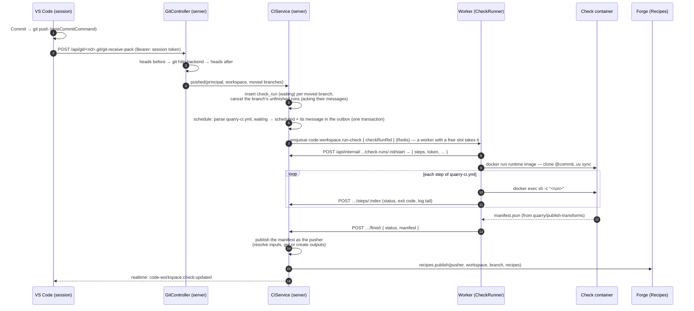
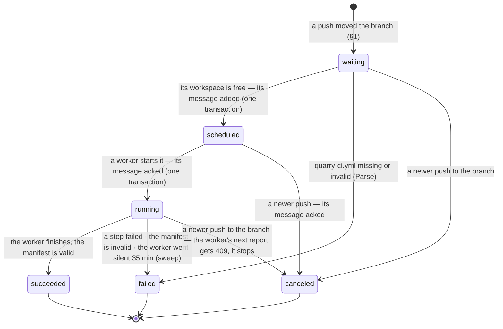

# Checks (CI)

_Spec, written 2026-10-27. Built so far: steps 1–3 of the build order — pushes queue runs, the scheduler hands them to the workers through a durable queue ([durable-queues.md](../durable-queues.md), since 2026-10-28), a worker runs quarry-ci.yml's steps and reports them; the sweep fails silent runs. Steps 4–5 built 2026-10-28: the manifest command and the template's quarry-ci.yml; a passing run publishes the branch's recipes, which builds run. Part of iteration 2 of [transforms.md](../transforms.md) ("checks and a Build button")._

A **check run** is CI for one commit of a Code Workspace: it runs the steps the repository declares in `quarry-ci.yml`, then — if they all pass — **publishes the workspace's recipes** for that branch, pinned to that commit. It's the only thing that publishes them: a build reads recipes, it never makes them ([forge.md](../forge.md)). No passing check, nothing to build.

## Decisions

| Decision | Choice |
|---|---|
| What triggers a check | A **push** that moves a branch — seen by `GitController`, which the push already passes through. Not local commits: until pushed, the server hasn't got them |
| Commit = push | The session's VS Code pushes after every commit (`git.postCommitCommand: "push"`), so for the user, committing is what runs checks |
| Which commits | One check per **moved branch head**. Five commits in one push → one check, of the newest |
| Who defines the steps | The **repository**: `quarry-ci.yml` at its root, written by the template, editable by the user |
| Who defines publishing | **Quarry**: the last step is `uses: quarry/publish-transforms`, a command in the runtime image, not a script in the repo. It only *claims* what the transforms are; the server checks every claim itself |
| Where checks run | The **Code Workspace worker**, in a throwaway container from the runtime image — it already has Docker, the image and `quarry.transforms` |
| As whom | The **pusher**. Every read, every dataset created, every recipe published is theirs to do, or the check fails |
| Publishing | All or nothing, and only while the commit is **still the branch head** |
| New outputs | A missing `Output("/path")` is **created** as an empty dataset, as the pusher (transforms.md) |

## End to end



## 1. Seeing the push

`GitService.servePush` (`git/git.service.ts`, gated write on the live workspace), around `serveGit`, for a `POST git-receive-pack` only:

```ts
// git.service.ts
const before = rest === 'git-receive-pack' ? await this.gitRepos.getHeads(rid) : null;   // git for-each-ref refs/heads

await serveGit(request, response, {
    …,
    afterServe: before ? () => this.ci.queueChecksForPush(principal, rid, before) : undefined,
});

// CIService.queueChecksForPush: gitRepos.getMovedHeads(rid, before) → queueChecksForMovedHeads(principal, rid, moved)
```

- `afterServe` runs once `git http-backend` has exited and **before the response ends**: when the user's `git push` returns, its runs are queued. A rejected push (non-fast-forward, say) moves nothing.
- `queueChecksForPush` never throws — the push already succeeded; a run that couldn't be queued is logged.
- `CIService.queueChecksForMovedHeads` → `CodeWorkspaceRepository.queueCheckRuns`, as the pusher, one transaction: cancel the branches' unfinished runs (acking their messages), insert a `waiting` run per head.
- **Deleted branches** run nothing. Their recipes stay until branch deletion is designed (open question).
- **The template's first commit** doesn't pass through the controller (`git-repos.ts` pushes straight to the bare repository); creating a workspace calls `ci.queueChecksForMovedHeads` for `main` itself.
- **Push on commit**: `docker/code-workspace-runtime/configuration-defaults.json` gets `"git.postCommitCommand": "push"`. `git commit` in the terminal still needs a `git push` — ordinary Git.

## 2. `quarry-ci.yml`

At the repository's root. The `python-transforms` template writes:

```yaml
# What every pushed commit goes through. The last step publishes this branch's
# transforms as recipes — what Build runs — and only if every step before it passed.
steps:
  - name: Environment
    run: uv sync --frozen

  - name: Tests
    run: pytest -q

  - name: Publish transforms
    uses: quarry/publish-transforms
```

Lint isn't in it yet — `ruff` would have to join the template's dev dependencies first. The template also writes `tests/test_pipeline.py` (the pipeline imports), so the Tests step always has a test: a workspace made without an example — its example and its test commented out — still passes its first check.

| Field | Meaning |
|---|---|
| `steps` | In order; the first failing one stops the run |
| `name` | Shown in the Checks tab |
| `run` | A shell command (`sh -c`), in the checkout, with the workspace's `.venv` on `PATH`. Exit 0 passes |
| `uses` | A step Quarry provides. One today: `quarry/publish-transforms` |
| `timeoutMinutes` | Optional, per step; default 10, at most 30 |

Rules — a file breaking one fails the run at **Parse**, before anything runs:

- Valid YAML matching the schema (`CodeWorkspace.CI.Check.Config`, zod, in `@quarry/shared`); a step has exactly one of `run` and `uses`.
- Exactly one `uses: quarry/publish-transforms`, and it's the **last** step. A repository that wants no publishing can't opt out silently — every workspace is a producer.
- No file → the run fails: "No quarry-ci.yml at the root".

Templates own the file's first version: a future template (SQL, another language) writes its own steps and its own `uses:` step. The file is parsed **by the server**, from the bare repository at the commit (`git show <commit>:quarry-ci.yml`) — so a bad file fails fast without a container, and the worker gets the steps already validated.

## 3. Running it — scheduling and the worker

### Who runs when

One Code Workspace worker per machine serves every workspace — sessions and checks alike. The workers **pull** check runs from a queue (`code-workspace.run-check`), as ForgeAgents pull jobs and CI runners pull builds: each takes work when it has room, and another machine is just another worker. The server decides what may run; the workers decide when:

| Level | Rule | Enforced by |
|---|---|---|
| Steps of one run | one after another; the first failure stops the run | the worker |
| Runs of one branch | only the newest head: a push cancels the branch's waiting, scheduled and running runs | `queue` (§1) |
| Runs of one workspace | **one at a time** (scheduled or running), oldest waiting first — a workspace with five busy branches can't take every slot | a unique index: `(workspace_rid) WHERE status IN ('scheduled', 'running')` |
| Runs on a machine | at most `CODE_WORKSPACE_CHECK_SLOTS` (default 2) | the worker: its queue processor's concurrency — it takes a run only when a slot is free |

### Scheduling — in the transaction that frees the workspace

No scheduler process: like Forge's `finishJob`, every write that frees a workspace schedules its next run in the same transaction (`CodeWorkspaceRepository._scheduleNext`): its oldest `waiting` run → `scheduled`, `scheduled_at`, **and its message added** to the durable queue `CodeWorkspace.CI.DurableQueue.RunCheck` (job id = the run's RID). Those writes:

- **a push** (`queueCheckRuns`): its runs inserted — `quarry-ci.yml` is read per head *before* the transaction, so a missing or invalid file inserts the run already **failed at Parse** — the branches' older runs canceled (acked), then the next scheduled if the workspace is free;
- **a finish** (`finishCheckRun`), and **the sweep failing a silent run** (`failSilentCheckRuns`).

Scheduling takes a transaction-scoped advisory lock on the workspace, so two transactions freeing it at once schedule one run; the unique index is the backstop. After the commit, `relay()` sends the message; if Redis is down it stays in the outbox for the platform's sweep ([durable-queues.md](../durable-queues.md)).

### The worker

New in `packages/code-workspace-worker`: `src/run-check.processor.ts` (BullMQ, `concurrency: CODE_WORKSPACE_CHECK_SLOTS`) and `src/check-runner.ts`. The worker now uses Redis, for this queue; still no database — it reports everything to the server.

1. **Take** a message when a slot is free.
2. **Start**: `POST /api/internal/code-workspaces/check-runs/:rid/start` → `{ checkRun, steps, token }` — the file's steps, and a token for the pusher. Accepted once: `scheduled → running`, its message acked in the same transaction; else 409 (taken, or canceled), and the worker drops it.
3. **Container**: `docker run` the runtime image (`CODE_WORKSPACE_RUNTIME_IMAGE`) with no volume and no published port, CPU and memory limits (`CODE_WORKSPACE_CHECK_CPUS`, `CODE_WORKSPACE_CHECK_MEMORY`), labelled `quarry.check-run`. Then `quarry-check-setup` (beside `quarry-session-setup`): git's auth header, `git clone`, `git checkout --detach <commit>`, `uv venv --system-site-packages`. A failed setup fails the run (`failure.step: "Set up"`).
4. **Steps**, in order: `POST …/steps/:index` as each starts (`running`) and ends (`succeeded`/`failed`, exit code, times, the last 64 KB of output). `run` is `sh -c` in the checkout, stderr merged into stdout, the venv on `PATH`, killed at its timeout. `uses: quarry/publish-transforms` runs `python -m quarry.transforms.manifest`: stdout is the manifest, stderr its log.
5. **Finish**: `POST …/finish { status, failure, manifest }`.
6. Always: `docker rm --force` the container. A **409** on any report means the run was canceled (superseded) or taken back: the worker stops and removes the container.

At boot the worker removes leftover `quarry.check-run` containers — a restart lost their runs; the sweep fails them once they've been silent 35 minutes.

The **token** is minted by `SessionTokens.mint(pusher, 'check')` — the pusher's, like a session's. So any step that calls Quarry (the manifest, tests reading a dataset) acts as the pusher, checked on every request. A step's code is the user's code: it can do anything the pusher's token can — the same reach their session already has.

### The sweep

`POST /api/internal/code-workspaces/check-runs/sweep` — the system worker's timer, every minute (`code-workspace.check-sweep`):

| Found | Means | Becomes |
|---|---|---|
| `running`, no report for 35 min (the longest step is 30) | the worker died mid-run | `failed`: "The worker stopped reporting" |

Each failed run's workspace gets its next run scheduled. A `scheduled` run waits for a worker as long as it takes: delivering its message — and sending it again if Redis lost it — is the durable queue's sweep, not this one.

## 4. The manifest

`quarry/publish-transforms` runs `python -m quarry.transforms.manifest` (new in `transforms-python`, sharing `load_pipeline` with `preview.py`): import `src/<package>/pipeline.py`, describe every transform. It reads no data and resolves nothing.

```json
{
  "transforms": [
    {
      "name": "sales_cleaning.datasets.orders.clean_orders",
      "inputs":  { "raw": "/Sales/raw/orders" },
      "outputs": { "out": "/Sales/clean/orders" },
      "resources": { "cpuCores": 1, "memoryGb": 4 }
    }
  ]
}
```

`CodeWorkspace.CI.Check.Manifest` in `@quarry/shared` (zod): `name` a `ModuleFunctionPath`, references `CodeTransform.DatasetReference` (a RID or a library path). Fails the step: the pipeline doesn't import, a decorator is malformed (traceback on stderr, exit 1, nothing on stdout). The server refuses a manifest where two transforms write the same output. **No transforms is fine**: there's nothing to publish (a new workspace without an example).

## 5. Validating and publishing — the server

**Built 2026-10-28; simplified 2026-10-29.** `CIService.finish`, when the worker reports success, calls `CheckPublisher.publish(run, manifest)` (`services/CodeWorkspace/ci/check-publisher.ts`) **as the pusher**, through a delegate `check-run:<rid>`. The publisher checks nothing itself; the services it calls do:

1. Parse the manifest (`CI.Check.Manifest`).
2. Inputs: `catalog.getByReference` (a RID or a library path), which 404s if the pusher can't see a dataset there.
3. Outputs: `catalog.getOrCreateByReference`, which creates an empty dataset at a path nothing is at yet. Library 404s a missing folder; `createDataset` enforces write on it and a valid name.
4. Publish: `forge.recipes.publish(pusher, workspaceRid, branch, recipes)`, one recipe per transform. Forge refuses an output another producer owns.

Anything thrown fails the run at **Validate & publish** with the error's message, and the branch keeps its previous recipes. Datasets created before the failure stay empty, which is harmless. On success the step's log is "Published N recipe(s)".

Not checked here, because something else covers it:
- **Still the head:** a newer push cancels this run, and a canceled run's finish is a 409.
- **Write on existing outputs:** a build checks write on every output when it starts.
- **Cycles:** a build refuses recipes that read each other in a cycle. Today it only catches a cycle with no way in; every cycle is planned for D2.

## 6. Model

A check run's life — who moves it, and why:



Whether a `scheduled` run's message has reached Redis yet is the durable queue's business, not a status: it's in `foundations.outbox` from the moment the run is scheduled until a worker starts it.


`code_workspace.check_run` — one row per (branch head, push):

| Column | |
|---|---|
| `rid` | `ri.code-workspace.main.check-run.<uuid>` |
| `workspace_rid`, `branch`, `commit` | what's checked |
| `status` | `waiting → scheduled → running → succeeded \| failed \| canceled` |
| `steps` | jsonb: `[{ name, status (waiting/running/succeeded/failed/skipped), exitCode, startedAt, finishedAt, log }]` — the parsed file's steps, plus the server's own **Parse** first and **Validate & publish** last |
| `published` | did this run's commit become the branch's recipes |
| `failure` | jsonb `{ step, message }`, null unless failed |
| `pushed_by` | the pusher — whom the run acts as |
| `created_at` | pushed |
| `scheduled_at` | its workspace was free: its message added |
| `started_at` | a worker took it |
| `reported_at` | the worker's last report (start, a step) — silence fails it |
| `finished_at` | |

- **Steps** are laid out when the run is scheduled: **Parse quarry-ci.yml** (`succeeded`), the file's steps (`waiting`), **Validate & publish** (`waiting`). The worker's step `index` counts the file's steps from 0 (`steps[index + 1]`). On finish, steps still `waiting` become `skipped`.
- **One at a time per workspace**: `UNIQUE (workspace_rid) WHERE status IN ('scheduled', 'running')`.
- **Superseding**: a new run for a branch cancels that branch's waiting, scheduled and running runs (acking their messages) — which also frees the workspace for the next. A canceled run's late `step`/`finish` gets 409 (the ForgeAgent's rule); the worker removes its container on 409.
- **Delivery**: a durable queue — the run's message is added when it's scheduled and acked when a worker starts it (or it's canceled); the platform relays and resends it (§3, [durable-queues.md](../durable-queues.md)).
- **RLS**: read with read on the workspace; inserts and updates only through the service (the internal endpoints, as the system).

Domain: `CodeWorkspace.CI.CheckRun` (`Rid`, `Status`, `Step`, `Schema`), `CodeWorkspace.CI.Check.Config` (the file), `CodeWorkspace.CI.Check.Manifest`.

Everything CI is under one name, in each layer:

- **Shared domain**: `CodeWorkspace.CI` (`shared/domain/CodeWorkspace/CI/`): `CheckRun`, `Check`, `Queue`, `DurableQueue`, and `API` (the check-run endpoints, with `API.Internal` the worker's). Code imports it as `import CI = CodeWorkspace.CI`. `CodeWorkspace.Event` keeps `CheckRunUpdated`, since the channel is the workspace's.
- **Server**: `services/CodeWorkspace/ci/`, with `CIService` (the run's life), `CheckPublisher` and `check-config.ts`. Other code reaches it as `CodeWorkspaceService.ci`. The table stays behind the `CodeWorkspaceRepository` facade (`repository/check-run.repository.ts`), because it's in the `code_workspace` schema.

## 7. Reaching the user

**Built 2026-10-28** (except the IDE status bar and the Build button's gating).

- **Events**: `code-workspace:check-run:updated` with the run as it is now, on the workspace's channel `code-workspace:workspace:<rid>` (`CodeWorkspace.Event`, `Realtime.Event.defineFactory`, like Forge's) — after every commit that changes a run: a push (its runs, the ones it superseded, the one it scheduled), a start, each step report (as a step starts and ends), a finish (and the run it scheduled), the sweep failing a silent run. A run changed twice in one commit is announced once, as it is after it. Listening needs read on the workspace (the gateway's `mayListen`).
- **API**: `GET /api/code-workspaces/:rid/check-runs?branch=&before=&limit=` — newest first, `limit` default 25 (at most 100), `before` the last run RID seen (keyset paging on `(created_at, rid)`, so runs arriving meanwhile don't shift the pages); `nextBefore` is the next page's cursor, null after the last. `GET …/check-runs/:checkRunRid` — one run, through its own workspace only. Both need read on the workspace: 403 for a discoverer, 404 for someone who can't see it.
- **Checks tab** (`routes/$rid/checks.tsx`, `components/CheckRunTable.tsx`): runs newest first — status, branch, short commit, pushed, took; a row opens to its steps (status, duration, exit code) and each step's output; **Load older** fetches the next page. Live: `CodeWorkspaceSDK` follows the open workspace's channel from the route's open to its leave (`openWorkspaceRid`, as Data Connection follows an open source), so a new run appears on top and a running one updates in place, on every tab. State: `checkRuns` by RID, and per workspace its loaded RIDs in order with the next cursor (`checkRunHistory`).
- **In the IDE** (later): the status bar shows the head commit's check.
- **Build** stays disabled until the branch has recipes — `GET /api/forge/recipes/current` for the transform's output.

## Permissions

| Action | Needs |
|---|---|
| Push (and so start a check) | write on the workspace (`GitController`, as today) |
| See check runs | read on the workspace |
| What a check does | everything as the pusher: read inputs, create outputs in folders they can write, write outputs, publish (write on the workspace) |
| Worker ↔ server | the worker's service token (`/api/internal`), as for sessions |

## Build order

1. Domain and table — `CheckRun`, `Check.Config`, `Check.Manifest`; `code_workspace.check_run` in `code_workspace/001_initial.sql` (a living file until launch). **Built 2026-10-27.**
2. Push detection + `postCommitCommand` — `GitController`, `GitRepos.getHeads`, runs inserted `waiting`. **Built 2026-10-27.**
3. Scheduling and the worker's runner — inline scheduling (adds `code-workspace.run-check` messages; a durable queue since 2026-10-28), the internal endpoints, the sweep and its timer, `run-check.processor.ts`, `check-runner.ts`, `quarry-check-setup`. **Built 2026-10-27**; until step 5, a run whose manifest parses ends `succeeded` with its publish step `skipped`.
4. `quarry.transforms.manifest` and the template's `quarry-ci.yml` and `tests/test_pipeline.py`. **Built 2026-10-28**; tested by rendering the template and running its tests and its manifest (`test/code-workspace/template`).
5. Validate and publish — `CheckPublisher`, called by `CIService.finish`. **Built 2026-10-28.**
6. Checks tab and events.
7. Tests — the harness pattern from [testing.md](../testing.md): push to a real bare repository, play the worker, assert recipes.

## Open questions

- **Deleted branches** — drop the branch's recipes, or keep them until something else replaces them?
- **Logs** — the last 64 KB per step in Postgres for now; full logs in object storage later (with the ForgeAgents' job logs).
- **Caching** — every check does a full `uv sync` into a fresh container. A shared uv cache volume on the worker would make it seconds.
- **Moving to ForgeAgents** — once they run containers, a check could be a kind of Forge job; the server side (§5, §6) wouldn't change.
