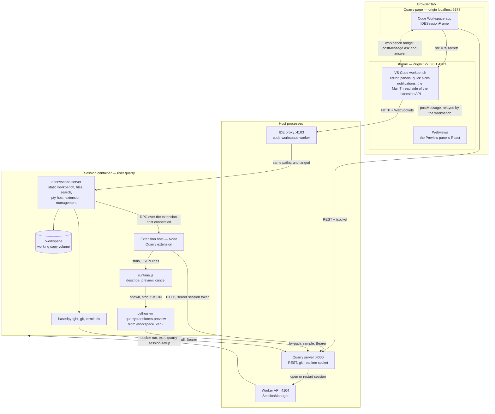

# The IDE: what runs in the browser, what runs in the container

_Written 2026-10-31 against the code as built (phase 5 of [forge-runtimes.md](../forge-runtimes.md): previews on the runtime). How the session's VS Code is split, what each half exposes, and every channel between the pieces — including the ones that don't exist._

VS Code in a session is **two halves of one program**. openvscode-server ships both: the **workbench** (the UI) runs in the browser, inside Quarry's iframe; the **server** (files, terminals, language servers, the extension host) runs in the session container. They talk over WebSockets through the worker's [IDE proxy](ide-proxy.md). Quarry's own page sits next to the workbench in the same tab; besides the iframe's URL, the only link between them is the [workbench bridge](workbench-bridge.md).

## The pieces and the channels

## What runs where

| Where | What | Process |
|---|---|---|
| **Browser, Quarry's origin** | The Code Workspace app: the page around the IDE, `IDESessionFrame` asking for the session's URL | React app (Vite, `:5173`) |
| **Browser, the IDE's origin** | The **workbench**: rendering the editor, file tree, panels, quick picks, notifications, menus; the browser half of every `vscode.*` call (`showQuickPick` is drawn here) | VS Code's JS, served by openvscode-server through the proxy |
| **Browser, nested iframes** | **Webviews**: the Preview panel (`webviews/preview/main.tsx`) | Their own iframes, created by the workbench |
| **Container** | **openvscode-server**: serves the workbench, reads and writes `/workspace`, search (ripgrep), terminals (pty host), installs extensions | Node, as `quarry` |
| **Container** | **Extension host**: every extension, including Quarry's — lenses, hover, diagnostics, commands, the Preview panel's logic | Node, a child of openvscode-server |
| **Container** | **Language servers and tools**: basedpyright, git, the shells behind terminals | Their own processes |
| **Container** | **The runtime** and the Python it spawns | Node (`runtime.js`), then Python from the working copy's `.venv` |

## The channels

| Between | Channel | Carries | Code |
|---|---|---|---|
| Quarry page → workbench | The iframe's `src` | The session's URL | `CodeWorkspaceSDK/ui/IDESessionFrame.tsx` |
| Workbench ↔ Quarry page | `postMessage`, through the [workbench bridge](workbench-bridge.md) | The IDE asking the page (`quarry.workbench.pickResource`: `quarry:ask`, `quarry:answer`); the page executing the extension's Preview and Build in the IDE (`quarry:execute`, `quarry:executed`); `quarry:hello` first | `quarry-bridge.js`; `CodeWorkspaceSDK/actions/workbench.ts` |
| Quarry page ↔ server | REST; WebSocket `/socket` | Opening the session; live events (check runs) | `CodeWorkspaceSDK`, `RealtimeSDK` |
| Workbench ↔ openvscode-server | HTTP and WebSockets, through the IDE proxy | Static assets; a **management connection** (files, search, terminals, extension management — VS Code's IPC channels); an **extension host connection** (the extension API's RPC) | [ide-proxy.md](ide-proxy.md) |
| Workbench ↔ extension host | VS Code's RPC (`MainThread*` in the browser ⇄ `ExtHost*` in the container), over the extension host connection | Every `vscode.*` call that touches the UI: an extension asks, the workbench draws and answers | VS Code |
| Workbench ↔ webview | `postMessage` between frames; the workbench relays to the extension host | The Preview panel's messages (`domain/PreviewMessage.ts`) | `preview-view.ts`, `webviews/preview/` |
| Extension host → Quarry server | HTTP, `Bearer` from `~/.quarry/session.json` | Resolving references (`by-path`, `path`) | `quarry.ts` |
| Extension host ↔ runtime | stdio, one JSON line per message (`Stdio`) | `describe`, `preview`, `cancel`; the runtime's `ready` and `log` events | `session-runtime.ts`, `pipeline.ts`; `code-workspace-runtime/src/preview.controller.ts` |
| Runtime → Python | spawn; the result JSON on stdout | One preview, or the transform list | `preview.controller.ts` |
| Python → Quarry server | HTTP, `Bearer` (the session's token, in its env) | Resolving inputs, downloading samples | `quarry/transforms/preview.py` |
| git → Quarry server | git over HTTP, `Bearer` | Clone, pull, push | [sessions.md](sessions.md) |
| Worker → container | `docker run`, `docker exec` | Starting it; `quarry-session-setup` (clone, venv, `session.json`) | `session-manager.ts` |

## What each side exposes

**The workbench (browser)**

- **To the person:** the UI.
- **To extensions:** the browser half of the extension API — `window.*` (quick picks, input boxes, messages, status bar), editors and decorations, webview hosting, `env.clipboard`, `env.openExternal` (always a new tab). Extensions don't see the browser: each call is an RPC the workbench answers.
- **Commands that ask Quarry's page:** VS Code's embedder `commands`, which the IDE image patches into openvscode-server's bootstrap — `quarry.workbench.pickResource`. See [workbench-bridge.md](workbench-bridge.md).
- **To Quarry's page:** only those commands' messages. It's another origin, so the page can't reach into it otherwise.

**openvscode-server and the extension host (container)**

- **HTTP on the session's path** (`/s/<secret>/`, behind the proxy): the workbench's assets, `vscode-remote-resource` (files the editor shows), the WebSockets above. Guarded by the path's secret and VS Code's connection token.
- **To extensions:** the container half of the extension API — `workspace.fs`, documents, `languages.*` providers, commands, tasks, terminals — plus all of Node (`fs`, `child_process`, `net`).
- **The Quarry extension contributes:** commands `quarry.preview`, `quarry.build` (picks a transform; building isn't wired up), `quarry.openInQuarry`, `quarry.useRid`; code lenses, hovers and diagnostics on dataset references; the Preview panel. See [extension.md](extension.md).
- **The runtime exposes:** `CodeWorkspace.Runtime` — `describe`, `preview`, `cancel` — to whoever starts it (here the extension; in a job container, Forge's `run` to the ForgeAgent).

## What isn't there

- **The page executes only what's listed.** Through the [bridge](workbench-bridge.md) it can run the extension's Preview and Build; opening a file or revealing a line would be more commands, not there yet.
- **No socket in the extension.** It only makes HTTP requests; it doesn't listen to Quarry's realtime events.
- **Builds from the IDE.** `quarry.build` stops after the pick; Forge's `createBuild` isn't called from the IDE or the app.
