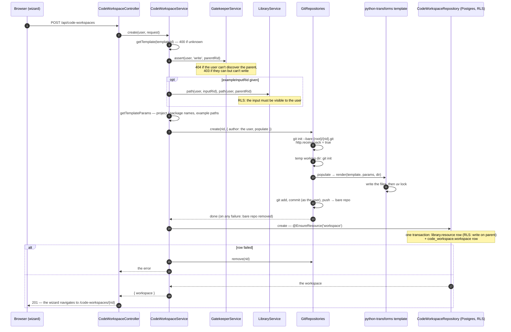

# Creating a Code Workspace

`POST /api/code-workspaces` — from the "New workspace" wizard (`CodeWorkspaceSDK.dialogs.openCreateWorkspace`).

```jsonc
{
  "parentRid":       "ri.library.main.project.…",   // where it goes
  "name":            "Sales cleaning",
  "description":     null,
  "templateId":      "python-transforms",
  "exampleInputRid": "ri.catalog.main.dataset.…"    // optional: the example transform reads it
}
```

## The flow

The repository is built **before** the database row, because building it is the expensive, external part (it runs `uv lock` against PyPI). So write on the parent is asserted up front — an unauthorised caller never gets that far — and a row that fails afterwards removes the repository again.



## What gets created

| Where | What |
|---|---|
| `library.resource` | the row: `rid` `ri.code-workspace.main.workspace.<uuid>`, `type = 'workspace'`, name, parent, `created_by` |
| `code_workspace.workspace` | `rid`, `type`, `template_id` (FK to the library row) |
| `<QUARRY_GIT_ROOT>/<rid>.git` | the bare repository, branch `main`, one commit by the user |

The commit's files (`templates/python-transforms.ts`):

```
pyproject.toml        # polars, duckdb; [tool.uv] package = false; [tool.basedpyright] standard
uv.lock               # from `uv lock` at creation
README.md
.gitignore
src/<package>/__init__.py
src/<package>/pipeline.py               # Pipeline().discover_transforms(datasets)
src/<package>/datasets/__init__.py
src/<package>/datasets/example.py       # the example transform (commented out without an input)
tests/test_example.py
```

Names come from `CodeWorkspace.Template.getProjectName` / `getPackageName` ("Sales cleaning!" → `sales-cleaning` / `sales_cleaning`; never starting with a digit). Paths come from `Library.Resource.getPath`. `quarry.transforms` isn't in the lock — it's preinstalled in the runtime image, which the workspace's `.venv` sees (`--system-site-packages`).

## Opening its page

`POST /api/code-workspaces/:rid/open { application: 'code-workspaces' }` — the route loader's call on entering the page (`CodeWorkspaceSDK.actions.workspace.open`): the workspace and the audit `open` (which feeds Recents) in one transaction. Opening the **session** is a separate request — see [sessions.md](sessions.md).
