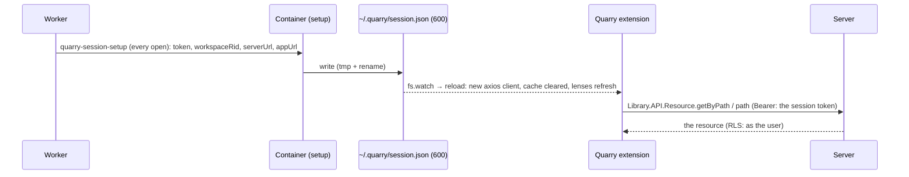
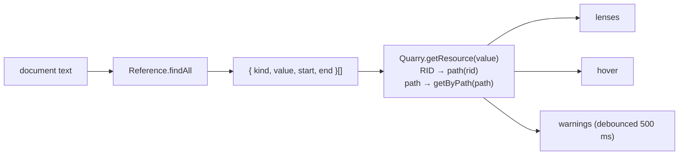

# The Quarry VS Code extension

`packages/code-workspace-extension` — preinstalled in every session (the IDE image installs its `.vsix`). It gives Quarry a voice **inside** the editor, which the page can't have: the IDE is a cross-origin iframe, so the page can't read or drive it.

## What it does (version 1)

| Feature | File | Behaviour |
|---|---|---|
| Lens above each `Input(…)` / `Output(…)` | `features/lenses.ts` | what it points to — `name · type · /location` (click: open in Quarry) — and **Use RID** for a path; "New dataset — the first build creates it" for an output that doesn't exist; "Not found" for an input |
| Use RID | `features/commands.ts` | replaces the path with the RID, keeps the path as a `# comment` at the end of the line |
| Hover card | `features/hover.ts` | name, type, location, description, updated, RID, "Open in Quarry" |
| Warnings | `features/diagnostics.ts` | an input that doesn't resolve; a reference to something that isn't a dataset |
| Open in Quarry | `features/commands.ts` | a new tab on `<appUrl>/library/<rid>` — Library redirects to the app that opens it |
| Pick from the Library | `features/links.ts`, `features/commands.ts` | ⌘/Ctrl+click a reference's string: Quarry's Library selector opens on the page, the pick becomes the RID with its path as the comment ([workbench-bridge.md](workbench-bridge.md)) |
| Build | `features/build.ts` | pick a transform, then build it **as of its last commit**: uncommitted changes → a warning first (they're left out; *Build last commit* or cancel); `git push` (unpushed commits run the checks); wait for that commit's check run — it must pass and publish; the transform's outputs → dataset RIDs (by path, or as written); `Forge.API.createBuild` (`manual`, the current branch); follow the build in a progress notification until it succeeds or fails (with the failed jobs' messages). Each job clones the repository at the published commit. Also Quarry's navbar Build, through the bridge |
| Themes | `themes/`, `features/theme.ts` | **Quarry Light** / **Quarry Dark** (Modern, with Quarry's palette); Quarry Light made the user's theme once, if they haven't chosen one |

## How it reaches Quarry



`Quarry` (`src/quarry.ts`) holds the client and a 30-second cache per reference value (a failed lookup isn't cached). It uses the shared contracts (`@quarry/shared/domain`) — bundled with esbuild into `dist/extension.js`.

## Finding references

`domain/Reference.ts` — `Reference.findAll(text)` matches `Input(…)` / `Output(…)` whose first argument is a string literal (`"…"`, `'…'`, or `ref="…"`) and records the **offsets of the string's contents**, so lenses, hovers, warnings and Use RID all address exactly the text inside the quotes. `Reference.isRid` tells a RID from a path.



## Building it

```
npm run build:code-workspace-ide
  └─ npm run package --workspace=packages/code-workspace-extension
       └─ esbuild → dist/extension.js ; vsce package → dist/quarry-code-workspace.vsix
  └─ docker build … (the Dockerfile copies the .vsix and installs it)
```

Pinned: `@types/vscode` 1.109.0 (the image's VS Code is 1.109.5), `@vscode/vsce` 4.0.0, `esbuild` 0.28.2. The themes include VS Code's own Modern themes, copied unchanged with their MIT licence (`themes/vscode/`).

## Next on the same extension

Theme sync with Quarry's light / dark (the page → worker → a file the extension watches), the Quarry menu bar (the page's menu items run VS Code commands the same way), and a ▶ Preview lens above each `@transform` (results back to the page need a realtime event).
