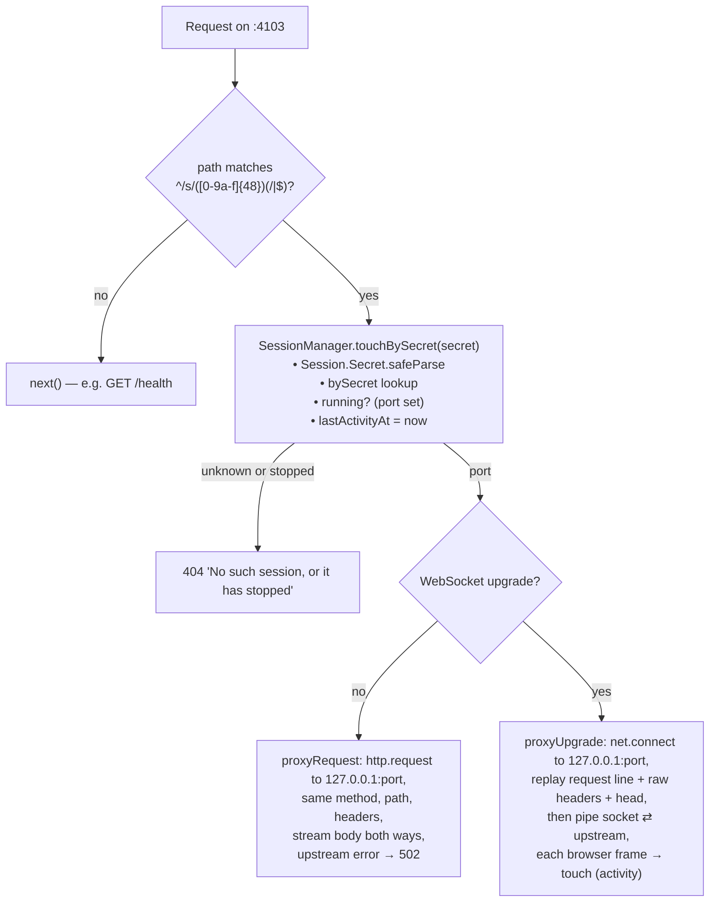
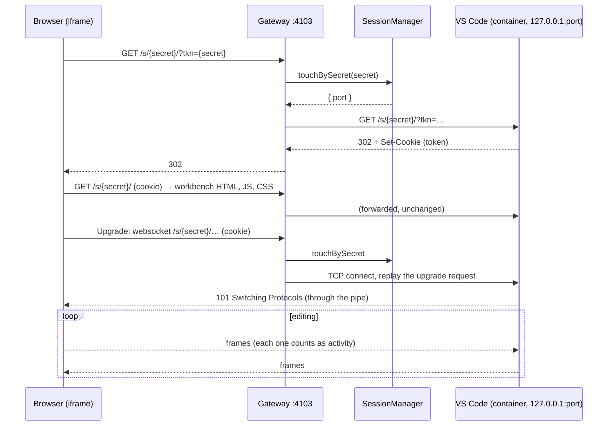

# The IDE gateway

The browser never talks to a session container directly — containers publish VS Code on `127.0.0.1` only. The code workspace worker's **gateway** (`code-workspace-worker/src/gateway.ts`, on `CODE_WORKSPACE_WORKER_PORT`, 4103) forwards each session's traffic.

It lives in the worker, not the API server, because Nest's WebSocket adapter in the server destroys every upgrade that isn't for its own paths (`/socket`) — VS Code's WebSockets couldn't pass through it. In production a reverse proxy would route a path (or host) to the worker.

## The URL

```
http://127.0.0.1:4103/s/<secret>/?tkn=<secret>
         gateway      └── path ──┘ └─ VS Code's connection token ─┘
```

- `/s/<secret>/` — VS Code runs with `--server-base-path /s/<secret>`, so it serves everything (pages, assets, WebSockets) under that path. The gateway forwards paths **unchanged**.
- `?tkn=<secret>` — VS Code's own check (`--connection-token`). The first request sets a cookie and redirects; after that the cookie carries it.

So the **secret is a capability**: whoever has the URL reaches that IDE, and it's handed out only by `POST /api/code-workspaces/:rid/session`, after Gatekeeper's `read` check. The gateway itself checks no Quarry login — it can't: an iframe can't send a Bearer header.

## A request





## Notes

- **Body parsing is off** in the worker (`NestFactory.create(…, { bodyParser: false })`), so request bodies stream through untouched.
- **Host and Origin are forwarded as sent.** VS Code sees the browser's own origin (`127.0.0.1:4103`) — the iframe is cross-origin to Quarry's page (`127.0.0.1:5173`), which is why the page can't reach into the editor (see [extension.md](extension.md)).
- **A stopped session's URL 404s.** The page's Reconnect re-runs the open (starting it again) and reloads the iframe with the returned URL — the same URL, since a session keeps its secret for the container's life.
- **One worker.** Sessions live in that worker's memory; several workers would need routing (sticky by session, or shared state). Not built.
