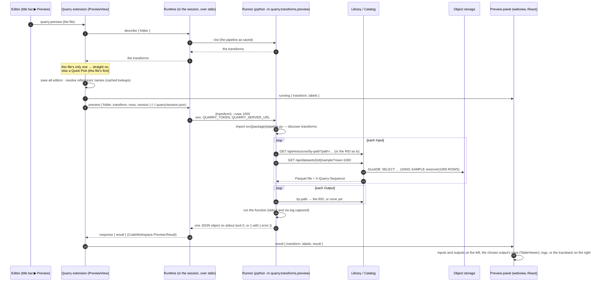
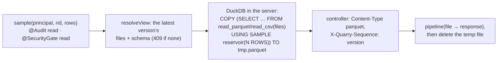

# Running a preview

**Preview** runs one transform **as it is in the working copy** — saved, not necessarily committed — on **samples** of its inputs, and shows its outputs in the IDE's **Preview** panel (bottom panel, beside Problems and Terminal). It writes nothing anywhere.

It all happens in the session: the **Quarry extension** (`code-workspace-extension`) asks the **code-workspace runtime** — the same one Forge's jobs run, started by the extension in the session's container and kept while the IDE is open ([forge-runtimes.md](../forge-runtimes.md), phase 5) — and the runtime runs the runner as a child process. Neither the server's Code Workspace API nor the worker takes part; only the runner's reads of the inputs reach Quarry, as the user.

## End to end

`features/DatasetTransformPreview/preview-view.ts` runs it (`DatasetTransformPreview/pipeline.ts` `runPreview`, through `session-runtime.ts`); `webviews/preview/main.tsx` is the panel; `domain/PreviewMessage.ts` is what they say to each other. The runtime's side is `code-workspace-runtime/src/preview.controller.ts` (calls `CodeWorkspace.Runtime.Describe` / `Preview` / `Cancel`). **Stop** sends `cancel`, and the runtime kills the runner; a new Preview replaces a running one. **Build** (beside Preview) picks a transform the same way (`features/transform-picker.ts`) — builds themselves aren't wired up yet.

## The runner

`transforms-python/src/quarry/transforms/preview.py`, run in the workspace's root:

1. **Find the pipeline** — `src/*/pipeline.py`, imported fresh (a new Python process per preview, so edits always apply). It must define `pipeline = Pipeline()`.
2. **Find the transform** by name — `module.function` (`sales_cleaning.datasets.example.example`).
3. **Sample each input** into a temporary directory — `QuarryClient.resolve` (a RID as is; a path via `by-path`) then `sample` (writes `sample.parquet`, returns the version).
4. **Prepare outputs** — `TransformOutput(rid, writer)`; `write_table` converts Polars / pandas / Arrow / DuckDB to an Arrow table and keeps it in memory.
5. **Call the function** with `TransformInput`s, `TransformOutput`s, and `ctx` if it takes one (`ctx.duckdb()` registers each input as a view). `print` and `ctx.log` go to `logs`, never stdout.
6. **Check** every output was written.
7. **Print** `{ transform, inputs: { name: { rid, sequence } }, outputs: { name: { columns, rows (≤ 1000), rowCount } }, logs }`. Column types are mapped from Arrow to Quarry's (`integer`, `long`, `double`, `boolean`, `date`, `timestamp`, `decimal(p,s)`, `binary`, `string`).

A transform that **raises** (or a pipeline that doesn't import) prints `{ error: { message, traceback } }` and exits 1. That's an **answer**, not a failed run: the panel shows the message and traceback. A run that fails itself (no output, the session not connected yet) shows as an error in the panel.

`--list` prints the declared transforms instead — what Preview's and Build's pickers show, read each time one opens.

## The sample

`GET /api/datasets/:rid/sample?rows=` (`CatalogStorage.sample`, `catalog.controller.ts`):

Sessions can't read storage themselves — they hold no storage credentials, and a dataset's version and schema live in Postgres. **Cost**: a reservoir sample scans the whole dataset, on every preview, in the server process. Fine at today's sizes; the planned fix is a per-version cached sample with block (`system`) sampling — see transforms.md.

## Timeouts

| Step | Limit |
|---|---|
| The extension listing transforms (`--list`) | 1 min |
| The extension waiting for a preview | 5 min, then the process is killed |
| Runner's HTTP calls to Quarry | 120 s each |

## Known issue

Inside VS Code's webview, scrolling the Preview panel's table can leave rows blank (Blueprint's table, rendering only part of the viewport). Not reproducible outside the webview; not fixed yet.
