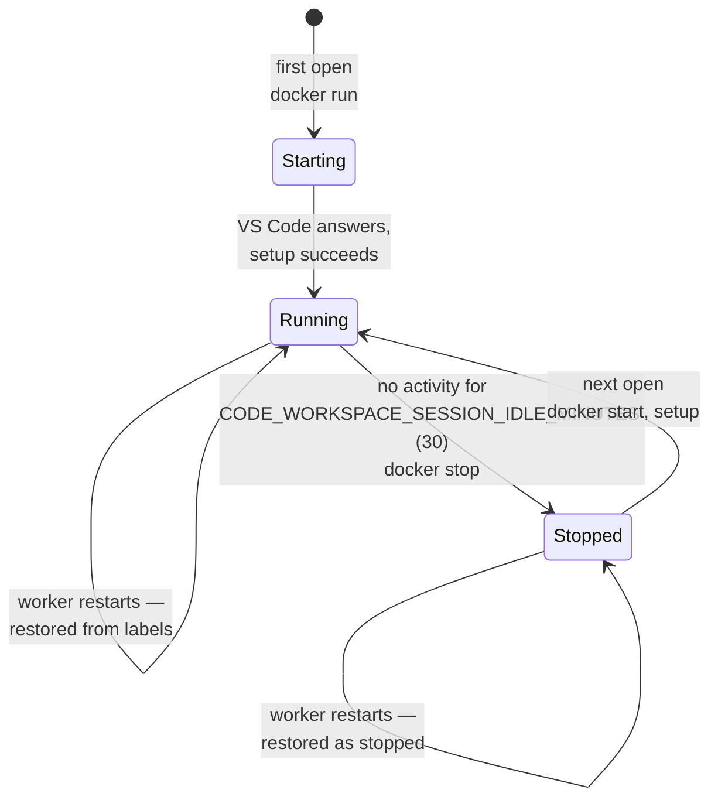
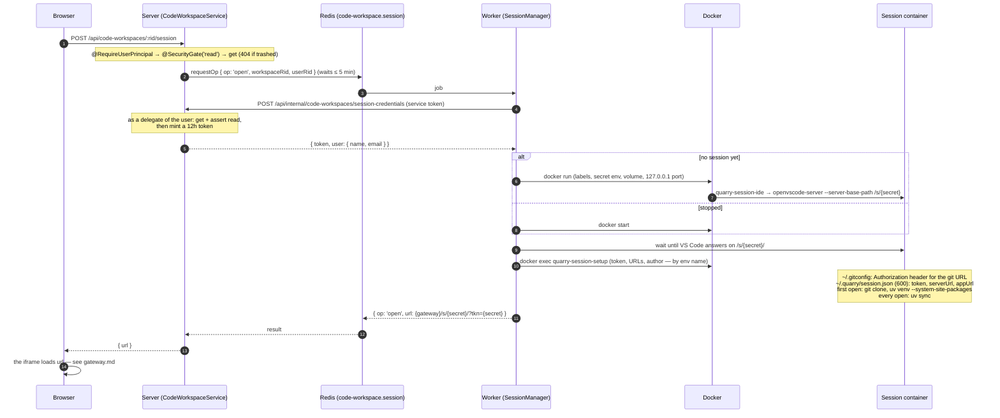
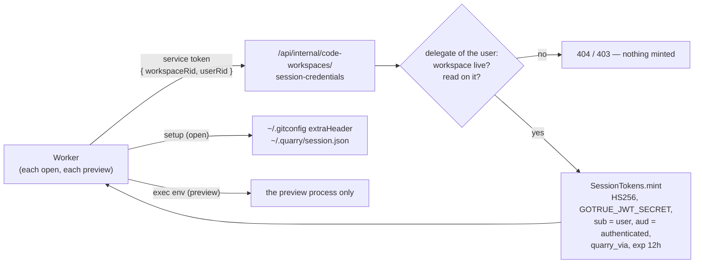

# Sessions

A **session** is one user's container on one workspace — the computer behind their open IDE. Only the code workspace worker knows sessions: in memory (`SessionManager`) and on their containers' Docker labels. Nothing about them is in Postgres.

| | |
|---|---|
| Identity | `Session.Key` = `<workspace rid>\|<user rid>` (`code-workspace-worker/src/domain/Session.ts`) |
| Container | `quarry-code-workspace-session-<workspace uuid>-<user uuid>`, from `CODE_WORKSPACE_RUNTIME_IMAGE` |
| Volume | same name, mounted at `/workspace` — the working copy (`/workspace/repo`) and uv's cache survive stops |
| Secret | 48 hex characters (`Session.createSecret`) — the IDE's path `/s/<secret>/` and VS Code's connection token |
| Port | VS Code's 3000, published on `127.0.0.1:<random>` only |
| Limits | `CODE_WORKSPACE_SESSION_MEMORY` (4g), `CODE_WORKSPACE_SESSION_CPUS` (2) |
| Labels | `quarry.code-workspace-session=true`, `.workspace`, `.user`, `.secret` (`Session.toLabels`) |

## Lifecycle

A stopped session keeps its container and volume, so uncommitted files are there on the next open. Nothing removes containers or volumes yet (trashing a workspace doesn't either).

## Opening one

`POST /api/code-workspaces/:rid/session` → the IDE's URL. The page calls it through `CodeWorkspaceSDK.query.session(rid)` once it has rendered; the iframe loads the URL.

Two opens of the same session at once share one in-flight open (`SessionManager.opening`). Reopening a running session is ~0.1 s: no container work, only setup (which refreshes the token).

## The credential

Everything in the container that calls Quarry acts **as the user**, with a token the server mints for the session:

Lifetimes: each token works 12 hours. Git's and the extension's copy is refreshed on every open (including Reconnect); a preview's copy is minted for that one run. See [authorization.md](authorization.md) for what the token can reach.

## After a worker restart

On boot the worker lists every container labelled `quarry.code-workspace-session` and rebuilds each session through `Session.fromLabels` (schema-validated; a container with bad labels is skipped): running ones get their current host port and keep serving, stopped ones start on their next open. Every restored session's idle clock starts at the restart.

## Idle stop

Every minute, any running session whose `lastActivityAt` is older than the idle limit is stopped. Activity is: an open, a preview or transforms listing, and **every gateway request or WebSocket frame from the browser** (`SessionManager.touchBySecret`) — so an open IDE tab keeps its session alive; a closed one lets it stop.
