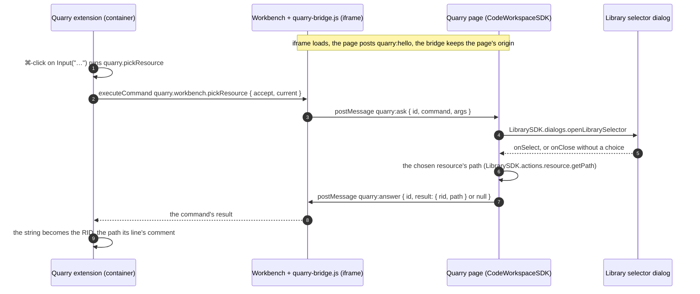
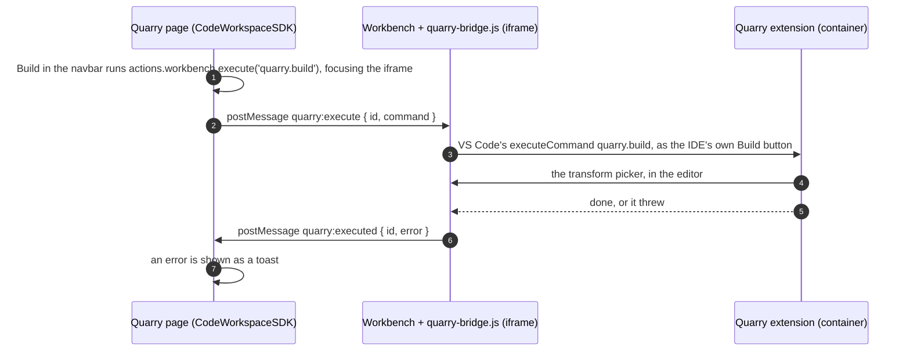

# The workbench bridge

_Built 2026-10-31. How the session's VS Code and the Quarry page around it talk, both ways: the IDE asks the page (a dataset picked in the Library selector) and gets the answer as a command's result; the page executes the extension's commands in the IDE (Preview, Build — their pickers open in the editor). The pieces it connects are in [client-and-server.md](client-and-server.md)._

The IDE runs in Quarry's iframe on another origin, and its extensions run in the container, so nothing in VS Code can reach Quarry's page by itself. The bridge is a script in the workbench's page — the part of VS Code running in the browser — that talks to the parent page by `postMessage`:

- **The IDE asks the page:** a few **commands registered in the workbench**, whose handlers ask the page. An extension calls one like any command and awaits its result.
- **The page executes in the IDE:** the page names one of the extension's commands; the bridge runs it with VS Code's own `executeCommand` and reports when it has finished.

## A pick, end to end

## Preview or Build from Quarry's page

## The pieces

| Piece | What it does | Code |
|---|---|---|
| **The messages** | `CodeWorkspace.Workbench`: `Hello`; `Ask` and `Answer` (the IDE asks the page); `Execute` and `Executed` (the page executes in the IDE). Under `Command`, each command's namespace: `Command.PickResource` (`COMMAND`, `Request`, `Response`, `Ask`), `Command.Preview` and `Command.Build` (`COMMAND`, `Execute`). `Ask` and `Execute` are unions discriminated on `command` | `shared/domain/CodeWorkspace/Workbench.ts` |
| **The bridge** | Runs in the IDE's page before the workbench. Defines `globalThis.quarryWorkbenchCommands`: each handler posts `quarry:ask` to the parent and resolves with the matching `quarry:answer`. On `quarry:execute` for a command in its `EXECUTABLE` list (Preview, Build), runs it with `globalThis.quarryExecuteCommand` and posts `quarry:executed`. Accepts messages only from `window.parent`, and after hello only from that origin | `docker/code-workspace-ide/workbench/quarry-bridge.js` |
| **The patch** | At image build: copies the bridge next to the workbench, loads it from `workbench.html` before `workbench.js`, makes the bootstrap pass `commands: globalThis.quarryWorkbenchCommands` to VS Code's `create()` — the embedder option openvscode-server doesn't expose — and puts the web API's `commands.executeCommand` on `globalThis.quarryExecuteCommand`. Matches each minified spot by shape and **fails the build** unless each matches exactly once | `docker/code-workspace-ide/workbench/patch-workbench.py`, the IDE `Dockerfile` |
| **The extension** | `ReferenceLinks`: every `Input`/`Output` string is a link (⌘/Ctrl+click) to `quarry.pickResource`, which calls the workbench command, then replaces the string with the RID and puts the path in the line's comment (replacing an older path comment, never another comment). If the code changed under the link meanwhile, it does nothing | `code-workspace-extension/src/features/links.ts`, `features/commands.ts` |
| **The page** | `CodeWorkspaceSDK.actions.workbench.connect(frame)`: says hello on each load of the iframe, takes messages from that frame and origin only, and parses them as `Workbench.Ask` — a union discriminated on `command`, so a message naming any other command is dropped; `quarry:executed` settles the command it reports on. `handleWorkbenchEvent(ask)` (`CodeWorkspaceSDK/workbench-events.ts`) switches on the command: `pickResource` opens the Library selector and resolves with `{ rid, path }`, or `null` when it closes without a choice. `actions.workbench.execute(command)` focuses the iframe (the picker needs the keyboard), posts `quarry:execute` and resolves when the IDE reports back, showing an error as a toast | `CodeWorkspaceSDK/actions/workbench.ts`, `ui/IDESessionFrame.tsx` |
| **The buttons** | Preview and Build in the workspace's navbar, on the Code tab — `execute('quarry.preview')`, `execute('quarry.build')`. They act as the IDE's own: the picker opens in the editor, this file's transforms first | `apps/code-workspaces/routes/$rid/route.tsx` |
| **The selector** | Gained `onClose` — called however it closes, after `onSelect` when something was chosen | `LibrarySDK/dialogs/library-selector-dialog.tsx` |

## Decisions

- **In the browser, not through the server.** The question and the answer stay in the tab: workbench ⇄ page. No endpoint, no realtime event, and only the tab you clicked in reacts.
- **Hello, then one origin.** The page tells the IDE its origin after the IDE loads; the bridge sends questions only there, and takes answers only from its parent at that origin. The page, in turn, listens only to its own iframe at the session URL's origin. A bridge that hasn't heard hello (the IDE opened outside Quarry) rejects, and the extension says so.
- **Patching openvscode-server's bootstrap**, not serving our own workbench page: one regex on one call, guarded at build time. Each openvscode-server upgrade re-runs it; if the call's shape changed, the image build stops with the reason.
- **Executing, not any command:** the page can only name the commands `Workbench.Execute` lists, and the bridge only runs those in its `EXECUTABLE` — the protocol stays explicit, as `Ask` does.
- **Adding a command the IDE asks** is three places: its id in the bridge's `COMMANDS`; its namespace in `CodeWorkspace.Workbench.Command` (`COMMAND`, `Request`, `Response`, `Ask`), added to the `Ask` union and `Answer`'s result; and its case in `handleWorkbenchEvent` (`CodeWorkspaceSDK/workbench-events.ts`) — the switch covers the union, so a command without a case fails the typecheck.
- **Adding a command the page executes** is two: its namespace in `Command` (`COMMAND`, `Execute`), added to the `Execute` union; and its id in the bridge's `EXECUTABLE`.

## Verified

With the built IDE image, a throwaway extension calling `quarry.workbench.pickResource` on startup, and a headless browser loading the IDE in an iframe from a stand-in page on another origin (the page said hello and answered): the page received `{ accept: ['dataset'], current: '/Test/x' }`, and the extension got `{ rid, path }` back as the command's result; no page errors. Then executing: the stand-in page posted `quarry:execute` for `quarry.build`, the IDE's **Build** picker opened, and the page got `quarry:executed` with no error (the picker then said the pipeline couldn't be read — that test container has no working copy). The Library selector, the ref rewrite and the navbar's buttons in a real session are checked by hand.

**Cookies:** VS Code's connection token is a cookie set inside the iframe. Across sites (an IDE host unrelated to Quarry's) a browser blocking third-party cookies breaks the IDE itself, bridge or not; in dev `localhost` and `127.0.0.1` count as different sites, and Chrome allows it by default. In production, serve the IDE proxy on Quarry's site (a subdomain or a path) — see [ide-proxy.md](ide-proxy.md).
