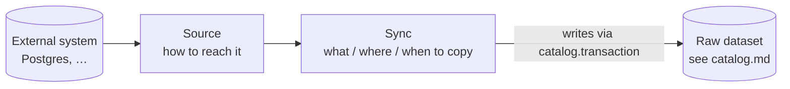

# Data Connection — Sources and Syncs

_Draft, 2026-10-18 (split from the 2026-10-13 datasets sketch). Tables are in [database.md](database.md#7-data_connection); queues in [jobs.md](jobs.md); permissions in [gatekeeper.md](gatekeeper.md); the datasets it writes in [catalog.md](catalog.md). Foundry background: [research notes](../research/palantir-foundry-ontology.md) §2–3._

Data Connection gets raw data from external systems into datasets. It's the **first layer** of the platform: transforms, ontology mapping and indexing come later and only consume the datasets it writes.



---

## 1. Model

| Thing | RID | Library resource? | What it is |
|---|---|---|---|
| **Source** | `ri.data-connection.main.source.…` | **yes** — in a folder, grants, trash | How to reach one external system |
| **Sync** | `ri.data-connection.main.sync.…` | no — belongs to its source | What to copy, into which dataset, how, when |
| **Sync run** | `ri.data-connection.main.sync-run.…` | no — belongs to its sync | One execution; each retry is its own run |
| Output dataset | `ri.catalog.main.dataset.…` | yes (Catalog's) | The raw dataset a sync writes |

Syncs and runs have RIDs because they're addressed from outside their tables (URLs, job payloads, the delegate's `via`, transaction provenance), but they aren't resources: no place in the tree, no grants of their own, no trash. Access to them is access to their source. See [database.md §2](database.md#2-resource-ids-rids).

### Source

A **stored configuration, not a live connection** — a connection is opened by the source's runtime when something needs it, and closed after ([§3](#3-source-definitions-and-runtimes)).

```ts
// shared/domain/DataConnection/Source.ts
Source {
  rid, name, description, parentRid, …,      // Resource.Base
  definitionId: "postgres",                   // which source type — see §3
  config: {},                                 // settings that aren't the login; validated against the definition's Config
  credentialRid: "ri.keychain.main.credential.…",   // the Keychain credential it logs in with (host, port, user, password…)
                                              // null iff the definition takes none — see keychain.md
  outputFolderRid: "ri.library.main.folder.…",      // where its syncs' datasets go by default — a project or folder;
}                                             // null: the source's own folder. A sync can still choose another.
```

Sources are connected from the **Data Connection app** ("New source" on its home), in a wizard: source type (searchable) → details (name, location, description) → connection (the definition's Config) → credential (only for a definition that takes one) → output folder.

### Sync and sync run

A **sync** is a configured, schedulable instruction (a noun, as in Foundry): *copy what this config describes, into this dataset, on this schedule.* Each execution is a **sync run** — the verb is "run".

```ts
// shared/domain/DataConnection/Sync.ts, SyncRun.ts
Sync {
  rid, sourceRid, name,
  config: { kind: "table", schema: "public", table: "tools", incrementalColumn: "updated_at" },
                                        // the source integration's sync Config (§3) — a union on `kind`
  outputDatasetRid,                     // a raw dataset, written only by this sync (UNIQUE)
  schedule: Cron | null,                // null = manual only
  enabled, createdBy, createdAt,
}

SyncRun {
  rid, syncRid, transactionRid,
  status: "running" | "succeeded" | "failed",
  stateFrom, stateTo,                   // opaque to everyone but the integration — e.g. a high-water mark
  rowCount, error,
  trigger: "manual" | "schedule", triggeredBy,
  startedAt, heartbeatAt, finishedAt,
}
```

### Snapshot or append, and state

The **integration decides** from the sync's config whether a run is a `snapshot` (replace the dataset's view) or an `append` transaction (`SyncDefinition.transaction(config)`). For Postgres: no `incrementalColumn` → snapshot; with one → append.

- **Snapshot** — re-copy everything. Simple, catches deletes, costly for big tables.
- **Append (incremental)** — copy only what's new since the last run. Fast; doesn't see deletes; the raw dataset accumulates every row version (useful history — the clean layer picks the latest per key).

What "since the last run" means is the integration's business: it returns a **state** string after each run (Postgres: the max of the incremental column), the server stores it as the run's `stateTo`, and the next run gets it back. A future S3 sync could keep the last file name, a REST sync a page token — nothing outside the integration interprets it.

### Raw-layer rule

A raw dataset is a **faithful copy**: same columns, same names, no cleaning. Interpretation happens downstream (transforms), so a bad cleaning rule is fixed by rebuilding — never by re-pulling from the source.

---

## 2. Processes and the credential boundary

Three packages, three processes, and a strict split:

| Package | Data Connection parts | Database | Source credentials |
|---|---|---|---|
| **server** | `DataConnectionService` + controllers: sources, syncs, enqueue runs, ask for probes — and the **run lifecycle** behind `/api/internal/…` (start, heartbeat, complete, fail, reap, scheduled syncs) | **yes — the only one** | stores them encrypted (Keychain); decrypts only to reveal |
| **data-connection-worker** | `src/processors.ts`: `SyncProcessor` (one run), `SourceProbeProcessor`; `src/infra.ts` (DuckDB, `SourceRuntimes` — decrypts the credential, the server client) | no | **decrypts them for runs and probes** |
| **system-worker** | `src/processors.ts`: `SyncReaperProcessor`, `Schedules` (reconcile on boot) — plus Catalog's outbox relay and storage GC | no | no |

The **Data Connection worker is the only process that reaches source systems**, and it **never touches Postgres**: everything about a run's rows, its dataset transaction and its permissions is a call to the server (`DataConnection.API.Internal`, service token `QUARRY_INTERNAL_TOKEN`).

**Credentials** are Keychain resources ([keychain.md](keychain.md)), stored as one blob encrypted with the workspace key `QUARRY_ENCRYPTION_KEY`. Using one needs **read** on it: when a source is created, and again — as the run's delegate, or the requester — every time the server hands it to the worker. The server sends it **still encrypted** (in `StartRun`'s response, in the probe job), and the worker decrypts it with the same key, checks it's of the definition's template, and parses it against the template's Fields. Credential values never sit in Postgres, Redis or a job payload in plain text.

Anything that touches a source from the server goes through the `data-connection.source-probe` queue as **request–reply** (`QueueManager.request`, 15 s timeout): test, explore. The job carries the source the server already loaded and permission-checked, and its credential, encrypted.

---

## 3. Source definitions and runtimes

Each external system is a **definition** (what it is) plus a **runtime** (how to talk to it), side by side in their own package — like PretzelGraph's `nodes` package with its Gateway definitions and sockets:

```
packages/integrations/                @quarry/integrations
├── definitions.ts           entry point — SOURCE_DEFINITIONS, CREDENTIAL_TEMPLATES, find…, toWire   API-safe: imports no runtime
├── runtimes.ts              entry point — SOURCE_RUNTIMES: definition id → runtime class  Data Connection worker only
├── core/
│   ├── definition.ts        SourceDefinition, defineSource, toWire, ConfigOf, CredentialOf
│   ├── credential.ts        CredentialTemplate, defineCredential, credentialToWire
│   ├── runtime.ts           abstract SourceRuntime, RuntimeContext (interfaces — no server dependency)
│   └── duckdb.ts            literal / identifier quoting
└── Postgres/
    ├── definition.ts        id, displayName, icon, capabilities, credential, Config (zod), sync
    ├── credential.ts        the Postgres credential template: host, port, database, user, password, ssl
    └── runtime.ts           PostgresRuntime extends SourceRuntime
```

The server imports `@quarry/integrations/definitions` only (validation, the definitions list, the credential templates). The Data Connection worker imports `@quarry/integrations/runtimes` and passes its `DuckDb` in as the `RuntimeContext` (`SourceRuntimes` in `data-connection-worker/src/infra.ts`). The server's build contains no runtime and no DuckDB.

**The definition** is data: metadata, capabilities (`explore`), its **credential template** (`credential: Credential` from `./credential.ts`, or `null` — like a PretzelGraph blueprint's `credentials`), its **sync** (`sync: defineSync({ Config, transaction })` — what a sync can copy, its Config a discriminated union on `kind`, rendered as one form where the `kind` switch mounts the fields), and its **Config as a zod 4 schema**, annotated with `.meta()` for forms — settings that aren't part of the login (Postgres has none yet). The API validates a new source's `config` against it and serves every definition at `GET /sources/definitions`, with Config converted to **JSON Schema** (`z.toJSONSchema`) — a client renders the form from that. A switch that mounts other inputs is a discriminated union (one per sub-object), which becomes `oneOf` with a `const` per option.

**The runtime** is one live connection to one source — an instance, created per use by `SourceRuntimes`, never by DI:

```ts
abstract class SourceRuntime<D extends SourceDefinition> {
  constructor(rid, config: ConfigOf<D>, credential: CredentialOf<D>, ctx: { duckdb })   // both typed by the definition
  open():  Promise<void>          // connect, with the decrypted credential values
  close(): Promise<void>          // idempotent
  sync(config, { destination, state }): Promise<{ rowCount, state }>   // switch on config.kind; write Parquet under destination
  explore?(): Promise<Table[]>    // iff capabilities.explore
}
```

| Use | Calls |
|---|---|
| sync run | open → `sync(config, run)` → close |
| test connection | open → close — opening is the test |
| list tables | open → explore → close |
| streaming (later) | open → stream … → close, kept alive by a registry |

`SourceRuntimes.with(source, credential, fn)` decrypts the credential, runs open → fn → close, closing even on failure, and refuses to boot if a definition has no runtime. **The boundary:** the API imports `definitions.ts` only; `runtimes.ts` (and with it drivers and DuckDB) is provided only in the Data Connection worker.

**Adding a system:** a folder in `packages/integrations` with `definition.ts` + `runtime.ts` (+ `credential.ts` if it logs in), one entry in `definitions.ts`, one in `runtimes.ts`. Its credential template joins the Keychain catalogue by being named on the definition. Later the same folder can hold its outbound pieces (writeback webhooks, exports).

The commit schema isn't asked of the source: after `read`, the Data Connection worker describes the Parquet it wrote (`describeParquet`, DuckDB), so every source type gets it for free.

### Postgres (the only source type so far)

A sync's config is `{ kind: "table", schema, table }` or `{ kind: "query", sql }`, each with an optional `incrementalColumn`.

Built on **DuckDB** (`@duckdb/node-api`): `open()` attaches the source read-only on a connection of its own (`ATTACH '…' (TYPE postgres, READ_ONLY)` under a random alias), `close()` detaches; `sync()` writes Parquet **straight to S3** — rows never pass through Node:

```sql
COPY (SELECT * FROM src.public.tools WHERE updated_at > $state)
  TO 's3://datasets/{datasetRid}/{transactionRid}/' (FORMAT parquet, PER_THREAD_OUTPUT true);
```

Type mapping (`parquet-schema.ts`, DuckDB's view of the written columns → `ColumnSchema.Type`): `DECIMAL(p,s) → decimal(p,s)`, small ints and `INTEGER → integer`, `BIGINT`/`HUGEINT → long`, `FLOAT`/`DOUBLE → double`, `BOOLEAN`, `DATE`, `TIMESTAMP* → timestamp`, `BLOB → binary`, everything else (`VARCHAR`, `UUID`, `JSON`, enums, arrays) → `string`.

Next source types: MySQL, S3/file drops, a generic REST source, Snowflake/BigQuery. DuckDB covers the database and file types; REST and SaaS sources need runtimes with their own clients.

---

## 4. Running a sync

### Triggering

- **Manual:** `POST /sources/:rid/syncs/:syncRid/run` → `runSync` checks write on the source (gate) **and** on the output dataset, checks the dataset is live, rejects a disabled sync, then enqueues `data-connection.sync` with `triggeredBy` = the user.
- **Scheduled:** BullMQ job schedulers, one per sync with a schedule (id = sync RID), `triggeredBy: null`. The server upserts the scheduler when a sync is created; the system worker reconciles them with `GET /internal/syncs/scheduled` on boot, healing a wiped Redis.
- **One run per sync at a time:** every producer passes `deduplication: { id: 'sync:<syncRid>' }`, and the unique index `sync_run_one_running` backs it in Postgres.

### Who a run acts as

The server decides, at every step: it loads the sync as `SELF`, then acts as a **delegate**: `Principal.onBehalfOf(triggeredBy ?? sync.created_by, 'sync:<syncRid>')`. Manual runs act for whoever pressed run; scheduled runs for the sync's creator. Gatekeeper checks a delegate exactly as that user — if they lose write on the dataset, or are deactivated, their runs stop. Failure cleanup runs as `SELF` so it always succeeds. The Data Connection worker never holds a principal.

### Run flow

| # | Data Connection worker (`SyncProcessor`, `data-connection-worker/src/processors.ts`) | Server (`DataConnectionService`, via `/api/internal/…`) |
|---|---|---|
| 1 | `POST /internal/sync-runs` `{ syncRid, trigger, triggeredBy }` | Load the sync (skip if missing or disabled) and its source as the delegate; decide snapshot/append from the integration and the sync's config; read the last run's `state`; insert the run (`running`); `catalog.transaction.open`; return source, sync config, state, destination (`s3://…/{dataset}/{transaction}/`) |
| 2 | Heartbeat every 30 s: `POST …/:runRid/heartbeat` | `heartbeat_at = now()` |
| 3 | Open the source's runtime → `sync(config, { destination, state })` → close: Parquet straight to the destination | — |
| 4 | Describe what was written: rows per key (footers), column schema | — |
| 5 | `POST …/:runRid/complete` `{ rowCount, state, schema, rowCounts }` | **List the prefix itself** (so nothing outside it can be registered), `registerChanges`, `commit(schema)`, mark the run succeeded |
| ✗ | Any failure: `POST …/:runRid/fail` `{ message }`, rethrow | Abort the transaction, fail the run (as `SELF`) |

BullMQ retries a failed job (3 attempts, exponential from 30 s); each attempt is a new run. The previous view stays current; storage GC deletes the aborted files.

If the output dataset (or its folder) is trashed mid-run, `registerChanges`/`commit` return 404 and the run fails and aborts ([catalog.md §3](catalog.md#3-the-write-protocol)).

### Lost workers

A worker that dies mid-run leaves a `running` run and an open transaction, which would block the next run. The system worker's **reaper** (every 2 min) calls `POST /internal/sync-runs/reap`; the server fails runs whose heartbeat is older than 5 min (`reason: 'worker lost'`) and aborts their transactions.

---

## 5. HTTP API (`DataConnection.API`)

| Route | Service | Gate |
|---|---|---|
| `GET /sources` | `source.list` — every live source the caller can see, across projects | `discover` (RLS) |
| `GET /sources/definitions` | `listDefinitions` | any member |
| `POST /sources` `{ parentRid, name, definitionId, config }` | `createSource` — 400 on an unknown type or invalid config | `write` on the parent folder |
| `GET /sources/:rid` | `getSource` | `discover` |
| `POST /sources/:rid/test` | `testSource` → probe | `read` |
| `GET /sources/:rid/explore` | `exploreSource` → probe | `read` |
| `POST /sources/:rid/syncs` `{ name, config, schedule, output: { parentRid, name } }` | `createSync` — 400 if the config doesn't match the integration's sync Config; creates the output dataset (write on its folder) and the sync | `write` on the source |
| `GET /sources/:rid/syncs` | `listSyncs` | `discover` |
| `POST /sources/:rid/syncs/:syncRid/run` | `runSync` | `write` on the source + the output dataset |
| `GET /sources/:rid/syncs/:syncRid/runs` | `listRuns` | `read` |

---

## 6. Not built yet

- **Updating, disabling or deleting a sync** (and keeping its scheduler in step — today only create upserts it).
- **Schema drift** — the run records the schema it found; nothing compares it with the previous view.
- **Source types beyond Postgres**; agents (connectors running inside a customer network) — `SourceRuntime` is transport-agnostic, so a runtime could run remotely later.
- **Outbound use** of sources (writeback, exports) — later, through the same source definition.
- **Permission failures still retry** — a delegate who lost access fails all 3 attempts; it should be an `UnrecoverableError`.
- **Changing a source's credential** — a source names its credential at creation only; the credential's *values* can change (Keychain).

---

## 7. Open questions

- **Deletes in append mode** — soft-delete column in the source, periodic snapshot reconciliation, or CDC (Postgres logical replication)?
- **Schema drift policy** — fail the run, auto-evolve, or record and warn? (Leaning: additive changes auto-evolve, type changes fail.)
- **What `discover` reveals** — `getSource` and `listSyncs` are gated on `discover`, so someone who can only see that a source exists also sees its host, database, user and the syncs' SQL. Should these need `read`, returning only the name at `discover`?
- **Large initial loads** — chunk by key range into one transaction, or several `append`s?
