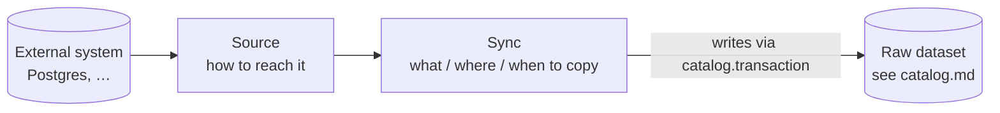

# Data Connection — Sources and Syncs

_Draft, 2026-10-18 (split from the 2026-10-13 datasets sketch). Tables are in [database.md](database.md#7-data_connection); queues in [jobs.md](jobs.md); permissions in [gatekeeper.md](gatekeeper.md); the datasets it writes in [catalog.md](catalog.md). Foundry background: [research notes](../research/palantir-foundry-ontology.md) §2–3._

Data Connection gets raw data from external systems into datasets. It's the **first layer** of the platform: transforms, ontology mapping and indexing come later and only consume the datasets it writes.



---

## 1. Model

| Thing | RID | Library resource? | What it is |
|---|---|---|---|
| **Source** | `ri.data-connection.main.source.…` | **yes** — in a folder, grants, trash | How to reach one external system |
| **Sync** | `ri.data-connection.main.sync.…` | no — belongs to its source | What to copy, into which dataset, how, when |
| **Sync run** | `ri.data-connection.main.sync-run.…` | no — belongs to its sync | One execution; each retry is its own run |
| Output dataset | `ri.catalog.main.dataset.…` | yes (Catalog's) | The raw dataset a sync writes |

Syncs and runs have RIDs because they're addressed from outside their tables (URLs, job payloads, the delegate's `via`, transaction provenance), but they aren't resources: no place in the tree, no grants of their own, no trash. Access to them is access to their source. See [database.md §2](database.md#2-resource-ids-rids).

### Source

A **stored configuration, not a live pool** — a connection is opened when something needs it (pooling is a runtime detail of the adapter).

```ts
// shared/domain/DataConnection/Source.ts
Source {
  rid, name, description, parentRid, …,                                     // Resource.Base
  settings:  { kind: "postgres", config: { host, port, database, user, ssl } },   // per kind; only postgres so far
  secretRef: SecretRef | null,          // an env var NAME, resolved by the sync worker only — never the credential
}
```

### Sync and sync run

```ts
// shared/domain/DataConnection/Sync.ts, SyncRun.ts
Sync {
  rid, sourceRid, name,
  target:  { kind: "table", schema, table } | { kind: "query", sql },
  mode:    { type: "snapshot" } | { type: "append", cursorColumn },
  outputDatasetRid,                     // a raw dataset, written only by this sync (UNIQUE)
  schedule: Cron | null,                // null = manual only
  enabled, createdBy, createdAt,
}

SyncRun {
  rid, syncRid, transactionRid,
  status: "running" | "succeeded" | "failed",
  cursorFrom, cursorTo, rowCount, error,
  trigger: "manual" | "schedule", triggeredBy,
  startedAt, heartbeatAt, finishedAt,
}
```

### Modes

- **Snapshot** — re-copy everything as a `snapshot` transaction. Simple, catches deletes, costly for big tables.
- **Append** — copy rows with `cursorColumn > lastCursor` as an `append` transaction; the run stores the new high-water mark in `cursorTo`. Fast; doesn't see deletes; the raw dataset accumulates every row version (useful history — the clean layer picks the latest per key).

### Raw-layer rule

A raw dataset is a **faithful copy**: same columns, same names, no cleaning. Interpretation happens downstream (transforms), so a bad cleaning rule is fixed by rebuilding — never by re-pulling from the source.

---

## 2. Processes and the credential boundary

The **sync worker is the only process that can reach source systems or read their credentials.** The API never holds a secret: `SecretResolver` is provided only in the sync worker, and secrets are env vars in its environment only.

| Process | Data Connection parts |
|---|---|
| **api** | `DataConnectionService` + controller: configure sources and syncs, enqueue runs, ask the sync worker to probe |
| **sync-worker** | `SyncProcessor` → `SyncRunner`; `SourceProbeProcessor`; adapters; `SecretResolver`; DuckDB |
| **system-worker** | `SyncScheduler` (reconciles schedules on boot), `SyncReaperProcessor` |

Anything that touches a source from the API goes through the `data-connection.source-probe` queue as **request–reply** (`QueueManager.request`, 15 s timeout): test, explore, shape.

---

## 3. Sources and adapters

```ts
// runtime/adapters/source-adapter.ts — sync worker only
interface SourceAdapter {
  kind
  test(source):                    Promise<void>                // can we reach it?
  explore(source):                 Promise<Table[]>             // list tables, for the UI
  shape(source, target):           Promise<ColumnSchema>        // columns → the dataset type system
  copy(source, target, options):   Promise<{ rowCount, cursorTo }>   // write Parquet under options.destination
}
```

`ResolvedSource` = the source with its secret resolved; it exists only inside the sync worker. `AdapterRegistry` picks the adapter by `settings.kind`.

### Postgres (the only adapter so far)

Built on **DuckDB** (`@duckdb/node-api`): it attaches the source read-only (`ATTACH '…' (TYPE postgres, READ_ONLY)` under a random alias), describes or reads it, and writes Parquet **straight to S3** — rows never pass through Node:

```sql
COPY (SELECT * FROM src.public.tools WHERE updated_at > $cursor)
  TO 's3://datasets/{datasetRid}/{transactionRid}/' (FORMAT parquet, PER_THREAD_OUTPUT true);
```

Type mapping (DuckDB's view of the Postgres type → `ColumnSchema.Type`): `DECIMAL(p,s) → decimal(p,s)`, small ints and `INTEGER → integer`, `BIGINT`/`HUGEINT → long`, `FLOAT`/`DOUBLE → double`, `BOOLEAN`, `DATE`, `TIMESTAMP* → timestamp`, `BLOB → binary`, everything else (`VARCHAR`, `UUID`, `JSON`, enums, arrays) → `string`.

Next adapters: MySQL, S3/file drops, a generic REST adapter, Snowflake/BigQuery. DuckDB covers the database and file kinds; REST and SaaS sources need hand-rolled adapters.

---

## 4. Running a sync

### Triggering

- **Manual:** `POST /sources/:rid/syncs/:syncRid/run` → `runSync` checks write on the source (gate) **and** on the output dataset, checks the dataset is live, rejects a disabled sync, then enqueues `data-connection.sync` with `triggeredBy` = the user.
- **Scheduled:** BullMQ job schedulers, one per sync with a schedule (id = sync RID), `triggeredBy: null`. The API upserts the scheduler when a sync is created; the system worker's `SyncScheduler` reconciles them with `data_connection.sync.schedule` on boot, healing a wiped Redis.
- **One run per sync at a time:** every producer passes `deduplication: { id: 'sync:<syncRid>' }`, and the unique index `sync_run_one_running` backs it in Postgres.

### Who a run acts as

The worker loads the sync as `SELF`, then acts as a **delegate**: `Principal.onBehalfOf(triggeredBy ?? sync.created_by, 'sync:<syncRid>')`. Manual runs act for whoever pressed run; scheduled runs for the sync's creator. Gatekeeper checks a delegate exactly as that user — if they lose write on the dataset, or are deactivated, their runs stop. Failure cleanup runs as `SELF('sync.cleanup')` so it always succeeds.

### Run flow (`SyncRunner.run`)

1. Load the sync (skip if missing or disabled); load the source as the delegate (fails if trashed or not visible).
2. Read `cursorFrom` (append mode) from the last successful run; insert the run (`running`); start a 30 s heartbeat.
3. `catalog.transaction.open` on the output dataset (`snapshot` or `append`, provenance `{ syncRid, syncRunRid }`); attach the transaction to the run.
4. `adapter.shape()` → the schema; `adapter.copy()` → Parquet parts under the transaction's storage prefix.
5. List the uploaded parts; row counts from the Parquet footers (DuckDB `read_parquet`).
6. `registerChanges` (one `add` per Parquet file), `commit(schema)`; mark the run succeeded with `cursorTo` and `rowCount`.
7. **Any failure:** abort the transaction, mark the run failed, rethrow. BullMQ retries (3 attempts, exponential from 30 s); each attempt is a new run. The previous view stays current; storage GC deletes the aborted files.

If the output dataset (or its folder) is trashed mid-run, `registerChanges`/`commit` return 404 and the run fails and aborts ([catalog.md §3](catalog.md#3-the-write-protocol)).

### Lost workers

A worker that dies mid-run leaves a `running` run and an open transaction, which would block the next run. The system worker's **sync reaper** (every 2 min) fails runs whose heartbeat is older than 5 min (`reason: 'worker lost'`) and aborts their transactions.

---

## 5. HTTP API (`DataConnection.API`)

| Route | Service | Gate |
|---|---|---|
| `POST /sources` `{ parentRid, name, settings, secretRef }` | `createSource` | `write` on the parent folder |
| `GET /sources/:rid` | `getSource` | `discover` |
| `POST /sources/:rid/test` | `testSource` → probe | `read` |
| `GET /sources/:rid/explore` | `exploreSource` → probe | `read` |
| `POST /sources/:rid/syncs` `{ name, target, mode, schedule, output: { parentRid, name } }` | `createSync` — creates the output dataset (write on its folder) and the sync | `write` on the source |
| `GET /sources/:rid/syncs` | `listSyncs` | `discover` |
| `POST /sources/:rid/syncs/:syncRid/run` | `runSync` | `write` on the source + the output dataset |
| `GET /sources/:rid/syncs/:syncRid/runs` | `listRuns` | `read` |

---

## 6. Not built yet

- **Updating, disabling or deleting a sync** (and keeping its scheduler in step — today only create upserts it).
- **Schema drift** — the run records the schema it found; nothing compares it with the previous view.
- **Adapters beyond Postgres**; agents (connectors running inside a customer network) — the adapter interface is transport-agnostic so it can run remotely later.
- **Outbound use** of sources (writeback, exports) — later, through the same source definition.
- **Permission failures still retry** — a delegate who lost access fails all 3 attempts; it should be an `UnrecoverableError`.
- **Vault-backed secrets** — `SecretResolver` reads env vars for now.

---

## 7. Open questions

- **Deletes in append mode** — soft-delete column in the source, periodic snapshot reconciliation, or CDC (Postgres logical replication)?
- **Schema drift policy** — fail the run, auto-evolve, or record and warn? (Leaning: additive changes auto-evolve, type changes fail.)
- **What `discover` reveals** — `getSource` and `listSyncs` are gated on `discover`, so someone who can only see that a source exists also sees its host, database, user and the syncs' SQL. Should these need `read`, returning only the name at `discover`?
- **Large initial loads** — chunk by key range into one transaction, or several `append`s?
