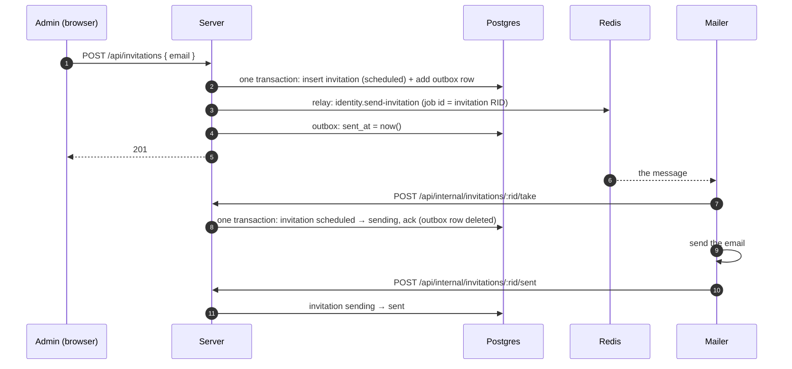

# Durable queues

_Design, 2026-10-28. Nothing here is built yet. Related: plain queues, [jobs.md](jobs.md); the hand-built ones this replaces — Forge's run-job ([forge.md](forge.md) §4), Code Workspaces' run-check ([code-workspaces/checks.md](code-workspaces/checks.md) §3) and Catalog's event outbox ([catalog.md](catalog.md))._

A **durable queue** is a BullMQ queue whose messages can't be lost. A message is first written to **the outbox** — one Postgres table for the whole platform — in the same transaction as the change that calls for it; then **relayed** to Redis. It stays in the outbox until the consumer **acknowledges** it, so if Redis loses it, or the server dies before sending it, it's sent again. It's the transactional outbox pattern, written once.

A domain declares a durable queue, **adds** a message inside its transaction, and **acks** it where the consumer takes the work. The outbox table, the relay, the sweep and its timer are the platform's.

## 1. Why

Handing work from the server to another process takes two writes — the domain's row ("this invitation should be sent") and the message ("send it") — in two systems, with no transaction across them:

| What happens | Without a durable queue |
|---|---|
| The server dies after the row commits, before the message is sent | the work never happens |
| Redis restarts (it runs without persistence) | every waiting message is gone |
| A message is sent twice (a retry, a resend) | the work runs twice |

Forge and checks each solved it by hand, with delivery states on their own rows (`scheduled`, `queued`) — about ten pieces across four packages per queue, and two concerns in one column: *is this job running?* and *is its message in Redis?* Catalog solved it the textbook way, with its own `outbox` table. A durable queue is Catalog's shape, made generic: the domain's row says what the work is; the outbox says what's been delivered.

Plain queues stay plain: timers and cron (sweeps, sync schedules) and best-effort work (realtime events) don't need any of this.

## 2. The model

```
domain transaction ─────────────────────────────┐
  insert/update the domain's row                │ one commit
  durableQueues.add(queue, message, jobId) ─────┘──► foundations.outbox: a row, unsent
                                                         │
relay (fast path after the commit; sweep every minute) ──┤ send to Redis, then set sent_at
                                                         ▼
                                                      Redis ──► consumer (processor)
                                                         │
consumer's take step (the domain's, one transaction) ───┘ the domain's row moves on
                                                           + durableQueues.ack(queue, jobId) → the outbox row is deleted
```

### Vocabulary

| Word | Means |
|---|---|
| **add** | write a message to the outbox, inside the domain's transaction |
| **relay** | send outbox messages to Redis, then mark them sent (`sent_at`) |
| **sweep** | relay what's stale: never sent, or sent long ago and still not acknowledged |
| **ack** | the work was taken (or canceled): delete its outbox row |
| **queue** | the plain BullMQ queue a durable queue relays to |
| **processor** | the consumer (`@Processor`, as for any queue) |

### The rules

1. **Add in the same transaction as the change.** The message exists exactly when the change does.
2. **Send, then mark.** A crash in between leaves it unsent; it's sent again — under the same job id, so a message already in Redis isn't duplicated.
3. **One job id per piece of work** — per attempt, if the domain retries (`<rid>_<attempt>`). Adding it again while it's in the outbox does nothing; sending it again while it's in Redis does nothing.
4. **Ack where the work is taken, in that step's transaction.** The consumer's take moves the domain's row on (`scheduled → running`, once) and deletes the outbox row together. A duplicate message finds the row moved on and does nothing.
5. **Ack what's canceled.** Whatever ends the work before it's taken (a canceled build, a superseded check) deletes its outbox row too — else the sweep resends it forever, harmlessly but noisily.
6. **Sent but not acknowledged for too long → sent again.** Maybe lost; free if it wasn't (rule 3).

Delivery is at least once; taking is exactly once (rule 4). What happens after the work is taken — heartbeats, timeouts, retries — is the domain's: a durable queue guarantees delivery, not completion.

## 3. The pieces

### The table — `foundations.outbox`

```sql
CREATE TABLE foundations.outbox (
    id          bigint GENERATED ALWAYS AS IDENTITY PRIMARY KEY,
    queue_name  text NOT NULL,                  -- the durable queue's name: 'identity.send-invitation'
    job_id      text NOT NULL,                  -- BullMQ's job id
    payload     jsonb NOT NULL,                 -- the message, checked against the queue's job schema
    created_at  timestamptz NOT NULL DEFAULT now(),
    sent_at     timestamptz,                    -- last relayed; null = never
    sends       integer NOT NULL DEFAULT 0,     -- how often — a row resent many times is a missing ack
    UNIQUE (queue_name, job_id)
);

CREATE INDEX outbox_unsent ON foundations.outbox (created_at) WHERE sent_at IS NULL;
CREATE INDEX outbox_sent   ON foundations.outbox (sent_at)    WHERE sent_at IS NOT NULL;

-- Users only append (add runs in their transactions, under RLS); the relay and acks run as the system.
GRANT INSERT ON foundations.outbox TO quarry_user;
```

### Shared — `Foundations.DurableQueue`

```ts
export namespace DurableQueue {

    export interface Definition<Q extends Queue.Definition = Queue.Definition> {
        readonly name:             Q["name"]   // the queue's — one durable queue per queue
        readonly queue:            Q
        readonly staleSentMinutes: number      // sent this long without an ack: sent again
    }

    export const define = <Q extends Queue.Definition>(options: { queue: Q; staleSentMinutes?: number }): Definition<Q> => …
}
```

Each domain declares its own beside its queue: `<Service>.DurableQueue.<Name>`.

### Server — `packages/server/src/infra/durable-queue/`

| Piece | Nest pattern (as `@nestjs/bullmq`) | Does |
|---|---|---|
| `DurableQueueModule.forRoot()` | `BullModule.forRoot()` | global: `DurableQueues`, the relay, the sweep's service |
| `DurableQueueModule.registerQueue(def)` | `BullModule.registerQueue({ name })` | registers `def` with the relay (and its plain queue); provides it under `getDurableQueueToken(def.name)` |
| `@InjectDurableQueue(def)` | `@InjectQueue(name)` | a handle on one durable queue: `add`, `ack`, `relay` |
| `DurableQueues` | — | the same three, for any registered queue |
| `DurableQueueRelay` | — | sends, marks, logs; a send that fails stays unsent |
| `DurableQueueInternalController` | — | `POST /api/internal/durable-queues/sweep`; `POST …/:name/ack { jobId }` |

```ts
interface DurableQueue.Handle<Job> {
    /** Inside a @Transactional method: joins that transaction (as @EnsureResource does). Again with the same job id: nothing. */
    add(message: Job, options: { jobId: string }): Promise<void>
    /** Inside the take (or cancel) step's transaction: the outbox row goes. */
    ack(jobId: string): Promise<void>
    /** After the commit: send this queue's unsent messages now. Best effort — never throws. */
    relay(): Promise<number>
}
```

`add` outside a transaction throws: a message added on its own is a dual write again.

A row whose `queue_name` isn't registered (a removed queue, a typo) is logged as an error when the relay meets it, and left in the outbox — nothing is dropped.

### System worker — one sweep for all

One queue, `durable-queue.sweep`, one processor calling `POST /api/internal/durable-queues/sweep`, one schedule: every minute. The sweep relays every registered queue's stale rows (each by its own `staleSentMinutes`) and logs rows sent over ten times — a missing ack. Adding a durable queue adds nothing here.

### Acks without a take step

A consumer whose work has no domain row to move on (an event, a notification) acks through the generic endpoint, `POST /api/internal/durable-queues/:name/ack { jobId }`, after it's done — so a crash mid-work means the message comes back.

## 4. Example: sending invitation emails

An example from outside Forge and Code Workspaces: an admin invites someone by email; a **mailer** process sends it. The invitation must never be lost — and a resend must never send it twice.



### 1. The domain's table — its own states only

```sql
CREATE TABLE identity.invitation (
    rid         identity.invitation_rid PRIMARY KEY,
    email       text NOT NULL,
    invited_by  identity.user_rid NOT NULL REFERENCES identity.user(rid),
    status      text NOT NULL DEFAULT 'scheduled' CHECK (status IN ('scheduled', 'sending', 'sent', 'failed', 'canceled')),
    sent_at     timestamptz,
    failure     text,
    created_at  timestamptz NOT NULL DEFAULT now()
);
```

No delivery columns: `scheduled` means "may be sent" — whether its message is in Redis is the outbox's business.

### 2. Shared: the queue and its durable queue

```ts
// packages/shared/domain/Identity/queue.ts
export namespace Queue {
    export namespace SendInvitation {
        export const Job = z.object({ invitationRid: Invitation.Rid })
        export const Definition = Foundations.Queue.define({
            name:    "identity.send-invitation",
            job:     Job,
            result:  z.object({ status: z.enum(["sent", "failed", "skipped"]) }),
            options: { removeOnComplete: true, removeOnFail: true },
        })
    }
}

// packages/shared/domain/Identity/durable-queue.ts
export namespace DurableQueue {
    export const SendInvitation = Foundations.DurableQueue.define({
        queue:            Queue.SendInvitation.Definition,
        staleSentMinutes: 5,                                    // mail isn't urgent
    })
}
```

### 3. Server: add with the insert, ack with the take

```ts
// identity.module.ts
imports: [DurableQueueModule.registerQueue(Identity.DurableQueue.SendInvitation)],

// invitation.repository.ts
@Injectable()
export class InvitationRepository extends Repository(IdentityDB.database) {

    constructor(@InjectDurableQueue(Identity.DurableQueue.SendInvitation) private readonly sendInvitations: DurableQueue.Handle<Identity.Queue.SendInvitation.Job>) {
        super();
    }

    /** The invitation and its message, in one transaction. */
    @Transactional('user')
    public async create(principal: Principal.User, email: string): Promise<Identity.Invitation.Schema> {
        const row = await this.trx.insertInto('identity.invitation')
            .values({ rid: Identity.Invitation.createRid(), email, invited_by: principal.userRid })
            .returningAll().executeTakeFirstOrThrow();

        await this.sendInvitations.add({ invitationRid: row.rid }, { jobId: row.rid });

        return IdentityDB.Invitation.toDomain(row);
    }

    /** The mailer takes it — once: scheduled → sending, and its message acknowledged. Null if it's moved on. */
    @Transactional('service')
    public async take(principal: Principal.Service, rid: Identity.Invitation.Rid): Promise<Identity.Invitation.Schema | null> {
        const row = await this.trx.updateTable('identity.invitation')
            .set({ status: 'sending' })
            .where('rid', '=', rid).where('status', '=', 'scheduled')
            .returningAll().executeTakeFirst();

        if (row)
            await this.sendInvitations.ack(rid);

        return row ? IdentityDB.Invitation.toDomain(row) : null;
    }

    /** An admin withdraws it before it's sent — and its message goes too (rule 5). */
    @Transactional('user')
    public async cancel(principal: Principal.User, rid: Identity.Invitation.Rid): Promise<boolean> { … status → canceled, ack(rid) … }
}

// invitation.service.ts
public async invite(principal: Principal.User, email: string): Promise<Identity.Invitation.Schema> {
    const invitation = await this.repository.invitation.create(principal, email);

    await this.sendInvitations.relay();          // the fast path — best effort; the sweep catches what it misses

    return invitation;
}
```

### 4. The consumer

```ts
// packages/mailer/src/send-invitation.processor.ts
@Processor(Identity.Queue.SendInvitation.Definition.name, { concurrency: 4 })
export class SendInvitationProcessor extends JobProcessor<typeof Identity.Queue.SendInvitation.Definition> {

    protected async handle({ invitationRid }) {
        const taken = await Identity.API.Internal.takeInvitation(api, invitationRid).catch(ifConflict(null));

        if (!taken)
            return { status: 'skipped' };                 // a duplicate, or canceled

        try {
            await this.mail.send(taken.email, invitationEmail(taken));
            await Identity.API.Internal.invitationSent(api, invitationRid);
            return { status: 'sent' };
        }
        catch (error) {
            await Identity.API.Internal.invitationFailed(api, invitationRid, { message: String(error) });
            return { status: 'failed' };
        }
    }
}
```

### What the invitation queue didn't have to write

No delivery columns, no relay, no "what's undelivered" query, no sweep endpoint, processor or schedule. Its delivery story is one `add` beside its insert, one `ack` beside its take (and its cancel), and `relay()` after the commit.

### When things go wrong

| Failure | The outbox row | What repairs it |
|---|---|---|
| The server dies before the transaction commits | none — nor the invitation | the request failed; nothing to repair |
| The server dies after the commit, before relaying | unsent | the sweep sends it within a minute |
| Redis refuses the send (down) | unsent | `relay` logs it; the sweep sends it once Redis is back |
| The server dies after sending, before marking | unsent, message in Redis | the mailer takes it; the sweep's resend is ignored (same job id) or skipped by `take` |
| Redis restarts with the message waiting | sent, no ack | after 5 min the sweep sends it again |
| Every mailer busy for over 5 min | sent, no ack, message waiting | the resend is ignored (same job id) — no duplicate |
| Canceled before the mailer takes it | deleted by `cancel` | nothing to send; a message already in Redis is skipped by `take` |
| The mailer dies after `take`, before `sent` | gone (acked) | the domain's, not the durable queue's: `sending` too long → its own rule. Mail is at least once |

## 5. Moving Forge, checks and Catalog onto it

| | Forge — run-job | Code Workspaces — run-check | Catalog — dataset events |
|---|---|---|---|
| Domain states | `waiting → scheduled → running → …` — **`queued` and `queued_at` go** | `waiting → scheduled → running → …` (today's `queued` becomes `waiting`; dispatch's claim becomes **scheduling**) | — (events) |
| add | where jobs become `scheduled`: `initializeBuild` (roots), `_scheduleReadyChildren`, a retry (`<rid>_<attempt>`) | where a run becomes `scheduled` (its workspace free) | in the commit, as now |
| ack | `startJob` (take); `cancelBuild`, `failBuild` (cancel) | `start` (take); superseding a run (cancel) | the consumer, through the generic ack endpoint, once handled |
| Deleted | `ForgeRelayService`, `listToRelay`, `markQueued`, `forge.relay-sweep` (queue, processor, endpoint, schedule) | `CheckDispatcher`'s sending, `listUntaken`, the resend in the check sweep | `catalog.outbox`, its relay endpoints, `catalog.outbox-relay` (queue, processor, schedule) |
| Kept (the domain's) | the reaper (planned) | failing runs silent for 35 min | — |

The "one running check per workspace" index becomes `UNIQUE (workspace_rid) WHERE status IN ('scheduled', 'running')`. Builds and checks show `scheduled` where they showed `queued`.

## 6. Build order

1. `foundations.outbox`; `Foundations.DurableQueue`.
2. The server's `DurableQueueModule`, `@InjectDurableQueue`, `DurableQueues`, the relay, the internal endpoints (sweep, ack). Tests over a throwaway durable queue: add joins the transaction (rolled back → no row); add outside a transaction throws; relay sends then marks; same job id twice → one message; the sweep's two cases; ack deletes; a rolled-back take leaves the row; an unknown queue is logged, not dropped.
3. The system worker's `durable-queue.sweep`.
4. Forge onto it — its tests (graph, relay, events, agent API, e2e) passing, with `queued` gone.
5. Checks onto it — states renamed, scheduling in place of dispatch.
6. Catalog's events onto it.
7. Docs: jobs.md's rows; forge.md, catalog.md and checks.md point here.

## Decisions

| Decision | Choice |
|---|---|
| Name | **durable queue** — a queue whose messages survive; the outbox is how |
| Where delivery state lives | **one platform table**, `foundations.outbox` — not on the domain's rows |
| The message | stored whole (`payload`), checked against the queue's job schema on add and on send |
| Order | add in the transaction; send, then mark |
| Done | **ack** = delete the row, in the transaction that takes (or cancels) the work |
| Who sweeps | the platform: one endpoint, one processor, one schedule for every durable queue |
| Consumers | ordinary BullMQ processors; taking the work once is the domain's step, and acks there |
| Not covered | what happens after the work is taken (heartbeats, retries, timeouts) — the domain's |
