# Forge — Runtimes and delegates

_Design, 2026-10-29. **Phase 1 built 2026-10-29** (the plumbing, §8): the contract, the stdio transport, the code-workspace runtime and its image, the ForgeAgent running jobs in containers. Everything after it is design. Decided with the user: runtimes as Nest microservices over stdio; one container per job; inputs read through presigned URLs; one shared uv cache per ForgeAgent machine. Extends [forge.md](forge.md) §5 (ForgeAgents and job containers); preview today is described in [transforms.md](transforms.md)._

A **runtime** is what does a Quarry application's compute. Every application that produces recipes has one: Code Workspaces first, later Pipeline Builder and Data Connection. It runs inside a container, takes instructions over stdio, and is the one interface for everything that wants that application's compute — a ForgeAgent running a build job, the IDE running a preview, a check run listing transforms.

## 1. The pieces

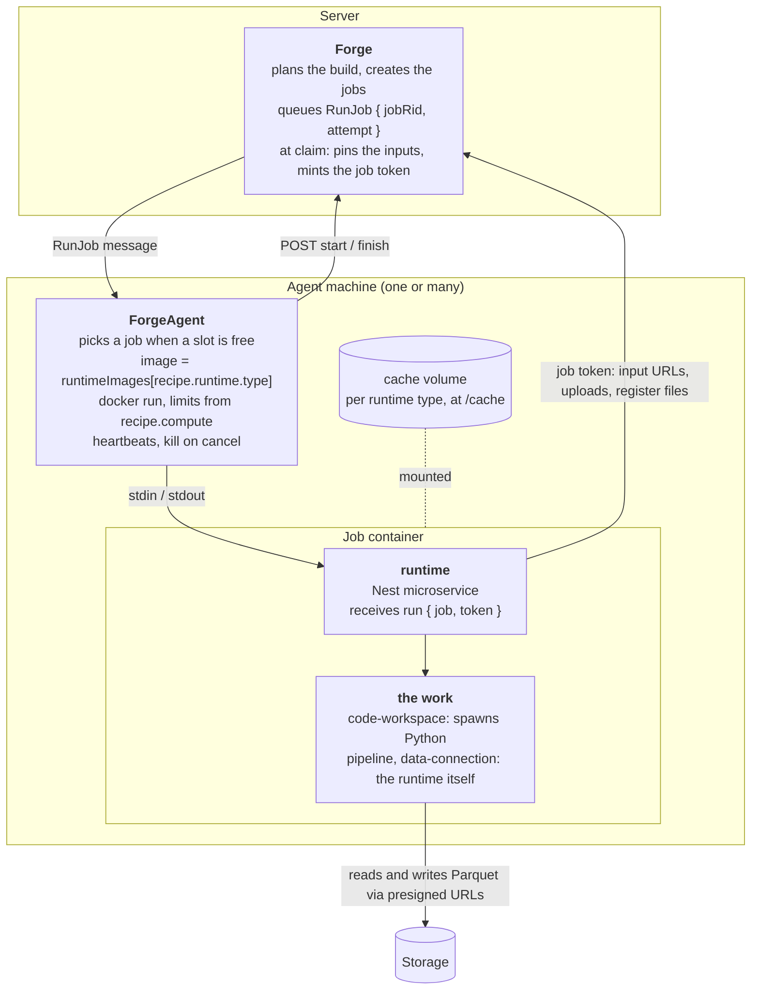

| Application | `recipe.runtime.type` | Runtime image | Does the work |
|---|---|---|---|
| Code Workspaces | `code-workspace` | `quarry/code-workspace-runtime` | spawns Python (`quarry.transforms`) per operation |
| Pipeline Builder (later) | `pipeline` | `quarry/pipeline-runtime` | itself: its engine |
| Data Connection (later) | `data-connection` | `quarry/data-connection-runtime` | itself: the sync |

Forge never knows a runtime's details. It plans, pins, locks, commits and aborts; the runtime is the application's.

### Runtime images

A recipe's `runtime` names the runtime that runs it (`type`) and holds what that runtime needs — for a workspace, `{ type: 'code-workspace', workspaceRid, commit, transform }`. The ForgeAgent has one map from type to image, and nothing else per application:

```ts
const runtimeImages: Record<Forge.Recipe.Runtime['type'], string> = {
    'code-workspace': 'quarry/code-workspace-runtime:<version>',
};
```

Everything else is the same for every runtime, so the ForgeAgent does it once: start the container (`docker run -i --rm`, limits from `recipe.compute`), mount the runtime type's **cache volume** at `/cache`, send `run` on stdin, turn `log` and `progress` into heartbeats, kill on stop, turn `done` into `finish`. A runtime uses `/cache` or ignores it — the code-workspace runtime keeps its uv cache there.

A new application adds one entry to the map and builds its runtime image; it writes no ForgeAgent code. An unknown type throws, and the job fails. If per-lock environment images come back, the value becomes a function of the recipe.

## 2. A job, end to end

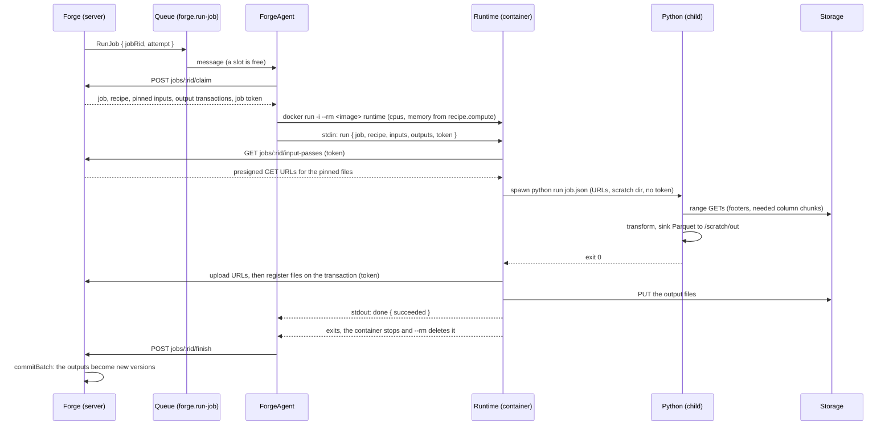

The message on the queue never carries the job or a credential: only `{ jobRid, attempt }`. Everything else comes from `claim` — the agent claims the job and the server grants it (scheduled → running, once per attempt) — when the inputs get pinned, and when the token is minted. A credential never waits in Redis.

## 3. Runtimes

### A Nest microservice over stdio

Every process has three pipes: **stdin** (input), **stdout** (output) and **stderr** (logs). Whoever starts a process holds its pipes: what the parent writes into the child's stdin, the child reads; what the child prints, the parent reads.

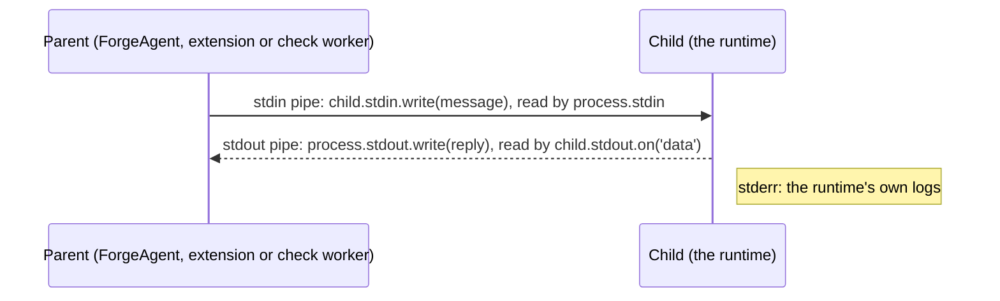

So the runtime needs no HTTP server and no port. It's a Nest microservice with a **custom transport** (Nest ships TCP, Redis, NATS, MQTT, RabbitMQ, Kafka and gRPC, and supports custom ones):

- **`Stdio`** (`packages/shared/domain/Stdio/Stdio.ts`) is the base, as `Realtime` is for events over Redis: `Stdio.Request.Base`, `Stdio.Response.Base`, `Stdio.Error`, `Stdio.Event` (`Ready`, `Log` — the transport's own), `Stdio.FromProcess`, `Stdio.PROTOCOL`, and `Stdio.Payload<M>` — a message without its envelope (`type`, `id`, `pattern`): what a handler returns and a caller passes.
- **A domain's calls extend it.** `Forge.Runtime.Run` (`packages/shared/domain/Forge/Runtime.ts`) is `Stdio.Request.Base.extend({ pattern: z.literal("run"), job, recipe })` and `Stdio.Response.Base.extend({ status, failure })` — fields directly on the message, as a domain's events sit on `Realtime.Event.Base`, so no `data` wrapper. A domain's fields never use the envelope's names (`type`, `id`, `pattern`, `event`). Code Workspaces' `describe` and `preview` will extend it the same way. `Forge.Recipe.Runtime` says which runtime a recipe uses; `Forge.Runtime` is what Forge asks of one.
- **`StdioServer`** (`@quarry/shared/server/stdio/stdio-server`), in the runtime: a `CustomTransportStrategy`, given the request schemas the runtime serves (`new StdioServer('code-workspace', [Forge.Runtime.Run.Request])`). It reads stdin a line at a time, parses each line whole against the schema of its pattern (the envelope only says which) before the `@MessagePattern` handler gets the request, and writes the handler's payload as the response — or the error — to stdout. `sendEvent({ event: 'log', stream, line })` writes an event.
- **`StdioClient`** (`…/stdio/stdio-client`), for whoever started the runtime — the ForgeAgent now, the extension and the check worker later: `request(Forge.Runtime.Run, { job, recipe })` sends the payload with the call's pattern and returns the parsed response; `log` events go to a callback. If the runtime exits, everything still waiting fails with its exit code; a line that breaks the protocol kills the runtime and fails what's waiting with the reason, never the caller's own process.

```ts
const app = await NestFactory.createMicroservice(RuntimeModule, {
    strategy: new StdioServer('code-workspace', [Forge.Runtime.Run.Request]),
    logger:   ['error'],                                  // Nest logs below error to stdout
});

@Controller()
export class RuntimeController {
    @MessagePattern('run') run(@Payload() request: Forge.Runtime.Run.Request) { … }   // built: returns Stdio.Payload<Run.Response>
    // later: describe (the transforms), preview, cancel
}
```

One JSON message per line, each with its `type`:

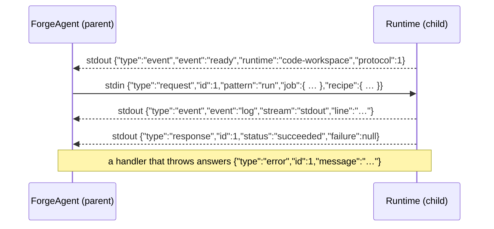

**`ready` comes first.** The runtime says which runtime it is and which protocol it speaks; the caller refuses anything else (`waitUntilReady`). It's also the "booted" signal: the caller sends nothing before it. The images are pinned to the agent's release (`FORGE_AGENT_RUNTIME_TAG`), so for jobs a mismatch only happens when something is pinned wrong; the IDE's long-lived runtime is where the check really matters.

stdout is only for protocol messages. The runtime's own logs go to stderr (`System.log.useStderr()`), and so does Nest's, at error level only. A closed stdin means stop: the runtime exits, even mid-request.

### Who starts it, and for what

| Caller | Starts it with | Sends | Lifetime |
|---|---|---|---|
| ForgeAgent | `docker run -i --rm <image> runtime` | one `run` | the job's: one job per container |
| IDE (the extension) | spawn, inside the session container | `describe`, `preview` (many), `cancel` | the IDE's; restarted after a crash or a changed environment |
| Check worker | `docker exec -i <container> runtime` | one `describe` (the manifest) | the check run's container |

`describe` replaces `preview.py --list` and `manifest.py`; `preview` replaces `preview.py <name>`; `run` is new.

### Lifetimes: a job container

The runtime is the container's main process, so they live and die together.

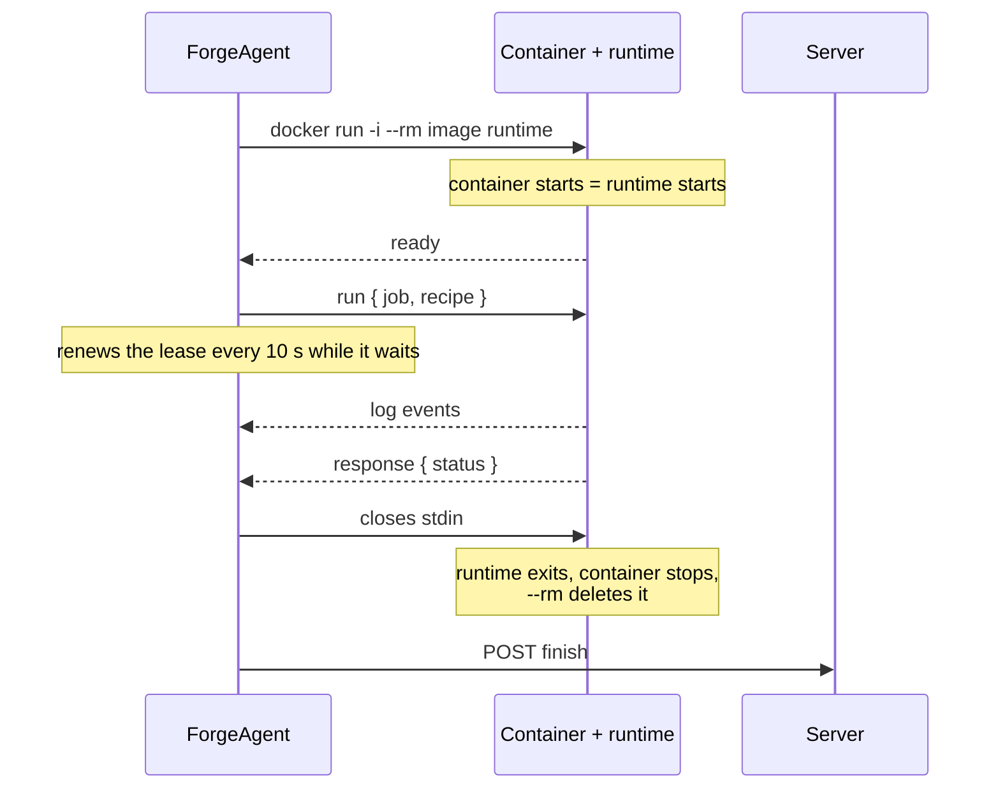

- **Normally nothing is killed.** The runtime answers `run`, the ForgeAgent closes its stdin, it exits, and the container ends with it.
- **Killed only when something's wrong:** a cancel (the heartbeat reply says `stop`), a timeout, or a runtime that sent `done` but doesn't exit (killed after a short grace).
- **If the agent restarts mid-job,** the pipe is gone and nobody is listening. The runtime treats a closed stdin as stop; the reaper fails a job with no heartbeat and kills what's left.

The ForgeAgent renews the job's lease every 10 s while the runtime runs — on a timer, not on events, since a transform can compute for minutes without printing — logs its `log` events, and turns the response into `finish`. A runtime that exits, breaks the protocol or never says `ready` fails the job with that reason.

### Inside the code-workspace runtime

The runtime coordinates; Python only runs transforms. Each `preview` or `run` spawns a **child process**, so a crash or out-of-memory doesn't take the runtime down, and edited code is imported fresh.

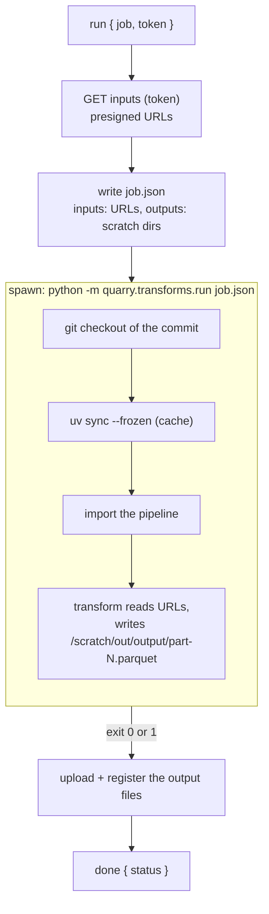

### Environment

The code-workspace runtime installs the workspace's `uv.lock` when the job starts (`uv sync --frozen`), with its uv cache in `/cache` (`UV_CACHE_DIR=/cache/uv`) — the code-workspace runtime's cache **volume**: a folder Docker keeps on the host, outside any container, that survives the containers that mount it. Every code-workspace job container on a machine mounts the same one:

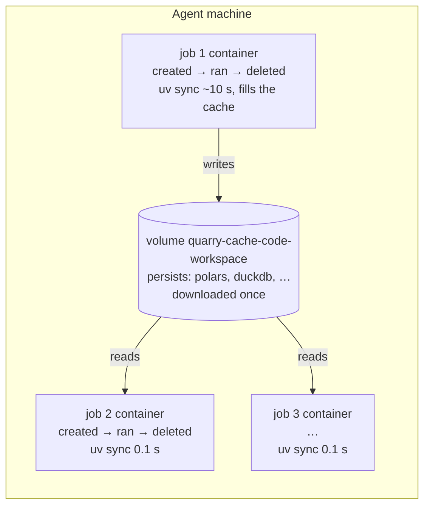

Measured 2026-10-29 in the IDE image (`quarry/code-workspace-ide:dev`) with the template's dependencies: about 10–11 s with an empty cache, 0.1 s warm (also on a volume); a bare container starts and stops in 0.2 s. The packages installed in the image don't help `uv sync` — it installs the locked versions into the venv anyway.

**Known risk, accepted for now:** the cache is writable by every job's code, so a malicious transform could tamper with cached packages that another workspace's job then installs and runs. Fixes when it matters: a cache volume per workspace, or a shared cache filled by a trusted step and mounted read-only in jobs.

## 4. Delegates: who holds which token

A runtime **carries** permissions; it can't **enforce** them. It runs in the same container as the user's code, so anything it holds, that code could read. Only the server enforces.

| Where | Token | Narrowed to |
|---|---|---|
| Build job | the **job token**, minted at `claim` | the pusher's delegated principal, limited to the job's pinned inputs (read) and outputs (write), for this attempt |
| Preview (IDE) | the session's token | the user |
| Check run | the run's token | the pusher |

In a job, **Python never gets the token**. The runtime holds it and gives Python only presigned URLs for its own pinned inputs and a local folder to write to. **Python runs as its own OS user** (decided 2026-10-29, built in phase 1). A process can read everything of another process of the same user — its environment (`/proc/<pid>/environ`), its memory, its files — so with one user, a transform could read the token straight out of the runtime. Every Python child is spawned as `transform` (uid 1001, `uid`/`gid` on `spawn`).

Switching users takes the right to switch, so the runtime runs as **root inside the container, with every capability dropped except switching users**: the ForgeAgent starts job containers with `--cap-drop ALL --cap-add SETUID --cap-add SETGID --security-opt no-new-privileges`. Switching from root to `transform` drops even those, so the child has no capabilities at all, can't switch back, and can't read the runtime's process. The child gets only what it's handed:

- **A clean environment.** The child is spawned with an explicit `env` (`PATH`, `HOME`, `UV_CACHE_DIR`, the job's settings), never the runtime's own — nothing the runtime knows leaks through variables.
- **No access to the runtime's files.** The runtime's working files and `job.json` drafts are readable by `runtime` only; the child gets its own job file and scratch directory, owned by `transform`.
- **No capabilities.** `transform` isn't root and holds none, so it can't switch users or read other processes.

## 5. Reading inputs

Nothing is mounted or copied into the container up front. The runtime asks the server for **input passes** — presigned URLs, short-lived, for exactly the pinned files, like a visitor's pass that opens certain doors for a day — and the engines read Parquet straight from storage over HTTP. Writing works the same way with **upload passes** (§7).

### What a Parquet file looks like

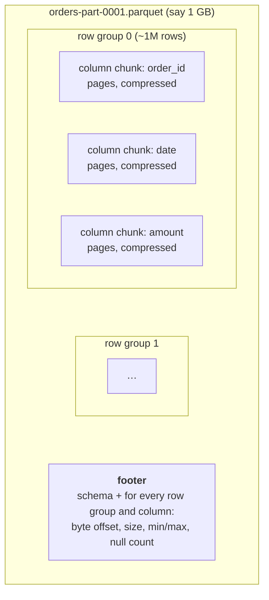

The footer is a table of contents. A reader fetches it first (one range request at the end of the file), then only the byte ranges it needs. Presigned URLs serve byte ranges like any object storage.

### From the job to a Polars frame

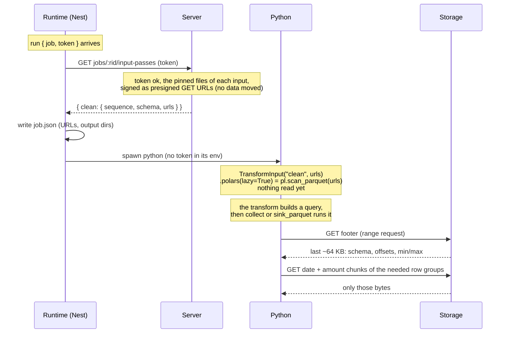

- `TransformInput` holds URLs instead of a local directory. Polars `pl.scan_parquet(urls)` and DuckDB `read_parquet([...])` read `https://` natively, with range requests in parallel; pyarrow and pandas go through `fsspec`'s HTTP filesystem.
- **Columns:** a transform using 5 of 50 columns fetches only those 5 (Parquet is columnar).
- **Row groups:** a filter like `date >= '2026-10-01'` skips whole row groups by their min/max.
- So "20 GB of data" is often a few GB actually read — when the transform reads lazily. Eager `.polars()`, `.arrow()` and `.to_pandas()` read everything.
- The URLs are signed for the job's longest allowed run, and only for those files.

### A chain of jobs

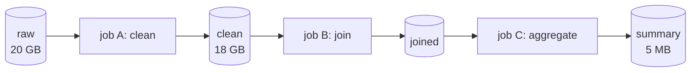

Every job reads its own inputs from storage — the previous job's output, not the original. Nothing is shared between containers; storage is. This is the industry's model too (storage apart from compute: Databricks, Snowflake, Foundry). What avoids re-reading big data later is **incremental transforms** (process only what's new since the last build; transactions already know what was appended), not copying data around.

## 6. Streaming: 20 GB in a 4 GB container

A lazy query is a plan, not data:

```python
orders = clean.polars(lazy=True)                              # plan: scan
result = (orders.filter(pl.col("date") >= "2026-10-01")       # plan: filter
                .group_by("customer").agg(pl.col("amount").sum()))
out.write_table(result)                                       # → runs, streaming
```

Run by the streaming engine (`collect(engine="streaming")`, or `sink_parquet`, which always streams):

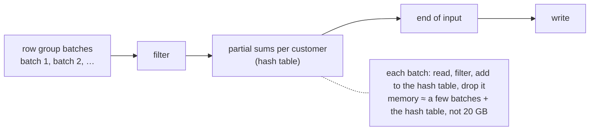

| Work | Streams? | Typical bottleneck |
|---|---|---|
| filter, select, `with_columns` | yes | I/O: reading from storage |
| group-by aggregations | yes — memory is the number of groups | CPU, then memory |
| joins with one small side | yes | CPU |
| sorts, joins of two big tables | spill to disk (DuckDB; Polars increasingly) | memory, then disk |
| eager `collect()`, `.to_pandas()`, Python row loops | no — everything in memory | memory (out-of-memory), CPU (loops are 10–100× slower) |
| decoding Parquet | — | CPU, about 1–2 GB/s per core |

Rough speeds: object storage does about 100 MB/s per connection, 1–10 GB/s with the parallel reads engines make; on the same machine or LAN as SeaweedFS, faster. Reading 20 GB is seconds to a minute; what decides 30 seconds against 30 minutes (or out of memory) is how the transform is written and `recipe.compute.memoryGb`. The template and docs should show lazy as the normal way.

## 7. Writing outputs

Outputs are written as **several files**, and each one is uploaded as soon as Python closes it, while Python writes the next. So the upload overlaps the transform: when Python exits, only the last file is left to upload, and the scratch disk holds a few files, not the whole output.

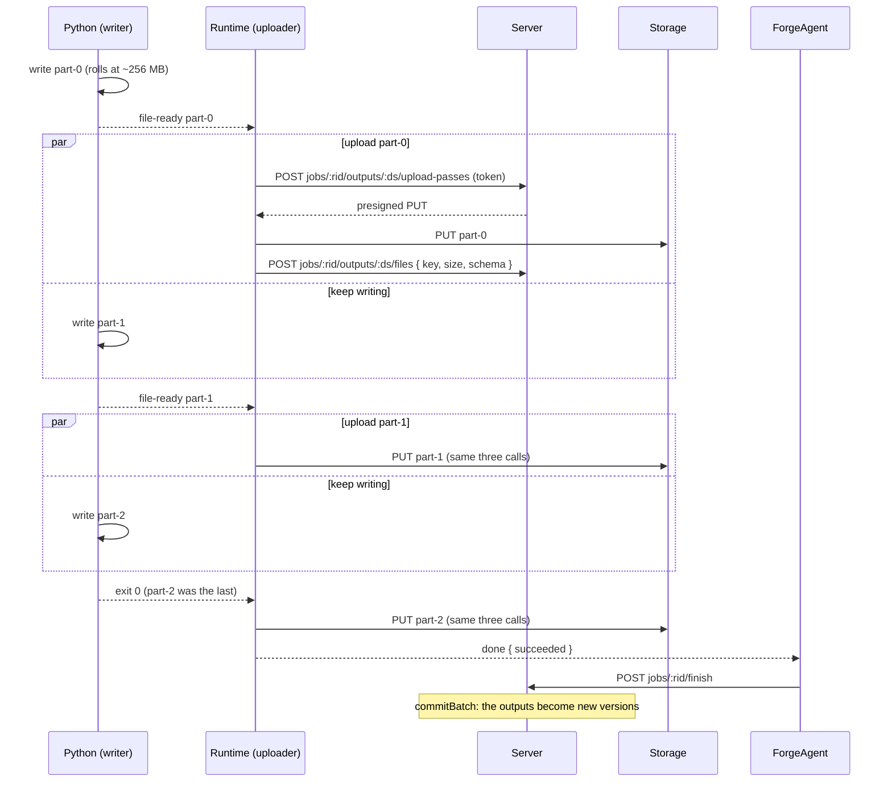

- **Rolling files.** `write_table` pulls the result in batches (a Polars LazyFrame's batches, DuckDB's `fetch_record_batch`, or Arrow directly) and writes them with pyarrow's `ParquetWriter`, starting a new file every ~256 MB. It still streams: the whole output is never in memory. A DataFrame or Arrow table that's already in memory is split the same way.
- **A file is announced only when it's complete.** Python writes `part-N.parquet.tmp`, closes it, renames it to `part-N.parquet`, then writes `{"type":"event","event":"file-ready","path":…}` to the runtime on **file descriptor 3** — a pipe of its own, because Python's stdout and stderr carry the transform's own prints (relayed as `log` events). The same line protocol as ForgeAgent ↔ runtime, one level down. A Parquet file is only valid once its footer is written, so a half-written file is never uploaded.
- **The runtime uploads, not Python** — uploading needs the token, and retries are the runtime's problem, not the user's. It uploads a few files in parallel, and registers each on the open transaction once it's stored.
- **Backpressure.** If uploads fall behind, Python waits once N finished files are still waiting to upload. The scratch disk only ever needs a few files' worth of room.
- **The schema** is read from the Parquet files and mapped to Catalog's column types (`preview.py`'s `column_type` already does this).
- Nothing is visible until `finish` commits. A crash leaves the uploaded files on an open transaction; the abort cleans them up.
- **Not chosen: streaming bytes straight into storage** (the Parquet writer feeding an S3 multipart upload, no files on disk). Parquet allows it — it's written front to back, footer last — but every part needs its own presigned URL from the runtime, retrying a failed part mid-stream is fiddly, and it only saves the scratch disk. Rolling files get almost all of the time back with per-file retries.

## 8. What has to be built

In phases, each small enough to read and review on its own (decided 2026-10-29):

| Phase | What | Proves |
|---|---|---|
| **1. Plumbing** | the `Forge.Runtime` contract and the stdio transport; the code-workspace runtime and its compute image; the ForgeAgent starting it (`runtimeImages`, limits, `/cache`), `run` over stdin, events → heartbeats, `done` → `finish`, kill on stop. `run` spawns Python as `transform`, which only imports `quarry.transforms` and exits. No token, no code, no data | a job reaches a runtime in its own container and comes back |
| **2. The code** | the job token at `claim`; the runtime checks out the commit, `uv sync --frozen` with `/cache`, imports the pipeline, finds the transform and checks its inputs and outputs against the recipe | the right code runs in the right environment |
| **3. Reading** | presigning; input passes; `TransformInput` from URLs; lazy reads | a transform reads its pinned inputs |
| **4. Writing** | upload passes; rolling files and `file-ready`; registering files; `commitBatch` on `finish` | a build writes new versions |
| **5. Callers** | the extension's preview and the check worker's manifest go through the runtime | one path for preview, checks and builds |

The items below say what each part needs; the table says when.

**Phase 1, as built:** `Stdio` in `packages/shared/domain/Stdio/Stdio.ts` and `Forge.Runtime` in `packages/shared/domain/Forge/Runtime.ts`; `StdioServer` and `StdioClient` in `packages/shared/server/stdio/`; the runtime in `packages/code-workspace-runtime/` (`main.ts`, `runtime.module.ts`, `runtime.controller.ts`; `npm run build` bundles it into `dist/runtime.js`); its image in `docker/code-workspace-runtime/` (`npm run build:code-workspace-runtime` → `quarry/code-workspace-runtime:dev`); the ForgeAgent's `JobContainers` (`docker run` and `docker kill`) and `RunJobProcessor` in `packages/forge-agent/src/`. Verified end to end by `test/e2e/forge-agent.e2e.test.ts` (a real ForgeAgent, real containers, the runtime's Python reporting uid 1001). `finish` still aborts the outputs: nothing is written until phase 4.

**Server**

1. Presigning in `FileStorage` (`infra/file-storage.ts`): GET, PUT and multipart PUT URLs (SeaweedFS's S3 API supports them).
2. The job token, minted at `claim`: scoped to the job's attempt, its pinned inputs (read) and outputs (write). **Phase 2**, decided 2026-10-29 — phase 1 runs without one.
3. Pinning inputs at `claim` (`job.inputs`).
4. `GET jobs/:rid/input-passes` → presigned URLs; `POST jobs/:rid/outputs/:ds/upload-passes` → upload URLs; `POST jobs/:rid/outputs/:ds/files` → registers files on the open transaction. All gated by the job token.
5. `catalog.transaction.commitBatch`, and `finish` committing on success instead of aborting.

**Shared**

6. `Stdio` and `Forge.Runtime`: the message contract — built with `Forge.Runtime.Run` and the events `Stdio.Event.Ready` and `Stdio.Event.Log`; `describe`, `preview` and `cancel` come with their callers.
7. The stdio transport: `StdioServer` (custom transport strategy) and `StdioClient`.

**Code-workspace runtime**

8. The Nest runtime (`describe`, `preview`, `run`, `cancel`), spawning Python per operation, and uploading output files as Python announces them.
9. `quarry.transforms`: `TransformInput` from URLs; `write_table` writing rolling files and announcing each (`file-ready`); a `run` entry point reading `job.json`; `describe` and `preview` behind the runtime.
10. **A separate compute image**, `quarry/code-workspace-runtime` — not the IDE's, which is `quarry/code-workspace-ide` (decided 2026-10-29): compute scales on its own and needs no editor. The runtime, Node, Python, uv, git; `/cache` from the agent.

**ForgeAgent**

11. The ForgeAgent's runtime protocol, the same for every runtime: `runtimeImages`, `docker run -i` with limits and the type's `/cache` volume, the stdio client, heartbeats from events, kill on stop, `done` → `finish`.

**Callers moving to the runtime**

12. The extension's preview and the check worker's manifest go through the runtime instead of `preview.py` and `manifest.py`.

## 9. Open questions

- **Token format and lifetime:** a signed token the server checks per request, or a session row like the check run's token? How it's renewed for long jobs (heartbeats could extend it).
- **Presigned URL lifetime** against the longest job; re-fetching URLs mid-job if they expire.
- **Preview inputs:** keep downloading samples, or sample to storage and hand URLs over, so preview and run read the same way.
