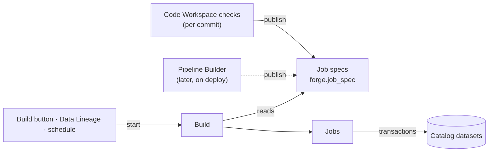

# Forge — Builds

_Draft, 2026-10-25. Nothing here is built yet. Split from [transforms.md](transforms.md) §5. What a build writes: [catalog.md](catalog.md); permissions: [gatekeeper.md](gatekeeper.md); queues: [jobs.md](jobs.md). Foundry background: its [Builds](https://www.palantir.com/docs/foundry/data-integration/builds/) docs._

**Forge** is the service that computes new versions of datasets. It's a platform service, like Catalog — not part of Code Workspaces: producers (a workspace's checks, later Pipeline Builder) publish **job specs**, and anything can start a **build** of them (a Build button, Data Lineage, a schedule). The name is a noun only: what it does is **build** — "built 2 hours ago", never "forged".



| Thing | RID | What it is |
|---|---|---|
| **Job spec** | `ri.forge.main.job-spec.…` | How to compute some datasets: a producer's logic at one version, inputs, outputs. Immutable |
| **Build** | `ri.forge.main.build.…` | One request to bring datasets up to date, on a branch: a set of jobs in dependency order |
| **Job** | `ri.forge.main.job.…` | One run of one spec: pinned input versions in, one transaction per output |

None of them is a library resource. Shared types: `Forge` in `@quarry/shared/domain` — `Forge.JobSpec`, `Forge.Build`, `Forge.Job`; branches are `Foundations.Branch`.

- **A build** has a branch and its fallback branches, a **target** — `manual` (exactly these datasets; what a Build button does), `upstream` (these and every out-of-date ancestor) or `connecting` (only what lies between some inputs and the targets) — `forceBuild`, `abortOnFailure`, `retryCount`, and a status: `running` → `succeeded` / `failed` / `canceled`. Its jobs point at it; it doesn't list them.
- **A job** runs one spec in one build: `waiting` for its upstream jobs → `running` → `succeeded` / `failed` / `canceled`. Its outputs' transactions are opened when the build resolves; its inputs are pinned (to transactions) when it starts. `attempt` counts retries.

## Job specs

A **job spec** (`Forge.JobSpec`, `ri.forge.main.job-spec.…`) is how to compute some datasets: a producer's logic at one version, its inputs and its outputs. Producers publish them; builds only read them. Not a library resource.

| Producer | Publishes | Specs |
|---|---|---|
| Code Workspace | checks, on every commit, per branch | one per transform |
| Pipeline Builder (later) | deploy | one per pipeline |

Building — clicking Build, a schedule — never publishes one; it runs the current spec.

```sql
forge.job_spec                  -- immutable: one row per publish, never updated
  rid PRIMARY KEY, producer_rid, branch, logic, resources, published_by, published_at

forge.job_spec_input_dataset    -- what it reads
  job_spec_rid → forge.job_spec, dataset_rid → catalog.dataset
  PRIMARY KEY (job_spec_rid, dataset_rid)
  INDEX (dataset_rid)                      -- what reads this dataset: lineage downstream

forge.job_spec_output_dataset   -- what it writes
  job_spec_rid → forge.job_spec, dataset_rid → catalog.dataset
  PRIMARY KEY (job_spec_rid, dataset_rid)

forge.current_job_spec          -- the pointer: which spec computes this dataset on this branch
  dataset_rid, branch, job_spec_rid → forge.job_spec
  PRIMARY KEY (dataset_rid, branch)
```

Inputs and outputs are **sets of datasets**, as rows, not `jsonb`: the questions that matter start from a dataset or a version ("what reads this?", "what wrote this?"), and rows get foreign keys and plain indexes. No parameter names — Forge doesn't need them; only the runner does, and the code has them (below). As in Foundry, whose JobSpecs declare their inputs as "a set of InputSpecs".

**Which input is which** comes from the code: the runner imports the pipeline at the spec's commit, finds the transform, and resolves each `Input` / `Output` ref — `orders=Input("/Sales/raw/orders")` → a RID. It then checks those RIDs are exactly the spec's sets. A path renamed or moved since checks resolves differently and **fails the job** ("`orders`: /Sales/raw/orders now resolves to a different dataset than when checks ran — push again") rather than reading the wrong data. Refs written as RIDs never drift.

- **One producer per dataset per branch** is the pointer's primary key; a second producer claiming an output fails.
- **Publishing** replaces the producer's pointers on that branch in one transaction: outputs it still has move to the new spec, outputs it dropped lose their pointer (the dataset stays; nothing produces it there), new outputs get one.
- **Jobs reference the spec they ran**, so provenance stays exact after the pointer moves.
- **Staleness**: an output is fresh when its latest version was built by its current spec from the inputs' current versions. Every commit publishes new specs, so every commit makes the workspace's outputs out of date.

## Builds and jobs: tables

```sql
forge.build
  rid PRIMARY KEY, branch, fallback_branches, target, force_build, abort_on_failure, retry_count,
  status, created_by, created_at, finished_at

forge.job
  rid PRIMARY KEY, build_rid → forge.build, job_spec_rid → forge.job_spec,
  status, attempt, failure, started_at, finished_at

forge.job_input_transaction     -- the input versions it read, pinned when it starts
  job_rid → forge.job, transaction_rid → catalog.transaction
  PRIMARY KEY (job_rid, transaction_rid)
  INDEX (transaction_rid)                  -- what read this version

forge.job_output_transaction    -- the transactions it writes, opened when the build resolves
  job_rid → forge.job, transaction_rid → catalog.transaction
  PRIMARY KEY (job_rid, transaction_rid)
  UNIQUE (transaction_rid)                 -- one writer per transaction
```

## Builds

A build brings target datasets up to date. It's started by hand ("Build" in the IDE or on a dataset) or by a schedule, and runs the **committed** code on **full** inputs.

1. **Plan** — from the targets, walk lineage upstream within the build's scope (single / full / connecting); collect each dataset's current job spec on the build's branch ([job specs](#job-specs)).
2. **Skip what's fresh** — a transform whose inputs haven't changed since its last successful job is skipped. Syncs always run (the external source's changes aren't visible).
3. **Run** jobs in dependency order; independent ones in parallel. A failed job stops everything downstream of it; unrelated branches finish.

## Build workers

A **build worker** (a NestJS worker, like the data connection worker) takes jobs from a BullMQ queue. It **orchestrates**; it doesn't run Python itself:

1. Pin every input to its latest committed transaction; open a `snapshot` transaction on every output (through `catalog.transaction`, as the delegate).
2. **Start a container** from the spec's environment image, with its resource limits and a short-lived token scoped to those inputs and outputs.
3. In the container, Python reads the input Parquet files, runs the function, and writes the output Parquet to object storage under each transaction's prefix.
4. When the container exits cleanly, register the files and **commit** every output with its provenance; otherwise abort them all.
5. Stream the container's logs into the job, and remove the container.

Data lands where every write lands: **Parquet in object storage** (SeaweedFS), recorded by Catalog in **Postgres**. DuckDB is an engine inside transforms, never a store.

## Provenance

Each output transaction records **what produced it**:

```
/Sales/clean/orders  transaction #12
  job:      ri.forge.main.job.…
  code:     workspace ri.code-workspace.main.workspace.… at commit a1b2c3d, function clean_orders
  inputs:   /Sales/raw/orders     transaction #40
            /Sales/raw/customers  transaction #7
```

That's **version-aware lineage**: any version of a derived dataset names the exact code and the exact input versions that produced it, so it can be explained and rebuilt.

**Stored in Catalog**, beside the transaction it describes (decided 2026-10-24); lineage queries are joins:

| Column / table | Holds |
|---|---|
| `catalog.transaction.produced_by` | The **resource** that wrote it — the Code Workspace for a transform's output, the Source for a sync's (a sync isn't a resource) |
| `catalog.transaction_input (transaction_rid, input_transaction_rid)` | One row per input version read |

The exact **run** isn't on the transaction: runs already point at what they wrote, in the producer's own tables — `data_connection.sync_run.transaction_rid`, and `forge.job_output_transaction (job_rid, transaction_rid)` for jobs (through which the commit). Catalog never reads its writers' tables; `produced_by` is a plain resource RID, resolved through the Library like any resource link.

A transaction points at the **job**, not the job spec: the spec is what should run, the job is what ran (that attempt, its pinned inputs, its logs). One spec has many jobs — rebuilds, retries, force builds; the spec is one hop away (job → spec).

**Not like this yet in the code:** `catalog.transaction` has a free-form `provenance jsonb` instead of `produced_by` and `transaction_input`; syncs write `{ syncRid, syncRunRid }` into it. Until that changes, a job would write `{ jobRid }` the same way.

As in Foundry's dataset About panel, the dataset viewer then shows:

- **Updated … by** *user* — the actor of the latest committed transaction (the delegate's user: whoever pressed Build, or the schedule's owner).
- **Created … by Quarry** — for an output created by checks. The dataset's creator is the system; the audit log still records the committer as the delegate behind it, and checks verified their write on the folder first.
- **Updated via** *workspace* — `produced_by` of the latest transaction, linked.
- **Inputs** — the datasets of the latest transaction's `transaction_input` rows.

A job acts as a **delegate** — of whoever started the build, or the schedule's owner — so Gatekeeper decides what it may read and write, exactly as for sync runs ([gatekeeper.md](gatekeeper.md)).
