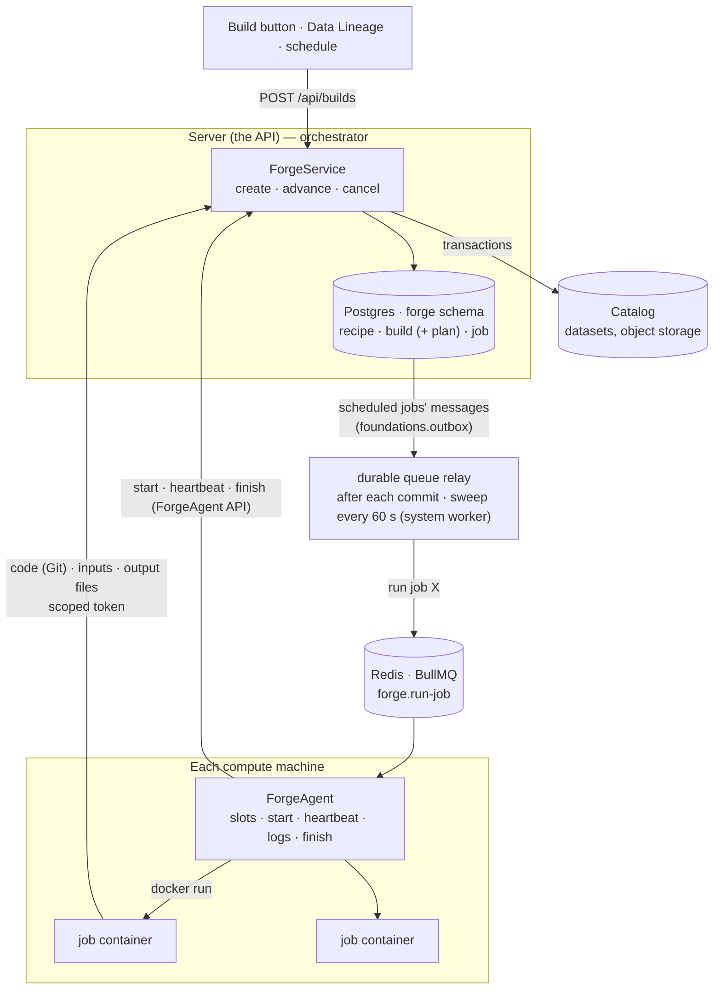
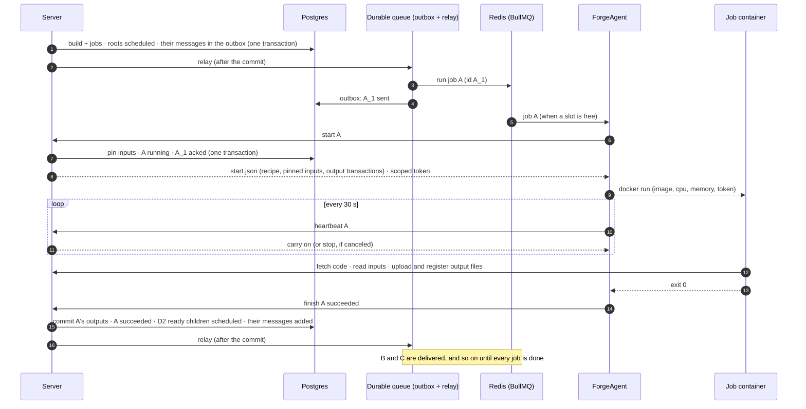
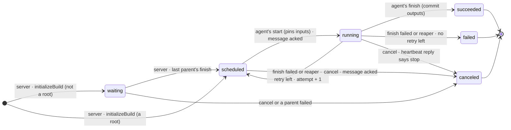

# Forge — Builds

_Draft, 2026-10-25. **Built 2026-10-26–27**: publishing recipes; initializing, listing and canceling manual builds; delivery (since 2026-10-28 a durable queue), the ForgeAgent API and a ForgeAgent scaffold that starts and finishes jobs without compute ([§8](#8-what-runs-today)). Nothing runs a job yet — the ForgeAgent, the relay and finishing jobs are planned (marked below). Split from [transforms.md](transforms.md) §5. Related: what a build writes, [catalog.md](catalog.md); permissions, [gatekeeper.md](gatekeeper.md); queues, [jobs.md](jobs.md). Foundry background: its [Builds](https://www.palantir.com/docs/foundry/data-integration/builds/) docs._

**Forge** computes new versions of datasets. It's a platform service like Catalog, not part of Code Workspaces: **producers** (a workspace's checks, later Pipeline Builder and syncs) publish **recipes**; anything can start a **build** of them (a Build button, Data Lineage, a schedule). The name is a noun only — what it does is **build**: "built 2 hours ago", never "forged".

## 1. Model

| Thing | RID | What it is | Changes? |
|---|---|---|---|
| **Recipe** | `ri.forge.main.recipe.…` | How to compute some datasets: the runtime that runs it (and what that runtime needs, e.g. a commit and a transform), its input datasets, its output datasets | immutable — a new version is a new recipe |
| **Build** | `ri.forge.main.build.…` | One request to bring datasets up to date on a branch: its target, its **plan**, its status | status only |
| **Job** | `ri.forge.main.job.…` | One run of one recipe within one build: pinned input versions in, one transaction per output | status, attempt, times |

None is a library resource. Shared types: `Forge.Recipe`, `Forge.Build` (with `Forge.Build.Plan`), `Forge.Job`, `Forge.API` in `@quarry/shared/domain`; branches are `Foundations.Branch`.

- **Producers publish, builds run.** A Code Workspace publishes one recipe per transform on every commit (checks), per branch; Pipeline Builder will publish one per pipeline on deploy. Clicking Build or a schedule firing never publishes — it runs the current recipe.
- **Runtimes run jobs.** One per kind of producer — `code-workspace` (built first), later `data-connection` and `pipeline` — each the application's own, in its own image. A recipe's `runtime` names its runtime (`type`) and holds what that runtime needs (for a workspace: the commit and the transform). The ForgeAgent starts the runtime's image and speaks the same protocol to every runtime; Forge itself only plans, pins, locks, commits and aborts, and knows no runtime's details ([forge-runtimes.md](forge-runtimes.md)).
- **One producer per dataset per branch.** A dataset has at most one *current* recipe on a branch; many over time (history), different ones on different branches.
- **The plan** is the build's graph, as an adjacency list over recipes: `{ roots, children }`. A recipe is a child of every recipe in the build whose output it reads; roots wait for nothing. Fixed when the build is created.
- **One job per node** of the plan. A recipe writing several datasets is one job that writes them all together — building one of them rebuilds its siblings.
- **Targets** (`Forge.Build.Target`): `manual` — exactly the targets' recipes, no walking upstream (a Build button; the only one built); `upstream` — the targets and every out-of-date ancestor; `connecting` — only what lies between some inputs and the targets.

**Statuses.**

```
build   running ──▶ succeeded | failed | canceled

job     waiting ──▶ scheduled ──▶ running ──▶ succeeded | failed
           └────────────┴────────────┴─────▶ canceled

        waiting     parents not finished (the default)
        scheduled   may run now: its message is on its way to an agent (the outbox, then Redis)
        running     an agent took it; its container runs
        canceled    stopped before finishing: the build was canceled, or a parent failed

        Airflow's names for the same steps. Whether a scheduled job's message is in Redis yet is the
        durable queue's business (docs/design/durable-queues.md), not a job status.
```

## 2. Components

The **server orchestrates** — it decides what runs when. **ForgeAgents execute** — one per machine, starting and watching that machine's containers. **Each job runs in its own container**, which does the compute. In between, the **job table** in Postgres and a **queue** in Redis carry "run this job".

**Delivery is a durable queue** ([durable-queues.md](durable-queues.md); moved onto it 2026-10-28). The server decides a job may run by setting it `scheduled`, and **in the same transaction adds its message** (`run job X, attempt N`) to the platform's outbox, `foundations.outbox` — the dual write between Postgres and Redis can't split: a commit has its message, a rollback has none. After the commit `relay()` sends it to BullMQ (`forge.run-job`, job id `<rid>_<attempt>`) — the fast path, best effort. Every minute the system worker's **durable-queue sweep** sends again what wasn't sent, or was sent over 2 minutes ago and never acked — Redis runs without persistence, so a restart loses its messages; a message still there has the same job id and is ignored. The message is **acked** (deleted from the outbox) in the transaction that **starts** the job — `start` moves it `scheduled → running` once per attempt, so a duplicate message gets a 409 — or that **cancels** it (a canceled or failed build). Postgres stays the source of truth; Redis only delivers.




| Component | Does | How many |
|---|---|---|
| **Server** — `ForgeService` | Creates builds (collect the plan, validate, lock the outputs, persist), advances them when a job finishes (commit its outputs, ask D2 which jobs are now ready, mark them scheduled, relay them), cancels them, fails silent jobs (reaper) | the API |
| **Delivery** — the durable queue `Forge.DurableQueue.RunJob` | A scheduled job's message is added to `foundations.outbox` with the change that schedules it, relayed to BullMQ (job id `<rid>_<attempt>`) after the commit and by the platform's every-minute sweep, and acked when the job starts or its build ends — [durable-queues.md](durable-queues.md) | — |
| **Queue** — BullMQ on Redis | Delivers "run job X" to one agent: one queue, `forge.run-job` | — |
| **ForgeAgent** | Takes a job when it has a free slot, calls `start`, starts the image of the runtime its recipe names (`recipe.runtime.type`) with the recipe's compute, sends it the job, heartbeats, streams logs, waits for the exit, calls `finish`; kills the container on cancel. Never moves data | one per machine |
| **Job container** | The runtime, as its main process — for `code-workspace`: fetches the code at the commit, reads the inputs, runs the function, uploads and registers the output files, exits 0 or 1 | one per job, removed after |
| **Catalog** | Datasets, their transactions and files — what jobs read and write | — |

**Why an agent per machine.** The agent doesn't compute; it stands in for a machine, the way Jenkins and Buildkite agents or Kubernetes' kubelet do. With plain Docker, containers run on the machine whose Docker daemon starts them, and Docker's API should stay local (exposed over the network it's root on the host). Each agent pulls a job only when its machine has room, so the queue does the placing — no central scheduler. Start with one machine; add machines (each with its agent) when one isn't enough. With Kubernetes, one or two agents submit Kubernetes Jobs and the cluster places them; nothing else changes.

**The ForgeAgent API** — built. ForgeAgents never connect to Postgres; only the server does (AGENTS.md). They talk to the server through their own API, meant for ForgeAgents only: `/api/forge-agent/…`, contract `Forge.API.Agent` in `@quarry/shared`, `ForgeAgentController` on the server.

| Endpoint | What |
|---|---|
| `POST /api/forge-agent/jobs/:rid/start` | take the job (`scheduled` → `running`, once per attempt; its message acked), pin its inputs; returns `start.json` and the job's scoped token |
| `POST /api/forge-agent/jobs/:rid/heartbeat` | still running; the reply says carry on or stop |
| `POST /api/forge-agent/jobs/:rid/finish` | succeeded or failed (with a message); idempotent per attempt |

It's authenticated with the **ForgeAgent token** (`FORGE_AGENT_TOKEN`, checked by `AuthGuard` on `@ForgeAgentOnly()` routes), separate from the internal service token the other workers use, and accepted on these routes only: agents run on machines next to user code, so what a leaked agent token can do is limited to claiming, heartbeating and finishing jobs. Why not let agents use the database directly: a database credential on every compute host would expose everything if a container escaped; agents would eat Postgres connections; every migration would have to reach every machine. The industry went the same way — Kubernetes' kubelets talk only to the API server, never etcd; Airflow 3 moved task execution from direct metadata-database access to a Task Execution API; CI runners talk to their controller's API.


## 3. Schema

Migration: `server/migrations/forge/001_initial.sql`. Datasets and producers are other services' resources, so their columns reference `library.resource` (database.md rule 3); transactions are Catalog's and have no FK. A job's transactions are kept keyed by dataset: Forge can't join `catalog` (rule 2), and aborting a transaction goes through its dataset.

```sql
-- ── recipes ──────────────────────────────────────────────── built ──

forge.recipe                       -- immutable: one row per publish
  rid           recipe_rid  PRIMARY KEY
  producer_rid  → library.resource      -- the workspace (later: pipeline, sync)
  branch        text
  runtime       jsonb                   -- Forge.Recipe.Runtime: which runtime runs it, and what that runtime needs
  compute       jsonb                   -- { cpuCores, memoryGb }
  published_by  → identity.user, NULL = the system
  published_at  timestamptz
  INDEX (producer_rid, branch)

forge.recipe_input_dataset         -- what it reads
  recipe_rid  → forge.recipe
  dataset_rid   → library.resource
  PRIMARY KEY (recipe_rid, dataset_rid)
  INDEX (dataset_rid)                   -- what reads this dataset

forge.recipe_output_dataset        -- what it writes
  recipe_rid  → forge.recipe
  dataset_rid   → library.resource
  PRIMARY KEY (recipe_rid, dataset_rid)

forge.current_recipe               -- the pointer; replaced on every publish
  dataset_rid   → library.resource
  branch        text
  recipe_rid  → forge.recipe
  PRIMARY KEY (dataset_rid, branch)     -- one producer per dataset per branch

-- ── builds and jobs ─────────────────── built, except columns marked (P) ──

forge.build
  rid               build_rid  PRIMARY KEY
  branch            text
  fallback_branches text[]
  target            jsonb               -- Forge.Build.Target
  plan              jsonb               -- Forge.Build.Plan: { roots, children }, written once
  force_build       boolean
  abort_on_failure  boolean
  retry_count       integer
  status            text                -- running | succeeded | failed | canceled
  created_by        → identity.user, NULL = the system
  created_at        timestamptz
  finished_at       timestamptz         -- NULL while running
  INDEX GIN (target -> 'datasetRids')   -- builds of this dataset
  INDEX (created_at DESC)

forge.job                            -- (P) = planned
  rid           job_rid  PRIMARY KEY
  build_rid     → forge.build
  recipe_rid  → forge.recipe
  status        text                    -- waiting | scheduled | running | succeeded | failed | canceled
  attempt       integer                 -- 1, then each retry
  failure       jsonb                   -- { message }
  inputs        jsonb                   -- { <dataset rid>: <transaction rid> }: the version of each input it read, pinned when it starts
  outputs       jsonb                   -- { <dataset rid>: <transaction rid> }: each output's transaction, opened when the build is created
  scheduled_at  timestamptz             -- may run from here: roots at initialization, children when their last parent finishes
  started_at    timestamptz
  heartbeat_at  timestamptz             -- not indexed, so heartbeats stay HOT updates
  log_key       text                (P) -- the job's log in object storage
  finished_at   timestamptz
  UNIQUE (build_rid, recipe_rid)      -- one job per node of the plan
```

**Why the plan is a column, not an edges table.** It's written once and never updated, and every question about it — which jobs are ready, what to cancel, drawing the graph — is about one build, so it's loaded whole and handed to D2 in the shape D2 uses. An edges table would only pay off for edge queries across builds; lineage uses recipes, not job edges.

**Why a job's transactions are `jsonb` on the job, but a recipe's datasets are rows.** A job's inputs and outputs are only ever read with the job (to start it, cancel it, show it); the reverse questions have other answers — what wrote a version is on the transaction itself (its provenance names the job), and staleness goes from a dataset's latest transaction to its job. Keyed by dataset, each says which version of *this* dataset. A recipe's datasets are different: they're queried across recipes, starting from a dataset — "what reads this dataset?" (lineage downstream), "what does this recipe read?" walked recursively (upstream builds) — and each row is checked on publish (read on an input, write on an output); rows give that foreign keys, plain indexes and per-row policies. No parameter names: Forge needs sets of datasets; only the runner needs to know which is which, and the code says (§5).

**Row-level security.** A recipe is its producer's: seen with discover on the producer, published with write on it — plus read on each input and write on each output; moving the pointer is write on the dataset. A build is seen by whoever can discover one of its targets, and created or canceled by whoever can write all of them; its jobs follow the build.

## 4. A build, end to end

### Creating it — built

`POST /api/builds` → `ForgeService.initializeBuild` (the build and its jobs), in phases:

1. **Collect the plan.** Each target's current recipe — on the build's branch, then its fallbacks; a target nothing produces is a 409. A recipe writing several targets is one node. The plan's `children` link a recipe to every recipe in the build reading its outputs; recipes with no parent are the `roots`. No roots means a cycle (409). Manual only, main only for now (400 otherwise).
2. **Validate.** Write on every output (siblings too), read on every input; an input not built in this build must already have data.
3. **Lock the outputs.** One snapshot transaction on every output of every recipe, all in one database transaction (`catalog.transaction.openBatch`, provenance `{ buildRid, jobRid }`) — or none: a dataset already being written is a 409. No other writer gets in until the build finishes.
4. **Persist.** The build (with its plan), one job per node (`waiting`), their output transactions — one database transaction. If this fails, the transactions from 3 are aborted.
5. **Schedule the roots** — the same database transaction marks the roots `scheduled` and adds their messages to the outbox; after the commit `ForgeService` relays them to Redis.

### Running it — the flow built; compute, commits, retries and the reaper planned



**Starting** (`POST /api/forge-agent/jobs/:rid/start`): accepted once per attempt, from `scheduled` (`UPDATE … SET status = 'running' WHERE rid = … AND attempt = … AND status = 'scheduled'`), acking its message in the same transaction — `running` is what decides ownership. A duplicate message finds the job running and gets a 409. Then the server pins each input to its newest committed version — for an input built in this build, the version its parent just committed — records them in the job's `inputs`, marks the job `running`, and returns `start.json` with a short-lived token scoped to the job's inputs and outputs.

**Finishing** (`POST /api/forge-agent/jobs/:rid/finish`), in one database transaction:

- **succeeded** — commit all the job's output transactions together (`catalog.transaction.commitBatch`, planned: a job's outputs update together or not at all), job `succeeded`; load the plan and the jobs' statuses, `D2.getReady` → each ready child goes `waiting → scheduled` (a conditional update, so two parents finishing at once schedule it once) and its message is added, relayed after the commit; nothing left waiting, scheduled or running → build `succeeded`.
- **failed** — attempts left (`retryCount`)? `attempt + 1`, `scheduled` again (a new BullMQ id, `<rid>_<attempt>`), same open transactions. Otherwise abort its transactions, job `failed`; `D2.getDescendants` → abort theirs and cancel them (with `abortOnFailure`, cancel everything still waiting); nothing left running → build `failed`.

**Canceling** — built: needs write on every target (asserted first — under RLS alone a viewer's cancel would match no rows). **Mark first**: the build and its unfinished jobs go `canceled`, then their transactions are aborted — in that order so a running job can't still finish once its outputs are being released (finish needs the job `running`; a late one gets 409, which the agent takes as "canceled while it ran"). Failing a build does the same. With agents, a running job's next heartbeat reply says stop and the agent kills its container.

**Reaping** — planned: a `running` job not heard from in about 2 minutes is treated as failed (its agent died).

The data never passes through the server's orchestration or the agent: the container registers its files on the open transactions; `finish` only commits them; a child reads its parents' outputs because its inputs are pinned to the newest committed versions when it starts.

### A job's state, and what each crash leaves — planned

Every arrow is one write to `forge.job`, by the component named on it. The dotted boxes are what a crash at that point leaves behind, and what repairs it.



| Crash | Postgres says | Redis has | What repairs it |
|---|---|---|---|
| server, before `initializeBuild` commits | nothing | nothing | the request failed; its open transactions are aborted |
| server, after the commit, before relaying | `scheduled`, its message unsent | nothing | the durable-queue sweep sends it within a minute |
| server, after sending, before marking the message sent | `scheduled`, its message unsent | `rid_attempt` | an agent starts it; the sweep's resend is ignored (same id) |
| Redis loses the message — any Redis restart, as it has no persistence | `scheduled`, its message sent, not acked | nothing | the sweep sends again a message unacked for over 2 minutes |
| agent, after `start`, while the container runs | `running` | done | heartbeats stop → the reaper: retry (`attempt + 1`, `scheduled`) or `failed` |
| the container (non-zero exit, out of memory) | `running` | done | the agent reports `finish(failed)` → retry or `failed` |
| agent, after the container exited, before `finish` arrives | `running` | done | the agent retries `finish` when it can; if it died, the reaper fails or retries the job — the outputs stay uncommitted |
| server, during `finish` | `running` (rolled back) | done | the agent retries `finish`; it's idempotent per attempt |
| a stale agent's late `finish`, after a retry began | `running`, a newer `attempt` | — | rejected: `start` and `finish` only count for the current attempt (the fencing token) |

`attempt` counts executions, not deliveries: only a retry raises it. Duplicate sends and refused duplicate messages leave it alone.

**Lock order: jobs, then the build.** Every transaction that changes both (`finishJob`, `failBuild`, `cancelBuild`) updates job rows before the build row. In the opposite order, a cancel racing the agent finishing a build's last job deadlocks (Postgres aborts one, 40P01 → a 500); in this order one waits for the other, and the loser gets its 409.


## 5. ForgeAgents and job containers — planned

Runtimes, the job token, reading and writing data: [forge-runtimes.md](forge-runtimes.md) (design, 2026-10-29) — it supersedes this section where they differ.

### Which agent runs a job

Every machine does the same work — "pull this image, run it with these limits" — so all agents share the one queue. **Load balancing is pull-based**: each agent has **slots** (a fixed concurrency to start, resource-aware later) and pulls a job only when one is free — busy machines stop taking work, idle ones take more. Different kinds of machine (GPU, big memory) would get their own queues, picked from the recipe's `compute`; not planned yet. (Spark is another layer: it spreads one job's work across machines; Forge spreads jobs.)

### Handing a job to its container

Instructions and a token, never data:

```
docker run
  --cpus 1 --memory 4g                                  ← the recipe's compute
  -e QUARRY_SERVER_URL=…  -e QUARRY_TOKEN=…             ← short-lived, scoped to this job
  -e QUARRY_JOB_RID=ri.forge.main.job.…
  -v /tmp/forge/<job>/start.json:/job/start.json:ro     ← what `start` returned
  <the environment image for the recipe>
  python -m quarry.transforms.run /job/start.json
```

The container: (1) fetches the code at the recipe's commit over Git; (2) imports the pipeline, finds the transform, and checks its `Input` / `Output` refs resolve to exactly the recipe's datasets — a path renamed or moved since checks **fails the job** ("push again") rather than reading the wrong data; refs written as RIDs never drift; (3) reads the inputs at their pinned versions; (4) runs the function; (5) uploads the output files and registers them on their transactions; (6) exits 0, or 1 with the error printed.

### Knowing a job finished

The agent waits on the container (`docker wait`):

| Outcome | Agent |
|---|---|
| exit 0 | `finish(succeeded)` |
| non-zero | `finish(failed, message)` — from the last log lines; `State.OOMKilled` tells "out of memory" (137) from a crash |
| past the maximum run time | kills the container, reports a timeout |
| canceled (the heartbeat reply says stop) | `docker stop` (SIGTERM, then SIGKILL after a grace period), reports it canceled |
| the agent itself dies | nothing — heartbeats stop and the reaper fails the job |

Then it archives the logs, removes the container and frees the slot. What happens next is the server's call.

### Heartbeats and logs

The industry's usual answer to "a worker died without saying so" (Airflow's zombie tasks, Spark's executor heartbeats, Temporal's heartbeat timeouts, Kubernetes' node leases) and to job logs (Airflow's remote logging, Foundry's live logs):

- **Heartbeat** — about every 30 s while the container runs: `POST /api/forge-agent/jobs/:rid/heartbeat` sets `heartbeat_at = now()`. One tiny write per running job per 30 s; not indexed, so a HOT update. The reply carries cancellation. Same as `sync_run.heartbeat_at` today.
- **Logs** — the job writes to stdout; the agent streams it while it runs (live in the Builds app) and archives it to object storage (`log_key`) when the container exits. Postgres holds only where it is.

### Environments

A container starts from an **environment image**: a Quarry-owned base (Python, `quarry.transforms`, the runner — later a CUDA variant) plus a layer installing the workspace's `uv.lock`, keyed by the lock's hash, built once by checks and shared by every recipe with the same lock. The code isn't in the image; the container fetches it. A `code-workspace` recipe's `runtime` names its environment (to add). Pipeline Builder and syncs have no user environment: their runner image is Quarry's own, and the job records which version ran it.

## 6. D2 — the graph, kept apart — planned

As PretzelGraph's S2 engine is apart from what runs on it, the graph algorithm knows nothing about recipes, datasets or containers:

```ts
D2.buildGraph(plan)              → D2.Graph { roots, children, parents }   // Kahn's algorithm: a cycle throws
D2.getReady(graph, statuses)     → nodes whose parents all succeeded and that haven't started   // "AND", the only policy
D2.getDescendants(graph, node)   → what to cancel when a node fails
```

Forge uses it with durable state (statuses in Postgres, advanced by "job finished"). A later in-memory runner — microtasks and hooks, S2-style — can use the same D2 for short runs in one process, such as a Pipeline Builder pipeline's own steps while its single job runs:

| Level | Nodes | Runs for | Runner |
|---|---|---|---|
| Build | recipes — a job each, in containers | minutes to hours, across machines | durable (Forge) |
| Inside one job | a pipeline's steps | seconds to minutes, one process | in-memory |

## 7. Provenance

Each output transaction records what produced it:

```
/Sales/clean/orders  transaction #12
  job:      ri.forge.main.job.…
  code:     workspace ri.code-workspace.main.workspace.… at commit a1b2c3d, function clean_orders
  inputs:   /Sales/raw/orders     transaction #40
            /Sales/raw/customers  transaction #7
```

Version-aware lineage: any version of a derived dataset names the exact code and input versions that produced it. A transaction points at the **job** (what ran — that attempt, its pinned inputs, its logs), not the recipe (what should run); the recipe is one hop away. Jobs record the versions they read and wrote (`forge.job.inputs`, `outputs`); Catalog never reads Forge's tables.

Planned in Catalog (decided 2026-10-24): `catalog.transaction.produced_by` (the resource that wrote it — the workspace) and `catalog.transaction_input`. **Not like this yet:** the transaction has a free-form `provenance jsonb`; syncs write `{ syncRid, syncRunRid }`, builds `{ buildRid, jobRid }`.

The dataset viewer then shows, as in Foundry's About panel: **Updated … by** the user who started the build (or the schedule's owner); **Updated via** the workspace; **Inputs**, the input versions. A job acts as a **delegate** of whoever started the build, so Gatekeeper decides what it may read and write, as for sync runs.

## 8. What runs today

`server/src/services/Forge/`: `ForgeService` (builds), `Recipes` (`forge.recipes`, for producers), `repository/` — the `ForgeRepository` facade over `BuildRepository`, `JobRepository` and `RecipeRepository` — and `forge.db.ts`. A created build **waits**: its jobs stay `waiting`, holding their outputs' transactions, until it's canceled.

| Endpoint | What |
|---|---|
| `POST /api/builds` | A manual build on main — [§4](#creating-it--built), phases 1–4 |
| `GET /api/builds?datasetRid=&limit=` | Builds the caller can see, newest first; with a dataset, those targeting it |
| `GET /api/builds/:rid` | The build (with its plan) and its jobs, by RID |
| `POST /api/builds/:rid/cancel` | Write on every target; marks the build and its unfinished jobs canceled, then aborts their transactions |
| `GET /api/jobs/:rid` | One job |
| `GET /api/recipes/current?datasetRid=&branch=` | What computes the dataset there, or null |

Publishing has no endpoint: producers call `forge.recipes.publish(principal, producerRid, branch, recipes)` in-process — nothing does yet (checks will).

**Live updates** (`Forge.Event`, realtime.md). Every change to a job is announced on its build's channel, `forge:build:<buildRid>`, as `forge:job:updated` with the job as it is now (`Forge.Event.Job.Updated`) — emitted by the server, whoever changed the row, right after the commit: initializing (all jobs), `start`, `finish` (the job and the children it scheduled), failing and canceling (the canceled jobs). Not heartbeats. It's a nudge for the UI, not the record: a lost event only means a later refetch, and nothing acts on these events but pages. ForgeAgents never publish. Subscribing needs to see the build (discover on one of its targets).

**Server layout** (`server/src/services/Forge/`): `forge.service.ts` — `ForgeService`, what users and other services do (initialize, list, get, cancel builds; `recipes`); `agent/` — `ForgeAgentController` and `ForgeAgentService`, what ForgeAgents do (start, heartbeat, finish, advancing and failing builds); `repository/` — `forge.repository.ts`, the facade (`initializeBuild`, `cancelBuild`, `failBuild`, `startJob`, `finishJob`: the writes that commit builds and jobs together) over `build.repository.ts`, `job.repository.ts`, `recipe.repository.ts` — it adds and acks jobs' messages (`Forge.DurableQueue.RunJob`) in those same transactions; `forge.db.ts`, `recipes.ts`. Each service emits its job events and aborts its transactions inline: `realtime.emitEvent({ ...Forge.Event.create('forge:job:updated', { job }), channel: Forge.Event.getChannel(job.buildRid) })`, `catalog.transaction.abortBatch(principal, Forge.Job.getOutputTransactions(job))`.

**ForgeAgent scaffold** (`packages/forge-agent`, `npm run dev:forge-agent`, health on `FORGE_AGENT_PORT`, default 4105). Initializing a build schedules its roots (their messages in the outbox), and the durable queue sends them to `forge.run-job` (BullMQ id `<rid>_<attempt>`). The agent's `RunJobProcessor` (concurrency `FORGE_AGENT_SLOTS`, default 2) calls `start`, logs the job, sends one heartbeat and calls `finish(succeeded)` — **no compute**. `finish` then:

- **aborts the job's output transactions** (`catalog.transaction.abortBatch`) — nothing was written, and committing would publish empty snapshots; committing comes with the compute. A repeated finish redoes this cleanup (and failing the build): both skip what's already done, so a cleanup that failed is finished by the agent's retry;
- on success, schedules each child whose parents have all succeeded (`Forge.Build.Plan.getReadyChildren`), adding its message, and relays it;
- on failure, cancels the rest of the build and fails it, then aborts their outputs (descendants only, later); the finished job's own event goes out first, so events follow the order of the commits;
- no job left unfinished → the build succeeded (or failed).

| ForgeAgent API | What |
|---|---|
| `POST /api/forge-agent/jobs/:rid/start` | `scheduled` → `running`, once per attempt (409 otherwise), its message acked; returns the job and its recipe. Inputs aren't pinned yet |
| `POST /api/forge-agent/jobs/:rid/heartbeat` | renews `heartbeat_at`; `stop` once the job isn't running |
| `POST /api/forge-agent/jobs/:rid/finish` | records the outcome and advances the build; a repeat of a recorded outcome is accepted, another attempt's is a 409 |

Relay sweep verified 2026-10-27 (before the move to the durable queue, which replaced it — its tests now: `test/forge/delivery`): a job set back to `scheduled` with no message in Redis, and a job `queued` 5 minutes ago whose message was deleted — one sweep relayed both (`{ relayed: 2 }`), a ForgeAgent then ran them and the build succeeded; the agent token is refused on the sweep endpoint (401).

Verified 2026-10-27 with the agent running — events: `A:scheduled → B:waiting → A:queued → A:running → A:succeeded → B:scheduled → B:queued → B:running → B:succeeded`; through `/socket`, the build's channel accepted and an unknown build's refused. Also: a two-recipe build (B reads A's output) ran A, then B; both went scheduled → queued → running → succeeded; the build succeeded; the outputs were aborted and the datasets left at sequence 0; a repeated finish was accepted, a wrong attempt and a second start refused (409).

**Unverified (noted 2026-10-27, during the repository split — not yet checked against the design):** two sibling jobs finishing at once may leave their build stuck. `finishJob` reads the build's jobs, then schedules children and ends the build; under READ COMMITTED with no lock, each transaction may still see the other job as `running`, so neither ends the build, and a child of both is never scheduled. A candidate fix is locking the build row (`select … for update`) at the start of `finishJob` and `failBuild`, as Catalog's commit locks the branch.

**Next:** the compute (the runner, containers, staging inputs and outputs, pinning inputs at `start`); committing outputs (`catalog.transaction.commitBatch`); `log_key` and logs; the reaper; retries; canceling descendants only, and D2; `environment` on code-workspace recipes. **Later:** upstream and connecting builds (a recursive query collecting the plan), staleness and `forceBuild`, dataset branches other than main, syncs publishing recipes, the Scheduler.
