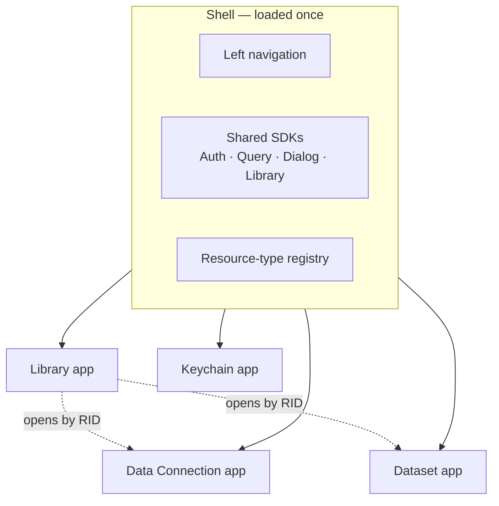

# Frontend — Shell, Apps and Resource Creation

_Draft, 2026-10-22. Decisions from the 2026-10-22 design discussion; not built yet unless marked. Code-writing rules (SDK pattern, store vs. query cache) are in [AGENTS.md](../../AGENTS.md); resources and `@EnsureResource` in [architecture.md](architecture.md#5-domain-models-vs-rows)._

Quarry's frontend follows Foundry's shape: a persistent workspace shell, and separate **apps** inside it — one per job (browsing files, connecting sources, looking at a dataset). Apps are independent; they meet only through RIDs, the shared SDKs, and the API.



---

## 1. Shell and apps

| Part | What it is |
|---|---|
| **Shell** | Always loaded: left navigation, auth, routing, the dialog stack, the shared SDKs, the resource-type registry. Never reloads when you switch apps. |
| **App** | One job, one route subtree: Library, Data Connection, Datasets, Keychain. Owns its UI and its own SDK, or uses a shared one (the Keychain app works on the shared KeychainSDK). Described by `App.Definition` (§1a). React's root component in `main.tsx` is `QuarryApp`, so `App` only ever means a workspace app. |

Foundry's equivalent: the workspace sidebar stays while apps change; Compass (Library) holds files, and opening a resource opens the app that owns it (a dataset opens in Dataset Preview, not in Compass). How Foundry bundles its apps isn't documented.

### 1a. `App` — the shared app kit

Every app is built from one namespace, **`App`**, exported from **`src/AppKit/`** (`import { App } from '@/AppKit'`) — the common design language for apps, like Foundry's apps all sharing one layout (Palantir doesn't publish that layout; this is Quarry's own convention, read from Foundry's apps such as the Workshop editor). AppKit is layout and types only — no state; it isn't an SDK. Styled with Tailwind. _Built: `layout.tsx` (Root, LeftNav + `LeftNav.Item`, sidebars, Content + `Content.Toolbar`), `header.tsx`, `definition.ts`, `index.ts`; no app uses it yet._

| Part | What it is |
|---|---|
| `App.Root` | the app's grid: the header across the top; LeftNav · LeftSidebar · Content · RightSidebar below. Parts place themselves by grid area, so any can be left out |
| `App.LeftNav` | icon strip choosing what the left sidebar shows (vertical tabs); `App.LeftNav.Item` is one tab (icon button, tooltip, `active`) |
| `App.LeftSidebar` | the panel `LeftNav` selects |
| `App.Header` | the top band |
| `App.Header.Icon` | the app's glyph (from its definition) in a square at the header's left, directly above the left nav |
| `App.Header.Rows` | the header's two stacked rows |
| `App.Header.Breadcrumbs` | location; the last item is the title |
| `App.Header.Title` | the resource or page name |
| `App.Header.Menubar` | File, Help, … — a plain `Menubar.Root` (standard-ui) |
| `App.Header.Actions` | right side: undo/redo, save/publish, share, sidebar toggles |
| `App.Content` | the main view; `App.Content.Toolbar` for a toolbar on top of it |
| `App.RightSidebar` | properties / details of the selection, toggled from the header |
| `App.Glyph` | an app's coloured mark on a tinted tile, one of two kinds: a Blueprint icon drawn whole in a base colour with chosen parts (the sub-paths of its path) painted over in other colours — `{ icon, tile, base, parts }`; or a shaded standard-ui illustration mixed from one colour — `{ illustration, color, tile }` (the Library's yellow folder, from PretzelGraph) |
| `App.Definition` | the model of an app: `id`, `label`, `glyph`, `to` (its home route, `/<app>` — every app has one), `inNavigation`, and `opens` — for each resource type it opens, the route it opens at (`rid => ToOptions`, type-checked against the route tree) |

The shell's own sidebar (the workspace navigation) is not part of an app.

**One shell measure: 56px** (Tailwind `14`) — the collapsed workspace sidebar's width and its top row's height, the left nav's width, the header's height and its icon square — so the corners line up across the shell and every app.

**Rules for every app:** the header menubar is app-wide and constant (File, View, Help — actions on the resource as a whole); `LeftNav` switches what the app shows — the left sidebar's panel, or the app's sections (the Library Explorer's Files / Cloud / Trash); actions for the current view go in `App.Content.Toolbar` or the panel's own header.

### Bundling and versioning

- **One build, one lazily loaded route per app.** An app's code is fetched the first time it's opened, then cached. No iframes, no Module Federation.
- **The workspace is versioned as a whole.** A deploy updates every app at once; there are no per-app versions, so shared SDKs need no compatibility rules between apps.
- **Stale tabs after a deploy.** A tab running the previous build may request an app chunk that no longer exists. Keep the previous build's assets for a while, and reload the page when a chunk fails to load — the user moves to the new workspace version as a whole.

### Registered apps and mounting

- **Each app exports its own definition** from `src/apps/<name>/definition.ts`; the file imports no app code (types only), so registering an app never loads it.
- **`src/shell/apps.ts`** imports those definitions into `APPS`. It tells the shell what exists: the workspace sidebar draws its links from it (`inNavigation` and an entry route `to`), and `resourceRoute(type, rid)` finds where a resource opens — the app whose `opens` has the RID's type, else the Library's `/resources/$rid`. `ResourceLink`, `ResourceBreadcrumbs` and the create dialogs use it. _Built: Library, Keychain, Datasets (`/datasets/$rid`), Data Connection (`/data-connection/sources/$rid`, a scaffold around the existing source panel)._
- **Launchpad** (`shell/Launchpad.tsx`): the sidebar's first item, "Launchpad", opens a grid of every registered app (Foundry's Applications portal); each tile opens the app's home. The sidebar below it lists the apps with `inNavigation`. _Built._
- **Every app has a home route**, `/<app>`: Datasets (`/datasets`, every dataset you can see — `GET /api/datasets`), Data Connection (`/data-connection`, every source — `GET /api/sources`), Library (`/library`), Keychain (`/keychain`). Resource routes hang below it (`/datasets/$rid`).
- **The router mounts apps.** Each app is a route subtree under `_workspace`; the router plugin's `autoCodeSplitting` puts every route's component in its own chunk, so an app's code loads on first visit; `WorkspaceLayout` renders the sidebar and `<Outlet />`. The layout never inspects the URL itself — that would be a second routing system and lose typed params, `beforeLoad` and per-route splitting.
- **RID → URL** is `resourceRoute` (the RID's type is in the RID); **URL → app** is the router.

Foundry's URLs have the same shape — the app first, then the resource's RID: `/workspace/compass/view/<folderRid>`, `/workspace/data-integration/dataset/preview/<datasetRid>/master`, `/workspace/module/view/latest/<moduleRid>` (from real Foundry links; not a documented list).

### Navigation between apps

Every app has its own routes, as in Foundry (`/workspace/compass/view/<rid>`, `/workspace/data-integration/dataset/preview/<rid>/…`, …): there's no single route that renders any resource. Apps link by RID — the registry's `open(rid)` gives a type's route, and the target app loads what it needs itself. No app reads another app's state.

**`/resources/$rid` is the Library app's route** — Compass's `view/<rid>`. A folder or project renders its contents. The selected item is a search param: **`/resources/<folderRid>?selected=<itemRid>`** shows the folder with that item selected and its details panel open (below). A non-folder RID at `/resources/<itemRid>` redirects there (`<parentRid>?selected=<itemRid>`), so a pasted or old RID link always lands somewhere meaningful. Listings link straight to the owning app's route for opening; selecting is a separate action. _Built so far: `/library` and `/resources/<project or folder>` render the Library Explorer; any other RID redirects to the app that opens it (Keychain opens credentials). Selection and `?selected=` aren't built yet._

**`LibraryExplorer`** (`SDKs/LibrarySDK/ui/LibraryExplorer/`, after PretzelGraph's `LibraryBrowser`) is the Library as composable parts — shared, so a picker can reuse them:

```ts
LibraryExplorer = {
    Root,                                                  // context: cwd + setCwd (from the host), onItemClick, isItemDisabled, the two searches
    Tree: Content + { Header, SearchInput },               // project/folder tree; children load on expand, the open folder's ancestors expand
    View: Content + { Header, Breadcrumbs, SearchInput, CreateBtn, Skeleton },  // the open folder as cards grouped by type
}
```

The Library Explorer app (`apps/library/LibraryExplorerApp.tsx`) is an AppKit app: the header holds the breadcrumbs, the search and "+ New"; the left nav switches its sections — **Files**, **Cloud** (disabled, not built) and **Trash** (a placeholder until there's an endpoint listing trashed resources) — kept in `/library?tab=`. On Files, the tree fills the left sidebar and the content shows the projects as cards (`ProjectCards.tsx`) at `/library`, or the open folder's items inside a project; the view's search sits in the header next to "+ New". `cwd` comes from the URL; choosing a non-container opens it in its app.

**The dataset app** starts with a **Preview** tab (first rows, read with the dataset's schema). History (needs a transactions endpoint), schema, files, and later compare / health / builds follow.

### Library: selection and the details panel

Like Compass: items in a folder can be selected (several at once), and the **primary selected item** — the last one selected — shows a details panel beside the listing:

| Section | Contents | In Quarry today |
|---|---|---|
| Header | icon, name, type; close | ✓ `Library.Resource.Base` |
| Description | inline-editable | ✓ field exists; no edit endpoint checked |
| Access | your role on it; who has access | grants list exists (`Gatekeeper.API.Grant.List`); "your role" may need an endpoint |
| Collaborators | users with grants | from the grants list |
| Misc | RID (copy), location path (copy), created / modified, by whom | ✓ `rid`, path (`Library.API.Resource.path`), `created_by`/`created_at`/`updated_at`; **no `updated_by`** |

Foundry's panel also has views, followers, comments and documentation — not in Quarry.

Selection is Library-app state: the primary item is in the URL (`?selected=`, so it survives a refresh and can be linked); the rest of a multi-selection is transient UI state.

---

## 2. SDKs: shared and local

| | SDKs | Owned by |
|---|---|---|
| **Shared** | Auth, Query, Dialog, Library, Keychain | the shell — one instance for the whole workspace |
| **Local** | DataConnection, Catalog (dataset app) | their app |

Because everything is one build, a shared SDK is one module instance: one store, one query cache. A resource picker opened from any app makes one request and every app reads the cached result.

**Apps never import other apps.** An `apps/X` → `apps/Y` import would still work technically (the bundler moves the module into a shared chunk), but it silently turns one app's internals into a shared API and makes opening one app download another. Enforced by a lint rule (`import/no-restricted-paths` or `eslint-plugin-boundaries`). When another app genuinely needs an SDK, it moves into the shared SDKs deliberately.

**State: store or query cache only** ([AGENTS.md §7](../../AGENTS.md#7-tanstack-query-owns-request-state)). Entities shared by RID, read by several screens or SDKs, changed locally, or used by selectors go in the SDK store. Read-only results for one screen (dataset views, previews) stay in the query cache only. Never both. _Built for CatalogSDK._

---

## 3. Resource types

Every library resource (project, folder, dataset, source, credential) is created by its **owning service's** endpoint. The server writes the `library.resource` row and the subtype row (`catalog.dataset`, `data_connection.source`, …) in one transaction via `@EnsureResource`; Library's own endpoints create only projects and folders. Every create request has the same base — `{ parentRid, name, description? }` (projects have no parent) — plus the type's own fields. _Built; folders moved to `POST /api/folders` with `parentRid` in the body._

### The registry

LibrarySDK holds a **static list of resource types** — one entry per type, contributed by the owning app:

| Field | Meaning |
|---|---|
| `type` | `Library.Resource.Type` |
| `label`, `icon` | how it appears in the "+ New" menu and in listings |
| `open(rid)` | the route the resource opens at, in its app |
| `dialog?` | a lazily imported custom creation dialog — only for types that need one (§4) |
| `inNewMenu` | whether the type is offered in the Library's "+ New" menu; types created through a multi-step flow in their own app aren't |

A static list rather than self-registering modules: it's typed, has no import-order problems, and shows every type in one place. Entries are small and must not import app code eagerly — anything heavy (a custom dialog) is a dynamic `import()`.

---

## 4. Creating a resource

### Entry point: the "+ New" menu

Like Compass: a **+ New** button in a folder, listing the resource types. Library's own types first (Folder), a divider, then every other creatable type alphabetically. Credentials aren't listed (`show_in_explorer = false`; created in Keychain). Projects have their own "New project" button.

### Who does what

| | Owns |
|---|---|
| **LibrarySDK** | the menu, the registry, the generic dialog, the create call, storing the new resource, refreshing the folder, navigating to the new resource |
| **Owning SDK** | nothing at creation time; it loads its type's own fields when its app opens the RID |

LibrarySDK calls the type's **public create endpoint directly through the shared API client** (`Catalog.API.Dataset.create`, …) — no app code is loaded to create a resource. It stores **only the library part** of the response: every subtype schema extends `Library.Resource.Base`, so parsing the response with it drops the subtype's fields. Creating from the Library is a Library operation on the client, even though the server writes both rows.

```
+ New → type
  generic: LibrarySDK's dialog → shared client → owning service's endpoint (library row + subtype row)
  custom:  the app's dialog (lazy) → shared client → owning service's endpoint
then: store Library.Resource.Base · refresh the folder's children · navigate to open(rid)
```

### The generic dialog and generated fields

The generic dialog renders `name` and `description` itself (the parent is the current folder). Any further fields come from the type's create-request schema:

1. `z.toJSONSchema(<Type>.API.Create.Request, { io: 'input' })` — in the browser; request schemas live in `@quarry/shared`.
2. Remove `parentRid`, `name`, `description`.
3. Render the rest with `SchemaFields` (it renders JSON Schema, already used for source config and credential fields).
4. Validate with the same zod schema before sending.

A type with no extra fields (dataset, folder) gets the plain dialog. Fields that need more than an input are marked in the schema with `.meta(...)`, which zod copies into the JSON Schema — e.g. `{ widget: 'resource', resourceType: 'credential' }` for a resource picker, `{ widget: 'options', from: '…' }` for choices loaded from the server; `SchemaFields` maps widgets to components.

### Custom dialogs

For forms that change shape after a choice, the app supplies the dialog; it receives `parentRid`, calls the shared client, and hands the new RID back so LibrarySDK still stores, refreshes and navigates. Files (uploading a dataset from a file) are multipart and also stay in their app's dialog.

### Sources: created in Data Connection

A source isn't a file you name and fill in later — it needs a system, a credential and a working connection before it's useful. Like Foundry ("Data Connection → Sources → New source", where the location is one step of the flow), sources are **created in the Data Connection app** through a multi-step flow, not from the Library's "+ New" (`inNewMenu: false`):

1. **System** — choose the source type (`definitionId`).
2. **Name and location** — a folder picker (any project or folder; Foundry recommends a project per source, Quarry doesn't enforce it).
3. **Connection** — credential (filtered to the system's template) and config (`SchemaFields` from the definition's `configSchema`).
4. **Test**, then create — the source is created at the end, in one request, so there's no half-configured source.

A source is still a library resource (`library.resource` + `data_connection.source`): it appears in its folder, has grants, can be moved and trashed, and opening it goes to Data Connection.

---

## 5. Today vs. this design

| Today | Changes to |
|---|---|
| `FolderPanel` (Library) imports `NewSourceDialog` (Data Connection) and `UploadDialog` (Catalog) | the "+ New" menu from the registry; sources created in Data Connection |
| `DatasetPanel` renders inside the Library's `/resources/$rid` route | the dataset app's own route |
| `createFromFile` writes the new dataset into `CatalogSDK.state.datasets` | LibrarySDK stores the library part only |
| Apps call `LibrarySDK.invalidate(children)` after creating | LibrarySDK refreshes the folder itself |
| `packages/frontend/src/SDKs/*`, `routes/*` | `shell/`, shared `SDKs/`, `apps/<name>/` |

---

## 6. Open questions

- **Folder layout** — the proposed `shell/` · `SDKs/` · `apps/<name>/` split hasn't been confirmed.
