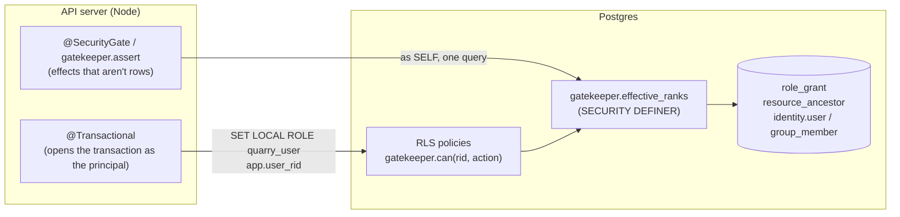
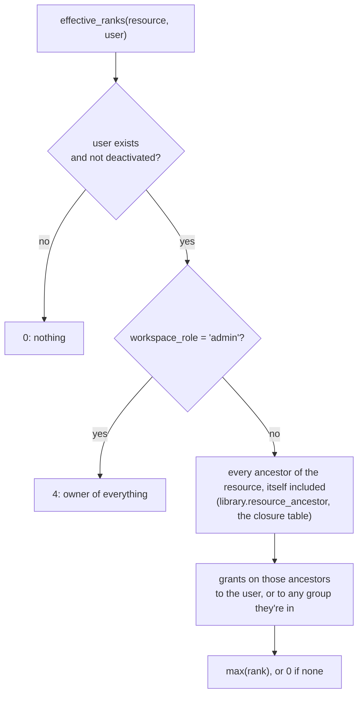
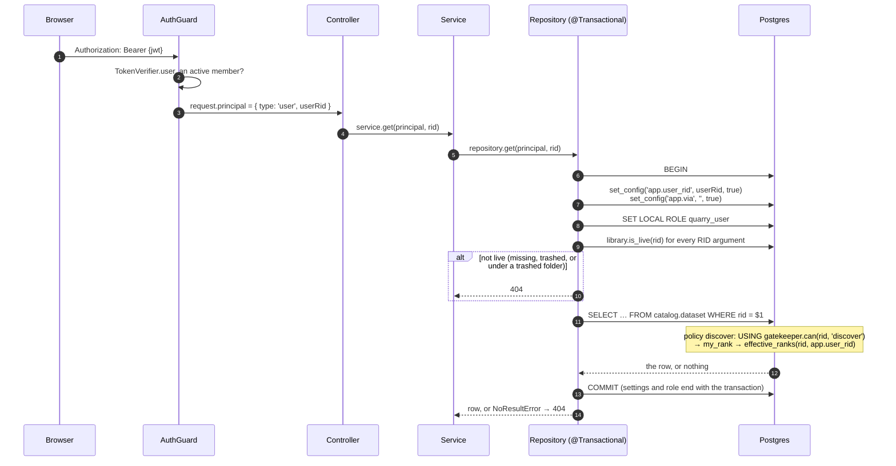
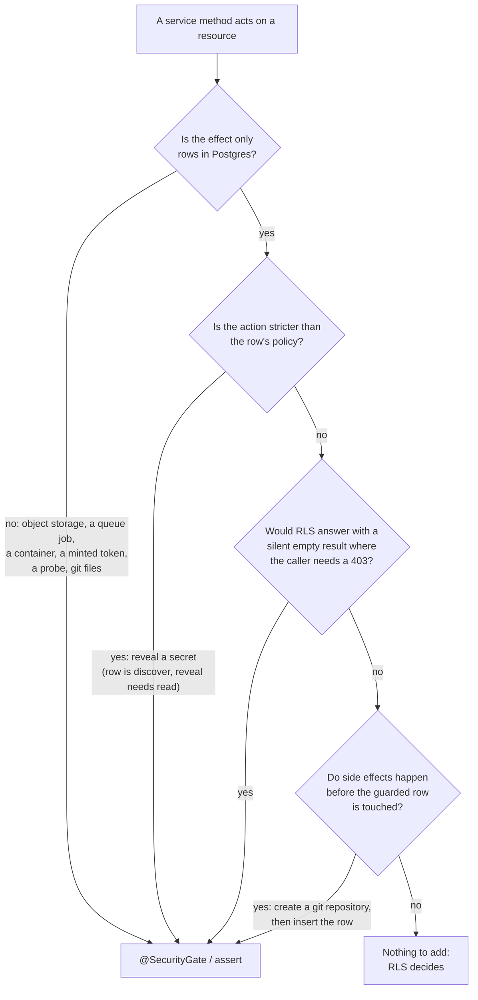
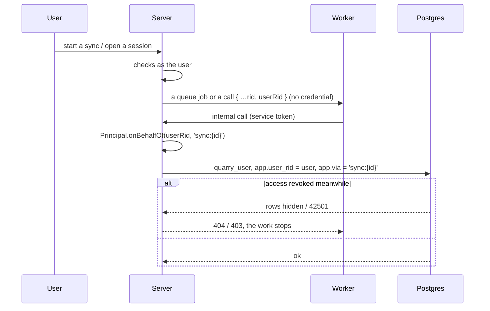

# How Gatekeeper and row-level security work together

[gatekeeper.md](gatekeeper.md) is the design: principles, roles and API. [database.md §8](database.md) covers the database roles. This file follows one request through the code and shows **where each check runs, which one fires, and why**.

In one sentence: **Postgres decides about rows, and `GatekeeperService` decides about everything else.** Both ask the same question through the same SQL function, so they can't disagree.



---

## 1. The single source of truth: effective rank

| Role | Rank | Smallest action it allows |
|---|---|---|
| discoverer | 1 | `discover`: see that it exists, its name, its place in the tree |
| viewer | 2 | `read`: its contents (rows, files, samples, sessions) |
| editor | 3 | `write`: change it, create things inside it |
| owner | 4 | `manage`: change who has access |

`Gatekeeper.Action.MINIMUM_RANK` (`shared/domain/Gatekeeper/Action.ts`) is `discover 1 · read 2 · write 3 · manage 4`. The SQL function `gatekeeper.can` repeats this mapping in a `CASE`, and the `gatekeeper.action` domain rejects typos (`'raed'` fails instead of silently denying).

A user's **effective rank** on a resource is computed by `gatekeeper.effective_ranks(rids[], user)` (`migrations/gatekeeper/001_initial.sql`):



- **Inheritance is free.** The closure table holds a `(resource, ancestor)` row for every ancestor, depth 0 included. A grant on a project therefore reaches every folder and dataset under it in one join, with no recursion at query time.
- **Grants only add.** There are no deny rules, so the highest grant wins. Taking access away means removing a grant (or moving the resource out from under it).
- **`SECURITY DEFINER`.** The function reads grants and ancestry that RLS hides from the user, and the policies themselves call it. It runs as the table owner, so it isn't subject to those policies (otherwise it would recurse into itself).

### Worked example

```
Sales (project)           ← alice: viewer (2)    group analysts: editor (3)
└── Raw (folder)          ← bob: owner (4)
    └── orders (dataset)
```

| User | Rank on `orders` | Why |
|---|---|---|
| alice | 2 | viewer on Sales, an ancestor |
| alice, after joining `analysts` | 3 | the group's editor grant beats her own viewer one |
| bob | 4 | owner on Raw |
| carol (no grants) | 0 | `discover` fails, so it's a **404** for her, not a 403 |
| any admin | 4 | implicit owner |
| a deactivated admin | 0 | deactivation wins over everything |

---

## 2. Principals: who is asking

Every repository method and every gated service method takes a `Principal` first (`server/src/auth/principal.ts`):

| Principal | Created by | Checked as | Transaction runs as |
|---|---|---|---|
| `user` | `AuthGuard` → `TokenVerifier.user(jwt)`: a GoTrue JWT and an active `identity.user` row, looked up on every request | that user | `quarry_user`, `app.user_rid = user` |
| `delegate` | `Principal.onBehalfOf(userRid, via)`: background work for a user (a sync run, a code workspace session's credentials) | **exactly that user**, so it can never do more than they could | `quarry_user`, `app.user_rid = user`, `app.via = via` |
| `service` | `Principal.SELF(reason)`: the system on its own (housekeeping, permission lookups) | **bypasses** Gatekeeper: rank 4 everywhere | the connecting role, which owns the tables, so RLS doesn't apply |

`via` is for logs and audit only. It is never an input to access control.

---

## 3. How a request becomes an RLS-checked transaction



What makes this work (`server/src/db/pool.ts`, `server/src/db/repository.ts`):

- **`set_config(…, true)` and `SET LOCAL`** last only for the transaction. A pooled connection goes back to the pool clean, and one request's user can never leak into another's.
- **`quarry_user`** is a `NOLOGIN` role (`migrations/foundations/001_initial.sql`) that the app's connection may switch to. Every table's policies are written `TO quarry_user`. The owner role, used for service work, has no policies applied.
- **`gatekeeper.my_rank(rid)`** reads `current_setting('app.user_rid', true)`. Without a user it is 0, so a `quarry_user` transaction that somehow had no user sees nothing.
- **Joining.** A decorated repository method called inside another joins its transaction, but only as the **same principal** (`samePrincipal`). A user's call can't join a service transaction and pick up its unrestricted role, or the other way around; trying throws.
- **Liveness is separate from permission.** `@Transactional` checks every top-level RID argument with `library.is_live` (also `SECURITY DEFINER`: a trashed folder you can't see still hides the dataset you can). `@AllowTrashed()` exempts a parameter for restore, purge and trash listings.

---

## 4. What the policies look like

Every resource table follows the same short pattern. The policy names the action; `gatekeeper.can` does the rest:

```sql
-- catalog.dataset (and code_workspace.workspace, keychain.credential, data_connection.source …)
CREATE POLICY discover ON catalog.dataset FOR SELECT TO quarry_user USING      (gatekeeper.can(rid, 'discover'));
CREATE POLICY create_  ON catalog.dataset FOR INSERT TO quarry_user WITH CHECK (gatekeeper.can(rid, 'write'));

-- child tables check the owning resource's RID
CREATE POLICY read ON catalog.transaction FOR SELECT TO quarry_user USING      (gatekeeper.can(dataset_rid, 'read'));
CREATE POLICY open ON catalog.transaction FOR INSERT TO quarry_user WITH CHECK (gatekeeper.can(dataset_rid, 'write'));
```

| Table | SELECT | INSERT | UPDATE | DELETE |
|---|---|---|---|---|
| `library.resource` | discover on it **or its parent** | write on the parent (admins only for projects) | write | none (trash is an UPDATE) |
| `library.resource_ancestor` | discover | definer triggers only | no | no |
| `gatekeeper.role_grant` | read | manage | manage | manage |
| subtype rows (`dataset`, `source`, `workspace`, `credential`) | discover | write | write | none |
| contents (`transaction`, `sync_run`, …) | read | write | write | none |
| `audit.access_event` | your own `open`s (Recents) | your own only | no | no |

Some cases a policy can't handle, so a trigger does instead:

- **New resources.** A new `library.resource` row's ancestry is written by an `AFTER INSERT` trigger, *after* the policy checks run. That's why `discover` also accepts discover on the **parent**, and why `create_` on subtype tables (checked later, in the same transaction) already finds the ancestry in place.
- **Moves.** A policy sees only the new row, so it can't tell a rename from a move. `library.check_parent` (a `BEFORE UPDATE OF parent_rid` trigger) requires write on the **new** parent, and only for users (`app.user_rid` set).

### What a refusal looks like

| RLS outcome | Seen by the code as | HTTP (`db/errors.ts`) |
|---|---|---|
| SELECT on a row you can't see | no row (`NoResultError`, or an empty list) | 404 |
| UPDATE / DELETE on a row you can't see | 0 rows affected → `requireAffected` | 404 |
| INSERT / UPDATE failing `WITH CHECK` | SQLSTATE `42501` | 403 |
| `check_parent` refusing a move | `42501` (`insufficient_privilege`) | 403 |

RLS hides rows rather than raising errors, so "doesn't exist" and "not yours" look the same: a 404. That's deliberate, since it doesn't reveal what exists.

---

## 5. `GatekeeperService`: the checks that aren't rows

`GatekeeperService` (`services/Gatekeeper/gatekeeper.service.ts`) asks the **same** `effective_ranks` from Node:

| Method | Answers |
|---|---|
| `rank(principal, rid)` | the effective rank (service principals: 4) |
| `can(principal, action, rid)` | `rank ≥ MINIMUM_RANK[action]` |
| `assert(principal, action, rid)` | returns, or records an audit `denied` event and throws **404** (can't even discover) or **403** (can discover, not this action) |
| `filter(principal, action, rids)` | the subset allowed: one query for any number |
| `listGrants` / `grant` / `revoke` | grant rows, so RLS decides (read to list, manage to change) |

`ranks` runs its query **as `SELF`**: it's a lookup, and `effective_ranks` is `SECURITY DEFINER` anyway. It memoizes per request in `RequestMemo`, keyed `userRid|rid`, so three checks on one resource in one request cost one query. The memo dies with the request, so it's never stale. Workers have no memo.

### `@SecurityGate(action)`

This is the decorator form of `assert`. It goes on a service method shaped `(principal, rid, …)` and runs before the body. Compound checks (two resources, or an action chosen at runtime) call `this.gatekeeper.assert` directly.

---

## 6. Which one to use

The rule in `security-gate.ts`: **RLS already decides every plain read and write of a row.** Add a Gatekeeper check only when RLS can't express the rule:



Real examples:

| Method | Check | Why not just RLS |
|---|---|---|
| `CatalogService.list`, `.get`, `CodeWorkspaceService.get`, `.list` | RLS only | plain rows |
| `KeychainService.getEncryptedBlob` | `@SecurityGate('read')` | the row policy is `discover`; using the secret needs `read` |
| `CatalogService.view` | `@SecurityGate('read')` | RLS on transactions would answer with a silently empty view; the view hands out storage keys |
| `CatalogStorage.sample`, `.preview` | `@SecurityGate('read')` | the bytes are in object storage, not Postgres |
| `DataConnectionService` `test`, `explore`, `previewTable` | `@SecurityGate('read')` | the effect is a queue job against an external system |
| `DataConnectionService` sync `run` | `@SecurityGate('write')` on the source, plus `assert('write')` on the output dataset | two resources |
| `CodeWorkspaceService.create` | `assert('write')` on the parent **first** | the git repository is created on disk before any row exists |
| `CodeWorkspaceService.openSession`, `preview` | `@SecurityGate('read')` | a call to the code workspace worker, and a container |
| `CodeWorkspaceService.authorizeGit` | `assert(push ? 'write' : 'read')` | the action depends on the git operation |

Never put `@SecurityGate` on the same method as `@Transactional`. The gate belongs on the service, RLS belongs in the repository it calls, and the two layers stay separate.

---

## 7. Decorator order

Decorators listed higher wrap those below, so they run first:

```ts
@RequireUserPrincipal('Only users have sessions')   // 1. 403 for non-users, before any lookup
@SecurityGate('read')                                // 2. 404 / 403 from Gatekeeper (a refusal is audited as `denied`)
public async openSession(principal: Principal.User, rid: CodeWorkspace.Rid) {
    const workspace = await this.get(principal, rid);  // 3. RLS + liveness (404 if trashed)
    …
}

@Audit('read', (rows: number) => ({ op: 'sample', rows }))   // outermost: records the access after the method succeeds
@SecurityGate('read')                                        // so a refusal is the gate's `denied`, never a read
public async sample(principal: Principal, datasetRid: Catalog.Dataset.Rid, rows: number) { … }
```

And in a repository creating a resource subtype:

```ts
@Transactional()                // opens the quarry_user transaction, checks liveness
@EnsureResource('dataset')      // inserts library.resource first (RLS: write on the parent → 403)
public async create(principal, values) {
    this.resource               // the library row, in this transaction
    // insert catalog.dataset: RLS create_, gatekeeper.can(rid, 'write'), already true through the parent
}
```

---

## 8. Delegates: background work stays bounded



A delegate is checked as its user **at the moment the work happens**, not when it was queued. Revoking access or deactivating the user stops queued and scheduled work on its next step. A job with no user (`onBehalfOf(null, …)`) becomes `SELF`; that is for system-triggered work only.

---

## 9. Cost, and when grants change

- **On the fly.** Each policy check computes the rank for that row: a closure-table join plus the user's group memberships. A list of N rows costs N small indexed lookups. There's no materialized access table yet.
- **`filter`** batches ranks for many RIDs in one query, for listings that come from outside Postgres.
- **Permission epoch.** Every change that can alter a rank fires a statement trigger that bumps `gatekeeper.epoch` and sends `NOTIFY gatekeeper_epoch`:
  - a grant changing
  - a move (`parent_rid`)
  - group membership changing
  - a user's `workspace_role` or deactivation changing

  Nothing caches across requests today, so nothing listens yet. The epoch is in place for a future cross-request decision cache (gatekeeper.md §7).

---

## 10. Pitfalls

- **Service principals see everything.** Pass the user's principal down. Use `SELF` only where the system acts on its own, and say why in `reason`.
- **RIDs inside payload objects aren't liveness-checked.** Resources you act on go in top-level parameters. `@EnsureResource` checks a new resource's parent.
- **A new table needs RLS.** `ENABLE ROW LEVEL SECURITY` plus policies `TO quarry_user`, and `GRANT` only the verbs you have policies for. A table with RLS enabled and no policy is invisible to users; a table without RLS is wide open to every user.
- **Policies see only `NEW`.** Anything that depends on the old row (moves) belongs in a `SECURITY DEFINER` trigger.
- **An empty list isn't an error.** If a caller must tell "none" from "forbidden", gate it with `assert`.
