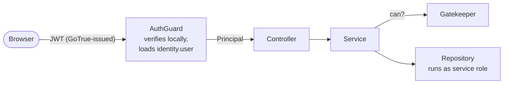

# Gatekeeper — Authorization

_Draft, 2026-10-13. Tables and triggers are in [database.md](database.md) (§3 `identity`, §4 `library`, §5 `gatekeeper`). Foundry background: [research notes](../research/palantir-foundry-ontology.md)._

Gatekeeper answers one question for every service: **may this principal do this action on this resource?** It's modelled on Foundry's split — authentication by one service (Multipass there, GoTrue here), authorization by a central permission service that every other service asks before acting.

---

## 1. Principles

- **Row-level security decides every plain read and write of a row** (decided 2026-10-21). User and delegate transactions run as `quarry_user` under policies built on the same rank function ([database.md §8](database.md#8-database-roles-and-row-level-security)); service code doesn't gate them. A 404 means *doesn't exist, or not yours*.
- **`@SecurityGate` / `assert` only for business rules RLS can't express:** effects that aren't rows (a queued sync run, a source probe, object storage), actions stricter than the row's policy (revealing or using a credential — its row is readable at discover), results RLS would silently empty (a dataset's view, a sync's run history), and side effects that come before the guarded row (creating a sync makes its dataset and scheduler first).
- **Every service asks before acting.** Gatekeeper is an in-process module — a check is a function call plus one indexed query, no network hop.
- **Relationship-based.** Permissions are edges in a graph: user → member of → group → role on → folder → ancestor of → dataset.
- **Additive.** Grants only add access; there are no deny rules. (Mandatory controls that *restrict* — markings — come later, §9.)
- **One workspace.** This app is a single-workspace silo: no tenant columns, no organizations. Having an `identity.user` row means being a member of the workspace.
- **Check, then act.** A check and the following write run in separate transactions; a revocation landing in between is accepted (a millisecond window). No in-transaction re-checks.

---

## 2. Authentication vs authorization



| Concern | Owner | Notes |
|---|---|---|
| Credentials, sessions, JWTs | **GoTrue** (`auth` schema) | Not our tables; we only verify its JWTs |
| Who is in the workspace, groups | **`identity` schema** | `identity.user.rid` = `ri.identity.main.user.<GoTrue user id>` |
| What a principal may do | **Gatekeeper** (`gatekeeper` schema) | Grants, roles, the check API |
| Resource tree used for inheritance | **Library** (`library.resource_ancestor`) | Gatekeeper reads it, never writes it |

**AuthGuard** (per request):
1. Verify the JWT signature locally with the GoTrue JWT secret — no database call.
2. Load `identity.user` by `sub`. Missing → `403 not a workspace member`. `deactivated_at` set → `403`.
3. Build `Principal.User { userRid, workspaceRole }` — `userRid` = `ri.identity.main.user.<sub>` (`Identity.User.fromAuthId`) — and attach it to the request.

Membership is provisioned by an admin (create `identity.user` + GoTrue invite). Signing up with GoTrue alone grants nothing.

**First admin:** the first verified login whose email equals `QUARRY_BOOTSTRAP_ADMIN_EMAIL` becomes a member with `workspace_role = 'admin'` — only while the workspace has no admin (serialised, so two concurrent first logins can't both win).

---

## 3. Principals

```ts
type Principal =
    | { type: 'user';     userRid: User.Rid; workspaceRole: 'member' | 'admin' }
    | { type: 'delegate'; userRid: User.Rid; via: string }      // background work on behalf of a user
    | { type: 'service';  reason: string };                   // the system itself
```

- **User** — a human acting through the API. Every check applies.
- **Delegate** — background work **on behalf of a user**: a sync run they triggered, or a scheduled run of a sync they created (`Principal.onBehalfOf(userRid, 'sync:<id>')`); a source probe they requested. Gatekeeper checks it **exactly as that user** — it can never do more than they could, and if they lose access the work stops (verified: a scheduled run for a user whose grant was revoked fails with *Not found* before opening a transaction). `via` is for audit only, never an access-control input. Delegates can't create projects (admins only). Mirrors PretzelGraph's `delegate`.
- **Service** — the system acting on its own: authentication bootstrap, Gatekeeper's own permission lookup, housekeeping (outbox relay, storage GC, reaper, scheduler), and failure cleanup that must succeed even if a user lost access mid-run. **Bypasses checks.** Each use names a `reason` so it's greppable — same convention as Pretzel's `asService`.
- **Workspace admin** (`workspaceRole = 'admin'`) — manages users and groups and is implicitly **owner of every resource**. A break-glass role for a single-workspace silo; see §10 for the alternative.

---

## 4. Roles and actions

Four roles, ranked; a higher role includes everything below it.

| Rank | Role | Can |
|---|---|---|
| 1 | **discoverer** | See that the resource exists: name, type, location. Not its contents. |
| 2 | **viewer** | Read contents: dataset files and schema, source config, sync history; **use** a credential (name it on a source, run with it) without seeing its values. |
| 3 | **editor** | Change it: commit transactions, edit config, run syncs, create children, rename, move, trash; **reveal** and change a credential's values. |
| 4 | **owner** | Manage it: grant and revoke roles, purge. |

Services check **actions**, not roles — each action maps to a minimum rank:

```ts
const MinimumRank = { discover: 1, read: 2, write: 3, manage: 4 } as const;
type Action = keyof typeof MinimumRank;
```

Coarse on purpose. If finer control is needed later ("may run syncs but not edit the source config"), name **operations** (`'data-connection:sync:run'`) and map each to a minimum rank — `@SecurityGate` keeps its signature, only its argument type widens.

Compound operations check every resource involved:

| Operation | Requires |
|---|---|
| Create a resource in folder F | `write` on F |
| Move R from F to G | `write` on R and `write` on G |
| Read a dataset's files | `read` on the dataset |
| Run a sync | `write` on the sync's source **and** `write` on its output dataset |
| Grant a role on R | `manage` on R |

---

## 5. The permission model

**Grants** (`gatekeeper.role_grant`) attach a role to a user *or* a group on any library resource — usually a project or folder.

**Effective rank** of user U on resource R:

```
max( rank of every grant on R or any ancestor of R,
     to U or any group U belongs to )
— 4 if U is a workspace admin
— 0 if U is deactivated
```

Inheritance comes from the **closure table** `library.resource_ancestor`, which stores every (resource, ancestor) pair including the resource itself. Library maintains it with triggers on insert and move, so an ancestor lookup is one index scan instead of a recursive walk. The whole rule is one SQL function:

```sql
gatekeeper.effective_rank(resource_rid, user_rid) → 0..4
```

Trash is **not** a Gatekeeper concern. Gatekeeper answers "would be allowed"; the repository layer answers "does it exist right now" (not trashed, no trashed ancestor): `@Transactional` checks every top-level resource-RID argument, unless that parameter is marked `@AllowTrashed()`. Both fail with 404, so a trashed resource and an invisible one look the same.

---

## 6. API

```ts
@Injectable()
export class GatekeeperService {

    /** Effective rank 0..4. Service principals → 4. */
    rank(principal: Principal, rid: Rid): Promise<Rank>;

    can(principal: Principal, action: Action, rid: Rid): Promise<boolean>;

    /** Throws NotFound if the principal can't even discover it, Forbidden otherwise. */
    assert(principal: Principal, action: Action, rid: Rid): Promise<void>;

    /** Batch: which of these may the principal act on — one query for any number. */
    filter(principal: Principal, action: Action, rids: Rid[]): Promise<Set<Rid>>;

    // Managing grants — each asserts `manage` on the resource first.
    grant(principal: Principal, rid: Rid, subject: Subject, role: Role): Promise<void>;
    revoke(principal: Principal, rid: Rid, subject: Subject): Promise<void>;
    listGrants(principal: Principal, rid: Rid): Promise<Grant[]>;   // needs `read`
}

type Rid     = Library.Resource.Rid;   // only library resources can be gated — see database.md §2
type Subject = { type: 'user'; userRid: User.Rid } | { type: 'group'; groupRid: Group.Rid };
```

**404 vs 403.** If the principal lacks `discover`, `assert` throws **NotFound** — telling them it's forbidden would reveal that it exists. With `discover` but not the required action: **Forbidden**.

### `@SecurityGate` — the usual way to check

A method decorator for service methods shaped **principal first, resource RID second** — the service-layer counterpart of the repositories' `@Transactional`.

```ts
type RidSecond<M> = M extends (principal: Principal, rid: infer R, ...rest: never[]) => unknown
    ? ([R] extends [Library.Resource.Rid] ? unknown : { error: 'second parameter must be a resource Rid' })
    : never;

export function SecurityGate(action: Action) {
    return function <M extends (principal: Principal, rid: never, ...rest: never[]) => Promise<unknown>>(
        target: { gatekeeper: GatekeeperService },               // the class must inject GatekeeperService
        key: string | symbol,
        descriptor: TypedPropertyDescriptor<M> & RidSecond<M>,   // second param must be a resource RID
    ): void {
        const original = descriptor.value!;

        descriptor.value = async function (this: { gatekeeper: GatekeeperService }, principal, rid, ...rest) {
            if (principal.type !== 'service')
                await this.gatekeeper.assert(principal, action, rid);   // memoized per request; 404 / 403

            return original.call(this, principal, rid, ...rest);
        } as M;
    };
}
```

```ts
@Injectable()
export class CatalogService {

    constructor(
        readonly gatekeeper:         GatekeeperService,
        private readonly repository: TransactionRepository,     // the only repository → `repository`
    ) {}

    @SecurityGate('read')
    async readView(principal: Principal, datasetRid: Dataset.Rid, branch = 'main'): Promise<View> {
        return this.repository.resolveView(principal, datasetRid, branch);
    }

    // Creating: the parent comes second, so the gate checks `write` on the folder.
    @SecurityGate('write')
    async createDataset(principal: Principal, parentRid: Library.Resource.Rid, name: string): Promise<Dataset> { … }
}
```

Compile-time guarantees (verified with `tsc --strict --experimentalDecorators`): the second parameter must be a library-resource RID — a plain `string` or a `Transaction.Rid` is rejected — and the class must have a `gatekeeper` field. `Action` is the union from §4, so a misspelled action doesn't compile.

**Outside the decorator's shape** — compound checks (move needs `write` on the target folder too; running a sync needs `write` on source and dataset) or methods whose second parameter isn't the resource — call `this.gatekeeper.assert(...)` in the method body. The decorator deliberately has only this one positional form.

**`@SecurityGate` goes on services, `@Transactional` on repositories — never both on one method.**

### Layering and nesting

Services check with the caller's principal (`@SecurityGate`, `assert`), then **pass that same principal to the repositories they call** — repositories don't re-check; the service layer is the one place authorization happens. Passing the real principal down means the transaction carries `app.user_rid` (and `app.via` for delegates) for audit, and repositories derive `created_by` / `started_by` / `granted_by` / `trashed_by` from it with `Principal.actorOf` — callers never pass an actor by hand. Repository methods are `@Transactional()` (any principal) unless system-only (`@Transactional('service')`). `app.user_rid` also drives row-level security: the policies ask `gatekeeper.can(rid, action)` for that user, so a repository call a service forgot to gate is still filtered or refused by Postgres.

Nesting gated service calls is **safe** — unlike `@Transactional`, a gate holds no transaction or connection, it's just a read. Three rules:

1. **Pass the caller's principal down service → service.** Every hop is then checked against what that user may do; checking the same resource twice costs nothing (request memo).
2. **`Principal.SELF` is an explicit escalation — only for genuine system work** (housekeeping, Gatekeeper's lookup, auth bootstrap, failure cleanup). Never to replace a user's or delegate's principal: that's the confused-deputy bug — the work does something the user couldn't. Background work for a user is a **delegate**, not `SELF`.
3. **The request memo is keyed by `(principal, rid, action)`**, never `(rid, action)` alone — a check made as `SELF` must not answer a later check made as the user.

### Listings

Never check items one by one (N+1). Two patterns:

- **Arbitrary set** — `filter(principal, action, rids)` → one query using `gatekeeper.effective_ranks(rids[], user)`.
- **Children of a folder** — a child's ancestors are the folder's ancestors plus itself, so `rank(child) = max(rank(folder), direct grant on child)`. Compute `rank(folder)` once; if it's ≥ the required rank, every child passes; otherwise only children with their own direct grant do. Library's listing query takes the folder rank as a parameter.

---

## 7. Cost and caching

A single check is one call to `gatekeeper.effective_rank` — an index lookup over a handful of closure rows (one per tree level), roughly a millisecond including the round trip to local Postgres. Requests make one to three.

| Tier | What | Status |
|---|---|---|
| **Request memo** | `(principal, rid, action) → decision` for the current request, in `AsyncLocalStorage` | **Always on.** Dies with the request, so always correct. |
| **JWT verification** | Signature checked locally | No database call. |
| **Decision cache** | `(user, rid) → rank` across requests | **Deferred until profiling shows checks matter.** Design below. |

### Decision cache design (when needed)

The hard part is staleness after a revoke. `gatekeeper.epoch` is a single counter, bumped **by database triggers** in the same transaction as any change that can alter a decision:

- grant created, changed or revoked (`gatekeeper.role_grant`)
- resource moved (`library.resource.parent_rid`)
- group membership changed (`identity.group_member`)
- user deactivated or admin status changed (`identity.user`)

Cache entries are tagged with the epoch they were computed under; an entry from an older epoch is discarded. The trigger also sends `NOTIFY gatekeeper_epoch`, so with several app processes each one learns of a bump immediately via `LISTEN`. A single-process deployment can read the epoch once per request instead.

Because triggers maintain it, no code path can change permissions without invalidating caches.

---

## 8. Ownership boundaries

- **Gatekeeper owns** `gatekeeper.*` and the epoch triggers it installs on `library.resource`, `identity.user` and `identity.group_member` (installed by Gatekeeper's migrations, since it's the consumer).
- **Gatekeeper reads** `library.resource_ancestor` and `identity.*` — the foundation schemas every service may read.
- **Nobody else reads** `gatekeeper.role_grant`. Other services go through the API; Library's folder listing takes the folder's rank as an input rather than joining grants.

---

## 9. Later: mandatory controls (markings)

Foundry's second layer — restrictions that **travel with the data** through lineage (`PII`, `HR`) and apply even to owners. The extension point is the check itself:

```
allowed = effective_rank ≥ required          ← discretionary (this doc)
      AND user holds every marking on R      ← mandatory (later)
```

Markings need lineage (which datasets derive from which) to propagate, so they wait until transforms exist.

---

## 10. Open questions

- **Admin as implicit owner** — keep it, or make admins grant themselves access explicitly (audited)? Implicit is simpler; explicit leaves a trail.
- **Seeing the path** — a user with a grant deep in a project: can they see the names of the folders above it (implicit `discover` on ancestors), or only the resource?
- **Project creation** — any member, or admins only?
- **Group nesting** — groups inside groups? (Not supported now; `group_member` holds users only.)
- **Audit log** — record grants, revokes and denied checks to an `audit` table from the start?
