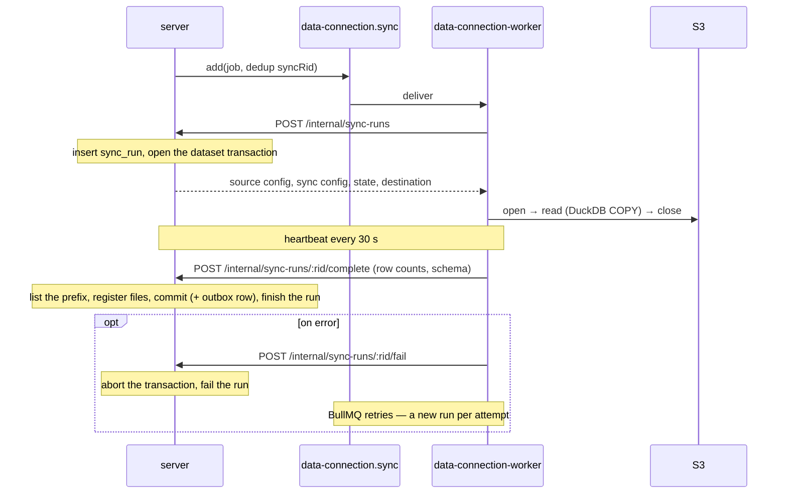
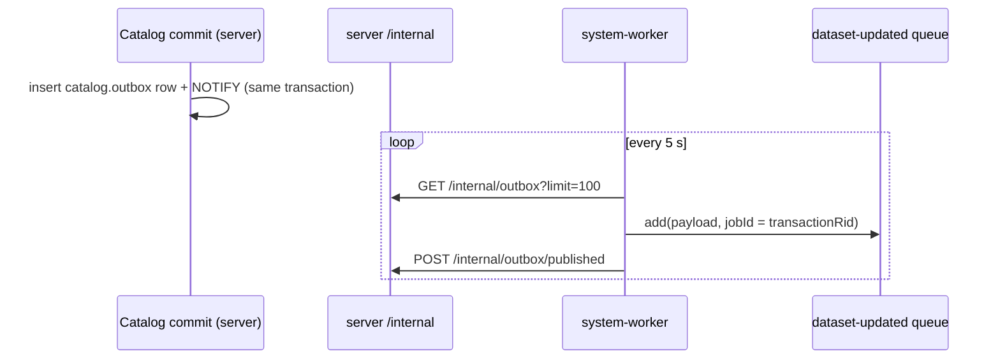

# Jobs & Queues

_Draft, 2026-10-13. BullMQ on Redis, consumed by the workers described in [architecture.md](architecture.md#1-shape). Tables referenced here are in [database.md](database.md)._

---

## 1. Principles

- **Postgres is the source of truth; BullMQ only executes.** Run state lives in `data_connection.sync_run`, `catalog.transaction`, `catalog.outbox`. Losing Redis loses no state — schedulers are rebuilt from Postgres on boot.
- **One queue per kind of job**, named `<service>.<job>` (dots, never colons — BullMQ uses colons in Redis keys). Moving a job to another worker = moving its processor to another worker module.
- **Each service owns its queues** like it owns its tables: a `queue/` folder in its shared domain, exported as `<Service>.Queue` next to `<Service>.API`, declaring each queue with `Foundations.Queue.define` (name, job schema, result schema, options). Contracts live in `@quarry/shared`; the BullMQ runtime and scheduling policy in the server.
- **Jobs are validated on both ends.** The producer builds a typed payload; the processor parses `job.data` with the same zod schema — Redis data is untyped, and a deploy can leave old-shaped jobs in a queue.
- **Jobs are idempotent and deduplicated**; delivery is at-least-once.
- **Events cross from Postgres to Redis only through the outbox** — never enqueue inside a database transaction and hope both commit.

---

## 2. Queue definitions

### The contract — `shared/domain/Foundations/Queue.ts`

Pure zod and types, no BullMQ dependency:

```ts
export namespace Queue {
    /** A queue's identity — Redis keys, processor routing and producers hang off it. */
    export const Name = z.string().regex(/^[a-z][a-z0-9-]*\.[a-z][a-z0-9-]*$/).brand("Foundations.Queue.Name")

    export interface Options { attempts?, backoff?, removeOnComplete?, removeOnFail? }   // BullMQ-compatible subset

    export interface Definition<J extends z.ZodType, R extends z.ZodType> {
        readonly name: Name;  readonly job: J;  readonly result: R;  readonly options?: Options
    }

    /** Throws at module load on a malformed name. */
    export const define = (definition: { name: string; job; result; options? }) => Definition

    export type JobOf<Q>, InputOf<Q>, ResultOf<Q>
}
```

`Name` is validated and branded because a mismatched name is a silent failure: jobs land on a queue no processor listens to. `<service>.<job>`, kebab-case, exactly one dot, no colons (BullMQ uses colons in Redis keys).

### The runtime — `server/src/infra/queue.ts`

```ts
/** The only way the server enqueues (server/src/infra/queue.ts). The workers consume with @nestjs/bullmq processors on a typed JobProcessor base. */
@Injectable()
export class QueueManager {
    add<Q extends Foundations.Queue.Definition>(queue: Q, job: InputOf<Q>, options?: JobsOptions): Promise<Job>;
    request<Q>(queue: Q, job: InputOf<Q>, timeoutMs: number): Promise<ResultOf<Q>>;     // request/reply
    upsertScheduler<Q>(queue: Q, schedulerId: string, repeat, job: InputOf<Q>): Promise<void>;
    removeScheduler(queue, schedulerId): Promise<void>;
    schedulerIds(queue): Promise<string[]>;
}
```

```ts
// data-connection-worker/src/infra.ts, system-worker/src/infra.ts — the consumer side
/** Base for @Processor classes: parses job.data before `handle` sees it, and the result before BullMQ stores it. */
export abstract class JobProcessor<Q extends Foundations.Queue.Definition> extends WorkerHost { … }
```

### A service's queues — `shared/domain/DataConnection/queue/index.ts`

Each service's job contracts sit in `@quarry/shared` next to its `API` namespace, exported as `<Service>.Queue` — `API` is the contract between browser and server, `Queue` between processes. Each queue is a namespace with `Job`, `Result` and its `Definition`:

```ts
export namespace Queue {                                    // → DataConnection.Queue

    export namespace Sync {
        export const Job = z.object({
            syncRid:     SyncD.Rid,
            trigger:     SyncRunD.Trigger,                  // 'manual' | 'schedule'
            triggeredBy: User.Rid.nullable(),
        })
        export const Result = z.object({ syncRunRid: SyncRunD.Rid, transactionRid: Transaction.Rid.nullable(), rowCount: z.number().int(), skipped: z.boolean() })

        export const Definition = Foundations.Queue.define({
            name:    "data-connection.sync",
            job:     Job,
            result:  Result,
            options: { attempts: 3, backoff: { type: "exponential", delay: 30_000 }, removeOnComplete: 1_000, removeOnFail: 1_000 },
        })

        /** At most one waiting or active job per sync — every producer must pass this. */
        export const deduplication = (syncRid: SyncD.Rid) => ({ id: `sync:${syncRid}` })
    }

    export namespace SourceProbe { Job, Result, Definition }   // request/reply: test, explore
    export namespace SyncReaper  { Result, Definition }        // housekeeping singleton
}
```

**Contract vs policy.** `shared` holds what both sides must agree on: name, payload, result, default options, the dedup key. Operational tuning stays in the server next to the code that uses it — `OUTBOX_RELAY_EVERY_MS`, `STORAGE_GC_EVERY_MS`, `SYNC_REAPER_EVERY_MS`, `STALE_HEARTBEAT_MINUTES` in their processors, `PROBE_TIMEOUT_MS` in `DataConnectionService`.

### Using them

```ts
// producer — DataConnectionService (server)
await this.queueManager.add(DataConnection.Queue.Sync.Definition,
    { syncRid, trigger: 'manual', triggeredBy: principal.userRid },
    { deduplication: DataConnection.Queue.Sync.deduplication(syncRid) });

// request/reply — DataConnectionService.testSource (server)
const result = await this.queueManager.request(DataConnection.Queue.SourceProbe.Definition, { op: 'test', source }, PROBE_TIMEOUT_MS);

// consumer — data-connection-worker/src/processors.ts (its own package)
@Processor(DataConnection.Queue.Sync.Definition.name, { concurrency: 1 })
export class SyncProcessor extends JobProcessor<typeof DataConnection.Queue.Sync.Definition> {
    protected readonly definition = DataConnection.Queue.Sync.Definition;

    protected async handle(job: DataConnection.Queue.Sync.Job) { … }   // server start → copy → server complete / fail
}
```

---

## 3. All queues (layer 1)

| Queue | Owner namespace | Consumer | Producer | Dedup | Retries | Schedule |
|---|---|---|---|---|---|---|
| `data-connection.sync` | `DataConnection.Queue.Sync` | **data-connection-worker** | API (run now), job schedulers (cron) | `syncRid` | 3, exponential | per-sync cron |
| `data-connection.source-probe` | `DataConnection.Queue.SourceProbe` | **data-connection-worker** | API (test / explore), request-reply | — | 1 | — |
| `data-connection.sync-reaper` | `DataConnection.Queue.SyncReaper` | **system-worker** | repeatable | singleton | — | every 2 min |
| `catalog.outbox-relay` | `Catalog.Queue.OutboxRelay` | **system-worker** | repeatable + `NOTIFY` nudge | singleton | — | every 5 s |
| `catalog.storage-gc` | `Catalog.Queue.StorageGc` | **system-worker** | repeatable | singleton | — | hourly |
| `catalog.dataset-updated` | `Catalog.Queue.DatasetUpdated` | none yet (layer 2: builds; layer 3: reindex) | outbox relay | `transactionRid` | — | — |
| `forge.run-job` | `Forge.Queue.RunJob` (durable: `Forge.DurableQueue.RunJob`) | **forge-agent** | the server, through the durable queue: added with the commit that schedules a job, relayed after it and by the durable-queue sweep | `<jobRid>_<attempt>` | — (a retry is a new attempt) | — |
| `durable-queue.sweep` | `Foundations.DurableQueue.Sweep` | **system-worker** → `POST /api/internal/durable-queues/sweep` | repeatable | singleton | — | every minute: every durable queue's unsent and stale messages ([durable-queues.md](durable-queues.md)) |
| `code-workspace.run-check` | `CodeWorkspace.CI.Queue.RunCheck` (durable: `CodeWorkspace.CI.DurableQueue.RunCheck`) | **code-workspace-worker** | the server, through the durable queue: added when a check run is scheduled | check run RID | — | per scheduled check run; concurrency = `CODE_WORKSPACE_CHECK_SLOTS` |
| `code-workspace.check-sweep` | `CodeWorkspace.CI.Queue.CheckSweep` | **system-worker** → `POST /api/internal/code-workspaces/check-runs/sweep` | repeatable | singleton | — | every minute: fails silent runs, schedules waiting ones |

Library has no queue in layer 1. Its first will be `library.purge` — when trashed resources pass their retention, ask each owning service to purge its subtype rows and storage, then delete the library row.

---

## 4. Flows

### Sync run



The server creates the `sync_run` row when the worker starts the run, so manual and scheduled runs share one path, and each retry is its own visible run. The Data Connection worker never touches Postgres.

### Schedules

Cron schedules are **BullMQ job schedulers** on `data-connection.sync` — not a separate queue:

- **server** — on sync create / update / delete: `upsertJobScheduler(syncRid, { pattern: cron }, { data: { syncRid, trigger: 'schedule', triggeredBy: null } })` or `removeJobScheduler(syncId)`.
- **system-worker on boot** — reconcile (`GET /internal/syncs/scheduled`): upsert a scheduler for every enabled sync with a schedule, remove schedulers with no matching sync. A wiped Redis heals on the next boot.

### Outbox relay



The server reads oldest first (`ORDER BY id LIMIT 100`). Using the transaction RID as `jobId` makes a re-publish after a crash a no-op.

Crash between enqueue and mark → the row is re-published next tick; the `jobId` makes that harmless.

### Reaper

Every 2 minutes the system worker calls `POST /internal/sync-runs/reap`. A run is **stuck** when `status = 'running'` and `heartbeat_at < now() - 5 min`. The reaper marks it `failed` (`error = { reason: 'worker lost' }`) and aborts its open dataset transaction; storage GC later removes the orphaned files. BullMQ's own stalled-job detection may also re-deliver the job — then the retry starts a fresh run, since the old one is no longer `running`.

### Storage GC

Hourly, the system worker calls `POST /internal/storage-gc`; the server, in order:
1. Abort catalog transactions left `open` longer than 24 h.
2. Delete objects of `aborted` transactions.
3. Delete files under `datasets/` with no `transaction_change` row, older than a 24 h grace period (uploads that never registered).
4. Apply history retention (a global policy, [catalog.md §7](catalog.md#7-not-built-yet)): mark files referenced only by views older than the window, sweep them after a grace period.

---

## 5. Conventions

- **Names** — `<service>.<job>`, kebab-case segments, defined once in the owning service's `<Service>.Queue` (shared domain).
- **Payloads** — IDs and small values only; never rows or file contents. The processor reads current state from Postgres.
- **Singletons** — repeatable housekeeping jobs run with concurrency 1 and a fixed scheduler id, so replicas don't double-run them.
- **Redis prefix** — `quarry`, so a shared Redis can't collide with other apps.
- **Retention** — `removeOnComplete` / `removeOnFail` on every queue; history lives in Postgres, not Redis.
- **Graceful shutdown** — workers call `enableShutdownHooks()`; BullMQ's `close()` waits for the active job or lets it be re-delivered.
