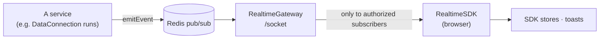

# Realtime — Live Events

_Draft, 2026-10-23. Ported from PretzelGraph's Realtime (shared `Realtime`, backend `RealtimeService` + `RealtimeGateway`, frontend `RealtimeSDK`), with one addition: **every subscription is authorized**._

Services publish domain events over Redis pub/sub; the server relays them to browsers over one WebSocket per tab. Polling is for when there's no channel for what you need.



---

## 1. Events and channels

`Realtime` (`shared/domain/Realtime/Realtime.ts`): a branded `Channel`, `Event.Base` `{ channel, type }`, `Signal.Base` (messages to workers), `Event.Forbidden`, and `ClientMessage` (`{ action: 'subscribe' | 'unsubscribe', channel }`).

A domain declares its own events, PretzelGraph-style:

```ts
export namespace Event {
    export const Channel = Realtime.Channel.brand("DataConnection.Event.Channel")
    export const getChannel = (sourceRid) => `data-connection:source:${sourceRid}` as Channel
    export const sourceOf   = (channel) => Source.Rid | null      // read back, for authorization
    export namespace RunUpdated { … type: z.literal("data-connection:run:updated"), run: SyncRun.Schema }
    export const Schema = z.discriminatedUnion("type", [RunUpdated.Schema])
    export const create = Realtime.Event.defineFactory(Schema)   // typed create(type, rest), without the channel
}
```

Events are built with the domain's `create` and addressed by the publisher, as in PretzelGraph (`defineEventFactory`): `create(type, rest)` checks `rest` against exactly that member of the union, and leaves the channel out — only the publisher knows where the event goes.

```ts
this.realtime.emitEvent({
    ...DataConnection.Event.create("data-connection:run:updated", { run }),
    channel: DataConnection.Event.getChannel(sourceRid),
})
```

**A channel names what it's about** — a resource's RID, or a user's — so the gateway can decide who may listen. Event types are `'<domain>:<entity>:<verb>'`.

| Channel | Who may subscribe | Events |
|---|---|---|
| `data-connection:source:<sourceRid>` | anyone with **discover** on the source (Gatekeeper) | `data-connection:run:updated` — a run started, succeeded or failed, as it is now |
| `identity:user:<userRid>` | **only that user** | `identity:notification` — `{ level, title, description }`, shown as a toast anywhere in the workspace |
| `forge:build:<buildRid>` | anyone who can **see the build** — discover on one of its targets (Forge decides: RLS on `forge.build`, resolved by the gateway through `ModuleRef` to avoid a module cycle) | `forge:job:updated` — any change to one of its jobs (scheduled, queued, started, finished, canceled), the job as it is now (`Forge.Event.Job.Updated`) |

Any other channel is refused.

## 2. Server

- **`RealtimeService`** (`services/Realtime/`, global): `emitEvent(event)` / `emitSignal(signal)` publish on the message's own channel, through the process's shared Redis client.
- **`RealtimeGateway`** — a WebSocket at `/socket` (`WsAdapter`, plain `ws`):
  - **Authentication:** `?token=<GoTrue JWT>`, checked by `TokenVerifier` (the same check as the HTTP guard: valid token, active member). Messages arriving during the check are held, then handled. No or bad token → closed with 1008.
  - **Authorization on every subscribe:** the channel is read back to its resource or owner (`DataConnection.Event.sourceOf`, `Identity.Event.userOf`) and checked — Gatekeeper `discover`, or the user's own RID. Refused → a `forbidden` event on that channel.
  - **Relay:** one Redis subscriber for the gateway; a channel is subscribed in Redis while at least one socket listens to it.
- **Who emits:** `DataConnectionService.Runs` — `run:updated` on the source's channel when a run starts, completes or fails (including the reaper's "worker lost"), and on a failure a notification to the user the run acted for (who pressed run, or the sync's creator for a scheduled run). Workers report through `/internal` endpoints, so events come from the server, after the database changed.

Accepted: a subscription isn't re-checked while it lasts — a user who loses access keeps that channel until they unsubscribe or reconnect.

## 3. Frontend

- **`RealtimeSDK`** (`SDKs/RealtimeSDK/`): one socket; `subscribeToChannel(channel, listener)` → unsubscribe, reference-counted (the last listener leaving unsubscribes on the server); reconnects with exponential backoff (1–30 s + jitter) and subscribes again to every channel in use; `forbidden` events are logged. Session cleanup (`cleanupSDKs`) closes it.
- **RealtimeSDK follows the session itself**: `RealtimeSDK.init()` (called once in `main.tsx`) observes AuthSDK, fetched from the SDK container — `AuthSDK.observe({ session: { onStart, onEnd } }, { immediate: true })`, after PretzelGraph's ExecutionSDK observers. `session.onStart(member)`: connect and subscribe to the member's channel, turning notifications into `NotificationSDK` toasts. `session.onEnd(member, { reason: 'signed-out' | 'switched' | 'lost' })`: disconnect. AuthSDK knows nothing about realtime.
- **`AsyncEventQueueHandler`** (`SDKs/RealtimeSDK/EventQueue.ts`, from PretzelGraph): a channel's events go through it so they apply in arrival order even when a handler awaits something; synchronous handlers use it the same way. `clear()` drops what's still pending when the subscription ends.
- **Data Connection:** the route `/data-connection/sources/$rid` says which source is open — `onEnter`/`onStay` call `DataConnectionSDK.actions.source.open(rid)`, `onLeave` calls `source.close(rid)` (a no-op if another source opened first). The SDK observes that itself (`observe({ source: { onOpen, onClose } })`, registered in its constructor, after PretzelGraph's ExecutionSDK attach/detach): `onOpen` starts `run.follow(rid)`, which applies `run:updated` to the store through an `AsyncEventQueueHandler`; `onClose` stops it. Components only render — the 3 s polling of run lists is gone.
- **Dev:** Vite proxies `/socket` (with `ws: true`) to the server.

## 4. Later

- **Declarative channel requirements.** Today the gateway's `mayListen` is a chain of per-domain checks, and it reaches into Forge (`ModuleRef`) for build channels. Instead, each domain's `Event` declares `getRequirement(channel)` — a resource and an action (`{ resourceRid, action: 'discover' }`), or a user for personal channels — and the gateway applies them generically, knowing no domain. Forge's build channel doesn't fit as is (its rule, discover on one of the build's targets, needs a lookup): either key Forge's channels by dataset (`forge:dataset:<rid>`, a job update on each of its output datasets' channels; recommended) or keep `forge:build:<rid>` with a Forge-resolved requirement. Decided to defer, 2026-10-27.
- **Re-checking subscriptions.** Access is checked once, at subscribe: someone who loses access keeps receiving events until they reconnect. Re-check on the permission epoch (gatekeeper.md), or drop a channel's subscriptions when grants change. Matters more once events carry sensitive text (a job's failure message will include a transform's error).
