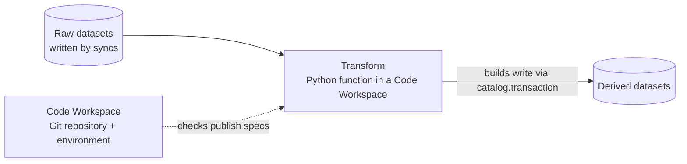

# Transforms — Code Workspaces and Builds

_Draft, 2026-10-24. Nothing here is built yet. The datasets transforms read and write are in [catalog.md](catalog.md); permissions in [gatekeeper.md](gatekeeper.md); queues in [jobs.md](jobs.md); the raw datasets they start from in [data-connection.md](data-connection.md). The API mirrors Foundry's `transforms.api` (Python lightweight transforms), and a Code Workspace is Foundry's Code Repository — so both read familiar to anyone who knows Foundry._

Transforms turn datasets into datasets: raw copies from syncs into clean, joined, business-ready tables. It's the **second layer** of the platform, on top of Data Connection; the ontology comes later and reads what transforms write.



Decided (2026-10-24):

- The app is **Code Workspaces**; the resource is a **Code Workspace** — a Git repository plus its Python environment, edited in VS Code in the browser.
- Git is **`git http-backend` behind the Quarry server** ([§3](#git-hosting)) — not Gitea, so Gatekeeper stays the one place that decides access.
- Code refers to datasets by **RID or library path**; checks resolve paths and pin them to RIDs.
- The package is **`quarry.transforms`**.
- **Outputs are created automatically**, as in Foundry.
- **Preview writes nothing**; only builds write datasets.
- **Default resources**: 1 CPU / 4 GB per transform, unless `with_resources` says otherwise.
- **RIDs**: `ri.code-workspace.main.workspace.…` (a library resource of type `workspace`); builds and jobs in the **Forge** service — `ri.forge.main.build.…`, `ri.forge.main.job.…` (not resources).
- **Forge** (decided 2026-10-25) is the service that runs builds — a platform service like Catalog, not part of Code Workspaces: anything can start a build (a Build button, Data Lineage, a schedule). Its name is a noun only; what it does is still **build** — a Build button, a Builds app, "built 2 hours ago" (never "forged", which reads as faked).
- **Schedules are a resource** with their own app, **Scheduler**: a schedule targets datasets and replaces the cron on a sync ([§5](#5-builds); its own design doc to come).
- **Sessions are one per user per workspace**: two people on one workspace each have their own container and clone, and share work by pushing.

### Iterations

1. **Workspaces and preview** — the Code Workspace resource and its repository (template, first commit), sessions (container, proxy, idle stop), `quarry.transforms`, preview. No checks, builds or provenance; nothing writes datasets yet. **Built 2026-10-24** — how it works, with diagrams: [code-workspaces/](code-workspaces/README.md).
   - Shared namespaces `CodeWorkspace` (`CodeWorkspace.Rid`, `.Schema`, `.Template`, `.Preview`, `.ModuleFunctionPath`, `.API`) and `CodeTransform` (`.Schema`, `.DatasetReference`, `.Listing`, `.Failure` — a transform as its pipeline declares it); server `services/CodeWorkspace` (`CodeWorkspaceService`, `/api/code-workspaces`); library type `workspace` (`ri.code-workspace.main.workspace.…`), schema `code_workspace`; Git at `/api/git/<rid>.git` (`git http-backend` behind the server); `GET /api/resources/by-path` (path → RID, `LibraryService.getByPath`) and `GET /api/datasets/:rid/sample` (Parquet) for previews.
   - `packages/transforms-python` (`quarry.transforms`, preview runner `python -m quarry.transforms.preview`); the runtime image `docker/code-workspace-runtime` (`npm run build:code-workspace-runtime`).
   - `packages/code-workspace-worker`: sessions, run with the `docker` CLI, behind its own HTTP API (`/sessions/open`, service token — `CodeWorkspace.API.Worker`; the server calls it through `CodeWorkspaceWorkerClient`). It also serves the IDE proxy (`/s/<secret>/…`, a separate port — Nest's WebSocket adapter in the server kills foreign upgrades). Each session's credential is a server-minted 12h token, fetched from `/api/internal/code-workspaces/session-credentials`, never sent by the server.
   - The **Quarry extension** (`packages/code-workspace-extension`, preinstalled in the runtime image):
     - **Preview and Build** in the editor title. Preview runs the runner itself, in the container, and shows the result in a Preview tab in the bottom panel (a React webview with standard-ui's `TableViewer`) — [code-workspaces/preview.md](code-workspaces/preview.md). Build picks a transform; builds aren't wired up yet.
     - Above each `Input(…)` / `Output(…)` a lens says what it points to (click: open it in Quarry), "Use RID" swaps a path for its RID (keeping the path as a comment), a hover card, and warnings for inputs that don't resolve. It calls Quarry with the session's token, which the setup writes to `~/.quarry/session.json` (mode 600) on every open. It also adopts Quarry's theme (`features/theme.ts`). Next on the same extension: a Quarry menu bar, a Preview lens on `@transform`.
2. **Checks and a Build button** — checks on push, the build worker, outputs created and written with provenance. Builds are single-scope (this transform, not its upstream).
3. **Scheduler** — schedules as resources targeting datasets, full / connecting scope; sync crons move into schedules.

---

## 1. Model

| Thing | Library resource? | What it is |
|---|---|---|
| **Code Workspace** | **yes** — in a folder, grants, trash | A Git repository plus its environment (`pyproject.toml` + `uv.lock`). Holds any number of transforms |
| **Transform spec** | no — belongs to its workspace | One transform at one commit: function, inputs, outputs, resources, environment. Published by checks |
| **Build** | no | One request to bring datasets up to date: a set of jobs in dependency order |
| **Job** | no — belongs to its build | One transform run: reads pinned input versions, writes its outputs' transactions |
| **Session** | no — belongs to a user and a workspace | The running container behind an open IDE ([§6](#6-sessions-the-ide-and-preview)) |
| Input / output dataset | yes (Catalog's) | Ordinary datasets; transforms don't own a special kind |

Rules:

- **One producer per dataset.** A dataset is the output of at most one transform (or one sync). Checks reject a second.
- **No cycles.** An output can't feed itself, directly or through other transforms.
- **The dataset is the unit** builds, schedules and lineage work on; the workspace is only where the code lives. Building a dataset runs its transform, not the whole workspace.

### One producer, handed over

A dataset has **one producer at a time** (as in Foundry: one job spec per dataset) — a build must mean one thing to run, snapshots from two writers would overwrite each other, and staleness and lineage need one set of inputs.

- **Taken:** checks fail a transform whose output already has another producer — "`/Sales/clean/orders` is produced by *Claims Transforms*", linking it.
- **Handing over:** remove the output from the old producer (commit), declare it in the new one (commit). The next version's `produced_by` is the new one; older versions keep theirs.
- **Several contributors:** each writes its own dataset; one more transform unions them.
- **Uploads:** the dataset viewer refuses file uploads into a dataset that has a producer — the next build would silently replace them. Datasets without one still take uploads.

---

## 2. The Python API (`quarry.transforms`)

Lightweight (single-node) transforms only, to start: the transform runs in one container, in one Python process, and picks its engine per call. Spark is a separate decorator later ([§8](#8-not-built-yet)), because it needs a cluster provisioned before the job starts.

### Declaring a transform

```python
import polars as pl
from quarry.transforms import transform, Input, Output

@transform.using(
    orders=Input("/Sales/raw/orders"),                    # a library path — or a RID
    customers=Input("ri.catalog.main.dataset.91ab…"),
    out=Output("/Sales/clean/orders"),                    # created by checks if it doesn't exist
).with_resources(cpu_cores=4, memory_gb=16)                 # optional
def clean_orders(orders, customers, out):
    df = orders.polars()
    out.write_table(df.filter(pl.col("status") != "cancelled"))
```

- Parameter names are the input and output names, and must match the function's parameters.
- A function that takes `ctx` first gets the transform context.
- **Several outputs** are allowed; each must be written, or the job fails. They commit together or not at all.

### Inputs — `TransformInput`

| Member | Returns |
|---|---|
| `.polars()` / `.polars(lazy=True)` | `polars.DataFrame` / `polars.LazyFrame` (scan: pushdown, streaming) |
| `.pandas()` | `pandas.DataFrame` |
| `.arrow()` | `pyarrow.Table` |
| `.path()` | Local directory with the input version's Parquet files — for any other engine |
| `.rid`, `.transaction_rid` | The dataset, and the exact version being read |
| `.schema` | Its column schema (Catalog types) |

Every loader reads **the same pinned version** — the one the build resolved when the job started. Loading twice reads the same data twice; it never picks up a newer commit mid-job. In a preview, the loaders read the **sample** instead ([§6](#6-sessions-the-ide-and-preview)).

### Outputs — `TransformOutput`

| Member | Does |
|---|---|
| `.write_table(data)` | Polars (eager or lazy), pandas, Arrow or a DuckDB relation → Parquet in the output's open `snapshot` transaction |
| `.rid` | The output dataset |

- The schema is inferred from the written data's Arrow schema, mapped to Catalog column types ([catalog.md §1](catalog.md#schema-type-system)). An unsupported type fails the job, naming the column.
- On success every output's transaction commits; on any error all abort. Outputs never half-update.

### Context — `ctx`

| Member | Gives |
|---|---|
| `ctx.duckdb().conn` | A DuckDB connection with every input registered as a table under its parameter name |
| `ctx.log` | A logger whose lines are the job's logs in Quarry |
| `ctx.job_rid` | This job (`None` in a preview) |

```python
@transform.using(orders=Input("/Sales/raw/orders"), out=Output("/Sales/clean/shipped"))
def shipped(ctx, orders, out):
    out.write_table(ctx.duckdb().conn.sql("SELECT * FROM orders WHERE status = 'shipped'"))
```

### Registration — `pipeline.py`

```python
from quarry.transforms import Pipeline

from . import datasets

pipeline = Pipeline()
pipeline.discover_transforms(datasets)   # every @transform in the package
```

---

## 3. Code Workspaces and templates

A Code Workspace is a normal Python project in **one Git repository** on the embedded Git server — a shared service holding every workspace's repository; sessions clone from it and push to it, and checks and builds fetch commits from it:

```
pyproject.toml          # dependencies; quarry-transforms is one
uv.lock                 # exact versions — the environment's identity
README.md
src/<package>/
  __init__.py
  pipeline.py
  datasets/
    __init__.py
    example.py          # one or more @transform per file
tests/
  test_example.py
.gitignore
```

The **environment** is the workspace's, shared by its transforms: `uv.lock` decides what's installed. Each transform decides only how much machine it gets (`with_resources`).

### Git hosting

A shared service, not part of a session: sessions only hold a clone, and checks and builds fetch commits from the server's copy — sessions stop when idle, builds don't wait for them.

```
session (clone) ──git over HTTP──▶ Quarry server ──▶ git http-backend ──▶ bare repositories (a volume)
                                     │ Gatekeeper: read = clone / fetch, write = push
build worker ──fetch <commit>────────┘ a push enqueues checks for the new commit
```

- **Smart HTTP** at `/git/<workspace rid>.git`: the server authenticates the request (the session's scoped token, or a user token for a local clone), checks Gatekeeper on the workspace, then hands it to `git http-backend`.
- **One bare repository per workspace**, at `<volume>/<workspace rid>.git`, created with the workspace (the template's first commit is pushed to it).
- **A push** is seen by the server directly (the request passed through it): it enqueues checks for the pushed commit. No webhooks.
- Trashing the workspace keeps the repository; deleting it for good removes it.
- Review, diffs and history views are Quarry UI on top, later — Gitea would have given them for free, but with its own users and permissions to keep in sync with Quarry's.

### Templates

A new workspace starts from a **workspace template** — a registry keyed by id, like source definitions:

```ts
// shared/domain/CodeWorkspace/Template.ts
Template {
  id:          "python-transforms",
  displayName: "Python transforms",
  description: "Polars, DuckDB and pandas transforms on datasets.",
  files:       Record<path, contents | (params) => contents>,   // rendered into the first commit
}
```

| Template | When |
|---|---|
| **Python transforms** | First — the only one |
| SQL transforms (DuckDB SQL files as transforms) | Later |
| Spark transforms | With Spark |
| Model training | With models |

### Creating one

From the Code Workspaces app ("New workspace"), in a wizard:

1. **Template** — searchable; one entry for now.
2. **Details** — name, location (project / folder), description.
3. **Example transform** (optional) — pick an **input dataset**; the output defaults to `<input name> (clean)` beside the workspace, editable.

With an input, `datasets/example.py` is a working passthrough — the first commit passes checks and previews at once:

```python
import polars as pl
from quarry.transforms import Input, Output, transform


@transform.using(
    source=Input("/Sales/raw/orders"),
    out=Output("/Sales/clean/orders (clean)"),
)
def example(source, out):
    """Copies the input unchanged. Replace the body with your logic, then Preview."""
    df = source.polars()

    out.write_table(df)
```

Without one, the same code is commented out — a placeholder input would fail checks, since inputs must exist.

Quarry renders the template (`uv lock` included) and makes the **first commit as the creating user**; checks run on it straight away.

---

## 4. Checks — what a commit goes through

Every commit runs **checks** (continuous integration) before its code can build anything. A failing commit gets a red result with the reason; datasets keep building from the last good commit.

1. **Environment** — resolve `uv.lock` into an environment image, keyed by the lock's hash ([§7](#7-environments-and-containers)); reused if it exists.
2. **Import** the package in that environment. The decorators run, the transforms don't: this collects every transform's inputs, outputs and resources.
3. **Resolve** library paths to RIDs, pinned in the spec — a later rename doesn't break the transform. **Create** missing outputs (a dataset at that path; needs write on the parent folder).
4. **Validate** — one producer per dataset, no cycles, inputs exist and are readable, outputs writable.
5. **Tests** — run the workspace's tests.
6. **Publish** one spec per transform for that commit:

```json
{
  "workspaceRid": "ri.code-workspace.main.workspace.…",
  "commit": "a1b2c3d",
  "module": "sales_cleaning.datasets.orders",
  "function": "clean_orders",
  "inputs":  { "orders": "ri.catalog.main.dataset.6f2e…", "customers": "ri.catalog.main.dataset.91ab…" },
  "outputs": { "out": "ri.catalog.main.dataset.c40d…" },
  "resources": { "cpuCores": 4, "memoryGb": 16 },
  "environment": "sha256:…"
}
```

Checks act as a **delegate of the committer** (`Principal.onBehalfOf(committer, 'checks:<workspace>')`): they can only resolve, read and create what the committer could.

---

## 5. Builds

A build brings target datasets up to date. It's started by hand ("Build" in the IDE or on a dataset) or by a schedule, and runs the **committed** code on **full** inputs.

1. **Plan** — from the targets, walk lineage upstream within the build's scope (single / full / connecting); collect each dataset's producer (a transform spec at its workspace's latest good commit, or a sync).
2. **Skip what's fresh** — a transform whose inputs haven't changed since its last successful job is skipped. Syncs always run (the external source's changes aren't visible).
3. **Run** jobs in dependency order; independent ones in parallel. A failed job stops everything downstream of it; unrelated branches finish.

### Build workers

A **build worker** (a NestJS worker, like the data connection worker) takes jobs from a BullMQ queue. It **orchestrates**; it doesn't run Python itself:

1. Pin every input to its latest committed transaction; open a `snapshot` transaction on every output (through `catalog.transaction`, as the delegate).
2. **Start a container** from the spec's environment image, with its resource limits and a short-lived token scoped to those inputs and outputs.
3. In the container, Python reads the input Parquet files, runs the function, and writes the output Parquet to object storage under each transaction's prefix.
4. When the container exits cleanly, register the files and **commit** every output with its provenance; otherwise abort them all.
5. Stream the container's logs into the job, and remove the container.

Data lands where every write lands: **Parquet in object storage** (SeaweedFS), recorded by Catalog in **Postgres**. DuckDB is an engine inside transforms, never a store.

### Provenance

Each output transaction records **what produced it**:

```
/Sales/clean/orders  transaction #12
  job:      ri.forge.main.job.…
  code:     workspace ri.code-workspace.main.workspace.… at commit a1b2c3d, function clean_orders
  inputs:   /Sales/raw/orders     transaction #40
            /Sales/raw/customers  transaction #7
```

That's **version-aware lineage**: any version of a derived dataset names the exact code and the exact input versions that produced it, so it can be explained and rebuilt.

**Stored in Catalog**, beside the transaction it describes (decided 2026-10-24); lineage queries are joins:

| Column / table | Holds |
|---|---|
| `catalog.transaction.produced_by` | The **resource** that wrote it — the Code Workspace for a transform's output, the Source for a sync's (a sync isn't a resource) |
| `catalog.transaction_input (transaction_rid, input_transaction_rid)` | One row per input version read |

The exact **run** isn't on the transaction: runs already point at what they wrote, in the producer's own tables — `data_connection.sync_run.transaction_rid`, and `forge.job_output (job_rid, transaction_rid)` for jobs (through which the commit). Catalog never reads its writers' tables; `produced_by` is a plain resource RID, resolved through the Library like any resource link.

As in Foundry's dataset About panel, the dataset viewer then shows:

- **Updated … by** *user* — the actor of the latest committed transaction (the delegate's user: whoever pressed Build, or the schedule's owner).
- **Created … by Quarry** — for an output created by checks. The dataset's creator is the system; the audit log still records the committer as the delegate behind it, and checks verified their write on the folder first.
- **Updated via** *workspace* — `produced_by` of the latest transaction, linked.
- **Inputs** — the datasets of the latest transaction's `transaction_input` rows.

A job acts as a **delegate** — of whoever started the build, or the schedule's owner — so Gatekeeper decides what it may read and write, exactly as for sync runs ([gatekeeper.md](gatekeeper.md)).

---

## 6. Sessions: the IDE and preview

Opening a Code Workspace starts a **session**: a container for that user and workspace.

| In the session | |
|---|---|
| **openvscode-server** | The VS Code backend the browser tab talks to (Node.js) |
| A Git checkout | The working copy, uncommitted changes included |
| The environment | The same image builds use — imports, completions and results match |
| A terminal | `uv add`, `pytest`, `git` |
| The **Quarry extension** | Runs previews — the preview runner, a Python process per preview |
| A scoped token | Reads input samples as the user, through Gatekeeper |

- **Where:** on a Docker host Quarry controls (Docker Desktop in development; a server or Kubernetes nodes later), started by a **session manager** through the Docker API.
- **Reached through the Quarry server**, which checks the session and proxies HTTP and WebSocket at `/code/<rid>/…`. Sessions are never exposed directly.
- **Lifecycle:** starts on open, stops when idle (about 30 minutes); uncommitted files persist on a small volume, so reopening restores them. About 1–2 GB of memory each while open.

### Preview

Preview runs the transform **as it is in the editor** — uncommitted — on a **sample** of its inputs, and shows the result in the IDE. As in Foundry, it **writes nothing**: no commit, no checks, no dataset, no hidden files.

- **Sample**: a random 1,000 rows per input by default; full inputs or a filter as options.
- Runs in a **fresh Python process** in the session, so a crash or runaway memory kills that preview, never the editor, and edits always take effect.
- Returns each output's rows and schema to the IDE, shown in the same table viewer as datasets.

---

## 7. Environments and containers

| Piece | Belongs to | |
|---|---|---|
| `uv.lock` | the workspace | what's installed |
| Package cache (wheels) | the machine building images | shared by every workspace |
| Environment image | one lock hash | base image (Python + Polars, DuckDB, PyArrow, pandas) + a layer installing the lock |
| Build container | one job | started from the image with `cpu_cores` / `memory_gb` limits; removed after |
| Session container | one user + workspace | the same image plus openvscode-server; stopped when idle |

Packages are installed **once per lock**, when checks build the image — never per run. Containers have no network except the Quarry API. Stronger isolation (gVisor) is a runtime switch later; the images don't change.

---

## 8. Not built yet

| Later | Why it can wait |
|---|---|
| `@transform.spark.using`, `.dataframe()` | Needs a cluster runtime |
| Incremental transforms (read only new input transactions; `append` writes) | Snapshot is correct, just slower |
| Data checks / expectations | Decorators on top; the core doesn't change |
| `gpu_type` resources | Needs GPU nodes |
| Git branches → dataset branches (build on a branch, merge, build on main) | Builds run on `main` first |
| `quarry.transforms.testing` helpers | Functions can already be called with fake inputs |
| More templates (SQL, Spark, model training) | One template proves the flow |
| A local VS Code extension (Foundry has one) | The browser IDE comes first |
| A visual pipeline builder | Would compile to the same transform jobs |

---

## 9. Open questions

- **The schedule model** (its own doc, with the Scheduler app) — triggers (time, dataset updated, schedule succeeded; AND / OR), targets and scope (single / full / connecting), who a schedule runs as, and migrating today's sync crons into schedules.
