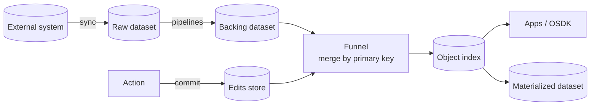
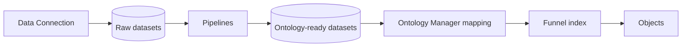
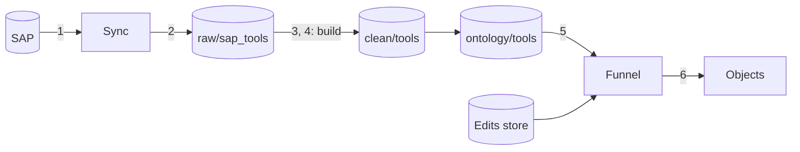
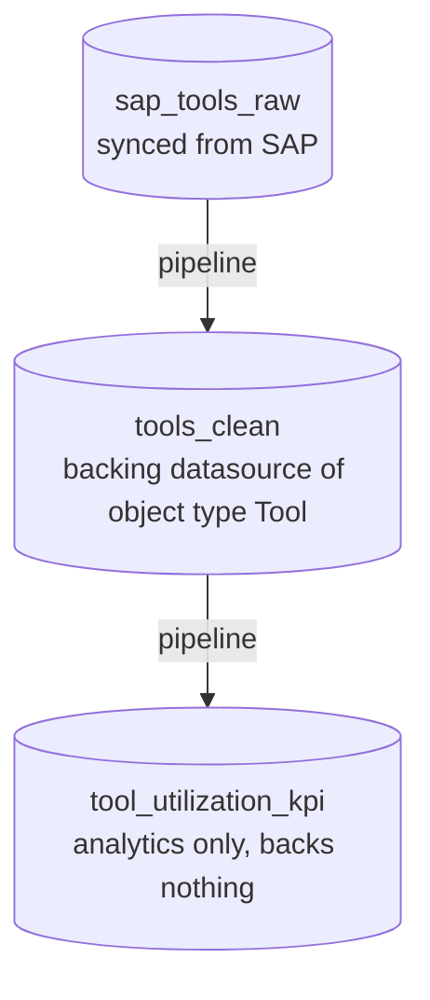
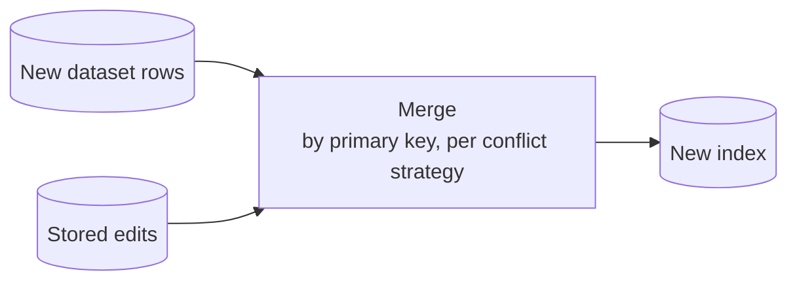

# Palantir Foundry Ontology — Research Notes

_Compiled 2026-10-12 from Palantir's public docs and community forum. Where something is inferred or unconfirmed, it's marked as such._

## Contents

1. [Architecture overview](#1-architecture-overview)
2. [End-to-end flow: from source system to objects](#2-end-to-end-flow-from-source-system-to-objects)
3. [Datasets and backing datasources](#3-datasets-and-backing-datasources)
4. [The ontology and the kinetic layer](#4-the-ontology-and-the-kinetic-layer)
5. [How user edits are stored and merged](#5-how-user-edits-are-stored-and-merged)
6. [History and audit](#6-history-and-audit)
7. [Schema changes, migrations and rollback](#7-schema-changes-migrations-and-rollback)
8. [Worked example: a factory](#8-worked-example-a-factory)
9. [Why it's designed this way](#9-why-its-designed-this-way)
10. [Appendix: TextQL](#10-appendix-textql)
11. [Sources](#11-sources)

---

## 1. Architecture overview

An object in Foundry is a **projection** of two separately stored tracks, merged into an index:



- **Top row: machine data.** Batch and recomputable.
- **Bottom row: human data.** Immediate and not recomputable. Edits are also applied to the live index straight away, without waiting for the Funnel.
- **Writeback (optional).** A webhook to the external system runs *before* an action commits.

| Layer | Written by | Nature |
|---|---|---|
| **Backing dataset** | Pipelines, syncs, uploads | Immutable, versioned, recomputable |
| **Edits layer** (Funnel edits store) | Actions / Ontology edits API | Human decisions, not recomputable |
| **Object index** | Funnel indexing pipeline | Derived, disposable, rebuildable |
| **Materialized dataset** | Funnel (periodic flush) | Snapshot of merged current state, for analytics |

Key rule: **actions never write to backing datasets.**

Common misreading: **Funnel doesn't transform data.** Pipelines transform data; Funnel only indexes the backing dataset and merges the stored edits on top. The index holds nothing that can't be rebuilt from those two.

---

## 2. End-to-end flow: from source system to objects

The whole system is a **dependency graph of datasets** (built like `make`) ending in an index, plus a separate log of human edits replayed onto it.



Everything from raw datasets to the ontology-ready datasets is visible in Data Lineage as one graph.

### Layer 1 — Data Connection: copying external data into datasets

Data Connection is the Foundry application for ingesting data:

| Concept | What it is |
|---|---|
| **Source** | Configured connection to one external system (Postgres, SAP, S3, Salesforce…): type, host, credentials, network route. A stored *configuration*, not a live connection pool — a connection is opened each time a sync runs. |
| **Agent** (optional) | Small program installed inside the customer network, for systems Foundry can't reach directly (e.g. a DB behind a firewall). Foundry → agent → database. |
| **Sync** | A job on a source: "copy this table / query into this dataset". One source, many syncs (typically one per table). |
| **Schedule** | When a sync runs: manually, on a time schedule, or chained with other builds. |

Each sync run commits a transaction to its output dataset — `SNAPSHOT` (replace everything) or `APPEND` (incremental, e.g. rows with `updated_at` > last run).

Sources are also used **outbound**: writeback webhooks and exports reach the external system through the same source definition.

_Unconfirmed:_ **virtual tables** query data in place (Snowflake, Databricks, BigQuery) without copying it into a dataset. How they interact with the ontology wasn't verified; the classic model is sync → dataset.

### Layer 2 — Pipelines: raw datasets → ontology-ready datasets

Transforms are written in **Pipeline Builder** (visual) or **Code Repositories** (Python/PySpark, SQL, Java). Each declares inputs and outputs and runs as a **build**, committing a new transaction to its output dataset:

```python
@transform_df(
    Output("/Factory/ontology/tools"),
    raw=Input("/Factory/raw/sap_tools"),
)
def compute(raw):
    return (raw
        .filter(raw.deleted_flag == False)
        .select(
            raw.EQUNR.alias("tool_id"),     # SAP column names → readable ones
            raw.EQKTX.alias("name"),
            raw.STATUS.alias("status"),
        )
        .dropDuplicates(["tool_id"]))
```

Conventionally organised in stages, e.g. `raw/` → `clean/` → `ontology/`. The final stage is shaped for the ontology:
- **One row per object.**
- **Unique, non-null primary key** — duplicates make indexing fail.
- **Readable column names, correct types.**
- **Link data** — FK columns for one-to-many links, separate join datasets for many-to-many.

Because every transform declares its inputs and outputs, Foundry knows the dependency graph automatically — **that graph *is* the lineage**. **Data Lineage** is the app that *visualises* it (datasets, schedules, build status, staleness); it doesn't transform anything.

### Layer 3 — Ontology mapping: dataset → backing datasource

Pure configuration, no data moves:
1. Create object type `Tool` in Ontology Manager.
2. Pick `/Factory/ontology/tools` as its **backing datasource**.
3. Map columns → properties, set types, pick the primary key and title property.
4. Define link types (e.g. `Tool.tool_model_id` → `ToolModel.id`).
5. Save → Funnel runs initial indexing → objects appear.

From then on, every new transaction on that dataset triggers indexing.

_Unconfirmed:_ Pipeline Builder can also declare object types as pipeline outputs, collapsing steps 2–3 into the pipeline config.

### Full flow: "new rows were added in SAP"

You don't reindex the ontology directly — you get new data into the backing dataset, and reindexing follows.

1. **New rows land in SAP.** Foundry doesn't know; nothing watches SAP live.
2. **Sync runs** (manual or scheduled) → new transaction on `raw/sap_tools` (`APPEND` if incremental, `SNAPSHOT` if full).
3. **A build schedule reacts.** Foundry walks the lineage graph and builds every stale dataset between the change and the target, in order. Up-to-date datasets are skipped.
4. **Transforms run**: `raw/sap_tools` → `clean/tools` → `ontology/tools`, each committing a new transaction.
5. **Funnel sees a new transaction on a backing dataset** → indexes it and merges the edits store on top by primary key.
6. **New `Tool` objects appear** in Workshop / search / OSDK. Existing objects keep their user edits (per conflict strategy).
7. **Downstream reactions** — automations watching for new `Tool` objects fire; materialization later writes out the merged state.



### Push vs pull scheduling

Same underlying logic — declare dependencies, rebuild only what's stale:
- **Push (trigger-based)** — "when `raw/sap_tools` updates, build what depends on it."
- **Pull (target-based)** — "keep `ontology/tools` fresh: hourly, build it and anything stale upstream." Exactly how `make` works.

### What triggers indexing (and what doesn't)

| Trigger | What happens |
|---|---|
| New transaction on the backing dataset (sync / pipeline build) | Funnel indexes the new data and replays stored edits on top |
| Schema change (ontology save: property, type, migration) | New schema version + full replacement reindex; goes live once hydrated |
| Action / user edit | **No reindex.** Edits are applied to the live index directly and persisted in the edits store |
| Materialization | Not indexing — a periodic job writing merged state *out* to a dataset |

_Unconfirmed:_ OSv2 can index some dataset updates incrementally (e.g. `APPEND`), while `SNAPSHOT` forces a full re-sync of the object type; exactly when Funnel chooses which isn't documented.

### Practical consequences

- **Two update speeds.** Machine data from SAP takes minutes to hours (sync interval + each build hop + indexing). User edits appear in seconds. For near-real-time source data, use a stream-backed object type.
- **"Reindex" mostly means "rebuild the chain".** If the backing dataset didn't change, a reindex yields the same objects — schema changes are the exception.
- **Debug via Data Lineage** — it shows which hop is stale or failed: sync error, build failure, or Funnel indexing failure (duplicate PKs, type mismatch).

---

## 3. Datasets and backing datasources

### Datasets

A dataset is a collection of files plus a schema plus version history — effectively git for data. Usually **many** Parquet files (large tables are split into chunks), but datasets can also hold CSVs or unstructured files (PDFs, images) with no schema. Most datasets in an instance (raw syncs, intermediate steps, reports) never back an object type.

**Parquet** is an open, **columnar** file format — values stored column by column instead of row by row. Queries read only the columns they need, similar values compress very well, types are built in, and per-chunk min/max stats let engines skip data. The tradeoff: files are immutable and bad at single-row updates — you write new files instead. That's one reason Foundry datasets work in transactions and why user edits live in a separate store rather than in the dataset.

### Dataset vs backing datasource

- **Dataset** — a *kind of storage*.
- **Backing datasource** — a *role*: whatever an object type is configured to read its rows from, plus the column → property mapping and primary key. Usually a dataset, but can be a restricted view, several datasets joined by PK (MDO), or a stream (see below).

Analogy: the dataset is a table; the backing datasource is the `FROM` clause of a view definition. Only changes to a backing datasource trigger reindexing of its object type.



**Transactions** (open → committed / aborted):

| Type | Effect | Used by |
|---|---|---|
| `SNAPSHOT` | Replaces the whole view | Batch pipelines |
| `APPEND` | Adds files, cannot modify existing ones | Incremental pipelines |
| `UPDATE` | Adds and may overwrite files | Breaks append-only; downstream must recompute fully |
| `DELETE` | Removes files from the view (bytes remain until retention cleans up) | Cleanup |

- **View** = latest `SNAPSHOT` + subsequent transactions applied in order. Past views can be read.
- **Branches** — datasets branch like code.
- **Schema** — metadata attached per view; it can change between views. _"There is no guarantee that the files in a dataset actually conform to the specified schema."_ Schema describes, it doesn't validate — mismatches surface at indexing time.
- **Retention policies** physically remove old data.

### Who writes datasets

| Writer | How |
|---|---|
| Pipelines (Code Repositories transforms, Pipeline Builder) | Builds (manual or scheduled) commit transactions |
| Data Connection syncs | Pull from external systems as SNAPSHOT / APPEND / UPDATE |
| Manual uploads | A user-uploaded file becomes a transaction |
| Ontology actions | **Never** |
| Ontology materialization | Writes its **own separate** dataset only |

Permissions come from the **Project** (Viewer / Editor / Owner), with markings and restricted views on top. In practice data engineers own datasets; operational users change objects only via actions.

### Backing datasource types for an object type

- **Dataset** — the normal case.
- **Restricted view** — dataset + row-level access policy; users only see objects for rows they may see.
- **Multi-datasource object type (MDO)** — several datasets / restricted views joined column-wise by primary key (e.g. sensitive columns in a locked-down dataset). Row-wise (union) is not supported. Streams can't participate. OSv2 only.
- **Stream** — real-time data. Actions are not yet supported on stream-backed object types.

---

## 4. The ontology and the kinetic layer

**Semantic layer (nouns):**
- **Object types** — with properties and a primary key.
- **Link types** — one-to-many via foreign-key properties, or many-to-many via a join dataset.
- **Time-series properties** — high-volume sensor data attached to objects rather than stored as objects.

**Kinetic layer (verbs):**
- **Actions** — a single transaction that creates / modifies / deletes objects and links. Configured with parameters, rules, **submission criteria** and permissions.
- **Functions** — TypeScript / Python logic for complex validation, derived values, or function-backed actions.
- **Webhooks**
  - *Writeback* mode: runs **before** edits; if it fails, the whole action fails and nothing is written.
  - *Side-effect* mode: runs **after** commit; failure doesn't roll back edits.
- **Notifications** and **Automations** (condition-triggered actions, e.g. "calibration due in 7 days → create WorkOrder").

### Actions vs user edits

**Actions are how you write to the ontology; user edits are what gets written.**

- **Action** — the command: parameters, permission checks, validation, side effects ("Report Defect on T42").
- **User edits** — the resulting object changes committed to the edits store (`T42.status = maintenance`, a new `MaintenanceEvent`).

One submission produces zero or more edits in one transaction — hence the Action Log records one entry per submission, Edit History records individual changes. Nuances:
- An action can produce **no edits** (webhook- or notification-only) — then nothing reaches the edits store.
- "User" ≠ human: edits from automations, function-backed actions or API/OSDK calls are all "user edits" — anything written through the ontology rather than the backing dataset.
- Edit History docs also mention edits arriving via functions and the API; in practice almost everything goes through an action type, which is where permissions, validation and action logs apply.

---

## 5. How user edits are stored and merged

Actions apply edits to the object index immediately and persist them in the edits store; Funnel periodically flushes merged state to a materialized dataset. **Edits are never written to the backing dataset** — a community answer notes they would be _"overridden the next time your pipeline runs."_

### Reindexing

Every reindex (dataset update or schema change) rebuilds from **dataset rows + stored edits**, merged by primary key:



So an action **without** writeback still produces durable data: it lives in the edits store and is reapplied on every reindex. Foundry is then the only place that data exists. **Writeback has nothing to do with whether an edit survives** — it only decides whether the external system also learns about the change. Actions don't trigger a reindex either (see [§2](#what-triggers-indexing-and-what-doesnt)).

### Walkthrough: tool T42

| Step | SAP | Backing dataset | Edits store | What users see |
|---|---|---|---|---|
| Initial sync | available | available | — | available |
| User reports defect (no writeback) | available | available | maintenance | **maintenance** |
| Pipeline reruns | available | available | maintenance | maintenance (edit reapplied) |
| *With writeback:* webhook updates SAP before commit | maintenance | available | maintenance | maintenance |
| Next sync (with writeback) | maintenance | maintenance | maintenance | maintenance — source and edit agree |

Gotcha with the default strategy: if SAP later flips T42 back to `available`, Foundry ignores it — the edit keeps winning for that property. "Apply most recent value" (below) exists for this.

### Conflict resolution strategies (per datasource)

- **Apply user edits (default)** — user edits always win; later source changes to edited properties are ignored. Unedited properties still follow the source.
- **Apply most recent value** — an edit wins only if newer than the source row's timestamp (requires a UTC timestamp property; OSv2 only). Edit-only properties always apply.

### Deletion / creation semantics

| Situation | Result |
|---|---|
| Object created by an action, no source row | Persists across reindexes — the edit *is* the object |
| Source object edited, then its row disappears | Object disappears; edits reapply if the row returns (default strategy) |
| Object deleted via action | Stays hidden even if the source row exists; recreating it does not inherit prior edits |
| Pipeline changes primary key generation | Edits no longer match any row — they appear lost but still sit in the store |

### When edits are actually lost

Ordinary reindexing doesn't lose edits. These do:
- A schema migration that **drops** edits (or "Delete edits" in Ontology Manager).
- Disabling edits on the object type.
- Changing primary key / datasource without a correct **move edits** migration.

---

## 6. History and audit

Three separate, mostly opt-in layers:

### Edit History (data — what changed)

- Opt-in per object type ("Track user edit history").
- Records every edit regardless of origin (actions, functions, API) with a UTC commit timestamp.
- Immutable to end users, even if edits are later reverted.
- **Not retroactive**; enabling it blocks actions for a few minutes while it initializes.
- Pipeline / datasource changes are **not** recorded — only user edits.
- **Disabling permanently deletes all history** for that object type (behind a warning).
- Deleted-then-recreated objects with the same primary key keep the old history visible.
- Mainly surfaced via the Workshop **Edit History widget**; community reports little/no API access.
- _Unconfirmed:_ exact fields stored (e.g. full before/after values) aren't spelled out in the docs.

### Action Log (intent — why it changed)

- Opt-in per action type (Capabilities → "Create action log objects").
- Each successful submission creates **one** log object linked to all edited objects.
- Stores: action RID, action type version, timestamp (shared with edit history), user, primary keys of edited objects, optionally parameter values, webhook/notification IDs, revert info, custom summary.
- Does **not** store before/after property values, failed submissions, or edits made outside actions.
- Not retroactive.
- An object type can be set to **"Only allow Action types with action logs."**

### Links

The weakest area. Link edits are captured through the same mechanisms, but you can't delete a link type's edit history (a "long-standing feature request"), and restore is documented only for object types.

### Schema history (Ontology Manager)

- Always on. Global **History** tab: every saved ontology change, who and when; one entry per save, consecutive same-author saves can be merged.
- Per-resource History tab including unsaved changes.
- **Restore** an object type to a previous version — added to working state, must be saved to apply.
- No first-class way to restore a **deleted** object type (per community answer).
- **Branching (beta)** — proposals, reviews, manual rebase once a branch has ontology edits.

---

## 7. Schema changes, migrations and rollback

Each save creates a **new schema version**; a replacement Funnel batch pipeline reindexes the object type, and the new version becomes queryable only once hydrated. A rollback is just another schema change → another version → another full rebuild.

### Breaking changes (OSv2 blocks saving until a migration is chosen)

- Changing input datasources
- Changing the primary key
- Changing a property's data type
- Changing the ID of a property with user edits
- Deleting a property / struct field with user edits
- Changing a struct field's data type

### Migration options

| Migration | Effect on edits | On rollback |
|---|---|---|
| Drop property / struct field edits | Discarded for that property | "Revert migration" — staff say within ~days; undocumented |
| Drop all edits | Objects reset to datasource data | Same as above |
| Move edits / move struct field edits | Moved to new property or datasource | Revertible; edits orphan silently if PKs don't match in new source |
| Cast property / struct field | Values converted (e.g. String→Integer, Timestamp→String) | Revertible; behavior for values that fail to cast is undocumented |
| Revert migration | Undoes a previous migration, via History → Migrations → Revert | — |

Limits: max **500** migrations at once; migrations can't target the **primary key** property. Failed migrations show an error on the Datasources tab with a "Fix schema migrations" option.

### What happens to data that no longer fits

- **Dataset-derived data is never lost** — the index is rebuilt from the dataset. If the dataset doesn't fit the schema (e.g. string column vs integer property), the indexing build fails with a sync error. _Inferred:_ the previous version stays live, since the new one only becomes queryable once hydrated.
- **User edits are the only data at risk**, because they have no other source of truth — hence the mandatory migration choice.

---

## 8. Worked example: a factory

_Illustrative model, not an official Palantir template._

### Sources

| Data | System of record | Into Foundry as |
|---|---|---|
| People, roles | HR (Workday / SAP HR) | Dataset, daily sync |
| Shifts, attendance | Scheduling / badge system | Dataset, hourly sync |
| Tool master data, maintenance | ERP / CMMS (SAP PM, Maximo) | Dataset |
| Sensor readings | IoT historian / MQTT | Time-series sync or stream |
| Checkouts, assignments, defect reports | Born in Foundry | Action edits |

### Ontology

**Object types:** Employee, Certification, Tool, ToolModel, WorkStation, ProductionLine, Shift, WorkOrder, ToolCheckout, MaintenanceEvent, ShiftAssignment.

**Links:** Employee↔Certification (holds), ToolModel→Certification (requires), Tool→ToolModel, Tool→WorkStation, Employee↔Shift (via ShiftAssignment), WorkOrder→WorkStation / Employee, ToolCheckout→Tool / Employee, MaintenanceEvent→Tool.

**Time series:** vibration, temperature, usage hours on Tool / WorkStation.

### Kinetic layer

| Action | Edits | Submission criteria |
|---|---|---|
| Check Out Tool | Create ToolCheckout; Tool.status → checked out | Valid certification; tool available |
| Return Tool | Set returnedAt, condition; Tool.status → available / maintenance | Holder or supervisor |
| Report Defect | Create MaintenanceEvent; Tool → maintenance | Anyone |
| Assign to Shift | Create ShiftAssignment | No overlap; under max hours |
| Create / Assign Work Order | Create WorkOrder, link assignee | Supervisor role |
| Retire Tool | Tool.status → retired | Maintenance manager |

Plus: functions (utilization, eligible operators), a webhook to SAP PM on defect, automations (calibration due, vibration threshold), action logs on checkout/return, edit history on Tool and Employee.

### Where data lives

- **Owned externally** → stays external; Foundry holds a read-only synced dataset; changes go back via writeback webhook and return on the next sync.
- **Born in Foundry** → edits layer (with a seed/empty backing dataset); enable materialization for analytics.
- **Sensor data** → time-series datasets / streams.
- **Derived KPIs** → pipeline datasets or functions.

### Flow: "Assign to Shift"

Modelled as a **ShiftAssignment object** (not a bare link), so it has properties, history and can be cancelled.

1. **Trigger** — supervisor opens the action form in Workshop with `employee`, `shift`, `roleOnShift`.
2. **Permission check** — is the user allowed to run the action?
3. **Validation** — submission criteria for simple rules; a function for cross-object checks (overlapping shifts, hour limits, certifications). Failure → nothing changes.
4. **Writeback webhook (optional, before edits)** — create the assignment in the scheduling system; failure aborts the action.
5. **Commit** — one atomic transaction to the edits layer: create ShiftAssignment (+ links via FK properties), optionally update Shift.assignedCount. Index updated immediately.
6. **Audit** — action log object + edit history entries, same timestamp.
7. **Side effects (after commit)** — notify the employee; side-effect webhooks.
8. **Async** — materialization flush; next sync from the scheduling system reconciled by the conflict strategy.

| Touched | Not touched |
|---|---|
| Edits layer, object index, action log, edit history | Employee / Shift backing datasets |
| External system (only if writeback configured) | Employee object, HR system |
| Materialized dataset (later) | |

Cancelling is its own action (`status = Cancelled`) rather than a delete, so history stays queryable.

---

## 9. Why it's designed this way

_Analysis, not an official Palantir rationale._

1. **Foundry sits on top of existing systems.** Customers have dozens of systems of record; Foundry integrates rather than replaces, so data is by default born elsewhere. Foundry only owns what's born inside it — human decisions.
2. **Two kinds of data.** Pipeline output is recomputable; human edits aren't. Storing them together means every `SNAPSHOT` rebuild would wipe decisions. Separation lets pipelines be rebuilt, backfilled and refactored freely.
3. **Dataset guarantees.** Lineage, immutability, branching and incremental (append-only) processing would all break under high-frequency user writes.
4. **Disposable index.** Because the index holds nothing unrecoverable, it can be rebuilt for schema changes, storage engine changes (OSv1 Phonograph → OSv2 was done by reindexing), or re-sharding.
5. **Explicit conflict resolution** between machine data and human decisions, instead of last-writer-wins races.
6. **Familiar pattern** — essentially event sourcing + CQRS: immutable inputs folded into a query-optimized read model; actions are commands.

**Costs:** three-plus places data lives (dataset, edits store, index, materialization); an opaque edits store; fragile primary-key matching; awkward modelling for app-native data (empty backing datasets); possible divergence from external systems without writeback. Worth it for integration-heavy enterprises; heavy machinery for apps where most data is created in-app.

---

## 10. Appendix: TextQL

TextQL is a startup whose product **Ana** is an AI data analyst over a customer's warehouse (Snowflake, Databricks, …), answering natural-language questions with SQL/Python.

Its **ontology** is a semantic layer / knowledge graph mapping business concepts (objects, attributes, links, measures, dimensions, metrics) onto warehouse tables so the AI queries defined concepts rather than raw tables. The ontology service is written in Haskell. **Ontology 3.0** merges in a Context Library (files, dashboards, agent configs); Ana proposes ontology changes from usage, admins approve/reject, and everything is git-backed.

| | Palantir Ontology | TextQL Ontology |
|---|---|---|
| Purpose | Operational (apps, workflows) | Analytical (AI understanding of data) |
| Writes | Actions, edits layer, edit history | Essentially read-only over the warehouse |
| Data | Indexed into its own object store | Stays in the warehouse |
| Schema history | Ontology Manager history/restore, branching | Git-backed, AI-proposed changes |

---

## 11. Sources

**Palantir docs**
- [Action log](https://palantir.com/docs/foundry/action-types/action-log/)
- [Edit History widget](https://palantir.com/docs/foundry/workshop/widgets-edits-history/)
- [User edit history](https://palantir.com/docs/foundry/object-edits/user-edit-history/)
- [Object edits overview](https://palantir.com/docs/foundry/object-edits/overview/)
- [How user edits are applied](https://palantir.com/docs/foundry/object-edits/how-edits-applied/)
- [Manage schema changes](https://palantir.com/docs/foundry/object-edits/schema-migrations/)
- [Review and restore changes](https://palantir.com/docs/foundry/ontology-manager/restore-changes/)
- [Test changes in the ontology](https://palantir.com/docs/foundry/ontologies/test-changes-in-ontology)
- [Foundry Branching](https://palantir.com/docs/foundry/foundry-branching/overview)
- [Datasets](https://palantir.com/docs/foundry/data-integration/datasets/)
- [Restricted views](https://www.palantir.com/docs/foundry/security/restricted-views/)
- [Configure restricted-view-backed object types](https://palantir.com/docs/foundry/object-permissioning/configuring-rv-access-controls/)
- [Multi-datasource object types](https://palantir.com/docs/foundry/object-permissioning/multi-datasource-objects/)
- [Ontology and data type updates (learning course)](https://palantir.com/docs/foundry/learning-application-appdev-02/19)

**Palantir community**
- [How are object edits written to the backing dataset?](https://community.palantir.com/t/how-are-objects-edits-written-to-the-backing-dataset/5952)
- [Dropped edit-created rows in migration](https://community.palantir.com/t/dropped-edit-created-rows-in-migration/3736)
- [Moving properties to new backing dataset](https://community.palantir.com/t/moving-properties-to-new-backing-dataset/1316)
- [Link type edit history deletion](https://community.palantir.com/t/is-it-possible-to-delete-link-type-edit-history-using-ontology-manager/4353)
- [Fetch edits history via API in OSv2](https://community.palantir.com/t/fetch-edits-history-using-an-api-in-osv2/4995)
- [Ontology edit history materialization](https://community.palantir.com/t/ontology-edit-history-materialization/3893)
- [Restoring deleted ontology objects](https://community.palantir.com/t/restoring-deleted-ontology-objects/5038)

**TextQL**
- [Ontology overview](https://docs.textql.com/core/how-it-works/ontology/overview)
- [Product / architecture overview](https://docs.textql.com/core/admin/compliance/ana-architecture)
- [Haskell in Production: TextQL's Ontology Service](https://www.textql.com/blog/why-haskell)
- [30-day launch roundup (Ontology 3.0)](https://textql.com/blog/thirty-day-launch-roundup)
